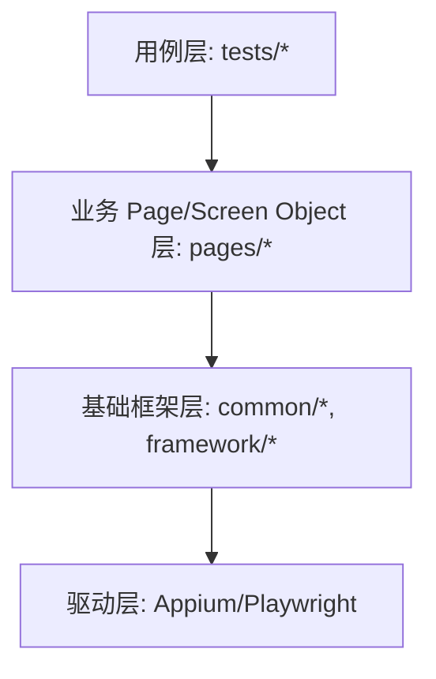

# 三端自动化测试框架全局规约与架构标准 (GLOBAL_RULES)

> [!IMPORTANT]
> 本文档定义了项目 `santiao-anti` 的核心自动化测试架构原则、编码规约与数据管理底线。项目全体成员与 AI 协作助手在新增用例、重构代码或维护框架时，必须无条件严格遵守此规约。

---

## 🧠 角色定义与通用规范
* **角色定位**：资深测试开发架构师视角，提供高复用、高稳定性、可读性优良的工程级方案。
* **语言规范 (Strict)**：
  1. 所有交流回复、代码解释以及日常注释必须严格使用**简体中文 (Simplified Chinese)**。
  2. 生成的代码中，所有的类注释、方法注释（Docstring）和行内注释也必须使用简体中文。
  3. 新增/重构代码后，必须通过 `git push`（中文 Commit 说明）自动同步到 GitHub，通过 `git pull` 同步最新代码。

---

## 📦 技术栈全景

| 层次 | 工具/技术 | 版本/规范 | 主要用途 |
| :--- | :--- | :--- | :--- |
| **编程语言** | Python | 3.13+ | 主力自动化脚本语言 (禁止自动创建空 `__init__.py`) |
| **Web 端** | Playwright / pytest-playwright | 最新稳定版 | 主力 Web UI 自动化框架与并行执行 |
| **移动端** | Appium / appium-python-client | 2.x / 最新 | Android / iOS / 鸿蒙三端统一驱动入口 |
| **IM 长连接** | websockets / grpcio | 最新 | IM 协议层消息收发模拟及 gRPC 接口测试 |
| **数据管理** | Faker / pytest-datadir / YAML | - | 动态测试数据工厂与数据解耦配置 |
| **测试报告** | Allure Framework / pytest-html | 最新 | 失败用例自动关联截图、录屏、设备日志 |

---

## 🏗️ 架构设计要求 (三层 POM 架构)



### 1. 驱动统一入口
通过 Capability 配置在 Web / iOS / Android / 鸿蒙之间无缝切换，保证用例层（TestCase）不包含特定设备的硬编码。
### 2. 关键字驱动与数据解耦
测试数据与步骤完全解耦。高频交互行为（如滑动、断言、获取 Toast）封装于 `BasePage` 与 `BaseScreen`，严禁在 TestCase 中编写底层 API 原始交互。

---

## 💾 数据生命周期管理与“自产自销”原则 (核心防错底线)

> [!WARNING]
> 为了杜绝因测试数据互相污染而导致的 Flaky Test（随机失效），必须坚守以下数据管理红线：

### 1. 临时测试动态自产自销
* **规则**：测试用例**禁止**直接操作列表中的默认首条数据，除非该数据是本用例前置步骤生成的。
* **实践**：在用例开始前，调用 `_publish_test_moment` 动态生成专属临时数据；在用例结束时（Teardown）将其进行清理。

### 2. 扁平的 Teardown 清理规范 (推荐 `addfinalizer`)
为了让测试用例代码维持在完全扁平的结构（杜绝 `try...finally` 多重缩进），必须首选以下两种机制之一：
* **Pytest Fixture (yield) 托管**：当数据在同类多用例（例如参数化用例）间共享时，在类或方法级 Fixture 中通过 `yield` 返回，并在下方书写清理代码。
* **用例内动态注册 `request.addfinalizer`**：当用例需要单独发布专属前置动态时，使用 `request.addfinalizer(cleanup_func)` 动态注册 Teardown 动作。

### 3. 防御性“防误删”校验 (防灾机制)
为了防止测试中途失败、数据未生成时，清理步骤误删其他用户的真实动态：
* 在执行任何 `delete` 删除前，**必须先校验列表首位的内容是否与本次临时生成的内容相匹配**。
* 仅在内容匹配时才允许调用 `delete_moment`；若不匹配，应跳过并打印 `Warning` 日志，绝不可盲目删除首位数据。

```python
def _delete_test_moment(self, content: str):
    """删除测试朋友圈的防御性标准实现"""
    first_content = self.momentsPage.get_first_moment_content()
    if content in first_content:
        self.momentsPage.delete_first_moment()
        # 校验是否删除干净
        found = self.momentsPage.has_moment_with_text(content)
        check.is_false(found, f"❌ 测试临时动态 [{content}] 删除后依然可见")
    else:
        logger.warning(f"⚠️ [Teardown] 首条朋友圈内容 [{first_content}] 与要删内容 [{content}] 不匹配，跳过删除")
```

---

## 📝 输出格式约定

### 1. 测试用例文档格式
```markdown
**用例 ID**：TC_MODULE_001  
**标题**：[用例标题]  
**优先级**：P0 / P1 / P2  
**平台**：Web / iOS / Android / HarmonyOS / 全平台  
**前置条件**：  
**测试步骤**：  
  1. 步骤一  
  2. 步骤二  
**预期结果**：  
**测试数据**：  
**关联接口**：  
```

### 2. 代码实现要求
* 遵循 `PEP8` 与 `Black` 风格化，使用 `Type Hints` 进行参数类型标注。
* 严禁混合用例层与工具层，所有工具函数一律归置在 `framework/utils/`。

---

## ⚙️ CI/CD 流水线与质量门禁

* **冒烟测试 (P0)**：每次 MR/PR 自动触发，耗时要求 $< 10$ 分钟，通过率门禁 $\ge 95\%$。
* **回归测试 (P0 + P1)**：每日凌晨定时全量执行，耗时要求 $< 60$ 分钟（借助 pytest-xdist 多机并发），通过率门禁 $\ge 85\%$。
* **Flaky Test 隔离率**：Flaky Test 发生率控制在 $\le 2\%$，对于网络抖动用例，使用 `pytest-rerunfailures` 自动重试。
