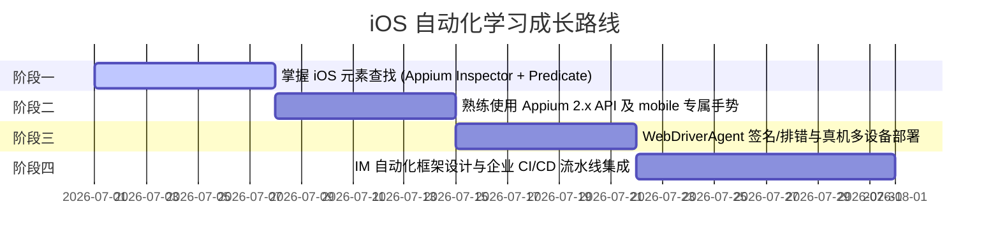

# iOS 自动化测试核心原理与学习资料

本资料是为 iOS 自动化测试初学者（小白）量身定制的学习指南。从 iOS 独有的系统机制开始，深入剖析元素定位策略、手势操作、IM 自动化专项技巧，并提供一套系统的学习路线。

---

## 目录
1. [iOS 自动化核心术语与概念](#1-ios-自动化核心术语与概念)
2. [iOS 专属元素定位策略详解 (核心)](#2-ios-专属元素定位策略详解-核心)
   - 2.1 为什么避免在 iOS 中使用 XPath？
   - 2.2 Accessibility ID (首选)
   - 2.3 iOS Class Chain (推荐：快速层级查找)
   - 2.4 iOS Predicate String (推荐：强大条件筛选)
3. [Appium iOS 常用操作与手势 API](#3-appium-ios-常用操作与手势-api)
   - 3.1 基础交互 (点击、输入、清空)
   - 3.2 iOS 专属手势 API (`mobile: XXX`)
4. [IM（即时通讯）软件 iOS 自动化专项技巧](#4-im即时通讯软件-ios-自动化专项技巧)
5. [iOS 自动化测试稳定性与防抖策略](#5-ios-自动化测试稳定性与防抖策略)
6. [精选学习资源与路线建议](#6-精选学习资源与路线建议)

---

## 1. iOS 自动化核心术语与概念

进行 iOS 自动化开发，必须掌握以下专业术语，这些与 Android 有显著的区别：

| 术语 | 全称/定义 | 对标 Android | 作用与含义 |
| :--- | :--- | :--- | :--- |
| **Bundle ID** | Bundle Identifier | Package Name (包名) | iOS 应用程序的唯一标识符（例如微信为 `com.tencent.xin`）。启动 App 时必须提供。 |
| **XCUIElementType** | XCTest UI 元素类型 | View Class (如 `android.widget.TextView`) | 苹果 XCTest 框架中定义的所有 UI 控件类型，所有 iOS 元素类型都以 `XCUIElementType` 开头（如 `XCUIElementTypeButton` 表示按钮）。 |
| **WDA** | WebDriverAgent | UiAutomator2 Server | 运行在 iOS 设备上、将 WebDriver 协议转换为苹果 XCTest 命令的后台 Agent。 |
| **IPA** | iOS App Store Package | APK | iOS 的应用程序安装包格式。 |
| **USBMuxd** | USB Multiplexor | ADB Daemon (部分功能) | 苹果官方用于在 macOS 与 iOS 设备间通过 USB 进行套接字通信的守护进程。 |

---

## 2. iOS 专属元素定位策略详解 (核心)

在 Android 中，我们常用 `id`（resource-id）或 `xpath` 定位元素。但在 iOS 自动化中，定位策略有很大不同，且性能差异极度明显。

### 2.1 为什么避免在 iOS 中使用 XPath？
在 iOS XCUITest 驱动下，**XPath 的执行效率极其低下**。
*   **原理原因**：XPath 解析需要 Appium 递归扫描并生成整张 iOS UI 树的 XML，然后再通过 XPath 语法解析器在内存中匹配。由于 iOS 系统安全机制和 UI 树的层级往往非常深，一次 XPath 查询可能耗时 **2~5 秒** 甚至更长，如果元素不存在，等待超时的过程会直接导致测试卡死或极度缓慢。
*   **最佳实践**：严禁在 iOS 中使用长 XPath！必须改用 iOS 专有的 **Class Chain** 或 **Predicate String**。

---

### 2.2 Accessibility ID (首选)
`Accessibility ID` 是 iOS 平台最快、最稳定的定位方式。它直接映射到 iOS 代码中控件的 `accessibilityIdentifier`（可访问性标识符）属性。
*   **Python 代码示例**：
    ```python
    # 定位聊天界面的“发送”按钮
    send_button = driver.find_element(by=AppiumBy.ACCESSIBILITY_ID, value="Send")
    ```
*   **开发协同**：如果遇到无法定位的元素，应推动 iOS 开发人员在代码中为控件加上 `accessibilityIdentifier`，这是最规范的自动化推进方式。

---

### 2.3 iOS Class Chain (推荐：快速层级查找)
当元素没有 `Accessibility ID`，但它处于一个明确的层级关系中时，使用 `Class Chain`（类链）是最佳选择。它的定位速度非常接近 Accessibility ID。
*   **语法规则**：类似文件路径，但结合了类型索引。
    *   `/` 代表绝对子节点，`**/` 代表任意子孙节点。
    *   `[$ 属性表达式 $]` 用于过滤属性。
*   **实例对比**：
    *   **定位聊天列表里的第一个头像**（假设头像类型为 `XCUIElementTypeImage`）：
        ```python
        # 查找特定表格下的第一个图片
        avatar = driver.find_element(
            by=AppiumBy.iOS_CLASS_CHAIN, 
            value="**/XCUIElementTypeTable/XCUIElementTypeCell[1]/XCUIElementTypeImage[1]"
        )
        ```
    *   **根据 Label 文本定位输入框**：
        ```python
        # 查找 label 属性值为 "请输入消息" 的文本输入框
        input_field = driver.find_element(
            by=AppiumBy.iOS_CLASS_CHAIN, 
            value="**/XCUIElementTypeTextField[`label == '请输入消息'`]"
        )
        ```

---

### 2.4 iOS Predicate String (推荐：强大条件筛选)
`Predicate String`（谓词定位）是利用苹果自身的 `NSPredicate` 规则进行元素检索。它允许你通过逻辑组合（AND、OR、LIKE、MATCHES）对控件的属性进行深度过滤，功能极其强大。

#### 支持的属性：
*   `name`：对应元素的 Accessibility ID。
*   `label`：对应元素在界面上显示的文本内容（非常常用！）。
*   `value`：对应输入框中的内容或开关的状态。
*   `type`：对应 XCUIElementType 类型。
*   `visible`：是否可见（`1` 或 `0`，或 `true` / `false`）。
*   `enabled`：是否可用。

#### 语法实例：
1.  **精确文本匹配 (label)**：
    ```python
    # 定位文本为 "通讯录" 的导航栏按钮
    contacts_btn = driver.find_element(
        by=AppiumBy.iOS_PREDICATE_STRING, 
        value="type == 'XCUIElementTypeButton' AND label == '通讯录'"
    )
    ```
2.  **模糊匹配与包含关系 (CONTAINS / BEGINSWITH / ENDSWITH)**：
    ```python
    # 定位以 "三条群聊" 开头的文本元素
    group_title = driver.find_element(
        by=AppiumBy.iOS_PREDICATE_STRING, 
        value="type == 'XCUIElementTypeStaticText' AND label BEGINSWITH '三条群聊'"
    )
    ```
3.  **正则匹配 (MATCHES)**：
    ```python
    # 定位消息发送状态中，文本包含数字的倒计时元素（如 "已发送 (5s)"）
    status_label = driver.find_element(
        by=AppiumBy.iOS_PREDICATE_STRING, 
        value="type == 'XCUIElementTypeStaticText' AND label MATCHES '已发送 \\(\\d+s\\)'"
    )
    ```

---

## 3. Appium iOS 常用操作与手势 API

由于 iOS 操作系统的安全沙箱机制，普通的 `TouchAction` 在新版 Appium 2.x 中已经被弃用。我们必须使用 W3C Actions 规范或 iOS 专用的 `mobile: ` 命令。

### 3.1 基础交互
```python
# 1. 点击元素
element.click()

# 2. 文本输入
element.send_keys("Hello Antigravity")

# 3. 清空文本（iOS 推荐做法）
# 有时 element.clear() 对 iOS 控件无效，可以使用以下逻辑清除：
element.click()
# 模拟全选并退格
driver.execute_script("mobile: performEditorAction", {"action": "selectAll"})
driver.execute_script("mobile: performEditorAction", {"action": "delete"})
```

---

### 3.2 iOS 专属手势 API (`mobile: XXX`)
通过 `driver.execute_script("mobile: <command>", <arguments>)` 调用 iOS 特有手势，能够绕过很多定位和操作瓶颈。

#### 1) 滑动/滚动页面 (mobile: scroll / mobile: swipe)
*   `mobile: scroll`：通常用于列表的翻页或定位特定元素。
*   `mobile: swipe`：速度较快，适用于横屏切换或快速滑动。
*   **代码示例**（向下滚动列表直到看到特定文本）：
    ```python
    # 向下滚动一屏
    driver.execute_script("mobile: scroll", {"direction": "down"})
    ```
*   **滑动到指定元素**（极其强大，省去手动循环滑动）：
    ```python
    target_element = driver.find_element(by=AppiumBy.ACCESSIBILITY_ID, value="TargetUser")
    driver.execute_script("mobile: scroll", {
        "elementId": target_element.id,
        "toVisible": True
    })
    ```

#### 2) 长按操作 (mobile: touchAndHold)
在 IM 应用中，长按消息弹出菜单（撤回/转发/删除）是高频场景。
*   **代码示例**：
    ```python
    message_bubble = driver.find_element(by=AppiumBy.iOS_CLASS_CHAIN, value="**/XCUIElementTypeCell[3]/XCUIElementTypeStaticText")
    
    # 长按气泡 2.0 秒
    driver.execute_script("mobile: touchAndHold", {
        "elementId": message_bubble.id,
        "duration": 2.0
    })
    ```

#### 3) 点击指定坐标 (mobile: tap)
如果某些元素无法定位，可采用临时坐标点击作为备用方案。
```python
# 点击相对于屏幕 (100, 200) 的坐标
driver.execute_script("mobile: tap", {
    "x": 100,
    "y": 200
})
```

---

## 4. IM（即时通讯）软件 iOS 自动化专项技巧

针对类似微信的聊天软件，iOS 端自动化有其特有的业务场景痛点。

### 1) 键盘的弹出与收起
iOS 的系统键盘弹出时，会遮挡下方的 UI 元素。如果需要点击发送按钮，有时必须收起键盘。
*   **收起键盘方法**：
    ```python
    # 方法 A：点击键盘上的 "Done" 或 "收起" 键
    driver.find_element(by=AppiumBy.ACCESSIBILITY_ID, value="Done").click()
    
    # 方法 B：点击聊天气泡区域，使输入框失去焦点
    chat_background = driver.find_element(by=AppiumBy.ACCESSIBILITY_ID, value="ChatBackground")
    chat_background.click()
    ```

### 2) 动态消息列表捕获 (Message Feed)
聊天界面中的消息气泡通常在 `XCUIElementTypeTable` 的 `XCUIElementTypeCell` 中。
*   **如何定位最后一条收到的消息**：
    ```python
    # 获取所有的消息气泡文本
    message_cells = driver.find_elements(
        by=AppiumBy.iOS_CLASS_CHAIN, 
        value="**/XCUIElementTypeTable/XCUIElementTypeCell/XCUIElementTypeStaticText"
    )
    # 取最后一个元素
    last_message_text = message_cells[-1].text
    print("最新消息是:", last_message_text)
    ```

### 3) 混合应用 WebView 切换 (Hybrid App)
如果聊天应用包含公众号、小程序或 H5 活动页，需要切换上下文（Context）来操作网页元素。
```python
# 获取当前所有的上下文
contexts = driver.contexts
print("可用上下文:", contexts) # 输出示例: ['NATIVE_APP', 'WEBVIEW_com.santiaotalk.im']

# 切换至 WebView
driver.switch_to.context('WEBVIEW_com.santiaotalk.im')

# 此时可以使用标准 Selenium/Playwright 的方式定位网页中的元素
# ... 执行 H5 操作 ...

# 切回原生 App 环境
driver.switch_to.context('NATIVE_APP')
```

---

## 5. iOS 自动化测试稳定性与防抖策略

iOS 端由于安全沙箱、WDA 状态同步机制等，较 Android 更容易产生 Flaky Test（偶发性失败用例）。

1.  **显式等待优先 (Explicit Waits)**：
    绝不能使用 `time.sleep()` 强制等待。必须使用 `WebDriverWait` 结合 `expected_conditions`。
    ```python
    from selenium.webdriver.support.ui import WebDriverWait
    from selenium.webdriver.support import expected_conditions as EC
    
    # 等待某个联系人名字在列表中渲染出来（最多等 10 秒）
    contact = WebDriverWait(driver, 10).until(
        EC.presence_of_element_located((AppiumBy.ACCESSIBILITY_ID, "张三"))
    )
    ```
2.  **跳过无用的等待时间**：
    在 capabilities 中配置：
    *   `"appium:waitForIdleTimeout": 0`：iOS 会在页面有任何动画或心跳请求时等待 UI 空闲。设置为 `0` 可以跳过这个等待，极大地提高 IM 软件发消息测试的流畅度。
3.  **WDA 崩溃自动重试**：
    有时 iOS 底层的 WebDriverAgent 会因为内存或系统升级而中断。在 pytest 框架中，建议引入 `pytest-rerunfailures` 插件，对失败用例自动重试 1~2 次。

---

## 6. 精选学习资源与路线建议

### 学习路线图


### 推荐官方文档与社区资料：
1.  **Appium 官方文档 (Appium 2.x)**：
    *   [Appium Documentation](https://appium.io/docs/en/latest/) — 详细了解最新的平台机制与插件。
2.  **Appium XCUITest Driver 官方仓库**：
    *   [appium-xcuitest-driver GitHub](https://github.com/appium/appium-xcuitest-driver) — 里面有关于所有 `mobile: ` 手势的高级配置与参数说明。
3.  **苹果官方 NSPredicate 语法指南**：
    *   [Apple Predicate Programming Guide](https://developer.apple.com/library/archive/documentation/Cocoa/Conceptual/Predicates/AdditionalChapters/Introduction.html) — 深入学习 Predicate 定位语法。
4.  **WebDriverAgent 官方仓库**：
    *   [appium-webdriveragent GitHub](https://github.com/appium/WebDriverAgent) — WDA 的官方演进与 issue 排查区。
