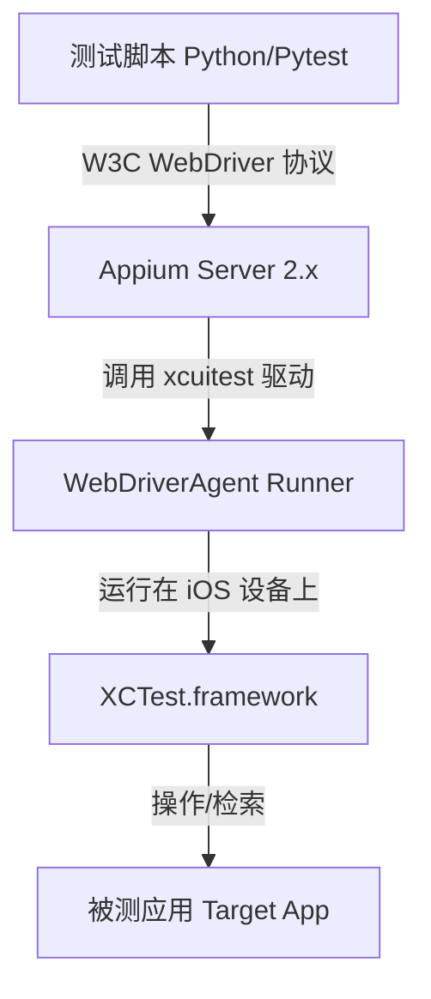

# iOS 自动化测试双端（Windows/macOS）搭建与操作指南

本指南专门为 iOS 自动化测试初学者（小白）编写，详细阐述了如何在 **macOS（本地运行/模拟器/真机）** 和 **Windows（通过远程 Mac 代理或使用 tidevice 工具直连真机）** 两种环境下搭建并运行基于 **Appium 2.x** 与 **XCUITest** 的自动化测试环境。

---

## 目录
1. [iOS 自动化测试核心架构原理简介](#1-ios-自动化测试核心架构原理简介)
2. [macOS 环境下环境搭建（全套本地环境）](#2-macos-环境下环境搭建全套本地环境)
   - 2.1 基础依赖安装 (Homebrew, Node.js)
   - 2.2 Xcode 与开发者工具安装
   - 2.3 Appium 2.x 及 XCUITest 驱动安装
   - 2.4 核心步骤：WebDriverAgent (WDA) 编译与签名
   - 2.5 模拟器与真机调试配置
3. [Windows 环境下 iOS 自动化测试方案](#3-windows-环境下-ios-自动化测试方案)
   - 3.1 方案一：Windows 发起请求 -> 远程 macOS 执行（推荐）
   - 3.2 方案二：Windows 直连 iOS 真机（基于阿里开源 `tidevice`）
4. [Appium Inspector 元素定位工具配置](#4-appium-inspector-元素定位工具配置)
5. [Python 脚本测试连接验证](#5-python-脚本测试连接验证)
6. [常见错误与排错指南 (Troubleshooting)](#6-常见错误与排错指南-troubleshooting)

---

## 1. iOS 自动化测试核心架构原理简介

在开始搭建环境之前，必须理清 iOS 自动化的核心链路。与 Android 依赖 `UiAutomator2` 类似，iOS 自动化依赖于苹果官方的 **XCTest** 测试框架。



*   **Appium Server**：作为中间件，接收测试脚本（Python）发送的 HTTP 请求，并解析为 W3C WebDriver 协议。
*   **WebDriverAgent (WDA)**：由 Facebook 开发、后由 Appium 社区维护的开源项目。它是一个运行在 iOS 设备上的 iOS App，其内部集成了一个 HTTP 服务器。它接收 Appium 发送的命令，并在 iOS 设备上调用底层的 `XCTest.framework` 来执行点击、滑动、输入以及元素定位等操作。
*   **XCUITest Driver**：Appium 用来与 WDA 通信的驱动。

> [!IMPORTANT]
> **iOS 自动化的核心难点在于 WebDriverAgent 的签名与安装**。由于苹果的安全限制，任何安装在真机上的 App 必须经过证书签名。因此，无论使用 Mac 还是 Windows，都必须先解决 WDA 在真机上的签名和部署问题。

---

## 2. macOS 环境下环境搭建（全套本地环境）

macOS 是 iOS 自动化的官方和首选开发环境。只有在 macOS 上才能运行 iOS 模拟器、使用 Xcode 编译/签名 WebDriverAgent。

### 2.1 基础依赖安装

首先，打开 macOS 的终端（Terminal），安装以下基础工具。

#### 1) 安装 Homebrew (macOS 软件包管理器)
如果在终端中没有 `brew` 命令，运行以下命令安装：
```bash
/bin/bash -c "$(curl -fsSL https://raw.githubusercontent.com/Homebrew/install/HEAD/install.sh)"
```
配置环境变量（安装完成后终端会有提示，一般为以下两行，根据实际情况执行）：
```bash
echo 'eval "$(/opt/homebrew/bin/brew shellenv)"' >> ~/.zprofile
source ~/.zprofile
```

#### 2) 安装 Node.js 与 npm
Appium 2.x 是基于 Node.js 开发的，因此需要安装 Node.js（建议选择 LTS 长期支持版）。
```bash
brew install node
```
验证安装：
```bash
node -v
npm -v
```

#### 3) 安装常用辅助工具
*   `usbmuxd`：用于通过 USB 与 iOS 设备进行通信的后台服务。
*   `libimobiledevice`：跨平台的连接 iOS 设备的库（相当于 Android 的 ADB 命令行工具）。
*   `ideviceinstaller`：用于在真机上安装/卸载 ipa 文件的工具。
*   `ios-deploy`：不需要 Xcode 即可将应用部署到 iOS 设备的工具（真机调试必需）。

```bash
brew install usbmuxd
brew install libimobiledevice
brew install ideviceinstaller
brew install ios-deploy
```

---

### 2.2 Xcode 与开发者工具安装

#### 1) 安装 Xcode
在 Mac 的 **App Store** 中搜索 **Xcode** 并下载安装（注意：Xcode 体积较大，建议预留 40GB+ 磁盘空间）。

#### 2) 安装 Xcode Command Line Tools (命令行工具)
打开终端，运行：
```bash
xcode-select --install
```
在弹出的窗口中点击“安装”，等待下载并自动配置完成。

#### 3) 接受 Xcode 许可协议
安装完成后，在终端运行以下命令接受协议（需要输入 Mac 开机密码）：
```bash
sudo xcodebuild -license accept
```

---

### 2.3 Appium 2.x 及 XCUITest 驱动安装

从 Appium 2.0 开始，Appium Server 和驱动程序（Driver）是分离开来安装的。

#### 1) 全局安装 Appium Server
```bash
npm install -g appium
```
验证安装：
```bash
appium -v
```

#### 2) 安装 xcuitest 驱动 (iOS 专属)
```bash
appium driver install xcuitest
```
验证驱动是否成功安装：
```bash
appium driver list
```
输出中应当显示 `xcuitest` 且状态为已安装（installed）。

---

### 2.4 核心步骤：WebDriverAgent (WDA) 编译与签名

这是初学者最容易报错和放弃的一步。请务必仔细按步骤操作。

#### 1) 寻找 WebDriverAgent 项目路径
xcuitest 驱动安装完成后，它的根目录下会自带一个 WebDriverAgent 项目。我们通常在以下路径找到它：
```bash
# 默认的全局安装路径
cd ~/.appium/node_modules/appium-xcuitest-driver/node_modules/appium-webdriveragent
```
如果您找不到，可以在终端使用以下命令查找：
```bash
find ~ -name "WebDriverAgent.xcodeproj" 2>/dev/null
```

#### 2) 使用 Xcode 打开 WDA 项目
在终端中进入 WDA 所在目录后，执行命令打开 Xcode 工程：
```bash
open WebDriverAgent.xcodeproj
```

#### 3) 配置个人免费/付费开发者账号签名
1.  在 Xcode 顶部菜单栏选择 **Xcode -> Settings... (或 Preferences...) -> Accounts**。
2.  点击左下角的 **`+`** 号，选择 **Apple ID**，登录你的 Apple ID（免费的个人账号即可，不需要支付 99 美元）。
3.  登录成功后，右侧会显示你的 Team 角色（通常是你的名字，显示为 `Personal Team`）。

#### 4) 修改项目 Bundle Identifier 与签名
在 Xcode 左侧的 Project Navigator 中点击最顶部的 `WebDriverAgent` 节点，然后在中间的主编辑区进行配置：

##### 步骤 A：修改 WebDriverAgentLib 签名
1.  在中间的 **Targets** 列表中选择 **`WebDriverAgentLib`**。
2.  选择 **Signing & Capabilities** 标签页。
3.  勾选 **`Automatically manage signing`**。
4.  在 **`Team`** 下拉菜单中选择你刚刚添加的 Apple ID (Personal Team)。
5.  在 **`Bundle Identifier`** 中（如果有的话），将其默认的 `com.facebook.WebDriverAgentLib` 改为全局唯一的标识符，例如：`com.yourname.WebDriverAgentLib`（将 `yourname` 改为你的拼音或任意英文字符，防止冲突）。

##### 步骤 B：修改 WebDriverAgentRunner 签名 (最关键)
1.  在 Targets 列表中选择 **`WebDriverAgentRunner`**。
2.  选择 **Signing & Capabilities** 标签页。
3.  勾选 **`Automatically manage signing`**。
4.  在 **`Team`** 下拉菜单中同样选择你的 Apple ID。
5.  在 **`Bundle Identifier`** 中，将 `com.facebook.WebDriverAgentRunner` 修改为自定义的唯一 ID，例如 `com.yourname.WebDriverAgentRunner`。

> [!WARNING]
> 如果不修改 Bundle Identifier，Xcode 会报错 `An application with identifier 'com.facebook.WebDriverAgentRunner' is not available.`，因为原生的 Bundle ID 已经被官方或其他开发者占用。

#### 5) 编译并部署到 iOS 真机/模拟器
*   **对于模拟器**：不需要真机证书签名，只要修改好 Bundle ID 即可。
*   **对于真机**：
    1.  用 USB 数据线将 iPhone 连接到 Mac。
    2.  在 iPhone 上开启开发者模式（iOS 16+ 路径：`设置 -> 隐私与安全 -> 开发者模式 -> 开启`，开启后手机会重启，并在重启后再次确认启用并输入锁屏密码）。
    3.  在 Xcode 顶部的设备选择框中，将目标设备从“Any iOS Device”或模拟器改为你的**实体 iPhone**。
    4.  点击 Xcode 菜单栏的 **Product -> Scheme**，确保勾选了 **`WebDriverAgentRunner`**。
    5.  点击 Xcode 菜单栏的 **Product -> Test**（或者按快捷键 `Cmd + U`）。
    6.  **首次部署的授信问题**：
        *   编译成功后，iPhone 上会出现一个名为 `WebDriverAgentRunner` 的 App，但会弹窗提示“不受信任的开发者”且测试会中断。
        *   此时**不要拔掉数据线**，在 iPhone 上进入 `设置 -> 通用 -> VPN 与设备管理`，找到你的 Apple ID 证书，点击 **“信任 XXX”**。
        *   信任完毕后，回到 Xcode，再次点击 **Product -> Test**。
        *   当你在 Xcode 的控制台（Output 窗口）看到类似以下日志时，说明 WDA 启动成功：
            ```text
            ServerURLHere->http://192.168.1.100:8100<-ServerURLHere
            ```

---

### 2.5 模拟器与真机调试配置

#### 获取测试所需的设备 UDID
*   **模拟器**：
    在终端输入以下命令查看已安装模拟器的列表及其 UDID：
    ```bash
    xcrun simctl list devices | grep Booted  # 查看当前启动着的模拟器
    # 或者
    xcrun simctl list devices  # 查看所有模拟器
    ```
*   **真机**：
    通过 USB 连接手机后，运行以下命令获取 UDID：
    ```bash
    idevice_id -l
    ```
    输出的一串 40 位（旧设备）或 25 位（带连字符，新设备如 iPhone 14/15）的字母加数字组合就是 UDID。

---

## 3. Windows 环境下 iOS 自动化测试方案

由于 Windows 系统无法直接安装 Xcode 和运行 iOS 模拟器，因此在 Windows 环境下做 iOS 自动化，通常有以下两种主流方案：

---

### 3.1 方案一：Windows 发起请求 -> 远程 macOS 执行（推荐）

这是企业级团队 and CI/CD 流水线中最常用的做法。你只需在局域网内准备一台 Mac 电脑作为执行机（不需要显示器，仅作为执行节点），而日常编写代码、运行测试命令都在 Windows 上完成。

```mermaid
graph LR
    Win[Windows 编写脚本] -->|通过局域网 HTTP 请求| Mac[Mac 执行机 (运行 Appium Server + WDA)]
    Mac -->|USB/Wifi| iPhone[iOS 真机 / 模拟器]
```

#### 配置步骤：
1.  **Mac 端配置**：
    *   按照本文第二部分，在 Mac 上完整搭建好 Node.js、Xcode、Appium 2.x 和 WebDriverAgent。
    *   获取 Mac 的局域网 IP（例如 `192.168.1.120`）。
    *   启动 Appium Server，并绑定 to `0.0.0.0`（允许外网和局域网访问）：
        ```bash
        appium --address 0.0.0.0 --port 4723
        ```
2.  **Windows 端配置**：
    *   在 Python 脚本中修改 `Remote` 连接地址，从原来的 `localhost` 改为 Mac 的 IP：
        ```python
        # 指向 Mac 的 Appium 地址
        APPIUM_SERVER_URL = "http://192.168.1.120:4723"
        ```
    *   在 capabilities 中填入连接到 Mac 上那台 iPhone 的 `udid` 等参数。
    *   在 Windows 上直接运行脚本，即可驱动 Mac 上的 iOS 设备进行测试。

---

### 3.2 方案二：Windows 直连 iOS 真机（基于阿里开源 `tidevice`）

如果你没有条件长期连接 Mac，或者希望将 iPhone 直接插在 Windows 电脑上进行自动化测试，可以使用阿里巴巴开源的 `tidevice` 工具。它通过纯 Python 实现了 usbmux 协议，可以在 Windows 上直接与 iOS 真机进行数据交互、启动/停止 WDA。

> [!WARNING]
> **前置条件限制**：使用 `tidevice` 虽然不需要把 iPhone 插在 Mac 上，但是 WebDriverAgent 的 `.ipa` 还是需要先在 Mac 上（或者通过第三方签名服务）进行**编译与签名**。你需要拿到签名后的 `WebDriverAgentRunner-Runner.app` 或者打包好的 `.ipa` 文件。

#### 1) 在 Windows 上安装 iTunes
必须安装官方版 iTunes（以便自动安装 `Apple Mobile Device Support` 驱动，用于 usbmux 识别设备）。
*   不要从 Windows 10/11 的 Microsoft Store 下载，建议下载官方独立安装包。
*   安装后，插入 iPhone，手机弹窗提示“信任此电脑”，选择“信任”并输入密码。

#### 2) 安装 tidevice
在 Windows 的命令行（Command Prompt 或 PowerShell）中，确保已安装 Python 3.8+，然后执行：
```powershell
pip install -U "tidevice[openssl]"
```
验证安装：
```powershell
tidevice version
```

#### 3) 检查设备是否连接成功
在 Windows 终端运行：
```powershell
tidevice list
```
应当能够输出连接的 iPhone 的 UDID、设备名称以及产品类型。

#### 4) 在真机上部署 WebDriverAgent
如果你已经在 Mac 上用 Xcode 将 WDA 跑在了这台手机上，那么手机上已经存在 `WebDriverAgentRunner` 的 App。
如果还没有，可以通过已经签名的 WDA ipa 文件，在 Windows 上使用 `tidevice` 直接进行安装：
```powershell
tidevice install WebDriverAgentRunner.ipa
```

#### 5) 启动 WDA 代理服务 (核心步骤)
`tidevice` 最强大的功能是可以在 Windows 上直接启动手机里的 WDA 并进行端口转发：
```powershell
tidevice wdaproxy -B com.yourname.WebDriverAgentRunner.xctrunner --port 8100
```
*   `com.yourname.WebDriverAgentRunner.xctrunner`：是你在 Mac Xcode 签名时配置的 WDA 的 Bundle ID（加上 `.xctrunner` 后缀）。如果你不知道，可以使用 `tidevice applist` 查阅。
*   `--port 8100`：将手机中 WDA 的 8100 端口映射到 Windows 本地的 8100 端口。

启动成功后，在 Windows 浏览器中输入 `http://localhost:8100/status`。如果看到返回的 JSON 格式的 WDA 状态数据，说明**握手完全成功**！你现在可以直接用 Windows 控制这台 iPhone 了。

#### 6) Windows Appium 脚本配置
当使用 `tidevice wdaproxy` 时，Appium 不需要再去安装或拉起 WDA，只需直接连接本地映射好的端口即可：
```python
capabilities = {
    "platformName": "iOS",
    "appium:automationName": "XCUITest",
    "appium:udid": "你的iPhoneUDID",
    "appium:deviceName": "iPhone",
    "appium:webDriverAgentUrl": "http://localhost:8100",  # 关键：告诉Appium直接使用tidevice映射出的WDA服务
    "appium:noReset": True
}
```

---

## 4. Appium Inspector 元素定位工具配置

Appium Inspector 是编写 iOS 自动化脚本不可或缺的图形化元素查看工具。

### 1) 下载与安装
访问 [Appium Inspector GitHub Releases](https://github.com/appium/appium-inspector/releases) 下载适合你系统（macOS / Windows）的最新版本并安装。

### 2) 启动与配置
启动 Appium Inspector，配置如下连接参数：

#### 在 macOS 本地 或 远程 macOS 模式下：
*   **Remote Host**: `127.0.0.1` (或 Mac 的局域网 IP)
*   **Remote Port**: `4723`
*   **Remote Path**: `/` (对于 Appium 2.x，默认为 `/`，不需要填 `/wd/hub`)

在 **Desired Capabilities** 区域填入以下参数：
```json
{
  "platformName": "iOS",
  "appium:automationName": "XCUITest",
  "appium:deviceName": "iPhone 15 Simulator",   // 真机填实际设备名
  "appium:udid": "你的设备UDID",
  "appium:bundleId": "com.santiaotalk.im",        // 被测App的Bundle ID
  "appium:noReset": true
}
```

#### 在 Windows + tidevice 模式下：
*   **Remote Host**: `127.0.0.1` (Windows 本地)
*   **Remote Port**: `4723` (Windows 运行的 Appium 端口)
*   **Remote Path**: `/`

in **Desired Capabilities** 区域填入：
```json
{
  "platformName": "iOS",
  "appium:automationName": "XCUITest",
  "appium:udid": "你的设备UDID",
  "appium:deviceName": "iPhone",
  "appium:webDriverAgentUrl": "http://localhost:8100", // 指向tidevice转发的本地端口
  "appium:bundleId": "com.santiaotalk.im",
  "appium:noReset": true
}
```

点击 **Start Session**。稍等片刻，工具会拉起手机上的 App，并在界面上实时同步显示手机屏幕以及 XML 元素树。

---

## 5. Python 脚本测试连接验证

确保本地已经安装了 Python 的 Appium 客户端库：
```bash
pip install appium-python-client
```

创建验证脚本 `test_ios_connection.py`：

```python
# -*- coding: utf-8 -*-
"""
iOS 自动化连接测试 Demo
"""
import time
from appium import webdriver
from appium.options.common import AppiumOptions

def test_ios_demo():
    # 初始化 Options
    options = AppiumOptions()
    
    # 基础配置
    options.set_capability("platformName", "iOS")
    options.set_capability("appium:automationName", "XCUITest")
    options.set_capability("appium:deviceName", "iPhone Simulator")  # 或真实设备名称
    options.set_capability("appium:udid", "YOUR-DEVICE-UDID-HERE")    # 替换为你的设备UDID
    
    # 指明要测试的 App 的 Bundle ID
    options.set_capability("appium:bundleId", "com.apple.Preferences") # 先拿系统设置做测试
    options.set_capability("appium:noReset", True)
    
    # 如果是在 Windows 下使用 tidevice，请取消下面这行的注释
    # options.set_capability("appium:webDriverAgentUrl", "http://localhost:8100")

    # Appium 2.x Server 默认端口为 4723
    appium_server_url = 'http://localhost:4723'
    
    print("正在连接 Appium Server 并启动测试...")
    driver = webdriver.Remote(appium_server_url, options=options)
    
    try:
        print("连接成功！当前设备上下文:", driver.contexts)
        time.sleep(3)
        
        # 截取一张图验证
        driver.save_screenshot("ios_settings_screenshot.png")
        print("截图已保存至本地：ios_settings_screenshot.png")
        
    finally:
        print("测试完毕，正在关闭 Session...")
        driver.quit()

if __name__ == "__main__":
    test_ios_demo()
```

---

## 6. 常见错误与排错指南 (Troubleshooting)

### 1) Xcode 报错：`Signing for "WebDriverAgentRunner" requires a development team...`
*   **原因**：未配置开发者证书，或未开通 Automatically manage signing。
*   **解决**：在 Xcode 中依次点击 Targets -> WebDriverAgentRunner -> Signing & Capabilities，在 Team 处选择你的 Apple ID，并手动修改 Bundle Identifier。

### 2) 手机安装了 WDA，但点击直接闪退，Appium 报错：`Unable to launch WebDriverAgent because of xcodebuild failure...`
*   **原因**：iOS 真机上没有信任开发者证书。
*   **解决**：在 iPhone 上进入 `设置 -> 通用 -> VPN 与设备管理`，找到开发者证书并点击“信任”，然后重新执行脚本。

### 3) 报错：`Could not locate integration app: .../WebDriverAgentRunner-Runner.app`
*   **原因**：Appium 运行 XCUITest 时，没有在指定路径中找到已经编译好的 WebDriverAgentRunner 包。
*   **解决**：先手动在 Xcode 中连接该设备执行一次 **Product -> Test**。只有成功通过 Xcode 构建一次并在手机上正常拉起后，该包才会被生成。

### 4) Windows 下使用 `tidevice` 报错：`USBMuxConnectionError`
*   **原因**：Windows 上的 Apple Mobile Device Service 没有启动，或者没有安装 iTunes。
*   **解决**：重新安装官方版 iTunes，或者在 Windows 服务管理器（`services.msc`）中手动启动 `Apple Mobile Device Service`，并重新拔插 USB 数据线。

### 5) 报错：`Original error: Xcode version 'XXX' is not supported...`
*   **原因**：本地的 Xcode 版本和 Appium / XCUITest 驱动版本不匹配（例如 Xcode 升级到了最新测试版，但 xcuitest 驱动还未更新）。
*   **解决**：尝试更新 `xcuitest` 驱动：`appium driver update xcuitest`。
