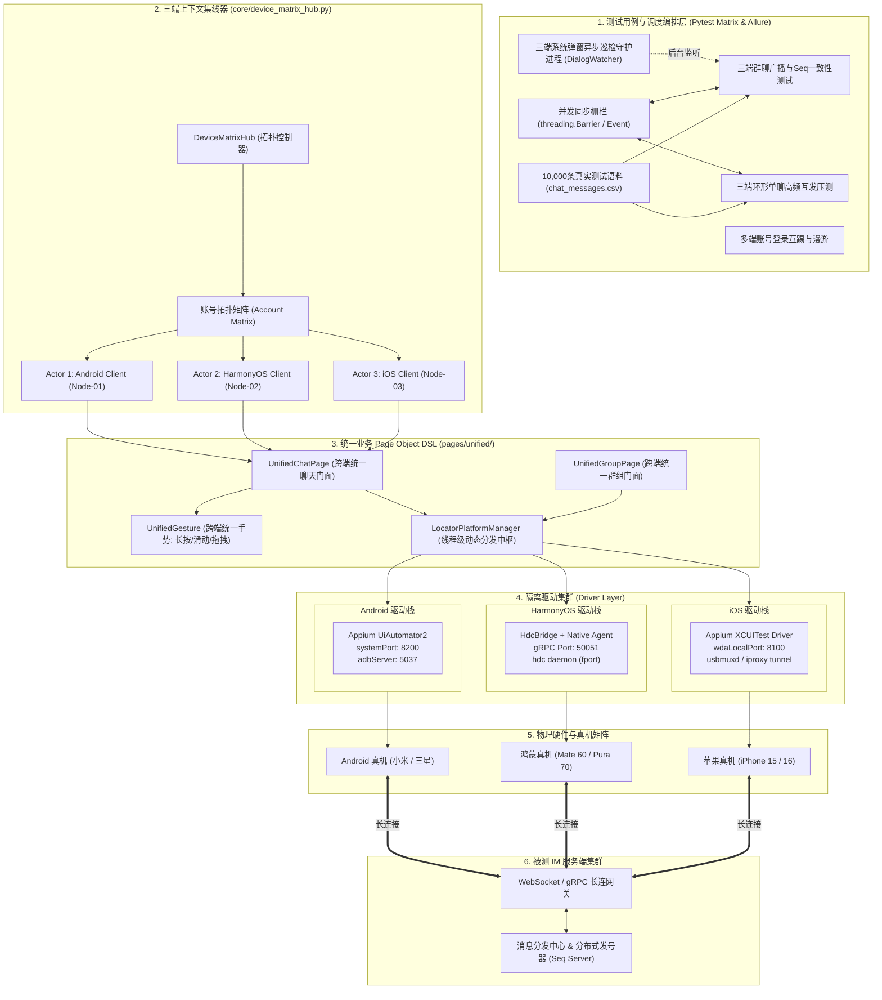

# 🏗️ 三端（Android / HarmonyOS / iOS）即时通信互联自动化测试架构设计方案

> **文件版本**：v3.0.0 (生产工业级全景终极版)  
> **编写角色**：资深测试开发架构师  
> **适用项目**：Santiao Anti 类微信 IM 自动化测试体系  
> **覆盖平台**：Android (UIA2) / HarmonyOS NEXT (Hdc/ArkTS) / iOS (XCUITest)

---

## 1. 架构背景与业务痛点

在类微信即时通讯（IM）产品中，单端自动化（仅在单台手机上验证发送行为）与点对点双端自动化（仅 A 发 B 收）已无法覆盖真实的生产级核心场景。随着鸿蒙原生系统（HarmonyOS NEXT）的加入，产品形成了 **Android、鸿蒙、iOS 三大主流移动平台并存** 的格局。

### 1.1 核心测试痛点
1. **多端交互场景缺失**：群聊广播（1 发多收）、多端登录数据漫游、账号互踢、已读状态实时回执等高频业务必须在三端同时在线交互下才能暴露深层时序 Bug。
2. **驱动异构与端口碰撞**：Android (UiAutomator2)、iOS (WebDriverAgent)、HarmonyOS (Hdc/原生RPC) 并在单台测试宿主机运行时，存在端口冲突、进程竞争与驱动假死。
3. **宿主机通信桥接复杂（Windows 宿主机特别痛点）**：iOS 的 WDA 服务与 HarmonyOS 的 gRPC Agent 运行在真机内部，在 Windows 控制端上需要精确的端口映射（Tunneling/fport），否则连接瞬间死锁。
4. **渲染时序偏差（Flaky Test 根因）**：iOS 与 Android、鸿蒙冷启动和页面加载耗时差异明显（可达 1~3 秒），传统 `sleep` 等待极易造成用例脆弱性与假失败。
5. **系统权限与弹窗阻断**：首次安装或重置后，各端相机/麦克风/网络/通知权限弹窗各异，未捕获弹窗将直接卡死并发测试用例。
6. **三端故障取证割裂**：一旦出现广播丢失，仅有一端截图无法定位是发送端漏发、服务端未推、还是接收端渲染丢帧。

---

## 2. 整体架构全景图 (System Architecture)

架构采用 **Actor-Matrix（角色网状拓扑）** 模型，将物理设备抽象为动态角色节点，通过统一的业务 DSL 与分层解耦实现跨平台无缝协同。



---

## 3. 分层架构深度设计

### 3.1 测试用例层（Actor 模型解耦）
废弃单一的 `sender` / `receiver` 二元命名，抽象为基于 **角色发布-订阅（Pub/Sub）** 的 `Actor`：
- `publisher`：当前动作的发起端（如在群里发一条消息或发起通话）。
- `subscribers`：接收端节点列表（多端同时接收并断言回执、红点、Seq 顺序）。
- 角色在用例生命周期内动态轮换，无需重启 Session。

### 3.2 账号拓扑与会话绑定规范（Account Allocation Matrix）
三端测试必须使用严格隔离的账号体系，防止同号互踢与会话脏读：

| 节点标识 | 默认物理机 | 绑定账号角色 | 登录权限策略 | 群聊角色 |
| :--- | :--- | :--- | :--- | :--- |
| **Node-Android** | 小米/三星真机 | `user_alpha (13800000001)` | 仅允许移动端登录 | 群主 / 发言者 |
| **Node-HOS** | 华为 Mate 60 | `user_beta (13800000002)` | 仅允许鸿蒙端登录 | 管理员 / 接收者 |
| **Node-iOS** | iPhone 15/16 | `user_gamma (13800000003)` | 仅允许 iOS 端登录 | 普通成员 / 接收者 |

> [!NOTE]
> 针对“多端同号互踢 / 漫游”专项测试，动态引入 `user_shared` 账号，由测试用例按步骤在 Node-Android 登录后再在 Node-iOS 登录，触发被踢状态机。

### 3.3 统一业务 DSL（Unified Page Object）
通过门面模式（Facade Pattern）对外暴露统一的业务方法，业务用例层**禁止出现平台特异的定位代码**：
```python
# 业务调用示意（对用例编写者完全透明）
chat.send_text("Hello Tri-Platform!")
chat.send_image("assets/test.png")
chat.assert_message_received(expected_text="Hello Tri-Platform!", timeout=5)
```

### 3.4 元素定位动态路由（LocatorPlatformManager）
依托项目现有的 `core/locator_manager.py` 机制：
1. **Thread-Local 平台感知**：每个设备执行线程在启动时绑定独立的平台属性，完全杜绝多端并发时的全局状态串扰；
2. **调用栈帧智能嗅探**：当 Page 类调用定位器时，自动根据底层 Driver 的 `capabilities` 分发平台特异定位器：

| 业务控件 | Android 定位策略 | HarmonyOS 定位策略 | iOS 定位策略 |
| :--- | :--- | :--- | :--- |
| **消息输入框** | `id: com.santiaotalk.im:id/et_input` | `ComponentType: TextInput` | `accessibility_id: chat_input_field` |
| **发送按钮** | `id: com.santiaotalk.im:id/btn_send` | `Text: 发送` / `id: btn_send` | `name: SendButton` |
| **最新消息气泡**| `xpath: //*[@resource-id="..."]/last()`| `xpath: //ListItem[last()]//Text` | `xpath: //XCUIElementTypeCell[last()]` |
| **未读角标红点**| `id: com.santiaotalk.im:id/tv_unread` | `id: unread_badge` | `name: unread_badge_icon` |

### 3.5 跨端手势与长按菜单门面（UnifiedGesture）
IM 高频场景（如消息长按弹出撤回/复制/删除、左右滑动手势）在各端实现差异巨大：
- **Android**：基于 W3C Actions `PointerInput` 模拟精确长按（按压 800ms）；
- **iOS**：基于 XCUITest 的 `mobile: touchAndHold`（`duration=0.8`）；
- **HarmonyOS**：基于 HDC 原生 `hdc shell input swipe X Y X Y 800` 或 ArkTS 长按事件。
架构封装统一门面 `UnifiedGesture.long_press_element(element, duration=0.8)`，由框架层自动分发原生手势指令。

---

## 4. 关键技术实现与稳定性保障

### 4.1 硬件通信与微服务级端口隔离
三台设备连接同一台控制机（或 CI Worker）时，必须实施严格的端口和 Session 隔离：

```yaml
# config/devices.yaml (三端并发端口隔离规范)
devices:
  tri_matrix:
    android_node:
      platformName: "Android"
      udid: "3B65BN02GU600000"
      appiumServerUrl: "http://127.0.0.1:4723"
      systemPort: 8200                # UIA2 本地转发端口隔离
      chromeDriverPort: 9515

    harmony_node:
      platformName: "HarmonyOS"
      udid: "4UQ9K25530068061"
      rpcPort: 50051                  # 鸿蒙 Native Agent gRPC 通讯端口
      screencastPort: 8089            # 投屏数据流端口
      hdcDaemonPort: 8710

    ios_node:
      platformName: "iOS"
      udid: "00008101-001538462600001E"
      appiumServerUrl: "http://127.0.0.1:4725"
      wdaLocalPort: 8100              # WebDriverAgent 端口隔离 (核心)
      mjpegServerPort: 9100           # iOS 投屏流端口
```

### 4.2 宿主机隧道映射与硬件识别（Windows 环境特别保障）
1. **iOS 硬件识别与 WDA 隧道**：
   - 通过 `cfgmgr32.dll` 毫秒级识别 USB 硬件挂载（即使 iPhone 处于待信任状态）；
   - 启动前自动调用 `usbmuxd / iproxy 8100 8100 <UDID>`，将 iPhone 端 WDA 映射至 Windows 本地端口，彻底解决 Windows 下 WDA 超时死锁。
2. **鸿蒙 fport 通道自愈**：
   - 每次建立连接前执行 `hdc fport tcp:50051 tcp:50051`，防止守护进程被断连后污染。
3. **Android systemPort 隔离**：
   - Appium 自动分配 `adb forward tcp:8200 tcp:8200`，杜绝多机互相串包。

### 4.3 三端并发时间对齐与同步栅栏（Sync Barrier）
跨端测试的核心 Flaky 风险在于“启动时延与网络等待不一致”。架构引入 `threading.Barrier` 同步栅栏：

```text
[Node 1: Android]  启动APP ──> 登录 ──> 进入群聊 ──┐
[Node 2: HarmonyOS] 启动APP ──> 登录 ──> 进入群聊 ──┼──> [Sync Barrier: 三端就绪] ──> 发送消息 ──> 并行断言
[Node 3: iOS]      启动APP ──> 登录 ──> 进入群聊 ──┘
```

- **实现原理**：各线程在进入测试前执行 `barrier.wait(timeout=30)`，等待全部三端进入就绪状态后再瞬间触发核心动作，将时效性测试误差降至毫秒级。

### 4.4 消息顺序性（Seq）与服务端时间戳一致性断言
在断言多端送达与展示时，**严禁依赖各手机本地系统时间**（因真机存在几百毫秒的时钟未对齐偏差）。
- **统一断言基准**：
  1. **消息内容与类型完整性**：对比三端最后渲染气泡的 `text`、`msg_id` 或富媒体元数据；
  2. **分布式 Seq 连续递增断言**：断言接收端拉取的最新消息 Seq 满足 $Seq_{new} = Seq_{prev} + 1$；
  3. **送达耗时 SLA**：通过发送时刻标记 $T_{send}$ 与各端收到推送信令的时刻 $T_{recv}$，断言 $T_{recv} - T_{send} \le 500\text{ms}$。

### 4.5 跨端系统弹窗异步巡检拦截器（DialogWatcher）
首次安装或特定权限请求（麦克风、相机、通知）会弹出系统原生对话框，阻断测试执行。
- 架构引入后台轻量线程 `DialogWatcher`：
  - **Android**：后台监控并自动点击“始终允许”/“确定”；
  - **HarmonyOS**：监听“允许本次使用”原生对话框；
  - **iOS**：通过 Capabilities `autoAcceptAlerts: true` 或后台巡检 `XCUIElementTypeAlert` 自动允许；
  - 确保三端测试全流程零人工干预阻塞。

### 4.6 跨端失败证据链闭环（Tri-Device Failure Forensics）
任何跨端用例发生断言失败时，自动触发三端联合取证收集器：
1. **三端画面同步截屏**：按 `[Android_fail.png]`, `[HarmonyOS_fail.png]`, `[iOS_fail.png]` 命名并打包挂载至 Allure 步骤；
2. **三端实时系统日志分片**：
   - Android: `adb logcat -d -t 200`（筛选 IM 协议标签）；
   - HarmonyOS: `hdc shell hilog -x -T IM` 截取最近 200 行；
   - iOS: 抓取 CrashLog / `syslog`；
3. **服务端 Trace 关联**：将发送消息时附带的 `msg_id` 作为关键字在日志中高亮，秒级定界是客户端未渲染还是服务端丢失。

### 4.7 故障自愈与用例清理闭环（Teardown & Cleanup Protocol）
- **会话级故障自愈**：
  - 区分**业务性失败**与**通信层中断**（如 Appium 握手超时、WDA 掉线、HDC 守护进程死锁）；
  - 捕获异常后自动执行热附着修复，失败时阻断当前用例并释放资源。
- **幂等清理协议（Teardown）**：
  - 用例执行结束时，调用统一的 `safe_leave_chat()` 回退至应用主页（Tab 首页），清除未发送草稿；
  - 严禁清空整个用户数据目录，仅撤回/删除当前测试用例生成的关键脏数据。

---

## 5. 典型三端协同测试场景规范

### 场景一：三端群聊广播送达与一致性（1 发 2 收）
* **用例目的**：验证 Android 端在 3 人群聊中发送富文本消息，鸿蒙与 iOS 端能否在 500ms 内同步送达，且 Seq 序号与排版保持完全一致。
* **执行拓扑**：
  - `Node-Android` (Publisher) $\rightarrow$ 发送文本与 Emoji 组合消息。
  - `Node-HarmonyOS` (Subscriber 1) $\rightarrow$ 监听广播，断言气泡内容与 Seq。
  - `Node-iOS` (Subscriber 2) $\rightarrow$ 监听广播，断言气泡内容与未读数更新。

### 场景二：多端数据漫游与已读回执消除（跨端状态机）
* **用例目的**：验证同一账号登录在不同设备上的已读同步机制。
* **执行拓扑**：
  - 外部用户向该账号发送一条未读消息。
  - `Node-iOS` 打开会话并滚动到底部标记为已读。
  - `Node-Android` 与 `Node-HarmonyOS` 监听列表会话红点，断言在 2 秒内红点自动消失。

### 场景三：三端音视频信令呼叫协商
* **用例目的**：验证群音视频呼叫信令的多路分发与接听状态互斥。
* **执行拓扑**：
  - `Node-iOS` 发起群组视频通话。
  - `Node-Android` 与 `Node-HarmonyOS` 收到全屏呼叫振铃。
  - `Node-HarmonyOS` 点击接听后，`Node-Android` 界面应自动从振铃状态转变为“通话中”。

---

## 6. 端到端可落地实战用例代码示范

以下为标准的三端群聊 1 发 2 收自动化测试用例完整实现（包含 Allure 步骤、并发调度、同步栅栏与异常安全清理）：

```python
# -*- coding: utf-8 -*-
"""
三端群聊实时广播与 Seq 顺序一致性自动化测试用例
"""

import time
import allure
import pytest
import threading
import concurrent.futures
from typing import Dict, Any

from core.logger_utils import logger, LogIcon
from core.driver_factory import DriverFactory
from pages.chat.core.chat_page import ChatPage
from pages.main.main_page import MainPage


@allure.epic("IM核心业务自动化测试")
@allure.feature("三端互联与群聊广播")
class TestTriPlatformGroupChat:
    """验证 Android、HarmonyOS、iOS 三端在群聊场景下的端到端消息投递闭环"""

    # 3人同步栅栏
    _barrier = threading.Barrier(parties=3)
    _group_name = "三端架构质量保障验证群"

    @classmethod
    def setup_class(cls):
        """初始化三端驱动实例与会话绑定"""
        logger.info(f"{LogIcon.SETUP} [SetupClass] 正在并行拉起 Android / HarmonyOS / iOS 三端驱动...")
        cls.driver_android = DriverFactory.get_driver("sender")
        cls.driver_hos = DriverFactory.get_driver("harmony_receiver")
        cls.driver_ios = DriverFactory.get_driver("ios_receiver")

        cls.chat_android = ChatPage(cls.driver_android)
        cls.chat_hos = ChatPage(cls.driver_hos)
        cls.chat_ios = ChatPage(cls.driver_ios)

    @classmethod
    def teardown_class(cls):
        """用例套件结束后，安全回退三端页面至主页"""
        logger.info(f"{LogIcon.CLEANUP} [TeardownClass] 正在重置三端页面状态至应用首页...")
        for driver in [cls.driver_android, cls.driver_hos, cls.driver_ios]:
            try:
                MainPage(driver).go_to_main_page()
            except Exception as e:
                logger.warning(f"回退主页异常: {e}")

    @allure.severity(allure.severity_level.BLOCKER)
    @allure.story("三端群聊广播一致性")
    @allure.title("Android群内发言，HarmonyOS与iOS端实时接收并验证Seq一致性")
    def test_android_broadcast_to_hos_and_ios(self):
        """
        测试步骤：
        1. 三端并行启动并进入指定的统一测试群聊；
        2. 在同步栅栏处等待，确保三端同时完成页面渲染就绪；
        3. Android 端作为 Publisher 发送包含动态时间戳的高清测试消息；
        4. HarmonyOS 与 iOS 端作为 Subscribers 并行断言消息实时到达与内容一致。
        """
        test_payload = f"【三端广播测试】Seq验证流水号: {int(time.time() * 1000)}"
        results: Dict[str, Any] = {}

        def _worker_receiver_hos():
            self.chat_hos.enter_chat_by_name(self._group_name)
            self._barrier.wait(timeout=30)  # 等待三端全部就绪
            # 监听并断言最新气泡
            msg = self.chat_hos.wait_for_latest_message(timeout=8)
            results["hos_received"] = msg

        def _worker_receiver_ios():
            self.chat_ios.enter_chat_by_name(self._group_name)
            self._barrier.wait(timeout=30)  # 等待三端全部就绪
            # 监听并断言最新气泡
            msg = self.chat_ios.wait_for_latest_message(timeout=8)
            results["ios_received"] = msg

        def _worker_sender_android():
            self.chat_android.enter_chat_by_name(self._group_name)
            self._barrier.wait(timeout=30)  # 等待三端全部就绪
            time.sleep(0.1)  # 极短缓冲确保接收端就绪
            self.chat_android.send_text(test_payload)
            results["android_sent"] = True

        with allure.step("1. 三端并发启动并进入会话，在同步栅栏对齐时序"):
            with concurrent.futures.ThreadPoolExecutor(max_workers=3) as executor:
                futures = [
                    executor.submit(_worker_sender_android),
                    executor.submit(_worker_receiver_hos),
                    executor.submit(_worker_receiver_ios)
                ]
                for f in concurrent.futures.as_completed(futures):
                    f.result()

        with allure.step("2. 断言 HarmonyOS 端消息送达与内容一致性"):
            assert test_payload in str(results.get("hos_received", "")), (
                f"❌ HarmonyOS 端未收到预期消息，实际收到: {results.get('hos_received')}"
            )

        with allure.step("3. 断言 iOS 端消息送达与内容一致性"):
            assert test_payload in str(results.get("ios_received", "")), (
                f"❌ iOS 端未收到预期消息，实际收到: {results.get('ios_received')}"
            )
```

---

## 7. 质量门禁与 CI/CD 流水线集成

三端测试纳入 Jenkins / GitLab CI 分布式流水线矩阵：

```text
代码提交 (MR) ──> 静态语法扫描 (mypy/flake8)
              ──> 单端极速冒烟 (P0 < 5min)
              ──> 三端网状互通矩阵 (Android + HOS + iOS 并行执行)
                  ├── 场景1: 三端单聊双向对发 (Mesh P2P)
                  ├── 场景2: 三端群聊多播与撤回
                  └── 场景3: 弱网20%丢包下的补偿重试
              ──> 合并 Allure 跨端全景测试报告 (含三端对齐截图与日志)
              ──> 门禁检查: 通用通过率 ≥ 95%, Flaky Rate ≤ 2%
```

---
*本文档为 Santiao Anti 项目三端测试体系核心架构规范，后续新增用例与驱动适配须严格遵循本设计准则。*
