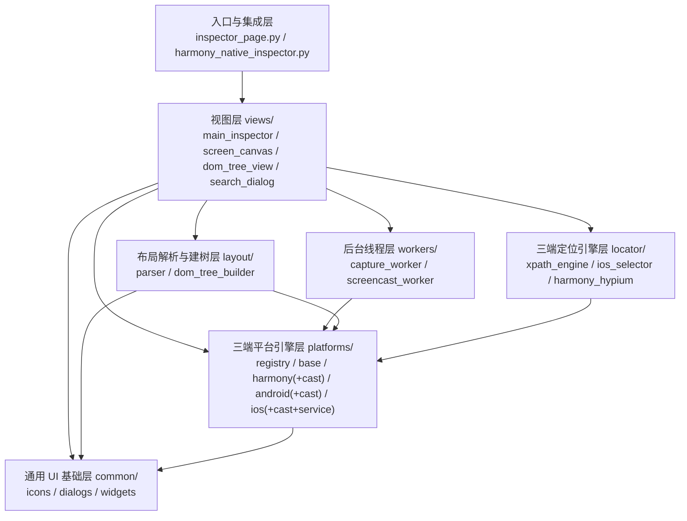

# 🧭 移动端多平台原生 UI 审查器（Inspector）模块化架构与全文件功能手册

> **适用范围**：`desktop_app/ui/inspector/` 全套 23 个子模块、兼容门面 `desktop_app/ui/harmony_native_inspector.py`、控制台集成页 `desktop_app/ui/inspector_page.py` 及双端打包脚本 `desktop_app/build_native_exe.py` / `desktop_app/build_mac_app.py`。
>
> **覆盖平台**：HarmonyOS NEXT（鸿蒙）、Android（安卓）、iOS（苹果）。

---

## 一、重构背景与架构全景

### 1.1 重构前后对比

| 维度 | 重构前 | 重构后 |
| :--- | :--- | :--- |
| **代码形态** | 单体 `harmony_native_inspector.py`（`610 KB` / `12,341 行`）+ 外挂猴子补丁 `inspector_perf_ext.py`（`46 KB`） | `desktop_app/ui/inspector/` 下 **6 层目录、23 个独立模块**（总计 `12,554 行`，最大单文件 `96.3 KB`） |
| **三端隔离** | 鸿蒙 / Android / iOS 的抓取、解析、投屏、WDA 服务与定位器混杂在同一巨型文件中 | `platforms/` 与 `locator/` 按平台完全解耦，单端改动不影响其他两端 |
| **性能补丁** | 通过运行期动态 Monkey Patch 注入 8 项渲染与 WebView 修复，维护链路隐蔽 | **已彻底删除 `inspector_perf_ext.py`**，全部 8 项增强原生合入对应模块 |
| **包规范** | 单文件直导 | 遵循项目「不主动创建 `__init__.py`」规范，采用 Python 3.11+ PEP 420 隐式命名空间包 + PyInstaller 显式 `--hidden-import` |
| **向后兼容** | 外部直导 `harmony_native_inspector` | `harmony_native_inspector.py` 保留为 `157 行` 兼容门面，100% 导出原全部 21 个类与 26 个公共函数 |

### 1.2 分层依赖拓扑



### 1.3 三端能力物理隔离矩阵

| 能力维度 | 鸿蒙（HarmonyOS NEXT） | 安卓（Android） | 苹果（iOS） |
| :--- | :--- | :--- | :--- |
| **抓树 / 解析 / 交互** | `platforms/harmony.py` | `platforms/android.py` | `platforms/ios.py` |
| **实时投屏 / 流解码** | `platforms/harmony_cast.py` | `platforms/android_cast.py` | `platforms/ios_cast.py` |
| **设备服务守护管理** | `HarmonyRpcLayoutClient`（内置于 `harmony.py`） | 内置 `u2` / `adb` 通道 | `platforms/ios_service.py`（WDA 8100 守护与中继） |
| **专属定位器引擎** | `locator/harmony_hypium.py`（`BY.*` / `HosBy`） | `locator/xpath_engine.py` | `locator/ios_selector.py`（Predicate / ClassChain） |
| **WebView / 遮挡自愈** | `heal_harmony_web_opacity` + `suppress_under_fullscreen_web` | `dump_android_hierarchy` 空 WebView 无障碍唤醒重试 | `heal_ios_container_visibility` + `_promote_webview_css_leaf_widgets` |

---

## 二、入口、集成层与打包配置说明

### 2.1 `desktop_app/ui/inspector_page.py`（287 行 / 10.9 KB）

控制台主窗口内嵌审查器的承载容器页，负责懒加载与双模态窗口切换。

| 符号 | 类型 | 功能作用 |
| :--- | :--- | :--- |
| `UndockedPlaceholder` | `QFrame` | 审查器弹出为独立窗口时，在主控制台右侧展示的占位引导面板，提供「收回并重新嵌入」信号 `reattach_requested`。 |
| `InspectorPage` | `QWidget` | 控制台审查器页面容器，管理顶部工具条、占位页与核心 `HarmonyAppiumInspector` 生命周期。 |
| `InspectorPage._init_container_ui()` | 方法 | 构建顶部控制栏（标题、三端标签、弹出/收回按钮）与占位层。 |
| `InspectorPage._ensure_inspector_loaded()` | 方法 | 首次切入审查器页时按需懒加载 `desktop_app.ui.inspector.views.main_inspector.HarmonyAppiumInspector`，并劫持其 `closeEvent` 防止独立窗关闭时销毁实例。 |
| `InspectorPage.on_page_activated()` / `on_page_deactivated()` | 方法 | 侧边栏切换页面时的激活/休眠回调，非首次激活时触发静默刷新在线设备列表（不打断抓屏）。 |
| `InspectorPage._toggle_undock_mode()` / `_reattach_to_container()` | 方法 | 实现「内嵌主工作台」与「独立浮动窗体」之间的平滑切换，自动保存和还原 `WindowFlags`。 |

### 2.2 `desktop_app/ui/harmony_native_inspector.py`（157 行 / 4.9 KB）

重构后的**向后兼容门面（Facade）与独立启动入口**：

- 重导出原单体文件的全部公共类与函数（共计 21 个类、26 个公共函数，覆盖 `HarmonyAppiumInspector`、`AppiumScreenView`、`DOMTreeWidget`、`SearchElementDialog`、`ScreenCastWorker`、`CaptureWorker`、`ModernMessageBox`、`DeviceController` 等），保障 `desktop_app/ui/mobile_page.py` 等外部引用方零改造兼容。
- 保留 `if __name__ == "__main__": main()` 入口，继续支持 `python -m desktop_app.ui.harmony_native_inspector` 独立拉起审查器。

### 2.3 双端构建脚本同步（`build_native_exe.py` / `build_mac_app.py`）

- 已移除失效的 `--hidden-import=desktop_app.ui.inspector_perf_ext`。
- 完整登记全部 **23 个** `desktop_app.ui.inspector.*` 子模块的 `--hidden-import`，确保 Windows（`PyInstaller --onedir`）与 macOS（`.app` / `.dmg`）在无 `__init__.py` 的 PEP 420 命名空间包结构下完整打包，不出现运行期 `ModuleNotFoundError`。

### 2.4 原 `inspector_perf_ext.py` 8 项能力归宿映射表

原外挂补丁文件 `desktop_app/ui/inspector_perf_ext.py` 已永久删除，其全部逻辑已按职责原生落位：

| 原补丁项 | 现原生落位文件与方法 |
| :--- | :--- |
| 1. 高分画布 DPR 圆角缓存与字体缓存 | `views/screen_canvas.py`：`AppiumScreenView._get_cached_rounded_pixmap` / `_tag_font` |
| 2. DOM 树等高行 O(1) 布局渲染 | `views/dom_tree_view.py`：`DOMTreeWidget.__init__`（`setUniformRowHeights(True)`） |
| 3. 属性表 Interactive 表头 + 就地单元格复用 + 长行按需测高 | `views/main_inspector.py`：`HarmonyAppiumInspector.update_selected_element_panel` / `_resize_long_attr_rows` |
| 4. 选中去重与面包屑 QSS 缓存 | `views/main_inspector.py`：`HarmonyAppiumInspector._apply_selected_node` |
| 5. iOS 冻结态 WDA 启停、日志尾摘要提取与快失败 | `platforms/ios_service.py`：`IosServiceActionWorker` / `_read_wda_failure_hint` |
| 6. Android `u2` 深度 80 + 空 WebView 无障碍唤醒重试 | `platforms/android.py`：`dump_android_hierarchy` |
| 7. iOS WKWebView 容器可见性自愈与纯 CSS 叶子提权 | `platforms/ios.py`：`heal_ios_container_visibility` / `_promote_webview_css_leaf_widgets` |
| 8. 鸿蒙 `<Web>` 透明度自愈、全屏网页底层遮挡抑制与小驼峰拾取 | `platforms/harmony.py`：`heal_harmony_web_opacity` / `suppress_under_fullscreen_web`；`views/screen_canvas.py`：`is_content_component`；`common/icons.py`：`get_dom_tag_color` |

---

## 三、核心分层与全部 23 个子模块详细功能说明

### 第一层：通用 UI 基础层（`desktop_app/ui/inspector/common/`）

#### 1. `common/icons.py`（457 行 / 21.3 KB）
> 职责：矢量应用图标生成、SVG/PNG 图标加载缓存与三端 DOM 树标签语义配色中心。

- **核心常量**：
  - `LOCAL_ICON_DIR`：本地图标落盘目录（`desktop_app/assets/icons`），导入时仅在缺失时按需写入模板 SVG，避免每次导入重复覆写磁盘或触发只读目录异常。
  - `_OFFICIAL_SVG_TEMPLATES`：16 套内置 Lucide 风格 SVG 模板（`refresh`/`target`/`tap`/`search`/`cast`/`sync`/`copy`/`save`/`expand`/`collapse`/`send`/`clear`/`play`/`check`/`spinner`/`loader`）。
  - `_TECH_ICON_CACHE`：`(name, color, size, rotation)` 维度的内存 `QIcon` 缓存。
- **核心函数**：
  - `create_modern_app_icon()`：优先加载本地品牌 Logo，缺失时使用 `QPainter` 动态渲染 16~128px 多分辨率 Retina 矢量图标。
  - `import_network_icon(url, save_name)`：支持从网络 URL 下载并缓存图标到本地目录。
  - `get_tech_icon(name, color, size, rotation)`：统一矢量图标渲染引擎，支持任意颜色动态染色、任意角度旋转（供 Loading 动画）及缓存复用。
  - `get_dom_tag_color(c_type)`：三端统一的莫兰迪低饱和度 DOM 标签配色方案，覆盖鸿蒙 ArkUI、Android View、iOS XCUIElement 及鸿蒙 `<Web>` 小驼峰网页标签（`rootWebArea`、`button`、`staticText`、`textField` 等）。

#### 2. `common/dialogs.py`（649 行 / 23.4 KB）
> 职责：全中文纯白轻奢圆角置顶弹窗与无阻塞悬浮 Toast。

- **核心函数与类**：
  - `_apply_win32_topmost(widget)`：跨平台安全守卫（仅 `sys.platform == "win32"` 调用 Win32 `SetWindowPos` 强化顶层 Z-Order，macOS/Linux 安全跳过）。
  - `ModernMessageBox(QDialog)`：无边框可拖拽圆角消息框，提供与 `QMessageBox` 对齐的 `critical` / `warning` / `information` / `question` 静态快捷接口，支持自动吸附父窗口或活跃窗口中央。
  - `ModernInputDialog(QDialog)`：圆角置顶单行文本输入对话框，提供 `getText(...)` 静态入口。
  - `ToastNotification(QLabel)`：居中透明圆角轻提示条，`show_message(message, duration_ms)` 定时自动渐隐不阻塞操作。

#### 3. `common/widgets.py`（355 行 / 12.5 KB）
> 职责：审查器工具栏与输入区高频复用基础控件。

- **核心类**：
  - `ButtonSpinner`：通用按钮 Loading 旋转控制器，基于 `QTimer` 步进渲染 `spinner` 图标旋转帧，任务结束后自动恢复原图标与原按钮文案。
  - `FlowLayout(QLayout)`：响应式流式折行布局，宽屏单行排布、窄屏自动折行；`addWidgetRight(widget)` 支持单行时将右侧状态/徽章控件自动推至行尾对齐。
  - `AutoResizingTextEdit(QTextEdit)`：自适应内容高度的多行纯文本选择器输入框，兼容 `QLineEdit` 的 `text()` / `setText()` / `cursorPosition()` / `returnPressed` 信号接口。
  - `AutoWrapStatusLabel(QLabel)`：支持自动换行且不会因单行超长状态文本撑破父容器宽度的状态标签。
  - `DeviceComboBox(QComboBox)`：基于一次性 `QMenu` 替代原生弹窗的设备选择下拉框，彻底规避 Windows DWM 透明窗口残留幽灵方框问题。

---

### 第二层：三端元素定位引擎层（`desktop_app/ui/inspector/locator/`）

#### 4. `locator/xpath_engine.py`（431 行 / 16.4 KB）
> 职责：跨端 XPath 高级扩展函数注册与双引擎静态语法校验。

- **核心函数**：
  - `init_lxml_xpath_extensions()`（兼容别名 `_init_lxml_xpath_extensions`）：幂等注册 `lxml` 自定义 XPath 2.0 扩展函数，支持 `matches(str, regex)`、`lower-case(str)`、`upper-case(str)`、`ends-with(str, suffix)`。
  - `validate_xpath_syntax(xpath_str)`：结合纯 Python 词法检查（引号闭合、方括号/圆括号配对、非法运算符、错误轴语法）与 `lxml.etree.XPath` 编译校验，返回精确的中文错误原因与合法示例。

#### 5. `locator/ios_selector.py`（512 行 / 22.3 KB）
> 职责：iOS 专属 `NSPredicate` 与 `Class Chain` 词法拆分及五大定位策略语法校验。

- **核心函数**：
  - `tokenize_ios_predicate(raw)`：将复杂的 iOS `NSPredicate` 字符串（含 `AND` / `OR` / `NOT`、括号分组、`CONTAINS[cd]` / `BEGINSWITH` / `ENDSWITH` / `LIKE` / `MATCHES` 等修饰符）解析为原子条件列表与规范布尔表达式，供本地检索求值。
  - `validate_ios_selector_syntax(strategy, val)`：统一校验 iOS 五大定位策略（`id` / `xpath` / `class name` / `-ios predicate string` / `-ios class chain`）语法合法性并给出针对性修正提示。

#### 6. `locator/harmony_hypium.py`（516 行 / 20.0 KB）
> 职责：鸿蒙 Hypium `BY.*` 链式表达式与项目内 `HosBy.*` 源码调用的零 `eval` AST 静态解析与求值引擎。

- **核心常量**：
  - `_HYPIUM_MATCH_PATTERNS`（`0~5` 及 `MatchPattern.*` 枚举映射）、`_HYPIUM_STR_METHODS`（`text`/`key`/`id`/`type`/`hint`/`description`）、`_HYPIUM_XPATH_METHODS`、`_HYPIUM_BOOL_METHODS`（`clickable`/`enabled`/`focused`/`selected`/`checked`/`scrollable`/`checkable`/`longClickable`）、`_HYPIUM_REL_METHODS`（`isBefore`/`isAfter`/`within`/`inWindow`）、`_HARMONY_TUPLE_STRATEGY_MAP`。
- **核心函数**：
  - `_eval_hosby_ast_arg(node)` / `_convert_hosby_call_to_by_expr(raw)`：安全静态解析直接从业务代码粘贴的 `HosBy.text(...)`、`HosBy.id(...)` 等封装调用，零 `eval` 风险。
  - `resolve_harmony_locator_input(raw)` / `extract_hypium_expression(raw)`：统一识别并归一化三类粘贴输入：`HosBy.*` 源码调用、日志/元组定位器 `(AppiumBy.XXX, value)` 及原生 `BY.*` 链式表达式。
  - `_eval_hypium_match_pattern` / `_eval_hypium_bool_arg` / `_parse_hypium_ast_chain` / `parse_hypium_by_expression(raw)`：递归将 `BY.xxx(...).yyy(...)` AST 链解析为有序条件步骤并校验方法名与参数类型。
  - `_match_hypium_str(actual, pattern, mode)` / `_eval_hypium_attr_step(...)`：按鸿蒙 `uitest` 的 `MatchPattern`（`EQUALS`/`CONTAINS`/`STARTS_WITH`/`ENDS_WITH`/`REG_EXP`/`REG_EXP_ICASE`）及属性状态规则执行本地精准求值。

---

### 第三层：三端平台引擎层（`desktop_app/ui/inspector/platforms/`）

#### 7. `platforms/base.py`（120 行 / 4.7 KB）
> 职责：三端共享的几何解析、Appium 活跃会话探测与离线占位图工具。

- **核心函数**：
  - `parse_bounds_wh(bounds_str)`：解析 `[l,t][r,b]` 字符串为 `(left, top, width, height)` 四元组。
  - `fetch_active_appium_source(ports, udid, platform_filter, source_validator, source_timeout)`：自动探测本机活跃的 Appium Server 会话并拉取 `/source`（完整兼容 Appium 2.x 的 `/appium/sessions`、`/wd/hub/appium/sessions` 与 1.x 的 `/sessions` 路径）。
  - `create_placeholder_screenshot(dest_path, width, height, title, subtitle)`：在 DOM 已成功抓取但截屏临时超时时生成轻量提示占位图，避免审查流程中断。

#### 8. `platforms/registry.py`（99 行 / 3.2 KB）
> 职责：三端设备聚合发现与跨平台统一控件动作分发中枢。

- **核心函数与类**：
  - `get_connected_devices()`：按鸿蒙 → 安卓 → iOS 顺序并行/聚合扫描全部在线设备并去重。
  - `DeviceScanWorker(QThread)`：后台异步设备探测线程，避免 HDC/ADB/usbmux 命令卡顿 UI 主线程。
  - `DeviceController`：统一动作路由外观，将 `tap` / `swipe` / `input_text` / `clear_text` 路由至对应平台引擎。

#### 9. `platforms/harmony.py`（635 行 / 25.4 KB）
> 职责：鸿蒙 HarmonyOS NEXT 工具链执行、设备发现、交互控制、RPC/CLI 抓树、`<Web>` 遮挡与透明度自愈以及投屏守护环境准备。

- **工具链与交互**：
  - `resolve_hdc_bin()` / `run_hdc(cmd, udid, timeout)`：优先走 `SmartPathResolver` 内置绿色工具链，Windows 静默无黑框执行 HDC 指令。
  - `scan_harmony_devices(seen_udids)`：扫描在线鸿蒙真机并读取设备型号与系统版本。
  - `harmony_tap` / `harmony_swipe` / `harmony_input_text` / `harmony_clear_text`：基于 `uitest uiInput` 的真机触控、滑动与中文输入/清空实现。
- **高速抓树与布局自愈**：
  - `HarmonyRpcLayoutClient`：直连真机 `uitest` 守护进程 RPC 端口（`_find_available_port` / `_ensure_daemon_running` / `_build_request_packet` / `capture_layout_fast`），毫秒级内存直出 `captureLayout` JSON。
  - `dump_harmony_layout(...)`：三通道高可靠 DOM 抓取（RPC 内存直出 → CLI `uitest dumpLayout` 含重试 → `hmnextauto` 兜底）。
  - `normalize_harmony_node(node, path_id)`：清洗鸿蒙原始 JSON 节点，统一 `bounds`、`type` 与节点唯一 ID。
  - `heal_harmony_web_opacity(node, in_visible_web)`：修复 ArkUI `<Web>` 子树默认上报 `opacity="0.000000"` 导致整个 H5/人机验证页 DOM 被误判为不可见的缺陷。
  - `_find_fullscreen_web_rect` / `_mark_subtree_occluded_by_overlay` / `suppress_under_fullscreen_web`：当层叠容器上层存在全屏活跃 `<Web>`（如人机验证浮层）时，精确抑制其遮盖的底层登录页节点（含抑制底层 `TextInput` 的免遮挡穿透）。
  - `parse_harmony_layout(...)`：解析鸿蒙布局文件并依次执行归一化、Web 透明度自愈与全屏覆盖层抑制。
- **投屏前置协议工具**：
  - `extract_harmony_nalu(resp_bytes)`：从鸿蒙 scrcpy Protobuf `ReplyMessage` 字节流剥离 H.264 NALU。
  - `clean_harmony_scrcpy_fports` / `kill_harmony_scrcpy_daemons` / `ensure_harmony_scrcpy_env`：清理残留 `fport` 转发、精准清理 scrcpy 守护进程（不误杀 `dumpLayout`/`uiInput`）并自动推送 `agent.so` 与 `scrcpy_server.so`。

#### 10. `platforms/harmony_cast.py`（250 行 / 9.2 KB）
> 职责：鸿蒙 HarmonyOS NEXT 硬件录屏实时投屏流与单帧静默截屏引擎。

- **核心函数**：
  - `cleanup_harmony_port(worker)`：安全关闭 gRPC Channel 并移除本地 HDC 端口转发。
  - `capture_harmony_single_silent_frame(cache_cls, udid, timeout)`：在未开启常驻投屏时，通过硬件录屏通道静默抓一帧高清图像（不触发真机截屏广播）。
  - `run_harmony_scrcpy_stream(worker, cache_cls)`：基于 gRPC + PyAV H.264 硬解的 60FPS 投屏主循环（已修复 `request_idr_task` 子线程对 `has_emitted_first_frame` 的提前引用竞态）。
  - `run_harmony_stream(worker, cache_cls)`：鸿蒙投屏总调度循环，含断线自动重连、首帧就绪上报与退出端口清理。

#### 11. `platforms/android.py`（369 行 / 15.2 KB）
> 职责：Android ADB 工具链执行、设备扫描、交互操作、三通道 DOM 抓取、Toast 注入、WebView 无障碍唤醒与离线截屏。

- **工具链与交互**：
  - `resolve_adb_bin()` / `run_adb(cmd, udid, timeout)`：统一走内置绿色工具链解析 ADB 并静默执行。
  - `scan_android_devices(seen_udids)`：扫描在线安卓真机/模拟器并采集品牌型号与 Android 版本。
  - `android_tap` / `android_swipe` / `android_input_text` / `android_clear_text`：支持 `adb input` 与 `uiautomator2` 中文输入/清空。
- **布局抓取与解析**：
  - `parse_android_node(elem)` / `parse_android_layout(layout_path, root_bounds)`：解析安卓 UIAutomator XML 为统一 DOM 树，智能剥离系统状态栏/侧边栏干扰浮层并保留 Toast 窗口。
  - `inject_android_toast_xml(xml_text, toast_text)`：将 `uiautomator2` 捕获的瞬时 Toast 文本注入 XML 层级树，便于审查与断言。
  - `dump_android_hierarchy(udid, layout_file)`：高可靠三通道抓取（Appium 活跃会话直拉 → `uiautomator2` `max_depth=80` + 空 WebView 无障碍唤醒重试 + Toast 注入 → 原生 `adb uiautomator dump` 兜底）。
  - `capture_android_static_screen(udid, local_png)`：三通道离线截屏（`u2` 显存直出 → `adb exec-out screencap -p` → 落盘拉取兜底）。

#### 12. `platforms/android_cast.py`（281 行 / 10.5 KB）
> 职责：Android 硬件 H.264 60FPS 实时投屏与多级降级流引擎。

- **核心函数**：
  - `cleanup_android_stream(worker)`：回收安卓 scrcpy Socket、服务端进程及 `adb reverse` 端口映射。
  - `run_android_scrcpy_stream(worker, cache_cls)`：自动推送 `desktop_app/assets/android/scrcpy-server`，通过 TCP + PyAV 解码原始 H.264 流输出 60FPS 实时帧。
  - `run_android_stream(worker, cache_cls)`：三级自适应调度（`scrcpy` 硬件流 → `uiautomator2` 截图流 → `adb exec-out` 轮询兜底）。

#### 13. `platforms/ios_service.py`（678 行 / 28.4 KB）
> 职责：iOS WebDriverAgent（WDA）服务守护、8100 端口中继、设备扫描、冻结态进程控制及动作派发。

- **核心函数与类**：
  - `register_ios_hid_dispatcher(fn)`：注册活跃 `ScreenCastWorker.dispatch_ios_hid` 回调，解耦服务层与投屏线程层之间的循环依赖。
  - `_resolve_tidevice_cmd(udid)`：自动适配冻结打包态（`[sys.executable, "--internal-tidevice", ...]`）与开发态 `tidevice` 命令。
  - `IosWdaManager`：
    - `kill_relays(ports)`：跨平台清理孤儿中继进程（Windows + macOS/Linux `psutil` 全覆盖），避免切换 iPhone 时 8100/9100 端口占死。
    - `get_device_product_version(udid)`：带缓存高速读取目标 iPhone 的 iOS 版本号（区分 iOS 17+ CoreDevice 路径）。
    - `test_wda_status(url, timeout)` / `get_wda_url(udid, allow_spawn)`：40ms 快速 TCP 探活 + `/status` 校验，按需自动拉起 8100 usbmux 转发。
  - `check_ios_wda_services()` / `_wda_log_path()` / `_read_wda_failure_hint(log_file)`：检测 8100 端口转发与 WDA 进程双状态，并在启动失败时从日志尾部提取关键报错原因直出界面。
  - `IosServiceActionWorker(QThread)`：异步启动/停止 WDA 服务后台线程；打包态原生走 `--internal-wda`，具备早退快失败检测与全进程树回收能力。
  - `scan_ios_devices(seen_udids)`：四级设备探测（`pymobiledevice3` usbmux → `tidevice` → Windows PnP USB → 本地 8100 WDA 端口）。
  - `run_ios_action(action, udid)`：优先走零延迟 CoreDevice HID 通道，未建立隧道时自动回落 WDA HTTP API。

#### 14. `platforms/ios.py`（422 行 / 17.6 KB）
> 职责：iOS 布局解析（XML/JSON）、WKWebView 可见性自愈、截图黑边裁剪标准化、多通道抓树与兜底截屏。

- **核心函数**：
  - `extract_ios_logical_size(layout_file)`：从 WDA 布局根节点提取 iPhone 逻辑点尺寸（如 `390x844`）。
  - `crop_ios_dvt_image(img, logical_size)` / `normalize_ios_screenshot_file(img_path, layout_file)`：自动裁除 iOS DVT/CoreDevice 帧缓冲 16 字节内存对齐造成的右侧/底部纯黑填充区，返回精确逻辑尺寸。
  - `parse_ios_node(elem, scale_x, scale_y)` / `parse_ios_json_node(data, scale_x, scale_y)`：将 WDA XML 或 JSON 节点按比例映射为通用 DOM 节点。
  - `_promote_webview_css_leaf_widgets(node)` / `heal_ios_container_visibility(node, in_webview)`：修复 iOS `WKWebView` / `UIKit` 包装容器误报 `visible="false"` 导致整个网页或人机验证组件被连坐隐藏的顽疾，并对实体小尺寸纯 CSS `<div>` 叶子节点精准提权。
  - `parse_ios_layout(layout_path, root_bounds)`：自动识别 XML/JSON 格式并执行上述可见性自愈。
  - `dump_ios_hierarchy(udid, layout_file)`：多通道抓树（Appium 2.x/1.x 活跃会话 → WDA `/source` XML → WDA `/source?format=json`）。
  - `capture_ios_fallback_screen(udid, local_png, allow_dvt_cli)`：离线截屏兜底（冻结态走 `--internal-pmd3` 执行 DVT 截屏，并支持 WDA `/screenshot` 回落）。

#### 15. `platforms/ios_cast.py`（955 行 / 43.5 KB）
> 职责：iOS 17+ CoreDevice/DVT 高帧率实时投屏、CoreDevice HID 触控派发、WDA MJPEG 降级流与隧道并发守卫。

- **核心函数**：
  - `release_all_ios_tunnels()`：全局强制清理残留的 `pymobiledevice3` `userspace_tunnel` 句柄与单例锁，防止异常退出导致后续无法重连。
  - `dispatch_ios_hid(cache_cls, action)`：向活跃的 `ScreenStreamServer` 事件循环异步投递 CoreDevice HID 触控点击、滑动与按键事件。
  - `capture_single_ios_frame(cache_cls, udid, timeout)`：优先 0ms 复用实时投屏内存帧，避免在隧道活跃时重复抢占 DVT 连接。
  - `run_ios_pymobiledevice3_stream(worker, cache_cls)`：iOS 17+ CoreDevice / DVT 双线程硬解主引擎，实时拉流、裁剪黑边并写入帧缓存。
  - `run_ios_legacy_fallback_stream(worker, cache_cls, is_ios_17_plus)`：三级降级流（WDA 9100 MJPEG 含冻结态 `--internal-tidevice` 中继与首帧状态上报 → WDA `/screenshot` 轮询 → 进程内 `DvtProvider`/`ScreenshotService`）。
  - `run_ios_stream(worker, cache_cls)`：iOS 投屏总控入口，根据系统版本与 WDA 就绪状态自动选路，并使用 `try/finally` 严格守卫隧道锁与 `is_active` 状态位（修复早期抢锁失败后状态卡死 Bug）。

---

### 第四层：跨端布局解析与 DOM 树构建层（`desktop_app/ui/inspector/layout/`）

#### 16. `layout/parser.py`（77 行 / 3.3 KB）
> 职责：三端布局文件统一解析与物理分辨率探测分发器。

- **核心函数**：
  - `get_layout_physical_size(layout_data, default_w, default_h)`：兼容鸿蒙 JSON 与安卓/iOS XML，从根节点精确提取设备物理分辨率。
  - `parse_layout_file(layout_path, platform, screen_w, screen_h)`：按 `platform` 分发至 `parse_harmony_layout` / `parse_android_layout` / `parse_ios_layout`，输出统一格式的通用 DOM 字典树。

#### 17. `layout/dom_tree_builder.py`（598 行 / 24.1 KB）
> 职责：通用 DOM 树 UI 装配、活跃模态弹窗识别、几何遮挡判定与自底向上容器可见性聚合。

- **核心常量**：`_ARKUI_CONTAINER_TYPES`（透明布局骨架集合）、`_NON_TRANSPARENT_TYPES`（具备实体底色的前景组件集合）。
- **核心函数**：
  - `find_active_dialogs(node)`：扫描布局树是否存在真实尺寸 `>= 100x100` 且非空的活跃模态弹窗，用于触发弹窗外底层元素遮挡逻辑。
  - `_collect_solid_leaf_bounds(node)`：穿透透明布局容器与 `Blank`，提取后序兄弟分支中真正具有实体遮挡能力的视觉边界。
  - `format_dom_node_label(platform, comp, is_full_type)`：按平台与「展示完整类名」开关格式化 DOM 树展示文本（标签名 + 关键 `id`/`text`/`bounds`/`occluded` 摘要）。
  - `build_dom_tree_into_inspector(...)`：递归完成 `QTreeWidgetItem` 节点挂载、`lxml` XML 元素树同步构建、平铺交互组件列表收集、反向遍历遮挡矩形集合计算及自底向上容器状态聚合。
  - `apply_occluded_visibility_to_tree(tree_widget, show_occluded)`：按「显示/隐藏遮挡元素」复选框自底向上刷新节点显隐，确保包含可见子孙的容器绝不被连坐隐藏，顶层页面骨架永不消失。

---

### 第五层：后台异步线程层（`desktop_app/ui/inspector/workers/`）

#### 18. `workers/capture_worker.py`（320 行 / 13.7 KB）
> 职责：三端截图与 UI 层次异步抓取后台工作线程（支持全量刷新 `full` 与纯 DOM 刷新 `dom_only`）。

- **核心类 `CaptureWorker(QThread)`**：
  - 信号：`capture_success(local_png, layout_file, platform)`、`dom_only_success(layout_file, platform)`、`capture_failed(err_msg)`。
  - `_silent_capture_harmony_screen(udid, local_png)`：鸿蒙四级静默截屏链路（0ms 投屏内存帧 → 磁盘最近帧缓存 → `snapshot_display` → 单帧硬件录屏通道）。
  - `_cleanup_old_temp_files()`：滚动清理 `reports/inspector/` 下的过期临时截图与布局文件，防止磁盘膨胀。
  - `_run_harmony` / `_run_android` / `_run_ios` / `run()`：按平台并行或顺序调度截图与抓树，并在 DOM 成功但截屏超时时生成占位图保底。

#### 19. `workers/screencast_worker.py`（226 行 / 7.8 KB）
> 职责：跨平台实时投屏轻量调度壳层与类级最新帧内存缓存中心。

- **核心类 `ScreenCastWorker(QThread)`**：
  - **类级状态与缓存**：维护 `latest_qimage`、`latest_udid`、`latest_frame_time`、`is_active` 及互斥锁，使抓图与点击审查可直接 0ms 复用内存最新帧；模块加载时自动调用 `register_ios_hid_dispatcher(ScreenCastWorker.dispatch_ios_hid)` 完成回调注册。
  - **静态/类方法**：`release_all_tunnels()`、`clear_cache()`、`dispatch_ios_hid(action)`、`get_latest_jpeg_bytes(target_udid)`、`capture_single_silent_frame(udid, timeout)`、`capture_single_ios_frame(udid, timeout)`。
  - **调度与清理**：`stop()` 优雅中断流并委托回收端口/进程/隧道；`run()` 按平台委托至 `harmony_cast.py` / `android_cast.py` / `ios_cast.py` 执行真实拉流。

---

### 第六层：视图与交互层（`desktop_app/ui/inspector/views/`）

#### 20. `views/screen_canvas.py`（523 行 / 22.2 KB）
> 职责：左侧真机屏幕实时渲染画布、坐标映射、高亮框绘制与最内层组件精准拾取。

- **核心常量与类**：
  - `_WEB_INNER_CONTENT_TYPES`：鸿蒙 `<Web>` 内部小驼峰可交互/文本标签白名单（`button`、`link`、`staticText`、`textField`、`image` 等）。
  - `InspectorMode`：交互模式枚举（`SELECT` 拾取模式 / `TAP_SWIPE` 真机直控模式）。
  - `AppiumScreenView(QWidget)`：
    - `_invalidate_screen_cache()` / `_get_cached_rounded_pixmap(target_size)`：按视口尺寸与 HiDPI DPR 缓存缩放并圆角裁剪后的底图，大幅降低 `paintEvent` 鼠标悬浮重绘开销。
    - `clear_screen()` / `update_screen_pixmap()` / `update_screen_image()` / `update_components_only()` / `load_screenshot()`：统一管理静态图、实时流 `QImage` 与叠加组件层更新。
    - `get_draw_rect()`：保持屏幕宽高比计算实际绘制区域，实现窗口坐标 ↔ 设备坐标的双向精准换算。
    - `is_content_component(comp)` / `find_component_at(dev_x, dev_y, for_hover)`：按深度优先与面积权重拾取坐标下最内层有效实体组件，支持穿透鸿蒙 `<Web>` / `<rootWebArea>` 容器直接命中网页内部按钮或输入框。
    - `paintEvent` / `mouseMoveEvent` / `mousePressEvent` / `mouseReleaseEvent`：绘制悬浮红框、选中蓝框、实时坐标胶囊、滑动轨迹箭头，并对外发出 `element_selected`、`coordinate_tapped`、`coordinate_swiped` 信号。

#### 21. `views/dom_tree_view.py`（248 行 / 8.8 KB）
> 职责：中间栏 DOM 层级树控件，提供等高行高性能渲染、水平滚动条防抖锁定与双击局部单词精准复制。

- **核心函数与类**：
  - `extract_word_bounds(text, pos)`：根据点击字符索引提取不含引号/括号/空格等边界符的完整属性词区间。
  - `DOMTreeItemDelegate(QStyledItemDelegate)`：自定义单元格绘制委托，保留莫兰迪彩色标签语法着色，同时在用户双击某个属性值单词时以蓝底纯白高亮绘制选中片段。
  - `DOMTreeWidget(QTreeWidget)`：启用 `setUniformRowHeights(True)` 实现大树 O(1) 滚动排版，重写 `scrollTo` 防止展开或选中节点时横向滚动条乱跳，支持双击选词与 `Ctrl+C` 精准复制选中单词或整行文本。

#### 22. `views/search_dialog.py`（1,746 行 / 82.8 KB）
> 职责：独立浮窗元素定位与调试器，支持三端全策略表达式实时语法校验、本地匹配高亮、一键点击/输入与跨会话记忆。

- **核心类 `SearchElementDialog(QDialog)`**：
  - **平台策略切换**：`_get_platform_strategies()` / `_rebuild_strategies()` / `_on_format_pill_clicked()` 动态渲染对应平台的策略胶囊（鸿蒙：`HypiumBy (BY.*)` / `XPath` / `id` / `text` / `type`；安卓：`XPath` / `id` / `text` / `accessibility id` / `class name`；iOS：`id` / `XPath` / `class name` / `Predicate` / `Class Chain`）。
  - **语法校验与自动回填**：`_on_selector_text_changed()` 实时调用 `locator/` 下对应校验器并在下方显示精准语法报错卡片；`sync_element_from_main(comp)` / `pick_current_element_to_input()` 支持把主界面当前选中的节点一键转为对应策略表达式。
  - **本地求值检索**：`do_search()` / `_evaluate_xpath_natively()` / `match_hypium_by()` / `match_xpath()` 结合 `only_visible` 过滤开关，在毫秒内列出全部命中元素并高亮首个/选中项。
  - **浮窗置顶与记忆**：`_toggle_stay_on_top()` / `_apply_native_topmost()` / `_on_app_state_changed()` 实现智能置顶；`_save_memory()` / `_load_memory()` 按平台隔离记忆上次输入的定位语句与策略。
  - **真机即时联调**：`on_tap_clicked()` 与 `on_send_keys_clicked()` 支持在搜索弹窗内直接对命中元素下发真机点击或文本输入。

#### 23. `views/main_inspector.py`（2,087 行 / 96.3 KB）
> 职责：UI 审查器主窗口中枢，串联左屏画布、中栏 DOM 树、右栏属性与快捷操作面板、设备扫描、实时投屏与搜索浮窗。

- **核心类 `HarmonyAppiumInspector(QMainWindow)`**：
  - **界面与主题**：`apply_white_luxury_theme()` / `init_ui()` 构建顶部工具条（设备选择、刷新、模式切换、实时投屏、抓屏、定位查找、源码复制、截图保存、iOS WDA 服务启停按钮）与三栏主工作区。
  - **设备与 iOS 服务联动**：`load_device_list()` / `_on_devices_scanned()` / `on_device_changed()` / `update_platform_badge()`；`refresh_ios_service_status()` / `on_ios_service_btn_clicked()` / `_on_ios_service_action_finished()`（含失败详情透传展示）。
  - **抓屏与 DOM 统一重建**：`_resolve_layout_viewport_size()` / `_rebuild_dom_state_from_layout()` / `_finish_dom_view_sync()` 统一驱动 `on_capture_success` 与 `on_dom_only_success`，消除重复代码；`save_screenshot()` 同时支持静态底图 `QPixmap` 与实时投屏 `QImage`。
  - **实时投屏控制**：`toggle_screencast()` / `start_screencast()` / `stop_screencast()` / `on_screencast_frame()` / `on_screencast_state_changed()` / `on_screencast_error()`。
  - **DOM 树内即时查找**：`toggle_dom_search()` / `on_dom_search_text_changed()` / `on_dom_search_next()` / `on_dom_search_prev()` / `clear_dom_search_highlights()`（支持大小写敏感、正则与全词匹配）。
  - **三栏选中联动与性能优化**：`_apply_selected_node()` 基于 `(node_id, id(comp), text)` 去重；`update_selected_element_panel()` 复用属性表格单元格并缓存面包屑 QSS，`_resize_long_attr_rows()` 仅对长值行按需测高。
  - **真机快捷交互**：`on_canvas_coordinate_tapped()` / `on_canvas_coordinate_swiped()` / `direct_tap_element()` / `direct_send_keys_to_element()` / `action_element_clear()` / `sync_live_input()` 及操作后延迟自动同步 `_sync_after_device_action()`。
- **独立入口函数**：`main()` 负责独立启动审查器并绑定应用级图标与高分屏策略。

---

## 四、核心端到端业务链路

### 4.1 全量抓屏 + DOM 树重建链路

```text
用户点击「刷新」
  → main_inspector.refresh_screen_and_dom()
  → workers/capture_worker.CaptureWorker (后台线程)
      ├── 鸿蒙: _silent_capture_harmony_screen (0ms内存帧/快照) + harmony.dump_harmony_layout (RPC→CLI→hmnextauto)
      ├── 安卓: android.capture_android_static_screen + android.dump_android_hierarchy (Appium→u2含WebView唤醒+Toast→ADB)
      └── iOS : ios_cast.capture_single_ios_frame / ios.capture_ios_fallback_screen + ios.dump_ios_hierarchy (Appium→WDA)
  → 信号 capture_success(local_png, layout_file, platform)
  → main_inspector._resolve_layout_viewport_size() (含 iOS DVT 黑边裁剪)
  → main_inspector._rebuild_dom_state_from_layout()
      → layout/parser.parse_layout_file() (触发各端 WebView 可见性/遮挡自愈)
      → layout/dom_tree_builder.build_dom_tree_into_inspector() (构建树 + 遮挡矩形 + XML)
      → layout/dom_tree_builder.apply_occluded_visibility_to_tree()
  → screen_canvas.load_screenshot() + _finish_dom_view_sync() (自动恢复选中节点)
```

### 4.2 实时投屏与 0ms 帧复用链路

```text
用户点击「开启投屏」
  → main_inspector.start_screencast()
  → workers/screencast_worker.ScreenCastWorker (后台线程)
      ├── 鸿蒙: platforms/harmony_cast.run_harmony_stream (gRPC + H.264 硬解)
      ├── 安卓: platforms/android_cast.run_android_stream (scrcpy H.264 → u2 → adb)
      └── iOS : platforms/ios_cast.run_ios_stream (CoreDevice/DVT → WDA MJPEG 9100 → /screenshot)
  → 每帧更新 ScreenCastWorker.latest_qimage 类缓存 + 发射 frame_ready 信号
  → main_inspector.on_screencast_frame() → screen_canvas.update_screen_image()
  → 若此时点击「刷新」/「同步」，CaptureWorker 直接 0ms 读取 latest_qimage，避免与投屏争抢设备通道
```

---

## 五、本次重构同步修复的 10 项关键缺陷清单

| 编号 | 所在模块 | 原缺陷现象 | 修复方案 |
| :---: | :--- | :--- | :--- |
| 1 | `platforms/harmony_cast.py` | 鸿蒙投屏 `request_idr_task` 子线程在首帧标志赋值前读取，偶发 `NameError` 竞态 | 提前初始化 `has_emitted_first_frame = False` 并保持闭包安全引用 |
| 2 | `platforms/ios_cast.py` | iOS 投屏抢锁失败提前返回时，`ScreenCastWorker.is_active` 仍残留为 `True` | 使用 `try/finally` 守卫，仅在抢锁成功后置 `True` 且退出必复位 |
| 3 | `platforms/ios_cast.py` | iOS 9100 MJPEG 降级流首帧未触发 `state_changed(True)`，且打包态硬编码外部 `tidevice` | 补发首帧就绪信号，9100 中继统一复用 `_resolve_tidevice_cmd` 支持 `--internal-tidevice` |
| 4 | `platforms/base.py` / `ios.py` | iOS 抓取活跃 Appium 会话仅查 1.x `/sessions`，漏掉 Appium 2.x `/appium/sessions` | 抽象 `fetch_active_appium_source()` 统一探测 Appium 2.x 与 1.x 全部端点 |
| 5 | `views/main_inspector.py` | 实时投屏模式下点击「保存截图」仅读 `screen_pixmap`，导致提示无画面 | `save_screenshot()` 兼容读取 `canvas.screen_image`（`QImage`）与 `screen_pixmap` |
| 6 | `views/main_inspector.py` | iOS WDA 服务启停失败时丢弃 `IosServiceActionWorker` 返回的具体日志错误摘要 | `_on_ios_service_action_finished()` 直接将详细 `message` 展示在提示与状态栏中 |
| 7 | `platforms/android.py` / `android_cast.py` / `harmony.py` | 设备扫描、安卓 `exec-out` 截屏及降级流硬编码 `"adb"` / `"hdc"`，绕过内置绿色工具链 | 统一收口至 `resolve_adb_bin()` 与 `resolve_hdc_bin()` |
| 8 | `platforms/ios.py` | 离线兜底截屏硬编码 `"pymobiledevice3"` CLI，在冻结 `.exe`/`.dmg` 包内执行失败 | 冻结态自动切换为 `[sys.executable, "--internal-pmd3", ...]` |
| 9 | `platforms/ios_service.py` / `common/dialogs.py` | `kill_relays` 缺少 macOS/Linux 清理；Win32 `ctypes.windll` 置顶调用未加平台守卫 | 为 `kill_relays` 补全 `psutil` 跨平台清理；`_apply_win32_topmost` 增加 `sys.platform == "win32"` 守卫 |
| 10 | `common/icons.py` | 每次模块导入都会强制覆写磁盘上全部 16 个 `.svg` 文件，只读目录易异常且多余 I/O | 改为 `if not os.path.exists(_svg_file)` 仅在缺失时落盘补齐 |

---

## 六、后续开发与维护指南

1. **新增或修改单端能力**：
   - 鸿蒙改动只动 `platforms/harmony.py`、`platforms/harmony_cast.py` 或 `locator/harmony_hypium.py`；
   - 安卓改动只动 `platforms/android.py`、`platforms/android_cast.py`；
   - iOS 改动只动 `platforms/ios.py`、`platforms/ios_cast.py`、`platforms/ios_service.py` 或 `locator/ios_selector.py`。
2. **新增子模块时的强制检查项**：
   - **禁止**在 `desktop_app/ui/inspector/` 任何层级创建 `__init__.py`；
   - 新增 `.py` 模块后，必须同步将 `--hidden-import=desktop_app.ui.inspector.<layer>.<module>` 加入 [build_native_exe.py](../desktop_app/build_native_exe.py) 与 [build_mac_app.py](../desktop_app/build_mac_app.py)；
   - 若暴露新的公共类/函数且需要保持旧路径兼容，同步在 [harmony_native_inspector.py](../desktop_app/ui/harmony_native_inspector.py) 的导入和 `__all__` 中登记。
3. **验证回归命令**：
   - 静态作用域检查：确保新增或修改模块经 `pyflakes` 检查为 0 致命错误；
   - 独立启动冒烟：`python -m desktop_app.ui.harmony_native_inspector`。
