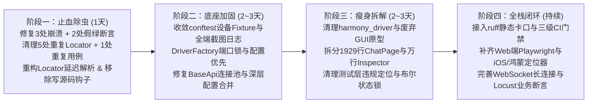

# 🧠 Santiao Anti · 全项目架构深度审查与工业级优化方案

> **审查范围**：`d:/projects/santiao-anti` 全量工程代码（核心框架、跨端驱动、定位器、Page Object、测试套件、接口与压测引擎、桌面端及 CI/CD 流水线）  
> **审查基准**：资深测试开发架构师标准 · Python 3.13+ · 四端（Web / iOS / Android / HarmonyOS）一体化自动化测试体系  
> **审查日期**：2026-11-24

---

## 一、项目全景画像与代码规模统计

当前仓库总计约 **89,000+ 行 Python 代码**（不含 `.kilo` 残留工作树与运行日志），模块分布如下：

| 层级 / 目录 | Python 文件数 | 代码行数 | 当前健康度评估 |
| :--- | :---: | :---: | :--- |
| **`core/`**（驱动工厂、跨端路由、日志、配置） | 5 | 3,083 | ⚠️ 含 1,701 行废弃驱动；跨端路由存在求值顺序串台缺陷 |
| **`common/`**（`BasePage`、通用枚举） | 3 | 1,339 | ⚠️ 存在参数解包崩溃、`back()` 未对齐设计、手势死等 8s |
| **`locators/`**（三端元素定位器） | 60 | 6,786 | 🚨 含 `NameError` 崩溃、5 处同名属性覆盖、iOS/鸿蒙覆盖率仅 ~14% |
| **`pages/`**（业务页面对象层） | 55 | 18,591 | 🚨 存在静态字典导入期锁死 Android、`press_back` 未定义、1,929 行巨石类 |
| **`strategy/` & `business_helpers/`** | 7 | 1,434 | 🚨 策略类默认参数在导入期锁死 Android 定位器 |
| **`tests/`**（冒烟与各模块回归套件） | 71 | 17,572 | 🚨 存在 2 处“假绿”反向断言、1 处同名用例静默覆盖、56 处硬编码 `sleep` |
| **`apis/` & `performance/`**（接口与压测） | 7 | 881 | ⚠️ `BaseApi` 未复用 `Session`、SSL 配置键错位、Locust 未校验业务码 |
| **`tools/` & `scripts/` & `utils/`** | 16 | 7,391 | ⚠️ 含运行时篡改源码脚本、多设备弱网失效、空实现函数 |
| **`desktop_app/`**（PyQt6 原生桌面控制台） | 27 | 26,640 | ⚠️ 单文件高达 11,598 行；所谓“不可逆加密”实为明文字节码包装 |
| **历史冗余原型（`qa_studio_*` / `templates` / `smart_qa_agent`）** | 23 | 6,672 | 🧹 多套迭代废弃 GUI/Runner 并存，建议归档清理 |

### 核心体检结论

项目已具备清晰的**三层自动化架构**、会话级热自愈（`RecoverableDriver` + `StateHealer`）、鸿蒙 `HosBy` 原生直查及 Frida 免 UI 压测能力。但当前最紧迫的风险集中在以下四点：

1. **跨端定位器过早求值**：导致导入期静态字典永久锁死 Android，以及单线程双端切换首次调用必拿错平台定位器。
2. **确定性崩溃与“假绿”断言**：3 处必崩代码、2 处完全颠倒黑白的假通过断言、1 条被同名覆盖丢失的用例、5 处被静默覆盖的定位器。
3. **测试期污染源码与并发竞态**：`pytest` 启动自动改写 `locators/` 源码文件；多设备 `systemPort` 分配缺乏并发锁且忽略配置端口。
4. **工程包袱过重与门禁缺失**：超 8,000 行死代码及 40MB+ 二进制包入库，缺少 `ruff` 静态卡口与自动化测试 CI 门禁。

---

## 二、核心跨端架构缺陷与重构蓝图

### 架构问题本质图示

```mermaid
flowchart TD
    subgraph现状["❌ 现状：导入期与传参期过早求值（存在锁死与串台）"]
        A1["模块 import 阶段"] -->|"无 Driver，回退默认平台"| A2["ChatPage._MSG_BASE_LOCATORS / ChatSessionStrategy 永久冻死为 Android 元组"]
        B1["单线程切换设备: iOS -> Android"] -->|"调用 android_page.find_element(HomeLocator.LEFT_MENU)"| B2["1. 先求值实参 HomeLocator.LEFT_MENU"]
        B2 -->|"_thread_local 仍残留 ios"| B3["拿到错误的 iOS 定位器元组"]
        B3 -->|"2. 后进入 find_element 函数体"| B4["虽然更新了 _thread_local='android'，但入参已错！"]
    end

    subgraph重构["✅ 目标：实例强绑定 + 延迟描述符解析（100% 并发与跨端隔离）"]
        C1["访问 XxxLocator.ATTR"] -->|"不立即查平台"| C2["返回不可变 LazyLocator(LocatorCls, 'ATTR')"]
        C2 -->|"传入 BasePage 方法"| C3["BasePage._resolve_locator(loc)"]
        C3 -->|"直接读取实例级 self._platform_name"| C4["精准路由至 Android / iOS / HarmonyOS 真实元组"]
    end
```

---

## 三、P0 级：致命崩溃、假绿断言与跨端失效清单（必须立即修复）

### 1. 跨端定位器在“导入阶段”与“参数求值阶段”锁死/串台
* **涉及文件**：
  * [locator_manager.py](file:///d:/projects/santiao-anti/core/locator_manager.py#L107-L126)
  * [chat_page.py](file:///d:/projects/santiao-anti/pages/chat/core/chat_page.py#L19-L47)
  * [chat_strategy.py](file:///d:/projects/santiao-anti/strategy/chat/chat_strategy.py#L19-L21)
  * [base_page.py](file:///d:/projects/santiao-anti/common/base_page.py#L110-L126)
* **根因剖析**：
  1. **导入期静态冻死**：`ChatPage._MSG_BASE_LOCATORS`（25 个消息气泡定位器）与 `ChatSessionStrategy`（`notice_locator` / `top_locator` / `delete_locator`）在 `import` 时直接求值。此时尚未初始化任何 Driver，`LocatorPlatformManager.get_current_platform()` 直接返回 `'android'`，导致即便编写了 493 行的 `chat_locator_ios.py` 和 343 行的 `chat_locator_hos.py`，在 iOS 和鸿蒙上查消息依然使用的是 Android `resource-id`。
  2. **参数求值早于函数体执行**：Python 执行 `self.find_element(HomeLocator.LEFT_MENU)` 时，先计算参数 `HomeLocator.LEFT_MENU`，后进入 `find_element` 执行 `set_thread_platform(self._platform_name)`。在单线程异构双端交互（如 Android 发 $\rightarrow$ iOS 收 $\rightarrow$ Android 校验）中，刚切回 Android 时的第一次定位器读取会命中残留的 `_thread_local.platform == 'ios'`，直接拿错定位器。
* **最优重构方案**：
  * 引入轻量级 `LazyLocator` 描述符（支持元组解包兼容），在 `BasePage` 内部通过 `self._resolve_locator(locator)` 按当前 Page 实例固化的 `self._platform_name` 实时解析，彻底废除 `_thread_local` 全局状态猜测与栈帧反射（`inspect.currentframe()`）。

---

### 2. 鸿蒙定位器构造器 `HosBy.after_text` 拼写错误导致必崩 (`NameError`)
* **涉及文件**：[hos_by.py](file:///d:/projects/santiao-anti/locators/common/hos_by.py#L62-L67)
* **问题代码**：
  ```python
  @classmethod
  def after_text(cl7s, anchor_text: str, target_type: str = "Image") -> tuple[str, str]:
      safe_anchor = cls._escape(anchor_text)  # ❌ NameError: name 'cls' is not defined
      safe_type = cls._escape(target_type)
      return ("HypiumBy", f'BY.isAfter(BY.text("{safe_anchor}")).type("{safe_type}")')
  ```
* **最优修复**：将形参 `cl7s` 修正为 `cls`。

---

### 3. 登录页回退兜底调用不存在的 `self.press_back()` (`AttributeError`)
* **涉及文件**：[login_page.py](file:///d:/projects/santiao-anti/pages/login/login_page.py#L73-L78)
* **问题代码**：
  ```python
  back_btn = self.find_element(LoginLocator.TOP_IV_BACK_BTN, timeout=1, expect_missing=True)
  if back_btn and back_btn.is_displayed():
      back_btn.click()
  else:
      self.press_back()  # ❌ LoginPage 与 BasePage 均无 press_back 方法！
  ```
* **最优修复**：改为调用基类标准方法 `self.back()`。

---

### 4. `BasePage.press_keycode` 在 iOS/Web 回落分支错误解包定位器 (`ValueError`)
* **涉及文件**：[base_page.py](file:///d:/projects/santiao-anti/common/base_page.py#L1121-L1127)
* **问题代码**：
  ```python
  elif input_locator:
      element = self.find_element(*input_locator)  # ❌ 将 (by, value) 拆成 locator=by, condition=value！
      element.send_keys(Keys.ENTER)                # ❌ 若未找到元素返回 None，此处二次触发 AttributeError
  ```
* **触发后果**：在无 `press_keycode` 的驱动（如 iOS XCUITest）上传入 `input_locator` 时，直接触发第 123 行 `ValueError: 不支持的元素等待条件`。
* **最优修复**：改为 `self.send_keys(input_locator, Keys.ENTER, clear=False)`。

---

### 5. 冒烟协议跳转校验存在“空字符串包含”假绿漏洞
* **涉及文件**：[test_smoke_login.py](file:///d:/projects/santiao-anti/tests/smoke_test/test_smoke_login.py#L52-L63)
* **问题代码**：
  ```python
  expected_title = '三条软件许可及服务协议 | 用户协议'
  ...
  protocol_title = self.loginPage.get_top_title()
  check.is_in(protocol_title, expected_title, ...)  # ❌ 判断 protocol_title in expected_title
  ```
* **触发后果**：当点击协议未跳转或顶部标题未加载出来时，`get_top_title()` 返回空字符串 `""`。Python 中 `"" in "三条软件许可及服务协议 | 用户协议"` **恒等于 `True`**，页面完全卡死也能 100% 测试通过！
* **最优修复**：
  ```python
  expected_titles = ("三条软件许可及服务协议", "用户协议")
  check.is_true(
      bool(protocol_title) and any(exp in protocol_title for exp in expected_titles),
      f"❌ 预期协议页面标题包含 {expected_titles}，实际获取为: '{protocol_title}'"
  )
  ```

---

### 6. 登录按钮禁用校验逻辑与日志完全颠倒黑白（按钮可点反而断言“禁用通过”）
* **涉及文件**：
  * [login_page.py](file:///d:/projects/santiao-anti/pages/login/login_page.py#L462-L475)
  * [test_login.py](file:///d:/projects/santiao-anti/tests/login/test_login.py#L105-L108)
* **问题代码**：
  ```python
  # pages/login/login_page.py
  def is_login_button_enabled(self) -> bool:
      login_btn = self.find_element(LoginLocator.VERIFY_AND_LOGIN_BTN, timeout=2)
      if login_btn:
          is_enabled = login_btn.is_enabled()
          if is_enabled:
              logger.info(f"{LogIcon.SETUP} 登录按钮处于置灰状态")  # ❌ enabled=True 却打日志说置灰！
              return True
  
  # tests/login/test_login.py
  if case.assert_ui_state == "button_disabled":
      is_enabled = self.loginPage.is_login_button_enabled()
      check.is_true(is_enabled, "❌ 预期登录按钮禁用，但实际可点击")  # ❌ is_enabled=True 反而断言通过！
  ```
* **最优修复**：修正 `is_login_button_enabled` 的返回值与日志语义（若客户端采用背景色变浅而非原生 `enabled="false"` 表达置灰，应结合 `VerifyColor` 像素饱和度/亮度判定），并在测试侧改为 `check.is_false(is_enabled, ...)`。

---

### 7. 朋友圈交互测试类中存在同名测试函数静默覆盖（丢失 1 条用例）
* **涉及文件**：[test_moments_interaction.py](file:///d:/projects/santiao-anti/tests/moments/test_moments_interaction.py#L129-L130) 与 [L381-L382](file:///d:/projects/santiao-anti/tests/moments/test_moments_interaction.py#L381-L382)
* **根因剖析**：`TestMomentsInteraction` 类中先后定义了两个 `def test_like_and_cancel_moment(...)`（第 129 行注入 `temp_interaction_moment`，第 381 行注入 `temp_like_moment`）。Python 类构建时后者直接覆盖前者，导致第 129~170 行的用例成为永远不会执行的死代码。
* **最优修复**：核对两个 fixture 的隔离意图，保留独立 fixture 版本或重命名区分场景。

---

## 四、P1 级：核心框架、会话生命周期与并发安全问题

### 8. `conftest.py` 在每次测试启动时直接覆写 Git 源码文件
* **涉及文件**：[conftest.py](file:///d:/projects/santiao-anti/conftest.py#L78-L85)、[sync_ide_platform.py](file:///d:/projects/santiao-anti/scripts/sync_ide_platform.py#L88-L124)
* **问题分析**：`pytest_configure` 每次启动都会调用 `sync_ide_platform()` 直接修改 `locators/**/*.py` 源码中的基类排列顺序。
  1. 只要切换 `--platform ios` 跑一次测试，工作区就会产生大量源码文件变更，污染 Git 提交历史；
  2. 多进程并发测试不同平台时，会同时覆写同一批 `.py` 文件引发竞态损坏。
* **最优修复**：从 `conftest.py` 中移除 `sync_ide_platform` 自动调用，仅保留为开发者手动切换 IDE 跳转视图时的 CLI 脚本。

---

### 9. `conftest.py` 失败取证不全、iOS 缺少首页归位、重跑篡改缺陷等级
* **涉及文件**：[conftest.py](file:///d:/projects/santiao-anti/conftest.py#L210-L251)、[L349-L552](file:///d:/projects/santiao-anti/conftest.py#L349-L552)、[rerun.yaml](file:///d:/projects/santiao-anti/config/rerun.yaml)
* **四大具体缺陷**：
  1. **失败截图漏掉 iOS 与多设备**：第 211 行硬编码 `["driver_sender", "driver_receiver", "driver", "driver_harmony_sender", "driver_harmony"]`，漏掉了 `driver_ios_sender`、`driver_ios_receiver`、`driver_harmony_receiver` 及 `driver_device3~9`（第 292 行已定义完整 `_DRIVER_FIXTURE_NAMES` 却未复用），且缺少失败时的设备侧日志（`logcat` / `syslog` / `hilog`）自动挂载。
  2. **iOS Driver 缺少启动首页自愈 + 12 个重复 Fixture**：`driver_ios_sender` / `driver_ios_receiver`（第 384~410 行）未执行 `MainPage(driver).go_to_main_page()` 归位；且第 349~552 行重复粘贴了 12 遍完全相同的 `try...yield...finally driver.quit()` 样板代码（文件底部第 555~714 行还残留了 160 行注释废弃代码）。
  3. **重跑失败强行降级 P0 严重度**：第 241 行 `allure.dynamic.label("severity", "normal")` 会在重跑依然失败（即实锤稳定 Bug！）时，把原本 `@allure.severity(BLOCKER)` 的 P0 阻断缺陷强行降级成普通 `normal`，严重误导质量门禁统计。
  4. **`rerun.yaml` 形同虚设**：`config/rerun.yaml` 中配置的 `max_reruns: 2`、`reruns_delay: 5`、`only_rerun_exceptions`、`never_rerun_exceptions` 在 `conftest.py` 中完全未被读取应用，与 `pytest.ini` 形成双轨配置割裂。
* **最优修复**：
  * 编写通用生成器 `_create_managed_driver(role_key, request)` 统一收敛全部 14 个设备 Fixture（代码量从 210 行压减至 45 行）；
  * 失败钩子统一遍历 `_DRIVER_FIXTURE_NAMES` 截图并附加近期设备日志；
  * 删除 `allure.dynamic.label("severity", "normal")`；统一收口重跑配置源。

---

### 10. `DriverFactory` 多设备 `systemPort` 分配忽略配置且存在并发抢占
* **涉及文件**：[driver_factory.py](file:///d:/projects/santiao-anti/core/driver_factory.py#L280-L335)、[devices.yaml](file:///d:/projects/santiao-anti/config/devices.yaml#L159-L206)
* **问题分析**：
  * 代码写死 `base_port = 8200 if 'sender' in device_key.lower() else 8220`，导致 `device3`~`device9` 在 `devices.yaml` 中配置的 `8202`~`8208` 被无视，全部从 `8220` 开始探测；
  * 多线程并发拉起 5 台设备（如 `TestChatMultiDevice`）时，多个线程同时执行 `psutil.net_connections()` 会同时看到 `8220` 空闲并同时分配给不同设备，引发 Appium UIA2 建连冲突。
* **最优修复**：增加类级互斥锁 `_PORT_LOCK = threading.Lock()` 与 `_RESERVED_PORTS: set[int]`；优先检测设备自身配置的 `systemPort` 是否可用，冲突时再从端口池递增分配并登记预占。

---

### 11. `BasePage` 与异常装饰器的实现偏差
* **涉及文件**：[base_page.py](file:///d:/projects/santiao-anti/common/base_page.py#L420-L435)、[L711-L742](file:///d:/projects/santiao-anti/common/base_page.py#L711-L742)、[except_utils.py](file:///d:/projects/santiao-anti/utils/except_utils.py#L19-L45)、[L211-L231](file:///d:/projects/santiao-anti/utils/except_utils.py#L211-L231)
* **具体问题**：
  1. `BasePage.back(prefer_ui=True)` 注释写了三层智能回退（收键盘 $\rightarrow$ 点左上角返回图标 $\rightarrow$ 系统返回），但代码实际忽略了 `prefer_ui`，只执行了 `self.driver.back()`，在 iOS 页面栈上极易失效。
  2. `BasePage.perform_gesture` 第 728 行注释写 `# 按住麦克风 0.5 秒录点声音`，代码却写成了 `pause(5)`（5 秒！加上第 735 行 `pause(3.0)`，每次调用硬阻塞 8 秒）。
  3. `except_utils.py` 中 `_take_screenshot_on_failure` 从未被调用；`check_element_status` 不仅从未被调用，且 `return True if result is None else bool(result)` 存在严重的空值误判逻辑错误。

---

## 五、P2 级：定位器冲突、三端覆盖缺口、用例规范与接口/压测体系优化

### 12. 定位器层 5 处同名属性重复定义覆盖清单
以下类内部存在同名属性二次赋值，导致前一个定位器被静默覆盖失效：

| 序号 | 文件路径 | 冲突属性名 | 被覆盖行 | 生效覆盖行 | 影响说明 |
| :---: | :--- | :--- | :---: | :---: | :--- |
| 1 | [home_locator.py](file:///d:/projects/santiao-anti/locators/home/home_locator.py#L92-L141) | `CONVERSATION_UNREAD_COUNT` | L92 (`ID`) | L140 (`XPATH`) | 外层容器 ID 定位器丢失 |
| 2 | [group_bot_locator.py](file:///d:/projects/santiao-anti/locators/groups/bot/group_bot_locator.py#L36-L100) | `BTN_CONFIRM` / `BTN_CANCEL` | L36-37 | L99-100 | 通用确认/取消按钮被警告语弹窗按钮覆盖 |
| 3 | [contact_detail_locator.py](file:///d:/projects/santiao-anti/locators/friend/profile/contact_detail_locator.py#L12) | `TV_NAME` | L12 | L168 | 联系人详情顶部名称与底部卡片名称冲突 |
| 4 | [group_create_locator.py](file:///d:/projects/santiao-anti/locators/groups/create/group_create_locator.py#L10-L23) | `FRIEND_NAME` | L10 | L23 | 重复定义同一控件定位 |
| 5 | [moments_locator.py](file:///d:/projects/santiao-anti/locators/moments/moments_locator.py#L137) | `CB_SELECT` | L137 | L156 | 相册选择框重复定义 |

---

### 13. 跨端覆盖缺口（iOS/鸿蒙仅 14%，Web 端空白）与回退报错不透明
* **现状数据**：`locators/` 下共 **47 个** Android 基础定位器文件，但仅有 **7 个** `_hos.py`（鸿蒙）和 **6 个** `_ios.py`（iOS），主要集中在 `login`、`home`、`chat/core`、`common`；好友、群管理、群机器人、动态、收藏、个人中心、富媒体插件等约 40 个模块尚未完成 iOS 与鸿蒙定位器适配；同时 **Web 端（Playwright）尚未建立页面与用例目录**。
* **改进建议**：
  1. 在跨端定位器解析层加入**异构策略拦截**：当当前设备为 `ios` 或 `harmonyos`，而回退拿到的 Android 定位器使用了 `AppiumBy.ANDROID_UIAUTOMATOR` 或 `com.santiaotalk.im:id/` 时，立即抛出语义清晰的 `LocatorNotAdaptedError("模块 XxxLocator.YYY 尚未适配 [ios] 平台定位器")`，替代晦涩的驱动超时。
  2. 按业务优先级（P0 冒烟路径优先：建群、加好友、图片/语音收发、群基础管理）分批补齐 `_ios.py` 与 `_hos.py`。

---

### 14. 测试层架构违规、类状态耦合与硬编码等待
* **违规项清理**：
  * [test_extract_report_tree.py](file:///d:/projects/santiao-anti/tests/report/test_extract_report_tree.py#L45-L120) 在测试脚本中直接使用 `AppiumBy` 和 `self.driver.find_elements`，违反“test 层严禁直接定位元素”的铁律。鉴于其本质是一次性菜单树抓取工具，应整体迁移至 `tools/extract_report_tree.py`。
  * [chat_page.py](file:///d:/projects/santiao-anti/pages/chat/core/chat_page.py#L94-L98) 存在兼容别名兼拼写错误方法 `click_top_back_bnt`，违反“禁止通过兼容别名修改命名”规范，应排查调用方后统一收敛为 `click_back_button`。
* **消除脆弱的类变量布尔锁**：
  * [test_smoke_login.py](file:///d:/projects/santiao-anti/tests/smoke_test/test_smoke_login.py#L18-L28) 和 [test_login.py](file:///d:/projects/santiao-anti/tests/login/test_login.py#L45-L66) 通过 `_has_entered_phone_login` 类变量记录是否已进入手机号表单。一旦前序用例登出回到欢迎页，后续用例将因状态锁未重置而失败。应删除该布尔锁，直接调用已具备页面状态自感知能力的 `self.loginPage.click_phone_login_button()`。
* **替换硬编码等待与内联账号**：
  * 逐步将 `tests/` 中的 **56 处 `time.sleep()`** 替换为 `BasePage.wait_for_element` / `wait_for_element_text` 条件轮询；
  * 将 [test_smoke_login.py](file:///d:/projects/santiao-anti/tests/smoke_test/test_smoke_login.py#L11-L12) 中硬编码的测试账号密码抽离至 `config/accounts.yaml` 或 `data/login/`。

---

### 15. 接口自动化（`apis/`）、性能压测（`performance/`）与弱网模块加固
1. **[base_api.py](file:///d:/projects/santiao-anti/apis/base_api.py#L17-L60) 重构**：
   * 第 59 行 `requests.request(...)` 改为 `self.session.request(...)`，真正启用 TCP 连接池复用与会话 Header 保持；
   * 移除类定义顶层的 `load_yaml_data('api/auth_config.yaml')` 磁盘读取，改为懒加载，防止文件缺失拖垮模块导入；修正拼写 `BASE_UTL -> BASE_URL`。
2. **[config_loader.py](file:///d:/projects/santiao-anti/core/config_loader.py#L29-L39) 与 [api_config.yaml](file:///d:/projects/santiao-anti/config/api_config.yaml#L63-L71) 对齐**：
   * 统一 `verify_ssl` 与 `verify` 字段命名，并将 `common_config.update(env_config)` 升级为递归深合并（Deep Merge），防止环境级 `headers` 覆盖丢失公共 `headers`。
3. **[data_loader.py](file:///d:/projects/santiao-anti/utils/file_reader/data_loader.py#L8-L156) 修复**：
   * 修正第 8 行错误的 `sys.path.append` 层级；补全或删除第 147 行空实现的 `save_csv_data`；对高频只读 YAML（如 `devices.yaml`）增加 `functools.lru_cache` 内存缓存，减少重复磁盘 IO。
4. **[locustfile.py](file:///d:/projects/santiao-anti/performance/locustfile.py#L91-L99) 增加业务码断言**：
   * 不仅校验 HTTP `200 <= status_code < 400`，还应支持配置 `expected_json_code`（如校验响应体 `resp.json().get("code") == 200`），杜绝“HTTP 200 但业务鉴权报错”导致的压测假绿；并将 `locust`、`websockets` 正式纳入依赖清单。
5. **[network_control.py](file:///d:/projects/santiao-anti/utils/network/network_control.py#L5-L23) 绑定设备 UDID**：
   * 改造为接收 `udid: str`，使用 `subprocess.run(["adb", "-s", udid, "shell", ...], check=True, timeout=5)` 替代无设备隔离的 `os.system("adb shell ...")`。

---

## 六、P3 级：工程瘦身、巨石模块拆分、安全纠偏与 CI/CD 质量门禁

### 16. 仓库瘦身清单（可立减 ~33,000 行冗余代码与 40MB+ 二进制包）
* **建议直接删除或归档至独立历史分支的内容**：
  1. [harmony_driver.py](file:///d:/projects/santiao-anti/core/harmony_driver.py)（**1,701 行**）：已全面迁移至 `appium-harmonyos-driver`，全仓零引用；同步清理 `BasePage` 中残留的 `_is_harmony_element` / `supports_native_gestures` 旧分支及 `requirements.txt` 中无用的依赖。
  2. **多套废弃控制台原型**：`qa_studio_app/`（3,668 行）、`qa_studio_next/`（1,026 行）、`qa_studio_platform/`（72 行）、`templates/`（1,109 行）、`smart_qa_agent/`（797 行），以及根目录旧打包脚本 [main.py](file:///d:/projects/santiao-anti/main.py)、`pack.py`、1 行空代理 `common/logger.py`。
  3. **工作树与大体积二进制文件清理**：将 `.kilo/` 加入 [.gitignore](file:///d:/projects/santiao-anti/.gitignore) 并清理本地 `.kilo/worktrees/`（内含完整重复仓库约 2.5 万行代码）；将 `tools/drivers/ios/AppleMobileDeviceSupport64.msi`（40.2 MB）移至内部制品库/网盘，通过下载脚本拉取而非直接塞入 Git 仓库。
  4. **OCR 依赖去重**：移除 [requirements.txt](file:///d:/projects/santiao-anti/requirements.txt#L29) 中的 `cnocr`，全仓统一使用 `rapidocr_onnxruntime`。

---

### 17. 巨石单文件（God Class）按职责边界拆分
* **[chat_page.py](file:///d:/projects/santiao-anti/pages/chat/core/chat_page.py)（1,929 行）**：保持对外 `ChatPage` 类名与方法签名 100% 不变的前提下，内部按业务职责拆分为组合或 Mixin 模块：
  * `ChatInputMixin`（文本、表情、语音、扩展面板输入）
  * `ChatMessageQueryMixin`（气泡定位、左右侧贴边判定、已读未读与状态机校验）
  * `ChatMultiSelectMixin`（长按多选、逐条/合并转发、删除、收藏）
* **`desktop_app/ui/harmony_native_inspector.py`（11,598 行） & `mobile_page.py`（4,076 行）**：将设备通信线程（`QThread` / HDC / WDA 视频流解码）、UI 树解析引擎与 PyQt6 视图面板拆分为独立子包，彻底摆脱万行单文件维护噩梦。

---

### 18. 桌面端源码保护安全纠偏
* **涉及文件**：[encrypt_engine.py](file:///d:/projects/santiao-anti/desktop_app/encrypt_engine.py#L33-L71)
* **真相说明**：当前实现并非注释所写的 Cython `.pyd` 机器码编译，而是 `marshal.dumps(compile(...)) + zlib + base85` 后交由 `exec()` 执行。外部人员只需拦截 `marshal.loads` 返回的 `CodeType` 对象即可在数秒内反编译还原全部 Python 源码与内嵌业务策略。若需商业级防逆向保护，应切换为 **Nuitka** 或 **Cython (`cythonize -3`)** 真正编译为原生 `.pyd` / `.so` 动态链接库。

---

### 19. 建立自动化静态检查与分级 CI/CD 质量门禁
1. **引入 `ruff` 极速静态卡口（`pyproject.toml` + `pre-commit`）**：
   * 开启规则 `F821`（未定义名称，直接拦截 `cl7s`）、`F811`（重复方法/属性定义，直接拦截同名用例覆盖）、`E722`（禁止裸 `except:`），并配置自定义 lint 脚本禁止 `tests/` 导入 `locators` 或 `AppiumBy`。
2. **修复并扩展 GitHub Actions / Jenkins 流水线**：
   * 修复 [build_mac_dmg.yml](file:///d:/projects/santiao-anti/.github/workflows/build_mac_dmg.yml#L109) 手工硬编码 `pip install` 与 `requirements.txt` 脱节的问题；
   * 落地三级流水线与 Allure 质量门禁自动判定脚本：
     * **MR/PR 门禁**：静态检查 + API 集成测试 + P0 冒烟集（`< 10 分钟`，通过率 $\ge 95\%$ 否则阻断合并）；
     * **每日凌晨回归**：分布式多机并行全量回归（`< 60 分钟`，通过率 $\ge 85\%$，Flaky 率 $\le 2\%$）；
     * **发版前专项**：Locust 高并发压测（P99 $\le 500\text{ms}$）+ 弱网消息补偿与跨端一致性专项。

---

## 七、分阶段执行路线图（Actionable Roadmap）



### 建议优先启动顺序
1. **第一步（零风险立竿见影）**：执行**阶段一**，一次性消除所有已知运行期崩溃点、假绿断言、重复定义冲突以及跨端定位器锁死/串台缺陷。
2. **第二步（提升多机稳定性）**：执行**阶段二**，完成 `conftest.py`、`DriverFactory` 与 `apis/` 基础层工业化加固。
3. **第三步（轻装上阵）**：确认无外部依赖后执行**阶段三**清理冗余目录并拆分超大文件，随后推进**阶段四**全栈自动化与质量门禁闭环。
