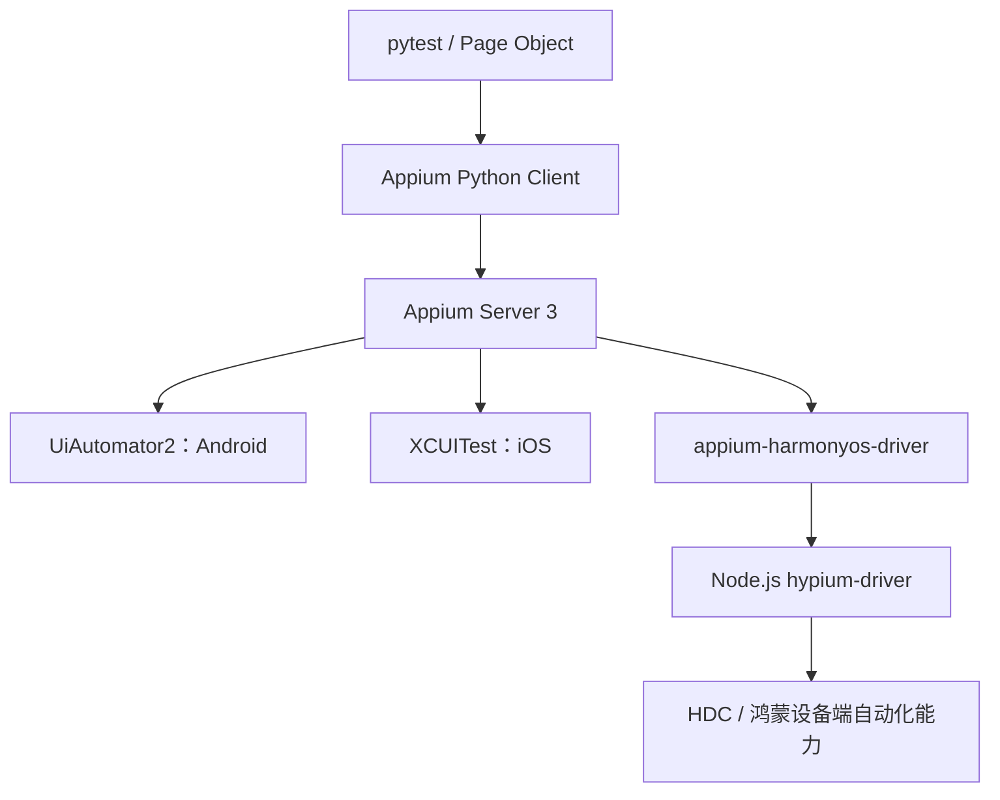

# appium-harmonyos-driver 完整 API 参考与配套工具使用指南

> 编写及核对日期：2026-11-03 至 2026-11-04  
> 上游仓库：zhihu/appium-harmonyos-driver  
> 源码快照：`025ddf92f040d40d300dd73a0febade5a833df68`  
> 快照中 package.json 版本：`1.0.1`  
> 阅读对象：使用 Python、pytest、Appium 进行 HarmonyOS NEXT 自动化测试的开发者。  
> 验证状态：已核对该快照的 README、全部驱动命令模块、执行映射、配置约束、日志、WebView、Doctor 与 Java 示例；未安装该驱动、编译上游项目或执行真机测试。

本文是基于源码重新整理的中文使用手册，不是官方 README 的逐字翻译，也不是“全部示例已经运行通过”的承诺。文档依照“环境准备 → 安装驱动 → 创建 Session → 启动应用 → 定位和操作 → 证据与日志 → WebView → 结束 Session”的调用顺序组织。

**重要：文中的命令与代码是供操作者选择执行的教程，编写本手册没有执行它们。安装软件、创建 Session、输入、点击、锁屏、清除数据、卸载应用及删除文件均有副作用，不要整页连续执行。**

## 目录

1. [完整范围、状态与技术关系](#scope)
2. [环境要求与版本管理](#environment)
3. [Windows 安装与 Appium 管理](#installation)
4. [Session、Capabilities、等待与超时](#session)
5. [应用启动、查询与生命周期](#applications)
6. [页面树、窗口与元素定位](#locators)
7. [WebElement 属性与操作](#elements)
8. [完整手势 API](#gestures)
9. [按键、输入、屏幕与设备信息](#device)
10. [文件管理 API](#files)
11. [截图、录屏与日志](#evidence)
12. [WebView、ChromeDriver 与 JavaScript](#webview)
13. [配套工具详细教程](#tools)
14. [完整 Python 使用示例](#examples)
15. [pytest、双设备与本项目接入建议](#project)
16. [异常、限制与故障排查](#troubleshooting)
17. [45 个执行映射完整清单](#execute-index)
18. [64 个模块处理函数完整清单](#handler-index)
19. [生命周期、日志、上下文与 Java 补充接口](#other-interfaces)
20. [源码依据、覆盖边界与升级核对](#references)

<a id="scope"></a>

## 一、完整范围、状态与技术关系

### 1.1 本文中“完整”的范围

本快照包含：

- `lib/method-map.ts` 中的 **45 个执行映射**：**41 个 `mobile:` 命令**与 **4 个非 `mobile:` 映射**。
- `lib/commands` 顶层命令模块中挂载到驱动的 **64 个处理函数**，包括空实现和内部辅助入口。
- 驱动生命周期、Context、ChromeDriver 代理、日志、WebSocket、BiDi 日志相关接口。
- `lib/constraints.ts` 的全部 **20 个配置约束条目**，以及 README 或代码中实际使用的其他重要配置。
- 上游 Java 示例的定位器、按键枚举、事件类与驱动构造入口。
- 实际使用所需的 Appium CLI、Appium Inspector、HDC、DevEco CLI、ChromeDriver、Python/pytest 教程。

**不把以下内容算作该驱动已经实现的功能：**

- Appium/Selenium 客户端暴露、但当前驱动没有接通的所有方法。
- 整个 Python Hypium SDK、Node hypium-driver SDK 或 ChromeDriver 的全部 API。
- 仅存在名称、参数映射或空函数的功能。
- 尚未在本项目设备上验证的系统兼容性、稳定性和性能。

### 1.2 状态标记

| 标记 | 含义 |
| :--- | :--- |
| 源码已实现 | 当前快照存在实际处理逻辑，不等于真机验收通过 |
| 转发到底层 | 桥接层调用 hypium-driver；具体返回、权限和系统支持仍取决于底层版本 |
| 部分实现 | 存在明显的语义限制、入口不完整或兼容风险 |
| 未实现 | 空函数、仅日志输出或未接通可用入口 |
| 待验证 | 源码不足以保证客户端到设备的完整链路 |

### 1.3 与 Appium、Hypium、hmnextauto 的关系



- `appium-harmonyos-driver` 是 Appium 服务端驱动，驱动名与 automationName 都是 `harmonyos`。
- 它依赖 Node.js `hypium-driver`，不是直接导入 Python `hypium`。
- 使用它不需要额外安装 Python `hypium` 或 `hmnextauto`。
- Android 仍使用 UiAutomator2，不会因为安装此驱动而改用鸿蒙自动化。
- Appium 统一的是通信入口，不会自动统一各平台的定位器、权限、手势或异常细节。

源码依据：[package.json](https://github.com/zhihu/appium-harmonyos-driver/blob/025ddf92f040d40d300dd73a0febade5a833df68/package.json)、[驱动主类](https://github.com/zhihu/appium-harmonyos-driver/blob/025ddf92f040d40d300dd73a0febade5a833df68/lib/driver.ts)。

<a id="environment"></a>

## 二、环境要求与版本管理

### 2.1 版本基线

| 组件 | 当前快照的要求或本文基线 | 注意事项 |
| :--- | :--- | :--- |
| appium-harmonyos-driver | package.json 为 `1.0.1`，以本文提交 SHA 为准 | 相同版本号不一定代表源码没有变化 |
| Appium | peer dependency：`^3.0.0-rc.2` | 不要沿用 Java README 中的“Appium 2.x”作为此快照要求 |
| Node.js | `^20.19.0 \|\| ^22.12.0 \|\| >=24.0.0` | 不是任意 Node 20/22 都满足 |
| npm | `>=10` | 与实际 Node 安装配套核对 |
| Node hypium-driver | `^6.0.7201` | 是范围，不是精确锁定版本 |
| appium-chromedriver | `^8.0.0` | WebView 才需要对应可用的 ChromeDriver |
| Python | 本项目兼容基线 3.11+，目标为 3.13+ | 驱动是 Node 软件，不能用其 Node 要求推导 Python 兼容性 |
| Appium Python Client | 本项目 requirements.txt 为 `5.2.7` | 本手册示例按其现代 Options 方式编写 |
| Selenium | 本项目 requirements.txt 为 `4.41.0` | 不因编写手册升级依赖 |
| HarmonyOS / 设备 | 按实际手机、系统完整版本、HDC、底层 SDK 验收 | 当前桥接仓库没有提供足以保证全部设备的完整矩阵 |
| Java（可选） | 仓库 pom.xml 使用 JDK 17 | Java README 写“11+”，实际编译配置是 17 |

### 2.2 只读检查

以下命令由操作者在需要时执行：

```powershell
Get-Command node, npm, appium, python, hdc | Select-Object Name, Source
node --version
npm --version
appium --version
python --version
hdc -v
appium driver list --installed
python -m pip show Appium-Python-Client selenium
```

执行 `hdc list targets` 会查询设备连接；多设备操作必须使用实际设备序列号，不能依赖默认第一台设备。

### 2.3 建议记录的版本信息

每次形成真机结论，至少记录：驱动 SHA、package.json 版本、实际安装的 hypium-driver 版本、Appium/Node/npm/Python/Client 版本、HDC 版本、设备 SN、型号、系统构建号、应用版本。

上游依赖使用 `^` 范围，不能仅锁定仓库 SHA 就认定 Node 依赖完全可复现。安装完成后在该驱动源码目录查看：

```powershell
npm ls hypium-driver appium-chromedriver
```

如果没有已有锁文件，不要声称首次 `npm install` 是可重复构建；应保存本次实际产生的依赖锁及安装记录，后续经过团队确认再复用。

<a id="installation"></a>

## 三、Windows 安装与 Appium 管理

### 3.1 安装 HDC 并配置环境

1. 从华为官方 DevEco Studio / Command Line Tools 获取匹配的 SDK 工具。
2. 找到真实的 `hdc.exe`，常见位置在 SDK 的 `openharmony\toolchains`，不要直接照抄他人的安装路径。
3. 将该目录加入当前终端 PATH，并设置 `HDC_HOME`。
4. 重新启动需要读取这些环境变量的 Appium 进程。

假设 HDC 已经能通过 PATH 找到，可在当前 PowerShell 设置：

```powershell
$hdcExecutable = (Get-Command hdc.exe -ErrorAction Stop).Source
$env:HDC_HOME = Split-Path -Parent $hdcExecutable
$env:Path = "$env:HDC_HOME;$env:Path"
hdc -v
hdc list targets
```

以上环境变量仅影响当前 PowerShell 及其新启动的子进程，不会永久修改系统设置。

**Doctor 的边界：** 当前驱动的检查只确认 `HDC_HOME` 已设置且路径存在，不验证目录内一定有可用 HDC，不验证设备已授权，也不验证 Session 能建立。

### 3.2 安装 Appium

已经存在满足要求的 Appium 时跳过，不要为了阅读文档升级工作环境。全新、经过批准的安装环境可以使用明确版本，例如：

```powershell
npm install --global appium@3.5.2
appium --version
```

这属于软件安装，会写入 npm 全局目录；不是本手册生成时执行的动作。

### 3.3 获取并构建驱动源码

上游 README 指引从本地源码注册驱动。下面用独立工具目录示范，避免把上游仓库混入业务测试代码：

```powershell
$driverRoot = 'D:\tools\appium-harmonyos-driver'
git clone https://github.com/zhihu/appium-harmonyos-driver.git $driverRoot
git -C $driverRoot checkout --detach 025ddf92f040d40d300dd73a0febade5a833df68
Set-Location -LiteralPath $driverRoot
npm install
npm run build
```

说明：

- `D:\tools` 必须由操作者选择并确认，不要覆盖已有同名目录。
- `npm install` 会下载依赖并可能执行依赖安装脚本；只在信任的环境中运行。
- package.json 的入口为 `build/index.js`，源码快照没有自带构建输出；所以不能把“下载源码”当成“已可加载的驱动”。
- 本次没有执行构建。如果 TypeScript、依赖导出或版本组合报错，应保留原始日志并核对上游，不要用关闭所有检查或强制忽略依赖冲突来冒充安装成功。

### 3.4 注册驱动

先确认现有使用情况。首次安装不需要卸载其他驱动：

```powershell
appium driver list --installed
Set-Location -LiteralPath 'D:\tools'
appium driver install --source=local 'D:\tools\appium-harmonyos-driver'
appium driver list --installed
appium driver doctor harmonyos
```

上游要求本地注册命令不要在该驱动源码目录内运行，示例切换到其父目录。

如果同名驱动已安装，需要在确认没有依赖它的任务后，单独安排替换。`appium driver uninstall harmonyos` 会改变安装环境，不应在每次测试启动前自动执行。

### 3.5 启动 Appium Server

在前台终端启动最容易观察日志：

```powershell
appium --address 127.0.0.1 --port 4723 --base-path /
```

另一个终端检查服务：

```powershell
Invoke-RestMethod -Uri 'http://127.0.0.1:4723/status' -TimeoutSec 5
```

- 客户端使用 `http://127.0.0.1:4723`。
- 默认不要添加旧版 `/wd/hub`；只有服务端显式使用该 base path 时才匹配添加。
- 仅监听本机，避免把设备操作接口暴露到不可信网络。
- 要保存服务日志，可以额外使用 `--log` 指向由操作者创建并拥有的日志目录；注意日志可能包含设备信息和测试输入。
- 关闭由自己启动的前台服务时使用该终端的 Ctrl+C，不批量结束其他人的 Node/Appium 进程。

### 3.6 需要服务端日志时

当前驱动的 `server` 日志需要显式安全开关。Appium 3 要带 automationName 作用域：

```powershell
appium --address 127.0.0.1 --port 4723 --allow-insecure=harmonyos:get_server_logs
```

不要照搬旧示例中的无前缀 `--allow-insecure=get_server_logs`；也不要为读取日志直接开启 `--relaxed-security`。

CLI 与安全规则依据：[Appium 扩展管理](https://appium.io/docs/en/3.0/reference/cli/extensions/)、[Appium Server 安全说明](https://appium.io/docs/en/3.0/guides/security/)。

<a id="session"></a>

## 四、Session、Capabilities、等待与超时

### 4.1 创建 Session

```python
from appium import webdriver
from appium.options.common import AppiumOptions
from appium.webdriver.client_config import AppiumClientConfig

options = AppiumOptions().load_capabilities(
    {
        "platformName": "harmonyos",
        "appium:automationName": "harmonyos",
        "appium:udid": "替换为实际设备序列号",
        "appium:newCommandTimeout": 120,
    }
)
client_config = AppiumClientConfig(
    remote_server_addr="http://127.0.0.1:4723",
    timeout=95,
)
driver = webdriver.Remote(
    command_executor="http://127.0.0.1:4723",
    options=options,
    client_config=client_config,
)
```

- 使用通用 `AppiumOptions`，不要用 `UiAutomator2Options` 冒充鸿蒙配置。
- `platformName` 是标准字段；其他 Appium 扩展字段加 `appium:` 前缀。
- `udid` 必须明确，尤其是双设备场景。
- 创建 Session 会连接设备，默认还会启动 hilog 捕获，不是纯本地对象构造。
- 操作结束由拥有该 Session 的调用方执行 `driver.quit()`。
- `driver.close()` 是 WebDriver 关闭窗口语义，不等于释放整个移动端 Session。

### 4.2 核心配置

| 配置 | 类型 | 实际意义及边界 |
| :--- | :--- | :--- |
| `platformName` | str | 建议固定 `harmonyos`；尽管约束接受 Harmony/HarmonyOS，插件平台路由声明的是 harmonyos |
| `appium:automationName` | str | 固定 `harmonyos` |
| `appium:udid` | str | README 声明的设备 SN，底层连接接收 capabilities；不填可能选第一台设备 |
| `appium:deviceName` | str | 描述信息；不能代替 udid 精确选择设备 |
| `appium:appPackage` | str | 与 appActivity 同时提供时，驱动创建 Session 后调用 startApp |
| `appium:appActivity` | str | 鸿蒙 Ability 名称；该字段沿用 Appium 命名，不代表 Android Activity |
| `appium:app` | str | 约束中允许，但当前 createSession 没有看到自动 installApp 流程，不承诺填路径就自动安装 |
| `appium:newCommandTimeout` | number | Appium 会话空闲超时，单位秒；不是一次元素查找或 HTTP 请求超时 |
| `appium:skipHilogCapture` | bool | true 时跳过驱动 createSession 中的 hilog.startHilog() |
| `appium:getDeviceLogs` | bool | 有配置声明；桥接主类未直接消费，不能据此保证自动导出整包日志 |
| `appium:getDeviceLogsToPath` | str | mobile: getDeviceLogs 使用的服务端本地输出目录，不是 Python 客户端目录 |

启动应用时不要照搬 Java README 里的 `appium:bundleId`、`appium:abilityId` 作为自动启动保证；当前桥接主类明确读取的是 `appPackage`、`appActivity`。

### 4.3 WebView 配置：覆盖全部其余约束条目

| 配置 | 约束类型 | 实现情况 |
| :--- | :--- | :--- |
| `appium:waitForWebviewMs` | number | 枚举 WebView 时等待，默认 0；当前实现即使没有等待预算也可能有一次约 500 ms 的轮询休眠 |
| `appium:chromedriverExecutable` | str | 指定服务端 ChromeDriver 可执行文件 |
| `appium:chromedriverExecutableDir` | str | 指定搜索目录；目录不存在时回退到底层 SDK 资源目录 |
| `appium:chromedriverPort` | number | ChromeDriver 监听端口；未指定时寻找空闲端口 |
| `appium:chromedriverPorts` | array | 有声明，当前上下文创建流程未见使用此池，不承诺自动从池中分配 |
| `appium:chromedriverArgs` | object | 约束写 object，但构造器把它当命令行参数传递，存在类型不一致，不能直接照搬数组示例 |
| `appium:chromedriverChromeMappingFile` | str | 传给 ChromeDriver 的 mappingPath |
| `appium:chromedriverUseSystemExecutable` | bool | 转发 useSystemExecutable |
| `appium:chromedriverDisableBuildCheck` | bool | 转发 disableBuildCheck；跳过检查不等于版本真的兼容 |
| `appium:chromeLoggingPrefs` | object | 有声明，当前构造流程未见显式传递，不保证启用浏览器日志 |
| `appium:autoWebviewTimeout` | number | 有声明，当前流程未见自动切入 WebView，不能替代显式切换 |
| `appium:recreateChromeDriverSessions` | 约束异常 | 切回原生时读取该值决定停止/挂起代理，但约束写的是 isBoolean:false，需验证实际校验行为 |

代码另读取 `chromeOptions`、`chromeBundleId`、`showChromedriverLog` 等选项，但这些没有全部列入约束。它们属于源码可见的透传入口，不保证所有 Appium 组合均接受。最小化配置，从只读 `contexts` 查询开始验证。

### 4.4 不同层次的超时

| 超时 | 设置示例 | 作用 |
| :--- | :--- | :--- |
| 客户端 HTTP 超时 | `AppiumClientConfig(timeout=95)` | Python 等待 Appium 响应的上限，秒 |
| Session 空闲超时 | `appium:newCommandTimeout=120` | Appium 等待下一条客户端命令的上限，秒 |
| shell 执行超时 | `mobile: shell` 的 `timeout=5000` | 单次 shell 的上限，毫秒，默认 300000 |
| WebView 发现等待 | `appium:waitForWebviewMs=5000` | WebView socket 枚举等待，毫秒 |
| 显式元素等待 | `WebDriverWait(driver, 10)` | 调用方轮询条件的等待预算，秒 |

这里需要区分五个层次，不能把“改大一个 timeout”当成修复所有超时。显式等待的轮询期限也不能中断一个已经阻塞的 HTTP 调用，总耗时可能超过标注值。

### 4.5 隐式等待的真实边界

```python
driver.implicitly_wait(0)
print(driver.timeouts)
```

该驱动继承了 Appium 的超时设置入口，但自定义 `findElOrEls` 没有显式使用 Appium 的隐式等待轮询，也没有在此函数中把该值传给底层。因此：

- 可以设置隐式等待，不等于已经证明鸿蒙元素查找会按该值轮询。
- 不能仅因为 README 有 `implicitly_wait(5)` 就宣称该行为已验收。
- 建议本项目保持隐式等待 0，采用有限的显式等待，并单独测量一次不存在元素查询耗时。
- 上游会包装查找异常，显式等待也可能掩盖通信问题，具体见异常章节。

<a id="applications"></a>

## 五、应用启动、查询与生命周期

**推荐优先使用本章列出的 `mobile:` 命令。** README 中的部分标准 Python 方法与当前 Appium 3 路由或驱动方法名不匹配，不应默认认为与 mobile 命令等价。

### 5.1 完整参数和返回边界

| 命令 | 实际读取的参数 | 结果及注意事项 |
| :--- | :--- | :--- |
| `mobile: activateApp` | `bundleId` 必填；`abilityId` 可选 | 有 abilityId 时直接启动；省略时通过 bm dump 查找启动入口，失败抛错；底层返回原样转发 |
| `mobile: isAppInstalled` | `bundleId` | 查询是否安装，底层结果原样返回 |
| `mobile: queryAppState` | `bundleId` | 状态码，见下表 |
| `mobile: getCurrentPackage` | 无 | 当前应用包名，底层结果原样返回 |
| `mobile: getCurrentActivity` | 无 | 当前 Ability 信息，沿用 Activity 命名 |
| `mobile: backgroundApp` | `seconds` | 按 Home，等待指定秒数，然后尝试启动任务列表第一项；不保证一定是原应用 |
| `mobile: terminateApp` | `bundleId`；`timeout` 可选 | 状态不高于 NOT_RUNNING 时直接返回 false，否则转发 stopApp |
| `mobile: installApp` | `appPath`；`timeout` 可选 | appPath 位于 Appium 服务端；其他安装选项虽出现在映射表，但实现没有读取 |
| `mobile: removeApp` | `bundleId` | 卸载应用，可能丢失数据 |
| `mobile: clearApp` | `bundleId` | 清空应用数据，可能清除账号状态与聊天缓存 |

`timeout` 在安装/停止包装函数中原样交给底层，桥接源码未给出其默认值与单位，不能把 shell 的毫秒规则直接套用；使用前核对实际安装的 hypium-driver 文档。

### 5.2 应用状态码

| 值 | 常量 | 含义 |
| :--- | :--- | :--- |
| 0 | NOT_INSTALLED | 未安装 |
| 1 | NOT_RUNNING | 未运行 |
| 3 | RUNNING_IN_BACKGROUND | 后台 |
| 4 | RUNNING_IN_FOREGROUND | 前台 |

本快照没有定义值 2，不要自行把 Android 的状态枚举补入鸿蒙结果。

### 5.3 查询与启动示例

```python
bundle_id = "com.example.im"
ability_id = "EntryAbility"

installed = driver.execute_script(
    "mobile: isAppInstalled", {"bundleId": bundle_id}
)
state = driver.execute_script(
    "mobile: queryAppState", {"bundleId": bundle_id}
)
print(installed, state)

driver.execute_script(
    "mobile: activateApp",
    {"bundleId": bundle_id, "abilityId": ability_id},
)
print(driver.execute_script("mobile: getCurrentPackage"))
print(driver.execute_script("mobile: getCurrentActivity"))
```

示例包名和 Ability 是占位值，必须以应用工程、安装包或 `bm dump` 的实际结果为准。启动成功后还应等待首页的业务标识，不以“没有抛异常”代替启动成功。

### 5.4 后台、停止、安装和清理

```python
driver.execute_script("mobile: backgroundApp", {"seconds": 3})
driver.execute_script("mobile: terminateApp", {"bundleId": bundle_id})
```

安装命令示例：`driver.execute_script("mobile: installApp", {"appPath": r"D:\packages\example.hap"})`。

清除数据与卸载命令分别为：

- `driver.execute_script("mobile: clearApp", {"bundleId": bundle_id})`。
- `driver.execute_script("mobile: removeApp", {"bundleId": bundle_id})`。

它们仅适用于明确拥有、允许重置的测试应用；不能放进通用失败恢复或无条件 fixture 清理。

### 5.5 自动匹配 Ability 的策略

源码解析 `bm dump -n 包名`，从声明桌面入口 action 的 Ability 中选择。属于主模块会加更高权重，名称匹配模块主 Ability 再加权。因此：

- 应用有多个入口时可能选到非预期入口。
- bm dump 结构变化会影响解析。
- IM 回归优先显式指定 Ability，减少自动推断。
- 驱动提供内部 `getMissionTasks()`，但没有对应的公开 mobile 映射，不要编造 `mobile: getMissionTasks`。

<a id="locators"></a>

## 六、页面树、窗口与元素定位

### 6.1 页面和窗口

| Python 入口 | 驱动处理函数 | 返回及限制 |
| :--- | :--- | :--- |
| `driver.page_source` | getPageSource() | dumpLayout 后转成 XML，临时布局文件 finally 清理 |
| `driver.get_window_size()` | getWindowSize() 或客户端对应窗口路由 | 来自底层屏幕尺寸，通常含 width/height；按实际响应核对 |
| `driver.get_window_rect()` | getWindowRect() | 实现只返回 getDisplaySize，不保证具有 W3C 要求的 x/y |
| `driver.execute_script("mobile: getDisplaySize")` | getDisplaySize() | 推荐直接获取屏幕 width/height |

页面树示例：

```python
from pathlib import Path

source_xml: str = driver.page_source
Path("page_source.xml").write_text(source_xml, encoding="utf-8")
display_size = driver.execute_script("mobile: getDisplaySize")
print(display_size)
```

文件写到运行 Python 的机器；底层临时目录在运行 Appium 的机器。二者不一定是同一台电脑。

### 6.2 原生定位方式全集

| 策略字符串 | 示例 | 说明 |
| :--- | :--- | :--- |
| `text` | `driver.find_element("text", "登录")` | 底层 BY.text |
| `type` | `driver.find_element("type", "Button")` | 底层 BY.type，使用实际控件类型 |
| `key` | `driver.find_element("key", "login_button")` | 底层 BY.key，优先使用稳定的开发标识 |
| `id` | `driver.find_element("id", "实际控件ID")` | 底层 BY.id，不应假定等同于 Android resource-id |
| `xpath` | `driver.find_element("xpath", "//*[@text='登录']")` | 原生 XPath 有明确实现，不只用于 WebView |
| `HypiumBy` | `driver.find_element("HypiumBy", 'BY.type("Button").text("登录")')` | 交给底层 byExpression 解析 |

在 WebView 之外，不使用 `android uiautomator`、`-ios predicate string` 等其他平台的策略。驱动主类还登记了 CSS/class/tag 等 Web 策略，但其原生查找 switch 不处理这些策略，必须先切到正确 WebView。

### 6.3 单元素、多元素及相对查询

```python
login_button = driver.find_element("text", "登录")
buttons = driver.find_elements("type", "Button")
```

- `find_element` 返回一个 WebElement。
- `find_elements` 应理解为返回多个元素；**当前实现无匹配时抛 NoSuchElement，而不是标准空列表**。
- 上游示例中出现对 `find_elements(...)` 直接 `.click()` 的写法，列表本身没有 click；应先判断数量并选择明确元素。
- 查找函数接收 `context` 参数，但没有把它用于限定子树。`parent.find_element(...)`、`parent.find_elements(...)` 的相对查询不能按已正确支持处理。
- 节点 XPath 中的 `.//`、`parent::`、`following-sibling::`、联合表达式及索引，应使用本项目实际页面树验证，不能仅根据存在 XPath 分支推导全兼容。

### 6.4 HypiumBy 的使用边界

组合条件示例：

```python
button = driver.find_element(
    "HypiumBy",
    'BY.type("Button").text("登录")',
)
icon = driver.find_element(
    "HypiumBy",
    'BY.isBefore(BY.text("设置")).type("Image")',
)
```

- 这些是传给 Node hypium-driver 的表达式字符串，不是 Python 代码对象。
- 文本、类型、key、id 与相对关系最终支持哪些方法，取决于实际安装的 hypium-driver 版本。
- 不把 Python Hypium 新版的全部 BY 方法当成 Node 版本都支持。
- 动态文本中的引号必须按表达式语法转义；不要直接拼接不可信用户输入。
- 表达式用法多并不代表比单一 key/id 更稳定，优先选择最简单且唯一的定位方式。

### 6.5 推荐定位顺序

优先稳定 key/id，其次唯一文本或组合属性，最后才是层级 XPath 与坐标。现有项目大量使用 XPath，不要求为了套用建议一次性全改；先验证树结构和查询语义，再决定是否迁移。

<a id="elements"></a>

## 七、WebElement 属性与操作

### 7.1 完整接口表

| Python 用法 | 驱动方法 | 实际语义 |
| :--- | :--- | :--- |
| `element.id` | 客户端对象属性 | Appium 元素引用，不是业务资源 ID |
| `element.click()` | click(element) | 调用缓存 Component.click |
| `element.send_keys("内容")` | setValue(keys, element) | 数组输入会先拼成字符串，再调用 inputText |
| `element.clear()` | clear(element) | Component.clearText |
| `element.text` | getText(element) | Component.getText |
| `element.tag_name` | getName(element) | Component.getType |
| `element.rect` | getElementRect(element) | x/y 为左上，width/height 为边界差值 |
| `element.size` | 由客户端 rect 或 getSize(element) 获取 | width/height |
| `element.location` | 通常由 rect 得到 | 左上角 x/y，不是中心 |
| `element.is_enabled()` | elementEnabled(element) | Component.isEnabled |
| `element.is_selected()` | elementSelected(element) | Component.isSelected |
| `element.is_displayed()` | elementDisplayed(element) | **仅判断中心点是否落在屏幕内** |
| `element.get_attribute(name)` | getAttribute(name, element) | 只支持下表列出的属性 |

`is_displayed()` 不检测遮挡、透明度、弹窗覆盖、真正可点击状态。它返回 true 不代表点击一定成功。

### 7.2 get_attribute 支持的全部名称

| 属性 | 实现 |
| :--- | :--- |
| text | getText |
| type | getType |
| id | getId |
| key | **也调用 getId**，因此不保证能区分 key 与 id |
| clickable | isClickable |
| scrollable | isScrollable |
| checked | isChecked |
| checkable | isCheckable |
| enabled | isEnabled |

其他名称在该实现中会抛错，不能直接照搬 Android 的 `content-desc`、`resource-id`、`bounds` 等属性名称。

### 7.3 输入、清空和读取

```python
search_input = driver.find_element("key", "实际输入框key")
search_input.click()
search_input.clear()
search_input.send_keys("中文、emoji 😀、标点 !?")
print(search_input.text)
print(search_input.rect)
```

中文、emoji、换行、长文本、密码输入框、软键盘和粘贴行为均需要按真实应用验证；底层 inputText 不一定完全复现 Selenium 的逐键事件语义。

### 7.4 获取中心点

README 的 `location_in_view` 不是应默认依赖的现代 Python 属性，服务端 `getLocationInView` 也不能保证在当前 Appium 路由下可达。推荐基于 rect 自行计算：

```python
rect = search_input.rect
center_x = int(rect["x"] + rect["width"] / 2)
center_y = int(rect["y"] + rect["height"] / 2)
```

### 7.5 元素缓存与生命周期

驱动缓存上限为 **128 个 Component**，采用 LRU。XPath 元素使用独立生成的引用，其他元素引用还存在 `#` 与 `_` 转换。

不要跨页面跳转、刷新、重建 Session 或很长操作链永久缓存 WebElement。大量连续查找可能淘汰旧缓存，之后的旧元素操作可能出现普通缓存错误，而不一定是标准 StaleElementReferenceException。优先保存定位器，操作前重新定位。

<a id="gestures"></a>

## 八、完整手势 API

本章通过 `driver.execute_script("mobile: 命令名", 参数字典)` 调用。除特别说明，包装函数没有业务返回，Python 常见结果为 None；必须通过页面或业务状态验证最终效果。

### 8.1 通用参数规则

- `elementId` 是 `element.id`，不是控件资源 id/key。
- 坐标使用设备屏幕坐标，不是比例；按屏幕尺寸计算后尽量转为整数。
- 同时提供 elementId 与区域/坐标时，实现通常优先使用元素。
- 旋转、页面刷新或导航栏变化后，重新获取元素和坐标。
- 包装层没有完整数值范围校验；调用方应限制坐标、次数、时长和速度。
- `speed` 是底层手势速度参数，不是毫秒 duration；桥接代码未统一说明物理单位，不自行换算。
- swipe/scroll 以 `if (!percent)` 检查比例，**0 会被拒绝**；推荐 `0 < percent <= 1`。

### 8.2 点击、双击、长按与多次点击

| 命令 | 参数 | 默认与实现 |
| :--- | :--- | :--- |
| `mobile: clickGesture` | elementId 或 x、y | Component.click 或 UiDriver.click |
| `mobile: doubleClickGesture` | elementId 或 x、y | Component.doubleClick 或 UiDriver.doubleClick |
| `mobile: longClickGesture` | elementId 或 x、y；duration | duration 毫秒，缺失或 0 时为 2000；使用 uinput 按下、等待、抬起 |
| `mobile: multipleClickGesture` | elementId 或 x、y；times | times 缺失或 0 时为 3；拼装 uinput 多次点击 |

```python
message = driver.find_element("text", "用于长按的测试消息")
driver.execute_script("mobile: clickGesture", {"elementId": message.id})
driver.execute_script("mobile: doubleClickGesture", {"x": 350, "y": 700})
driver.execute_script(
    "mobile: longClickGesture",
    {"elementId": message.id, "duration": 1200},
)
driver.execute_script(
    "mobile: multipleClickGesture",
    {"x": 350, "y": 700, "times": 2},
)
```

长按实现没有用 finally 保证抬起：链路中断后不能认定手势完整结束。先取证并检查页面，不自动重放结果未知的发送、删除等操作。

### 8.3 拖拽

命令：`mobile: dragGesture`。

| 参数 | 要求 |
| :--- | :--- |
| elementId | 可选，有值时使用元素中心作为起点 |
| startX、startY | 没有 elementId 时提供 |
| endX、endY | 实际使用必须提供终点 |
| speed | 缺失或 0 时为 2500，直接传给底层 |

```python
driver.execute_script(
    "mobile: dragGesture",
    {
        "startX": 300,
        "startY": 800,
        "endX": 700,
        "endY": 800,
        "speed": 2500,
    },
)
```

使用 elementId 时可省略起点，但仍需终点。这只是触摸拖动，不是拖拽文件等业务封装。

### 8.4 swipeGesture 与 scrollGesture

参数一致，分别调用底层 `Screen.swipe` 和 `Screen.scroll`，不保证行为完全相同。

| 参数 | 实际要求 |
| :--- | :--- |
| elementId | 可选，存在时使用元素边界 |
| left、top、width、height | 没有 elementId 时提供完整区域 |
| direction | 必填，建议小写 up/down/left/right |
| percent | 必填，建议大于 0 且不超过 1 |
| speed | 包装层没有默认，直接传递；上游注释称默认 5000，实际由底层决定 |

```python
size = driver.execute_script("mobile: getDisplaySize")
width = int(size["width"])
height = int(size["height"])

driver.execute_script(
    "mobile: swipeGesture",
    {
        "left": int(width * 0.1),
        "top": int(height * 0.2),
        "width": int(width * 0.8),
        "height": int(height * 0.6),
        "direction": "up",
        "percent": 0.6,
        "speed": 5000,
    },
)
```

将命令改成 `mobile: scrollGesture` 即走滚动接口。包装函数不返回 canScrollMore，不能直接复制 UiAutomator2 的布尔滚动循环。每次检查目标或列表位置，并限制次数及总耗时。

映射把所有字段都列为 required，但 `executeMobile` 直接把 opts 交给处理函数，未按这些元数据统一提取和校验。本快照可以按“元素或区域二选一”的实现理解；将来调度改变后要重新核对。

### 8.5 系统边缘手势与整屏移动

| 命令 | 参数 | 说明 |
| :--- | :--- | :--- |
| `mobile: swipeBack` | 无 | 系统返回边缘手势 |
| `mobile: swipeHome` | 无 | 回桌面手势 |
| `mobile: slideScreen` | direction、percent、times | 转发 Screen.slideScreen，内容方向与手指方向需实测 |

```python
driver.execute_script(
    "mobile: slideScreen",
    {"direction": "up", "percent": 0.5, "times": 1},
)
driver.execute_script("mobile: swipeBack")
driver.execute_script("mobile: swipeHome")
```

README 提及 percent=0.5、times=1，但包装函数没有自己设置默认。示例显式提供，避免依赖底层默认。

### 8.6 双指缩放：未实现

`mobile: pinchOpenGesture`、`mobile: pinchCloseGesture` 都只有 TODO 空函数：

- 映射声明 percent，以及 elementId/区域/speed，但没有实际执行。
- 可能返回空结果而没有任何动作。
- 不以“未抛异常”判断缩放成功，也不宣称多点触控支持。

### 8.7 W3C Actions：局部实现

`performActions` 只取第一组 action，只处理 type=pointer 且 id=touch，固定取 actions[0]、actions[2] 的起终点，临时当作 swipe。

不能保证完整 ActionChains、多指、pointer pause/down/up、连续手势或不同客户端生成结构的兼容性。`performMultiAction` 只记日志，没有实际动作。旧 TouchAction/MultiAction 也不能作为现代 Python Client 的推荐方案，优先使用已核对的 mobile 手势。

手势依据：[gestures.js](https://github.com/zhihu/appium-harmonyos-driver/blob/025ddf92f040d40d300dd73a0febade5a833df68/lib/commands/gestures.js)、[action.js](https://github.com/zhihu/appium-harmonyos-driver/blob/025ddf92f040d40d300dd73a0febade5a833df68/lib/commands/action.js)。

<a id="device"></a>

## 九、按键、输入、屏幕与设备信息

### 9.1 系统按键

| 命令/方法 | 参数 | 行为 |
| :--- | :--- | :--- |
| `driver.back()` | 无 | 底层 pressBack |
| `mobile: pressKey` | keycode；isLongPress=false；duration=2000 | 单键，duration 毫秒 |
| `mobile: pressCombineKeys` | keycode：整数列表 | 展开列表传给 triggerCombineKeys |

仓库 Java 枚举：

| 按键 | 数值 |
| :--- | :--- |
| HOME | 1 |
| BACK | 2 |
| VOLUME_UP | 16 |
| VOLUME_DOWN | 17 |
| POWER | 18 |

```python
driver.execute_script("mobile: pressKey", {"keycode": 1})
driver.execute_script(
    "mobile: pressKey",
    {"keycode": 18, "isLongPress": True, "duration": 1500},
)
driver.execute_script(
    "mobile: pressCombineKeys", {"keycode": [18, 17]}
)
```

电源/音量组合会触发系统行为，只用于明确专项用例。不要照搬 Android KeyEvent 数值。

映射声明 metastate、flags，但函数未使用；映射没有声明 duration，实际却读取 duration。本文以实现为准。

### 9.2 全局输入

`mobile: inputText` 读取 text、x、y。包装层 x/y 各自默认 **1**，再构造 Point 交给底层：

```python
driver.execute_script(
    "mobile: inputText",
    {"text": "自动化输入示例", "x": 500, "y": 900},
)
```

README 称省略坐标时输入当前焦点，但包装层仍传 (1,1)。不能假定它绝不会点击屏幕。优先对明确元素调用 send_keys，实际验证中文、emoji、换行、密码框、软键盘与长文本。

### 9.3 锁屏、解锁、唤醒

| 命令 | 行为 |
| :--- | :--- |
| `mobile: isLocked` | 转发 Screen.isLocked |
| `mobile: lock` | Screen.lock；没有使用 seconds |
| `mobile: unlock` | Screen.unlock |
| `mobile: wakeUp` | Screen.wakeUp |

```python
print(driver.execute_script("mobile: isLocked"))
driver.execute_script("mobile: wakeUp")
```

锁屏/解锁有设备副作用。数字密码、图案、生物识别没有在桥接层完整实现；不能承诺传 seconds 后自动解锁。

### 9.4 屏幕方向

| Python 入口 | 实际行为 |
| :--- | :--- |
| `driver.orientation` | 底层旋转值 0/2 为 PORTRAIT，其他为 LANDSCAPE |
| `driver.orientation = "PORTRAIT"` | 设置旋转值 0 |
| `driver.orientation = "LANDSCAPE"` | 设置旋转值 3 |

底层方法还识别 ROTATION_0/90/180/270 字符串，但不属于推荐的标准 Python orientation 值。不合法输入可能回落为 0，而不是清晰抛错。

### 9.5 设备信息与 shell

| 命令 | 参数 | 返回与默认 |
| :--- | :--- | :--- |
| `mobile: getDisplaySize` | 无 | 底层 width/height 对象 |
| `mobile: getDisplayDensity` | 无 | 底层密度结果，结构需按实际 SDK 核对 |
| `mobile: getDeviceTime` | format 可选 | 时间字符串，使用 Moment 格式而非 Python strftime |
| `mobile: getPowerCapacity` | 无 | Battery/capacity 原始输出字符串，可能有换行 |
| `mobile: shell` | command；timeout 可选 | shell 输出，默认超时 300000 毫秒 |

```python
print(driver.execute_script("mobile: getDisplayDensity"))
print(
    driver.execute_script(
        "mobile: getDeviceTime", {"format": "YYYY-MM-DD HH:mm:ss"}
    )
)
raw_capacity = driver.execute_script("mobile: getPowerCapacity")
print(str(raw_capacity).strip())
print(
    driver.execute_script(
        "mobile: shell", {"command": "whoami", "timeout": 5000}
    )
)
```

- 命令名准确写 getPowerCapacity，不加括号，不使用其他拼写。
- shell 只执行受信任且用途明确的命令，不直接拼接外部输入。
- Battery sysfs 路径并非全部设备保证存在，找不到时会抛错。
- 当前 shell 包装没有检查类似 adb_shell 的安全开关；这不代表可以开放给不可信网络。
- 标准 get_device_time(format) 与该函数 opts 形式存在差异风险，需要格式化时优先 mobile 入口。

<a id="files"></a>

## 十、文件管理 API

### 10.1 完整接口

| 命令 | 参数 | 返回与实现 |
| :--- | :--- | :--- |
| `mobile: pushFile` | remotePath、payload | Base64 payload 解码到服务端临时文件，再发送设备 |
| `mobile: pullFile` | remotePath | 单文件内容 Base64 字符串 |
| `mobile: pullFolder` | remotePath | 目录 ZIP 内容 Base64 字符串 |
| `mobile: deleteFile` | remotePath | 检查存在后调用 rm -r，无业务返回 |

文件权限由 HDC/系统限制，这不是访问任意应用私有沙箱的通道。

### 10.2 推送与拉取单文件

```python
import base64
from pathlib import Path

local_path = Path(r"D:\testdata\example.txt")
payload = base64.b64encode(local_path.read_bytes()).decode("ascii")
remote_path = "/data/local/tmp/im_test_example.txt"

driver.execute_script(
    "mobile: pushFile",
    {"remotePath": remote_path, "payload": payload},
)
received = driver.execute_script(
    "mobile: pullFile", {"remotePath": remote_path}
)
Path("received_example.txt").write_bytes(base64.b64decode(received))
```

本地输入路径位于 Python 客户端，临时文件位于 Appium 主机。Base64 HTTP 传输会增加体积和内存，不适合无限大的视频。空文件也要明确传 payload=""，不能省略导致 Buffer.from(undefined)。

### 10.3 拉取目录

```python
archive_payload = driver.execute_script(
    "mobile: pullFolder", {"remotePath": "/data/local/tmp/owned_test_dir"}
)
Path("owned_test_dir.zip").write_bytes(
    base64.b64decode(archive_payload)
)
```

先保存 ZIP 并查看列表，不将不可信归档直接解压到任意路径，防止路径穿越。最上层目录结构按底层拉取结果核对。

### 10.4 删除的安全限制

当前实现直接拼装 `rm -r <remotePath>`，没有完成 shell 路径转义：

- 仅接受当前测试明确拥有、经过校验的固定绝对路径。
- 不接受外部任意路径、空格、通配符、shell 元字符或归属不清的路径。
- 不删除根目录、共享目录或系统目录。
- 不纳入无条件失败恢复；不提供自动清空设备目录示例。

### 10.5 标准文件方法的兼容风险

Appium 3 默认路由按位置参数传 path/data，但该驱动同名函数读取 opts.remotePath/opts.payload，签名不一致。

README 中 driver.push_file/pull_file/pull_folder 的写法不能作为本快照可用保证，优先本章 mobile 对象参数入口。

<a id="evidence"></a>

## 十一、截图、录屏与日志

### 11.1 截图

| Python 方法 | 作用 |
| :--- | :--- |
| `driver.get_screenshot_as_base64()` | 返回 Base64 图像 |
| `driver.get_screenshot_as_png()` | 客户端解码为 bytes，名称不代表实际转换为 PNG |
| `driver.get_screenshot_as_file(path)` / `save_screenshot(path)` | 保存图像，不自动转换编码 |

驱动请求 .jpeg 服务端临时路径并调用 screenCap。按内容识别格式：

```python
image_bytes = base64.b64decode(driver.get_screenshot_as_base64())
if image_bytes.startswith(b"\x89PNG\r\n\x1a\n"):
    suffix = ".png"
elif image_bytes.startswith(b"\xff\xd8"):
    suffix = ".jpg"
else:
    raise ValueError("截图不是预期的 PNG/JPEG，请检查原始响应")
Path(f"screenshot{suffix}").write_bytes(image_bytes)
```

该截图实现没有 finally 删除临时图像，长期任务需观察主机临时文件积累；不可批量删除归属不明的系统临时目录。

### 11.2 录屏：存在处理函数，默认入口尚不能保证

| 函数 | 实现 |
| :--- | :--- |
| `startRecordingScreen(options={})` | options 直接传给底层，返回空字符串 |
| `stopRecordingScreen(options={})` | 停止录屏、读取 MP4 为 Base64，并 finally 清理临时文件 |

限制：

1. 45 个映射中没有 mobile: startRecordingScreen / stopRecordingScreen。
2. 本机 Appium 3.5.2 默认路由中未找到旧式 start_recording_screen/stop_recording_screen 入口；该驱动未见自行补充。
3. 因此不能把上游示例的 driver.start_recording_screen() 当成该组合已经可用。
4. 自造 mobile 命令不会自动转到同名函数，会触发未知命令。
5. start 的具体 options/单位未由桥接层定义；stop 还忽略调用方 options，只向底层提供输出路径。

需要录屏时先单独验收入口。补充 execute 映射或兼容路由属于独立代码变更，本次没有修复或安装上游驱动。

### 11.3 普通日志

| Python 入口 | 作用 |
| :--- | :--- |
| `driver.log_types` | 原生日志类型，WebView 时合并 ChromeDriver 类型 |
| `driver.get_log("hilog")` | 调用底层 hilog.getLogs |
| `driver.get_log("server")` | 需要 harmonyos:get_server_logs |
| `driver.get_log("browser")` 等 | 仅 WebView 且 ChromeDriver 支持时转发 |

记录通常有 timestamp、level、message：

```python
import json

print(driver.log_types)
hilog_records = driver.get_log("hilog")
Path("hilog.json").write_text(
    json.dumps(hilog_records, ensure_ascii=False, indent=2),
    encoding="utf-8",
)
```

日志读取是否消耗缓存、容量和保留时间由底层决定，未做真机验证。

### 11.4 整包设备日志

`mobile: getDeviceLogs`：

- logItems 可选并直接透传，不自行编造条目。
- 配置 appium:getDeviceLogsToPath 时输出到 Appium 服务端目录，无 ZIP 返回。
- 未配置时调用 System.stopHilogTask，压缩临时目录，返回 **Node Buffer**。
- 该返回不是明确的 Base64 字符串；HTTP 可能序列化为 Buffer 对象，不能无条件 base64 解码。
- 可能停止对应日志任务，与 get_log("hilog") 不是相同语义。

在独立采集任务中设置服务端输出目录后验证：

```python
driver.execute_script("mobile: getDeviceLogs", {})
```

目录在 Appium 主机，不是远程 Python 客户端。执行前确认路径权限、任务归属和采集是否已启动。

### 11.5 hilog WebSocket 广播

命令：

- `mobile: startLogsBroadcast`：注册当前 Session 广播 handler。
- `mobile: stopLogsBroadcast`：移除该 handler。

根 base path 下的地址：

```text
ws://127.0.0.1:4723/ws/session/<SESSION_ID>/appium/device/hilog
```

流程：创建 Session → 启动广播 → 连接当前 Session 的 WebSocket → 有超时地接收 → 关闭自己的 WebSocket → 停止广播 → quit。

可选包 websocket-client 的导入名为 websocket，它不是 websockets。仅当需要且依赖变更已确认时才安装。

```python
import logging
import websocket

driver.execute_script("mobile: startLogsBroadcast")
try:
    with websocket.create_connection(
        f"ws://127.0.0.1:4723/ws/session/{driver.session_id}"
        "/appium/device/hilog",
        timeout=5,
    ) as connection:
        print(connection.recv())
finally:
    try:
        driver.execute_script("mobile: stopLogsBroadcast")
    except Exception:
        logging.warning("停止日志广播失败，保留服务端日志", exc_info=True)
```

当前实现对多个监听者的管理有限，不当作多订阅者广播系统。反向代理、TLS、自定义 base path 和鉴权组合需要重新核对连接地址。

### 11.6 BiDi 相关能力

源码有内部 bidiEvent、输出 log.entryAdded，以及 context/type/level/source.realm/text/timestamp 字段；无法识别的等级转为 info。服务端日志监听受 get_server_logs 控制。

还定义了 appium:<domain>.contextUpdated 和旧式 appium.contextUpdated 模型，但存在模型不等于完整推送链路已接通，也不等于实现全部 WebDriver BiDi。本手册不提供未经验证的 BiDi 客户端调用保证。

<a id="webview"></a>

## 十二、WebView、ChromeDriver 与 JavaScript

### 12.1 前置条件

目标 WebView 允许远程调试、能发现 devtools socket、HDC 有转发权限，且 Appium 主机有兼容实际 ArkWeb/Chromium 内核的 ChromeDriver。调试开关由产品与安全策略决定，本手册没有修改。

### 12.2 枚举和切换 Context

```python
print(driver.current_context)
print(driver.contexts)

webview_name = next(
    name for name in driver.contexts if name.startswith("WEBVIEW_")
)
driver.switch_to.context(webview_name)
try:
    print(driver.current_context)
finally:
    driver.switch_to.context("NATIVE_APP")
```

- 原生名 NATIVE_APP；WebView 通常名为 WEBVIEW_<包名>，以实际列表为准。
- 服务端接受 null 回原生，但 Python 侧推荐明确传 NATIVE_APP。
- 没有目标时 next 抛 StopIteration；实际用例应把它报告为前置条件不满足，不自动选其他应用。
- 不存在的 Context 抛 NoSuchContextError。
- 枚举可能等待发现，不在无界高频循环里调用。

### 12.3 发现与代理流程

1. 读取 /proc/net/unix，匹配 webview_devtools_remote socket。
2. 解析 PID 并查询包名，构建 Context。
3. 使用“设备 SN + Context”缓存映射。
4. 建立主机空闲 TCP 到设备 localabstract 的 HDC 转发。
5. 启动/复用 ChromeDriver，debuggerAddress 指向转发端口。
6. 开启 WebDriver 代理；mobile 原生命令仍由鸿蒙驱动处理。

同包多进程、多 WebView、重启后的 socket 和缓存行为需测试，不能仅凭 WEBVIEW 名称断言选中正确页面。

### 12.4 ChromeDriver 配置

创建 Session 时按实际值加入：

```json
{
  "appium:waitForWebviewMs": 5000,
  "appium:chromedriverExecutable": "D:\\tools\\chromedriver\\chromedriver.exe",
  "appium:chromedriverPort": 9515
}
```

路径在服务端。并行 Session 不共用固定 ChromeDriver 端口。不要以永久开启 disableBuildCheck 代替版本匹配。

当前代码把 chromeOptions.w3c 默认设为 false；与现代 ChromeDriver/Client 的兼容性待实测，不能承诺全部 Selenium 4 DOM 操作自然可用。

### 12.5 DOM 与 JavaScript

```python
from selenium.webdriver.common.by import By

driver.switch_to.context(webview_name)
try:
    title = driver.find_element(By.CSS_SELECTOR, "h1")
    print(title.text)
    print(driver.execute_script("return document.title"))
finally:
    driver.switch_to.context("NATIVE_APP")
```

DOM 策略由 ChromeDriver 决定，包含 id/class name/css selector/link text/partial link text/tag name/xpath 等。driver.get(url) 会导航页面，不能对真实业务页面随意执行。

execute_script 分流：

- mobile: 前缀：查询驱动映射。
- 非 mobile 且在 WebView：作为 JavaScript 转发。
- 非 mobile 且在原生：NotImplemented。
- 映射表中裸写的 getScreenshot/getContexts 等不因此变成可直接使用的原生 script。

### 12.6 清理限制

切回原生默认挂起代理；recreateChromeDriverSessions 可触发停止代理。当前 deleteSession 未显式调用 stopChromedriverProxies，也未见逐一移除本次 HDC 转发。

不能保证 quit 已清理全部进程和规则。记录自己创建的资源并验收；不全局删除 fport，也不结束所有 ChromeDriver。

依据：[context.js](https://github.com/zhihu/appium-harmonyos-driver/blob/025ddf92f040d40d300dd73a0febade5a833df68/lib/commands/context/context.js)、[helpers.js](https://github.com/zhihu/appium-harmonyos-driver/blob/025ddf92f040d40d300dd73a0febade5a833df68/lib/commands/context/helpers.js)。

<a id="tools"></a>

## 十三、配套工具详细教程

### 13.1 工具职责

| 工具 | 用途 | 是否必需 |
| :--- | :--- | :--- |
| HDC | 设备连接、shell、文件、日志和端口 | 必需 |
| Appium Server / CLI | 注册驱动、Session 与请求路由 | 必需 |
| Appium Python Client | Python WebDriver | Python 项目必需 |
| Appium Inspector | 截图、树、定位器调试 | 推荐，需验收响应兼容 |
| DevEco CLI | 文档、布局、截图与诊断 | 可选 |
| ChromeDriver | WebView DOM | 仅 WebView 必需 |
| Hypium / UiViewer | 原生控件查看、独立 SDK 对照 | 可选 |
| websocket-client | 接收广播 | 可选 |
| Java / Maven / TestNG | 上游 Java 示例 | Python 项目无需安装 |

只装当前场景所需的工具，不为“齐全”引入第二套执行框架。

### 13.2 Appium Inspector：桌面方式

1. 从 [官方发布页](https://github.com/appium/appium-inspector/releases) 获取 Windows 版本，按团队策略核验来源。
2. 启动已加载 harmonyos 驱动的 Appium。
3. Server Details 设置 Host=127.0.0.1、Port=4723、Path=/，匹配服务端 base path；本地普通连接不勾 SSL。
4. JSON Capabilities 填写：

```json
{
  "platformName": "harmonyos",
  "appium:automationName": "harmonyos",
  "appium:udid": "替换为实际设备SN",
  "appium:newCommandTimeout": 120
}
```

5. Start Session 会创建真实设备连接，不是只读浏览。
6. 刷新 Screenshot/Source，核对截图、XML 和边界。
7. 用 XPath 搜索唯一节点，再在 Python 核对结果。
8. 结束自己创建的 Session，避免占用回归设备。

界面没有 text/key/HypiumBy 自定义策略入口时，使用 XPath 或 Python；不要把 accessibility id 当作鸿蒙 key。

### 13.3 Inspector：插件方式

可替代桌面形式，不必同时安装：

```powershell
appium plugin install inspector
appium --address 127.0.0.1 --port 4723 --use-plugins=inspector
```

访问 http://127.0.0.1:4723/inspector。插件安装会改变环境，需单独批准，本次未安装。

依据：[Inspector 安装](https://appium.github.io/appium-inspector/latest/quickstart/installation/)、[Session 配置](https://appium.github.io/appium-inspector/latest/quickstart/starting-a-session/)。

### 13.4 Inspector 注意事项

- 截图显示成功不证明所有定位和动作可用。
- Recorder 生成的 Actions/TouchAction 必须人工核对，不能直接认为受支持。
- 同设备不要同时使用 Inspector、自研 HarmonyDriver 和独立 Hypium Session。
- 临时定位器先验唯一性和稳定性，再考虑进入项目。
- 元素中心在屏幕内不代表没有被遮挡。

### 13.5 HDC：设备、信息和文件

```powershell
$deviceSn = '替换为实际设备SN'
hdc list targets
hdc -t $deviceSn shell echo harmony_connection_ok
hdc -t $deviceSn shell bm dump -n com.example.im
hdc -t $deviceSn shell aa help
hdc -t $deviceSn file send 'D:\testdata\example.txt' /data/local/tmp/im_test_example.txt
hdc -t $deviceSn file recv /data/local/tmp/im_test_example.txt 'D:\testdata\received_example.txt'
hdc -t $deviceSn fport ls
```

- 所有设备动作明确指定 SN。
- file send 是电脑到设备；file recv 相反。
- bm dump 用于核对包与 Ability，不能按显示名称猜测。
- aa 参数先看当前设备帮助。
- fport ls 仅查看，不默认删除全部规则。
- 安装可用 hdc -t SN install 包路径，卸载可用 hdc -t SN uninstall 包名；都有副作用，单独核对执行。
- 不将 hdc kill、kill -r、设备重启作为无条件恢复。

依据：[华为 HDC 指南](https://developer.huawei.com/consumer/cn/doc/harmonyos-guides/hdc)。

### 13.6 hilog：限制时间与输出

先查看设备帮助：

```powershell
hdc -t $deviceSn hilog -h
```

按当前版本选择过滤或一次性导出。持续观察时手动限定时间并 Ctrl+C；不无限运行。优先使用单次 get_log 或下节带数量限制的 DevEco CLI。

日志可能含账号、消息、token、设备标识，保存和分享前脱敏，不提交敏感完整日志。

### 13.7 DevEco CLI：文档、设备、布局、截图、日志

已安装时独立使用，不是 Appium 必需依赖：

```powershell
devecocli docs search Hypium --catalog harmonyos-guides --limit 5 --format json
devecocli docs search hdc --catalog harmonyos-guides --limit 3 --format json
devecocli docs read '开发指南/单元测试和UI测试/应用UI测试_基于Python/hypium-python-guidelines'
devecocli device list --format json
devecocli device view -t '实际设备SN' --format json
devecocli ui layout --device '实际设备SN' --mode full --format json
devecocli ui window list --device '实际设备SN' --all
devecocli ui screenshot --device '实际设备SN' --path 'D:\testdata\harmony_screen.png'
devecocli log --device '实际设备SN' --bundle-name com.example.im --from 30s --tail 200
devecocli log --device '实际设备SN' --crash --bundle-name com.example.im --tail 100
```

注意：

- 截图目录先准备好，不覆盖同名已有文件。
- layout 仅是可见区域可访问节点，不是整个应用全部页面。
- simplified 会折叠容器，核对 XPath 时优先 full，但不能保证与 Appium XML 同构。
- 多设备必须指定 --device/-t。
- 不与正在进行的测试并发点击同一设备。
- 不展开与本任务无关的构建、签名、模拟器重建等完整开发流程。

### 13.8 Hypium / UiViewer：独立辅助对照

[Hypium 官方说明](https://pypi.org/project/hypium/) 提供 PyCharm 插件、控件查看和 Driver 模式。建议：

1. 在独立且明确的环境准备工具。
2. 关闭自己拥有的 Appium Session 后再连同一设备。
3. 查看真实 key/id/type/text 和相对关系。
4. 用这些属性验证 Appium 定位，不直接复制另一 SDK 的方法。
5. 完成后关闭本次连接，再恢复 Appium。

pip install hypium 不会给 Appium 服务端补上缺失的 execute 映射；Python Hypium 与 Node hypium-driver 不是一个包。

### 13.9 ChromeDriver 核对步骤

确认真实 ArkWeb/Chromium 内核 → 选择兼容 ChromeDriver → 在 Appium 主机执行 chromedriver.exe --version → 配置可执行文件 → 枚举 Context → 执行只读 return document.title → 验证简单 DOM 查询。

参考：[ChromeDriver 版本选择](https://developer.chrome.com/docs/chromedriver/downloads/version-selection)。ArkWeb 的实际兼容还需华为对应资料和真机结果，不能只看桌面 Chrome 版本表。

<a id="examples"></a>

## 十四、完整 Python 使用示例

### 14.1 完整连接、读取与释放示例

这是供操作者保存为独立示例文件的完整内容；本次只将其写进本手册，没有创建或运行 Python 文件。建议先在独立目录验证，避免被本项目 conftest 自动创建其他设备 Session。

示例只建立 Session、读取当前页面并保存本次证据，不发送消息、不清数据、不停止应用。创建 Session 本身仍会启动设备自动化和默认日志采集。

```python
import base64
import logging
import os
from pathlib import Path

from appium import webdriver
from appium.options.common import AppiumOptions
from appium.webdriver.client_config import AppiumClientConfig
from appium.webdriver.webdriver import WebDriver

logger = logging.getLogger(__name__)


def create_driver(device_sn: str, server_url: str) -> WebDriver:
    """为明确指定的设备创建一个鸿蒙 Appium Session。"""
    if not device_sn.strip():
        raise ValueError("必须明确指定设备序列号")
    options = AppiumOptions().load_capabilities(
        {
            "platformName": "harmonyos",
            "appium:automationName": "harmonyos",
            "appium:udid": device_sn,
            "appium:newCommandTimeout": 120,
        }
    )
    client_config = AppiumClientConfig(
        remote_server_addr=server_url,
        timeout=95,
    )
    driver = webdriver.Remote(
        command_executor=server_url,
        options=options,
        client_config=client_config,
    )
    return driver


def save_snapshot(driver: WebDriver, output_dir: Path) -> None:
    """保存当前页面树和截图，并按图像真实格式命名。"""
    output_dir.mkdir(parents=True, exist_ok=True)
    source_xml: str = driver.page_source
    (output_dir / "page_source.xml").write_text(
        source_xml, encoding="utf-8"
    )
    image_bytes = base64.b64decode(driver.get_screenshot_as_base64())
    if image_bytes.startswith(b"\x89PNG\r\n\x1a\n"):
        suffix = ".png"
    elif image_bytes.startswith(b"\xff\xd8"):
        suffix = ".jpg"
    else:
        raise ValueError("截图编码不属于预期 PNG/JPEG")
    (output_dir / f"screen{suffix}").write_bytes(image_bytes)


def main() -> None:
    """创建自己的 Session，读取当前状态，最后释放连接。"""
    device_sn = os.environ["HARMONY_UDID"]
    server_url = os.environ.get(
        "HARMONY_APPIUM_URL", "http://127.0.0.1:4723"
    )
    output_dir = Path(os.environ["HARMONY_OUTPUT_DIR"])
    driver = create_driver(device_sn, server_url)
    try:
        driver.implicitly_wait(0)
        print("Session:", driver.session_id)
        print("屏幕:", driver.execute_script("mobile: getDisplaySize"))
        print("包名:", driver.execute_script("mobile: getCurrentPackage"))
        save_snapshot(driver, output_dir)
    finally:
        try:
            driver.quit()
        except Exception:
            logger.warning(
                "释放本次 Session 失败，请检查残留资源", exc_info=True
            )


if __name__ == "__main__":
    logging.basicConfig(level=logging.INFO)
    main()
```

供操作者选择的运行方法：

```powershell
$env:HARMONY_UDID = '实际设备SN'
$env:HARMONY_APPIUM_URL = 'http://127.0.0.1:4723'
$env:HARMONY_OUTPUT_DIR = 'D:\testdata\harmony_poc_run_001'
python .\harmony_poc.py
```

为每次运行选择独立输出目录，避免覆盖已有证据。示例把 quit 失败记为告警以保留原始错误；生产流水线应另外报告资源清理失败，不能把告警等同于资源已完全释放。

### 14.2 在授权的测试应用上定位和操作

以下为局部示例，必须先换成真实包名、Ability、页面标识与预期结果：

```python
from selenium.webdriver.support.ui import WebDriverWait

driver.execute_script(
    "mobile: activateApp",
    {"bundleId": "com.example.im", "abilityId": "EntryAbility"},
)
login_button = WebDriverWait(
    driver, 10, poll_frequency=0.5
).until(
    lambda active_driver: active_driver.find_element("key", "login_button")
)
login_button.click()
```

这里只等待“定位到了元素”，不保证元素未遮挡。点击后应等待目标页面或账号状态等业务结果。

WebDriverWait 会按其规则处理 NoSuchElement；当前驱动又会把部分通信异常包装为它，因此无法单靠这个等待区分业务等待和链路故障。出现异常等待时必须查看同时间段的服务端/设备日志。

### 14.3 不直接照搬的上游示例

| 上游写法或假设 | 本手册处理 |
| :--- | :--- |
| driver.driver.execute_script | 普通 Appium Python WebDriver 使用 driver.execute_script，不多套一层 driver |
| find_elements(...).click() | 返回列表，先确认数量和目标，再对单个元素 click |
| 从旧包导入 TouchAction | Python Client 5 使用现代入口；当前驱动的 Actions 仍是局部实现 |
| 不传 udid 使用默认设备 | 双设备/回归场景明确指定设备 |
| 任意固定 sleep 后判成功 | 等待可观察业务结果，设置上限 |
| app 填路径就保证自动安装 | 当前 createSession 未实现该流程，按独立安装步骤处理 |
| 把 getScreenshot 当原生脚本直接执行 | 使用标准截图接口 |
| 未报错就代表 pinch 成功 | TODO 空实现，不纳入已支持功能 |

<a id="project"></a>

## 十五、pytest、双设备与本项目接入建议

本章只是说明如何使用和验证，没有修改现有 DriverFactory、BasePage、定位器或配置。

### 15.1 pytest 最小生命周期

保留 pytest 的 fixture、参数化、断言和报告，不引入第二套 Hypium 工程调度。下面假定完整示例的 create_driver 已放在经过确认的独立示例模块中：

```python
from collections.abc import Iterator
import logging
import os

import pytest
from appium.webdriver.webdriver import WebDriver

from harmony_poc import create_driver


@pytest.fixture
def harmony_driver() -> Iterator[WebDriver]:
    """仅创建并释放当前 fixture 拥有的设备会话。"""
    driver = create_driver(
        os.environ["HARMONY_UDID"],
        os.environ.get(
            "HARMONY_APPIUM_URL", "http://127.0.0.1:4723"
        ),
    )
    try:
        driver.implicitly_wait(0)
        yield driver
    finally:
        try:
            driver.quit()
        except Exception:
            logging.warning("fixture 清理 Session 失败", exc_info=True)


def test_display_size(harmony_driver: WebDriver) -> None:
    """验证可观察的屏幕尺寸响应，而非只验证没有异常。"""
    size = harmony_driver.execute_script("mobile: getDisplaySize")
    assert int(size["width"]) > 0
    assert int(size["height"]) > 0
```

示例没有自动重试、没有数据清理、没有设备重启。是否增加截图 hook，沿用项目已有实现；不要重复创建一整套测试框架。执行 pytest 需操作者另外明确授权。

### 15.2 双设备资源表

推荐先用两台设备、两个明确的服务入口做最小验证：

| 角色 | 设备 SN | Appium 地址 | WebView ChromeDriver 端口 |
| :--- | :--- | :--- | :--- |
| sender | SN_A | http://127.0.0.1:4723 | 9515 或自动分配 |
| receiver | SN_B | http://127.0.0.1:4725 | 9517 或自动分配 |

使用两个 Appium 进程属于部署选择，不是此驱动必须一设备一服务的声明。后续是否合并到一个 Server 的多 Session，需要验证底层和资源隔离。

双设备流程按以下顺序：

1. 明确 sender/receiver 的 SN、账号、数据和端口。
2. 创建 sender Session，再创建 receiver Session。
3. 分别查询当前包名及页面标识，确认没有连接反。
4. 在受控账号上发送一条带唯一业务标识的消息。
5. receiver 等待并断言相同消息；不能以 sender 点击后未报错代替送达。
6. 记录两端截图和相同时间段日志。
7. 仅释放本次两个 Session，不清理其他任务端口。

sender 命令超时后，先检查是否已送达，不能自动重发导致重复消息。需要并行化再使用项目已有调度，不能让两个 worker 操作同一设备。

### 15.3 与当前项目的对应关系

| 现有位置 | 迁移时要检查的内容 |
| :--- | :--- |
| core/driver_factory.py | 当前鸿蒙构建自研 HarmonyDriver；切换需要显式 Appium Session 分支 |
| core/harmony_driver.py | 自研接口、XPath、健康检查和兼容行为不能只删 import 就替代 |
| common/base_page.py | 鸿蒙平台识别、原生长按和特殊元素标记需要核对 |
| config/devices.yaml | udid、平台、应用启动字段、Server URL 与端口 |
| locators 中 *_hos.py | XPath 树结构、相对轴、联合表达式、稳定 key/id |
| conftest.py | Session 所有权、失败证据与清理 |
| requirements.txt | 已有 Appium Client；本任务不升级或移除现有依赖 |

### 15.4 最小验收清单

- Session 创建、退出、创建失败后的残留。
- 原生 id/key/text/type、XPath 单个与多个查询。
- 空结果、无效 XPath、断线异常的实际表现。
- parent 范围查询是否正确，是否误查全页面。
- 输入、清空、中文/emoji/长文本。
- 长按、滚动、列表中的目标定位。
- 页面树、截图格式、缓存淘汰后的旧元素。
- 应用启动、后台、停止及真实状态。
- 日志获取、WebSocket 结束和敏感信息处理。
- WebView 发现、切换、App 重启后的缓存和清理。
- 双设备角色隔离、端口隔离和消息送达断言。
- 对录屏、双指、Actions、标准 Appium 方法分别记录支持状态，不能用普通点击通过替代。

<a id="troubleshooting"></a>

## 十六、异常、限制与故障排查

### 16.1 排查顺序

先确认 Appium 服务 → 驱动注册/构建 → HDC 与设备授权 → Session → 单次只读查询 → 定位器 → 页面业务状态。不要从重启、清数据或重建所有 Session 开始。

| 表现 | 优先检查 | 不应直接采取的动作 |
| :--- | :--- | :--- |
| Appium 连接失败 | Host/Port/base path、服务日志、监听状态 | 无条件重装全部软件 |
| 找不到 harmonyos driver | installed 列表、注册目录、Appium 所属用户/环境 | 卸载其他平台驱动 |
| 无法加载 build/index.js | 是否构建、输出目录、依赖错误 | 把源码目录存在当成构建通过 |
| HDC_HOME Doctor 报错 | 环境变量、目录、Appium 进程继承环境 | 只在另一个终端改 PATH 后认定已生效 |
| 设备不存在或 unauthorized | SN、USB/无线授权、HDC 版本 | 操作默认第一台设备 |
| 查找全部变成 NoSuchElement | Appium 原始错误、设备连接和调用栈 | 把每个错误都当业务元素缺失 |
| find_elements 空结果抛异常 | 当前源码的非标准空结果行为 | 全局吞掉所有 WebDriverException |
| parent 查询命中其他列表 | context 参数未被用于限定子树 | 仅增加等待时间 |
| 旧元素 Cannot resolve component | 页面变化、128 项 LRU 淘汰 | 认定一定是网络超时 |
| 滑动无效 | 参数、区域、percent、方向、实际页面变化 | 因返回 None 就判成功 |
| pinch 没反应 | 空实现 | 无限重复动作 |
| 录屏 UnknownCommand | Appium 3 路由和执行映射缺口 | 凭处理函数存在就增加 sleep |
| 文件提示 remotePath 缺失 | 是否用了不匹配的标准位置参数入口 | 修改设备文件权限 |
| WebView 只见 NATIVE_APP | 调试 socket、应用进程、waitForWebviewMs | 直接关闭版本检查 |
| ChromeDriver 连接失败 | 内核版本、可执行路径、HDC 转发、端口 | 结束全机 ChromeDriver |
| server 日志被禁止 | harmonyos:get_server_logs | 开启全部 relaxed-security |
| quit 后有残留 | 本次 ChromeDriver、转发、日志任务 | 清理所有测试任务资源 |

### 16.2 核心兼容差异汇总

| 项目 | 已确认源码行为 | 对用例的影响 |
| :--- | :--- | :--- |
| 查找异常 | findElOrEls 捕获查询中的异常并包装为 NoSuchElementError | 链路故障可能伪装成元素不存在 |
| 多元素空结果 | 空数组时主动抛 NoSuchElementError | 不能按标准空列表语义写判断 |
| 查询范围 | 收到 context 但未用于查询 | 子元素查找可能不限定父节点 |
| 元素缓存 | max=128 | 不长期持有大量旧元素 |
| 可见性 | 仅中心点是否在屏幕内 | 不检测遮挡或透明度 |
| 属性 key | 也调用 getId | 不能据此区分 key 与 id |
| 元素响应 | 使用 ELEMENT 形态引用 | 与现代 W3C Client 的响应转换链路需验收 |
| 隐式等待 | 未见原生查找使用其轮询/下传 | 不能只设置秒数就认为已等待 |
| 双指缩放 | TODO 空函数 | 不算支持 |
| W3C 多动作 | 第一组固定结构当 swipe，multiAction 仅日志 | 不算完整 Actions |
| 页面窗口矩形 | 只返回屏幕尺寸 | 不保证 x/y 字段 |
| 锁屏秒数 | 忽略 seconds | 不保证自动定时解锁 |
| 全局输入坐标 | 默认 (1,1) | 不保证省略坐标就是纯焦点输入 |
| 安装额外选项 | 只读 appPath/timeout | grantPermissions 等不能认定生效 |
| 后台后恢复 | 选择任务列表第一项 | 可能不是原应用 |
| Session 清理 | 未显式停止所有 ChromeDriver/转发 | 需记录并验收资源清理 |
| 截图临时文件 | 未 finally 删除 | 长任务观察磁盘积累 |

### 16.3 标准 Python 方法与当前驱动不完全等价

对照此驱动与本机 Appium 3.5.2 的默认路由：

| 客户端入口 | 当前风险 | 优先入口 |
| :--- | :--- | :--- |
| activate_app | 标准路由命令 activateApp；驱动实现 mobileActivateApp | mobile: activateApp |
| terminate_app | 标准路由命令 terminateApp；实现为 mobileTerminateApp | mobile: terminateApp |
| install_app / remove_app | 标准名与 mobile 处理名不同 | mobile: installApp/removeApp |
| is_app_installed / query_app_state | 标准名与 mobile 处理名不同 | mobile: isAppInstalled/queryAppState |
| push_file / pull_file / pull_folder | 服务端标准位置参数与 opts 对象不一致 | 对应 mobile 文件命令 |
| press_keycode / long_press_keycode | 未见此快照补上对应标准路由/处理名 | mobile: pressKey |
| lock / unlock / is_locked | 处理名为 mobileLock/mobileUnlock/mobileIsLocked，默认路由可达性需验收 | 对应 mobile 命令 |
| current_package / current_activity | 默认路由与当前驱动组合需验收 | mobile: getCurrentPackage/getCurrentActivity |
| start_recording_screen / stop_recording_screen | 存在处理函数，但默认 Appium 3 路由/映射未接通 | 当前无已确认等价可调用入口 |
| location_in_view | 不是推荐的现代 Python 属性与稳定路由 | 基于 rect 计算中心 |
| get_device_time(format) | 路由位置参数与 opts.format 形式不同 | mobile: getDeviceTime |

这是源码层兼容风险，不等于已执行真机复现；不同 Appium/客户端/自定义插件可能改变路由。不要把这些限制静默转成页面层的大量异常吞噬。

### 16.4 原始证据与恢复边界

一次问题至少保存：时间、角色/SN、Session ID、请求名与参数（脱敏）、原始异常、Appium 同时间段日志、截图/页面树、必要设备日志。

- 可选元素缺失与通信失败必须区分；当前驱动包装使区分困难时先明确记录，不宣称已经正确分类。
- 只读健康查询也必须有限时。
- 重建 Session、设备重启、结束进程是独立外部操作，不由文档编写授权。
- 自动恢复只能有限次，不能重放结果未知的消息发送、支付、删除、清数据。
- 不为了“测试通过”把失败降级为 warn 或空结果。

<a id="execute-index"></a>

## 十七、45 个执行映射完整清单

下表按使用阶段排列，参数以实际函数读取为主。`executeMobile` 自行分发 opts，映射中的 required/optional **不是已经执行过的完整参数校验**。

| 序号 | 执行映射 | 处理函数 | 实际参数 | 返回 | 状态 |
| :--- | :--- | :--- | :--- | :--- | :--- |
| 1 | `mobile: isAppInstalled` | `mobileIsAppInstalled` | bundleId | 底层安装状态 | 查询，转发 |
| 2 | `mobile: installApp` | `mobileInstallApp` | appPath；timeout 可选 | 底层结果 | 安装，有副作用 |
| 3 | `mobile: activateApp` | `mobileActivateApp` | bundleId；abilityId 可选 | 底层结果 | 启动，可自动匹配 Ability |
| 4 | `mobile: queryAppState` | `mobileQueryAppState` | bundleId | 0/1/3/4 等底层状态 | 查询 |
| 5 | `mobile: getCurrentPackage` | `getCurrentPackage` | 无 | 当前包名 | 查询 |
| 6 | `mobile: getCurrentActivity` | `getCurrentActivity` | 无 | 当前 Ability 信息 | 查询 |
| 7 | `mobile: backgroundApp` | `mobileBackgroundApp` | seconds，建议显式提供 | 无业务返回 | 后台后恢复首个任务，有风险 |
| 8 | `mobile: terminateApp` | `mobileTerminateApp` | bundleId；timeout 可选 | 未运行时 false，否则底层结果 | 停止，有副作用 |
| 9 | `mobile: clearApp` | `mobileClearApp` | bundleId | 底层结果 | 清数据，破坏性操作 |
| 10 | `mobile: removeApp` | `mobileRemoveApp` | bundleId | 底层结果 | 卸载，破坏性操作 |
| 11 | `mobile: clickGesture` | `mobileClickGesture` | elementId 或 x/y | 无 | 已实现 |
| 12 | `mobile: doubleClickGesture` | `mobileDoubleClickGesture` | elementId 或 x/y | 无 | 已实现 |
| 13 | `mobile: longClickGesture` | `mobileLongClickGesture` | elementId 或 x/y；duration=2000 ms | 无 | 已实现，异常抬起有限制 |
| 14 | `mobile: multipleClickGesture` | `mobileMultipleClickGesture` | elementId 或 x/y；times=3 | 无 | 已实现 |
| 15 | `mobile: dragGesture` | `mobileDragGesture` | elementId 或 startX/startY；endX/endY；speed=2500 | 无 | 已实现 |
| 16 | `mobile: swipeGesture` | `mobileSwipeGesture` | elementId 或 left/top/width/height；direction/percent；speed 可选 | 无 | 已实现，不返回 canScrollMore |
| 17 | `mobile: scrollGesture` | `mobileScrollGesture` | elementId 或区域；direction/percent；speed 可选 | 无 | 已实现，不返回 canScrollMore |
| 18 | `mobile: slideScreen` | `slideScreen` | direction/percent/times，建议都提供 | 无 | 转发，包装无默认值 |
| 19 | `mobile: swipeBack` | `swipeBack` | 无 | 无 | 系统返回手势 |
| 20 | `mobile: swipeHome` | `swipeHome` | 无 | 无 | 系统桌面手势 |
| 21 | `mobile: pinchOpenGesture` | `mobilePinchOpenGesture` | 声明 percent 等参数 | 无 | TODO，未实现 |
| 22 | `mobile: pinchCloseGesture` | `mobilePinchCloseGesture` | 声明 percent 等参数 | 无 | TODO，未实现 |
| 23 | `mobile: pressKey` | `pressKey` | keycode；isLongPress=false；duration=2000 ms | 无 | metastate/flags 被忽略 |
| 24 | `mobile: pressCombineKeys` | `pressCombineKeys` | keycode 整数列表 | 无 | 系统组合键 |
| 25 | `mobile: inputText` | `inputText` | text；x=1/y=1 | 无 | 焦点语义需验证 |
| 26 | `mobile: isLocked` | `mobileIsLocked` | 无 | 底层锁屏状态 | 查询 |
| 27 | `mobile: wakeUp` | `mobileWakeUp` | 无 | 无 | 唤醒，有副作用 |
| 28 | `mobile: lock` | `mobileLock` | 映射要求 seconds，但实现忽略 | 无 | 锁屏，不定时解锁 |
| 29 | `mobile: unlock` | `mobileUnlock` | 无 | 无 | 解锁能力受系统限制 |
| 30 | `mobile: getDisplaySize` | `getDisplaySize` | 无 | 底层尺寸对象 | 查询 |
| 31 | `mobile: getDisplayDensity` | `getDisplayDensity` | 无 | 底层密度结果 | 查询 |
| 32 | `mobile: getDeviceTime` | `getDeviceTime` | format，可选 | 时间字符串 | Moment 格式 |
| 33 | `mobile: getPowerCapacity` | `getPowerCapacity` | 无 | 原始输出字符串 | 固定 sysfs 路径依赖设备 |
| 34 | `mobile: shell` | `shell` | command；timeout=300000 ms | shell 输出 | 仅允许受信任命令 |
| 35 | `mobile: pushFile` | `pushFile` | remotePath/payload，Base64 | 无 | 写设备文件 |
| 36 | `mobile: pullFile` | `pullFile` | remotePath | Base64 字符串 | 读取设备文件 |
| 37 | `mobile: pullFolder` | `pullFolder` | remotePath | Base64 ZIP 字符串 | 读取目录 |
| 38 | `mobile: deleteFile` | `deleteFile` | remotePath | 无 | rm -r，路径须严格校验 |
| 39 | `mobile: getDeviceLogs` | `getDeviceLogs` | logItems 可选；capability 可指定输出目录 | Buffer 或无返回 | 停止采集并导出，非固定 Base64 |
| 40 | `mobile: startLogsBroadcast` | `startLogsBroadcast` | 无 | 无 | 创建 Session 日志 WebSocket |
| 41 | `mobile: stopLogsBroadcast` | `stopLogsBroadcast` | 无 | 无 | 移除本次日志 WebSocket |
| 42 | `getScreenshot` | `getScreenshot` | 无 | 内部 Base64 图像 | 裸映射，不可按原生 script 直接调用 |
| 43 | `getOrientation` | `getOrientation` | 无 | 内部方向字符串 | 裸映射，使用标准 orientation |
| 44 | `setOrientation` | `setOrientation` | 映射称 rotation；函数实际接收字符串 | 无 | 裸映射且签名不一致，使用标准 orientation |
| 45 | `getContexts` | `getContexts` | 映射称 waitForWebviewMs；函数实际无参数 | 内部 Context 列表 | 裸映射，使用标准 contexts |

上述后四项只是映射表条目，不是 4 个额外的 mobile 命令；不要自行加上 mobile: 前缀。四个名称也不会绕过原生 execute 对普通脚本的限制。

<a id="handler-index"></a>

## 十八、64 个模块处理函数完整清单

下表是驱动模块的源码签名清单，不代表每项都有独立 Python/HTTP 入口。参数 opts 的内容见对应章节，返回与限制以上文为准。表中的内部函数仅用于覆盖核对，不建议业务用例直接依赖。

| 序号 | 处理函数签名 | 源文件 | 入口与说明 |
| :--- | :--- | :--- | :--- |
| 1 | `mobileClearApp(opts)` | `lib/commands/app-managerment.js` | `mobile: clearApp` |
| 2 | `mobileIsAppInstalled(opts)` | `lib/commands/app-managerment.js` | `mobile: isAppInstalled` |
| 3 | `mobileInstallApp(opts)` | `lib/commands/app-managerment.js` | `mobile: installApp` |
| 4 | `mobileRemoveApp(opts)` | `lib/commands/app-managerment.js` | `mobile: removeApp` |
| 5 | `mobileActivateApp(opts)` | `lib/commands/app-managerment.js` | `mobile: activateApp` |
| 6 | `mobileTerminateApp(opts)` | `lib/commands/app-managerment.js` | `mobile: terminateApp` |
| 7 | `mobileQueryAppState(opts)` | `lib/commands/app-managerment.js` | `mobile: queryAppState` |
| 8 | `mobileBackgroundApp(opts)` | `lib/commands/app-managerment.js` | `mobile: backgroundApp` |
| 9 | `getMissionTasks()` | `lib/commands/app-managerment.js` | 内部辅助，无公开 mobile 映射 |
| 10 | `getCurrentActivity()` | `lib/commands/app-managerment.js` | `mobile: getCurrentActivity` |
| 11 | `getCurrentPackage()` | `lib/commands/app-managerment.js` | `mobile: getCurrentPackage` |
| 12 | `getPageSource()` | `lib/commands/viewport.js` | 协议/内部处理，见第六章 |
| 13 | `getWindowRect()` | `lib/commands/viewport.js` | 协议/内部处理，见第六章 |
| 14 | `getWindowSize()` | `lib/commands/viewport.js` | 协议/内部处理，见第六章 |
| 15 | `findElOrEls(strategy, selector, mult, context)` | `lib/commands/find.js` | 协议/内部处理，见第六章 |
| 16 | `click(element)` | `lib/commands/element.js` | 协议/内部处理，见第七章 |
| 17 | `elementEnabled(element)` | `lib/commands/element.js` | 协议/内部处理，见第七章 |
| 18 | `elementSelected(element)` | `lib/commands/element.js` | 协议/内部处理，见第七章 |
| 19 | `elementDisplayed(element)` | `lib/commands/element.js` | 协议/内部处理，见第七章 |
| 20 | `getElementRect(element)` | `lib/commands/element.js` | 协议/内部处理，见第七章 |
| 21 | `getLocationInView(element)` | `lib/commands/element.js` | 协议/内部处理，见第七章 |
| 22 | `getName(element)` | `lib/commands/element.js` | 协议/内部处理，见第七章 |
| 23 | `getSize(element)` | `lib/commands/element.js` | 协议/内部处理，见第七章 |
| 24 | `getText(element)` | `lib/commands/element.js` | 协议/内部处理，见第七章 |
| 25 | `clear(element)` | `lib/commands/element.js` | 协议/内部处理，见第七章 |
| 26 | `setValue(keys, element)` | `lib/commands/element.js` | 协议/内部处理，见第七章 |
| 27 | `getAttribute(attrName, element)` | `lib/commands/element.js` | 协议/内部处理，见第七章 |
| 28 | `mobileClickGesture(opts)` | `lib/commands/gestures.js` | `mobile: clickGesture` |
| 29 | `mobileDoubleClickGesture(opts)` | `lib/commands/gestures.js` | `mobile: doubleClickGesture` |
| 30 | `mobileLongClickGesture(opts)` | `lib/commands/gestures.js` | `mobile: longClickGesture` |
| 31 | `mobileMultipleClickGesture(opts)` | `lib/commands/gestures.js` | `mobile: multipleClickGesture` |
| 32 | `mobileDragGesture(opts)` | `lib/commands/gestures.js` | `mobile: dragGesture` |
| 33 | `mobileScrollGesture(opts)` | `lib/commands/gestures.js` | `mobile: scrollGesture` |
| 34 | `mobileSwipeGesture(opts)` | `lib/commands/gestures.js` | `mobile: swipeGesture` |
| 35 | `swipeBack()` | `lib/commands/gestures.js` | `mobile: swipeBack` |
| 36 | `swipeHome()` | `lib/commands/gestures.js` | `mobile: swipeHome` |
| 37 | `slideScreen(opts)` | `lib/commands/gestures.js` | `mobile: slideScreen` |
| 38 | `mobilePinchCloseGesture(opts)` | `lib/commands/gestures.js` | `mobile: pinchCloseGesture` |
| 39 | `mobilePinchOpenGesture(opts)` | `lib/commands/gestures.js` | `mobile: pinchOpenGesture` |
| 40 | `performActions(performActions)` | `lib/commands/action.js` | W3C Actions，仅局部 swipe |
| 41 | `performMultiAction(performAction)` | `lib/commands/action.js` | 仅日志，未实现多动作 |
| 42 | `back()` | `lib/commands/keycode.js` | 协议/内部处理，见第九章 |
| 43 | `pressKey(opts)` | `lib/commands/keycode.js` | `mobile: pressKey` |
| 44 | `pressCombineKeys(opts)` | `lib/commands/keycode.js` | `mobile: pressCombineKeys` |
| 45 | `inputText(opts)` | `lib/commands/keycode.js` | `mobile: inputText` |
| 46 | `mobileIsLocked()` | `lib/commands/screen.js` | `mobile: isLocked` |
| 47 | `mobileLock(opts)` | `lib/commands/screen.js` | `mobile: lock` |
| 48 | `mobileUnlock()` | `lib/commands/screen.js` | `mobile: unlock` |
| 49 | `mobileWakeUp()` | `lib/commands/screen.js` | `mobile: wakeUp` |
| 50 | `getOrientation()` | `lib/commands/screen.js` | `getOrientation` |
| 51 | `setOrientation(orientation)` | `lib/commands/screen.js` | `setOrientation` |
| 52 | `getDisplayDensity()` | `lib/commands/screen.js` | `mobile: getDisplayDensity` |
| 53 | `getDisplaySize()` | `lib/commands/screen.js` | `mobile: getDisplaySize` |
| 54 | `getScreenshot()` | `lib/commands/screen.js` | `getScreenshot` |
| 55 | `startRecordingScreen(options = {})` | `lib/commands/screen.js` | 有实现，当前 Appium 3 默认入口待补齐 |
| 56 | `stopRecordingScreen(options = {})` | `lib/commands/screen.js` | 有实现，当前 Appium 3 默认入口待补齐 |
| 57 | `shell(args)` | `lib/commands/system.js` | `mobile: shell` |
| 58 | `getDeviceLogs(opts)` | `lib/commands/system.js` | `mobile: getDeviceLogs` |
| 59 | `getDeviceTime(opts = {})` | `lib/commands/system.js` | `mobile: getDeviceTime` |
| 60 | `getPowerCapacity()` | `lib/commands/system.js` | `mobile: getPowerCapacity` |
| 61 | `pullFile(opts)` | `lib/commands/file.js` | `mobile: pullFile` |
| 62 | `pullFolder(opts)` | `lib/commands/file.js` | `mobile: pullFolder` |
| 63 | `pushFile(opts)` | `lib/commands/file.js` | `mobile: pushFile` |
| 64 | `deleteFile(opts)` | `lib/commands/file.js` | `mobile: deleteFile` |

<a id="other-interfaces"></a>

## 十九、生命周期、日志、上下文与 Java 补充接口

### 19.1 Driver 生命周期与代理方法

这些是 Node 服务端方法，不是 Python 应直接调用的同名业务 API。

| 方法 | 作用与入口 |
| :--- | :--- |
| constructor(opts={}, shouldValidateCaps=true) | 克隆约束、登记定位策略、初始化元素/Context/代理缓存、挂载命令 |
| createSession(w3cCaps1, w3cCaps2?, w3cCaps3?, driverData?) | 建立 BaseDriver Session、连接 UiDriver、默认启动 hilog、按配置启动应用 |
| deleteSession(sessionId?) | 移除本次 WebSocket handler、清元素缓存、断开底层、停止 hilog、移除服务日志监听，再调用父类清理 |
| removeAllSessionWebSocketHandlers(server, sessionId?) | 清除指定 Session 的 WebSocket handler |
| canProxy() | 返回 true，声明代理能力 |
| proxyActive(sessionId) | 返回内部 jwpProxyActive |
| getProxyAvoidList() | 根据 ChromeDriver 是否存在选择原生/网页免代理路由集合 |
| execute(script, args) | 分流 mobile 命令与 WebView JavaScript |
| executeMobile(cmd, opts={}) | 校验映射名存在后，把 opts 传给目标方法；不是全面参数/权限校验 |

内部 UiComponentCache 还有 constructor() 与 get(key)：前者设 max=128，后者处理引用转换并取缓存；缓存缺失会抛普通 Error。

### 19.2 Context 导出的全部服务端方法

| 方法 | 作用 |
| :--- | :--- |
| defaultContextName() | NATIVE_APP |
| getContexts() | 发现并返回原生+WebView 名称 |
| getCurrentContext() | 当前值或默认原生值 |
| isWebContext() | 判断是否不在原生 |
| setContext(name) | 规范默认值、检查存在后切换 |
| switchContext(name) | 启动、挂起或停止代理 |
| startChromedriverProxy(context) | 创建/复用 ChromeDriver，开启代理 |
| stopChromedriverProxies() | 停止并移除已记录的 ChromeDriver |
| suspendChromedriverProxy() | 清当前代理引用并关闭代理标志 |
| onChromedriverStop(context) | 当前活动代理意外停止时触发 Session 异常关闭，否则移除缓存 |

内部 setupNewChromedriver(opts, webviewMapping) / setupExistingChromedriver(chromedriver, webviewMapping) 负责端口、可执行文件和重建检查，无公开 mobile 映射。

实际导入的 helpers.js 还提供 isWebViewName、getWebviewMappingFromCache、getWebViewsMapping、parseWebviewNames，以及内部 socket 枚举/缓存键函数。仓库另有 helper.js，不应把重复辅助文件算成另一套独立客户端 API。

### 19.3 日志导出方法与数据模型

| 名称 | 作用 |
| :--- | :--- |
| nativeLogEntryToSeleniumEntry(entry) | 组合 prefix/message、移除 ANSI 颜色，生成日志记录 |
| assignBiDiLogListener(emitter, properties) | 安装监听并发出 bidiEvent，返回 emitter/listener |
| startLogsBroadcast() | 注册 Session hilog WebSocket |
| stopLogsBroadcast() | 移除 Session hilog WebSocket |
| getLogTypes() | 原生类型与 WebView 日志类型合并 |
| getLog(logType) | 原生日志走 BaseDriver；WebView 其他类型走 ChromeDriver |
| supportedLogTypes | hilog、server 的描述和读取函数 |
| GET_SERVER_LOGS_FEATURE | 值为 get_server_logs，安全特性名称 |
| makeLogEntryAddedEvent(entry, context, type) | 构建日志事件对象 |
| makeContextUpdatedEvent(contextName, domain) | 构建新版 Context 事件对象，是否发出需核对 |
| makeObsoleteContextUpdatedEvent(contextName) | 旧事件模型，已标 deprecated |

重要数据结构：

| 类型 | 字段 |
| :--- | :--- |
| WebviewsMapping | packageName、processId、socketName、webviewName |
| LogEntry | timestamp、level、message |
| BiDiLogLevel | debug、info、warn、error |
| LogEntryAddedEvent | context、method、params |
| ContextUpdatedEvent | method；params.name；params.type=NATIVE/WEB |

模型存在并不保证用户可通过任意客户端直接订阅；具体限制见日志章节。

### 19.4 Doctor 方法

EnvVarHdcHomeCheck 的入口：

| 方法 | 行为 |
| :--- | :--- |
| constructor(varName) | 保存环境变量名称，此驱动使用 HDC_HOME |
| diagnose() | 检查变量是否设置、路径是否存在 |
| fix() | 返回配置建议，不修改系统设置 |
| hasAutofix() | false |
| isOptional() | false |

对应工具入口为 appium driver doctor harmonyos，不存在已声明的“自动修复所有设备环境”能力。

### 19.5 标准 HTTP 入口速查

以下是按 Appium 3 标准路径理解的主要请求，不是额外自定义功能。实际响应仍受前面兼容限制影响。

| 方法与路径 | 含义 |
| :--- | :--- |
| GET /status | Appium 服务状态，不等于设备自动化已健康 |
| POST /session | 创建 Session |
| DELETE /session/<id> | 退出指定 Session，仅操作自己拥有的 id |
| GET /session/<id>/source | 页面树 |
| GET /session/<id>/screenshot | Base64 截图 |
| POST /session/<id>/element | 单元素查找 |
| POST /session/<id>/elements | 多元素查找，当前空结果行为非标准 |
| POST /session/<id>/element/<element>/click | 点击 |
| POST /session/<id>/element/<element>/clear | 清空 |
| POST /session/<id>/element/<element>/value | 输入 |
| GET /session/<id>/element/<element>/rect | 元素矩形 |
| GET /session/<id>/contexts | Context 列表 |
| GET /session/<id>/context | 当前 Context |
| POST /session/<id>/context | 切换 Context |
| POST /session/<id>/execute/sync | 执行 mobile 命令或 WebView JS |
| GET /session/<id>/se/log/types | 可用日志类型 |
| POST /session/<id>/se/log | 读取指定类型日志 |

例如 mobile 调用对应的 JSON：

```json
{
  "script": "mobile: getDisplaySize",
  "args": [{}]
}
```

不要直接请求另一个任务的 Session，或使用枚举/发现功能接管他人的连接。

### 19.6 npm 开发脚本全集

这些用于维护上游驱动，不是业务测试必经步骤；本次全部未执行。

| 命令 | package.json 对应行为 | 副作用 |
| :--- | :--- | :--- |
| npm run build | tsc -b | 生成 build |
| npm run dev | npm run build -- --watch | 持续编译，需要结束自己启动的监听 |
| npm run clean | npm run build -- --clean | 删除构建输出，不是清设备数据 |
| npm run format | prettier -w ./lib | 改写上游源码，必须事先审查 |
| npm run lint | eslint . | 代码检查，不连接设备 |
| npm run lint:fix | eslint . --fix | 改写源码，不能未经确认执行 |

Appium 扩展管理另有 install/list/doctor/update/uninstall/run。local 来源不要假设可以用 npm 来源的 update 自动升级；当前 package.json 没有声明可供 appium driver run harmonyos 调用的额外脚本，不能编造 reset 等命令。

### 19.7 Java Client：实际可用范围

仓库 javaclient 是示例工程，不是独立的另一套鸿蒙服务端。

pom.xml 当前声明：

- JDK/source/target：17。
- Appium Java Client：9.4.0。
- Selenium：4.26.0。
- TestNG：7.10.2。
- Maven 编译与测试使用 pom 的真实配置，不采用 README 中 JDK 11+/Appium 2.x 作为当前驱动的全部要求。

这些与本项目 Python 环境无关；不必为了 Python 测试额外引入 Java。

#### Java 定位器

| 方法 | 实际策略 |
| :--- | :--- |
| HypiumBy.text(String) | text |
| HypiumBy.key(String) | key |
| HypiumBy.type(String) | type |
| HypiumBy.options(String) | HypiumBy 表达式 |

示例：

```java
DesiredCapabilities capabilities = new DesiredCapabilities();
capabilities.setCapability("platformName", "harmonyos");
capabilities.setCapability("appium:automationName", "harmonyos");
capabilities.setCapability("appium:udid", "实际设备SN");

HarmonyDriver driver = new HarmonyDriver(
    new URL("http://127.0.0.1:4723"), capabilities
);
try {
    driver.findElement(HypiumBy.text("登录")).click();
} finally {
    driver.quit();
}
```

此片段假定导入了仓库 appium.harmonyos.HarmonyDriver/HypiumBy、java.net.URL 和 Selenium DesiredCapabilities，且运行环境已批准连接测试设备。未在本次编译。

#### Java 按键与事件类

HarmonyKey 枚举包含 HOME(1)、BACK(2)、VOLUME_UP(16)、VOLUME_DOWN(17)、POWER(18)，getCode() 返回数值。

HarmonyKeyEvent 提供无参构造、HarmonyKey 构造、build()。build 输出含 keycode 的不可修改 Map，可附带本类字段中的 metastate/flags；没有 keycode 时抛 IllegalStateException。本类没有提供完整独立 setter，不假设继承的所有 Android KeyEvent 设置方法与它的私有字段完全一致。

#### HarmonyDriver 的全部构造入口

| 参数形式 | 用途 |
| :--- | :--- |
| HttpCommandExecutor, Capabilities | 指定命令执行器 |
| AppiumClientConfig, Capabilities | 指定客户端配置 |
| URL, Capabilities | 指定远程服务 |
| URL, HttpClient.Factory, Capabilities | 远程服务与 HTTP 工厂 |
| AppiumDriverLocalService, Capabilities | 本地服务对象 |
| AppiumDriverLocalService, HttpClient.Factory, Capabilities | 本地服务与 HTTP 工厂 |
| AppiumServiceBuilder, Capabilities | 本地服务构建器 |
| AppiumServiceBuilder, HttpClient.Factory, Capabilities | 构建器与 HTTP 工厂 |
| HttpClient.Factory, Capabilities | 默认连接方式与 HTTP 工厂 |
| Capabilities | 默认服务地址方式 |
| URL remoteSessionAddress, String platformName, String automationName | 连接已有 Session 的构造形式，需核对客户端行为和所有权 |

这些构造函数主要调用父类。它实现 SupportsContextSwitching、LocksDevice、PressesKey、SupportsRotation、HasDeviceTime、PullsFiles、PushesFiles、InteractsWithApps、StartsActivity、CanRecordScreen 等接口，**不代表相应服务端路由已经在当前 Appium 3 下全部实现**。

#### Java 工程的手动执行步骤

仅在需要且已授权时：

1. 准备 JDK 17 与 Maven，检查 java -version、mvn -version。
2. 使用已核对版本的 Appium 和 harmonyos 驱动。
3. 将示例设备、包名、Ability 与断言改成受控测试数据。
4. 在独立目录阅读 pom/testng.xml，确认不会运行不期望的应用管理动作。
5. 执行 mvn test 或明确选择示例类，并保留完整编译/运行日志。

本次未执行 Maven 编译或测试，也没有确认示例工程能在所有当前依赖组合下直接编译。Java 的自动启动配置仍应按驱动主类的 appPackage/appActivity 核对，而不是照搬旧 README。

<a id="references"></a>

## 二十、源码依据、覆盖边界与升级核对

### 20.1 固定源码快照

本手册所有驱动实现结论以以下固定提交为准，升级后不要继续把旧结论当成新版本事实：

[025ddf92f040d40d300dd73a0febade5a833df68 源码树](https://github.com/zhihu/appium-harmonyos-driver/tree/025ddf92f040d40d300dd73a0febade5a833df68)。

| 范围 | 固定快照依据 |
| :--- | :--- |
| 上游使用说明 | [README.md](https://github.com/zhihu/appium-harmonyos-driver/blob/025ddf92f040d40d300dd73a0febade5a833df68/README.md) |
| 版本、依赖、入口、开发脚本 | [package.json](https://github.com/zhihu/appium-harmonyos-driver/blob/025ddf92f040d40d300dd73a0febade5a833df68/package.json) |
| 生命周期、缓存和代理 | [driver.ts](https://github.com/zhihu/appium-harmonyos-driver/blob/025ddf92f040d40d300dd73a0febade5a833df68/lib/driver.ts) |
| 20 个配置约束 | [constraints.ts](https://github.com/zhihu/appium-harmonyos-driver/blob/025ddf92f040d40d300dd73a0febade5a833df68/lib/constraints.ts) |
| 45 个执行映射 | [method-map.ts](https://github.com/zhihu/appium-harmonyos-driver/blob/025ddf92f040d40d300dd73a0febade5a833df68/lib/method-map.ts) |
| 命令分发 | [execute.js](https://github.com/zhihu/appium-harmonyos-driver/blob/025ddf92f040d40d300dd73a0febade5a833df68/lib/commands/execute.js) |
| 原生定位和异常 | [find.js](https://github.com/zhihu/appium-harmonyos-driver/blob/025ddf92f040d40d300dd73a0febade5a833df68/lib/commands/find.js) |
| 元素属性和操作 | [element.js](https://github.com/zhihu/appium-harmonyos-driver/blob/025ddf92f040d40d300dd73a0febade5a833df68/lib/commands/element.js) |
| 应用管理 | [app-managerment.js](https://github.com/zhihu/appium-harmonyos-driver/blob/025ddf92f040d40d300dd73a0febade5a833df68/lib/commands/app-managerment.js) |
| 手势 | [gestures.js](https://github.com/zhihu/appium-harmonyos-driver/blob/025ddf92f040d40d300dd73a0febade5a833df68/lib/commands/gestures.js) |
| Actions | [action.js](https://github.com/zhihu/appium-harmonyos-driver/blob/025ddf92f040d40d300dd73a0febade5a833df68/lib/commands/action.js) |
| 文件 | [file.js](https://github.com/zhihu/appium-harmonyos-driver/blob/025ddf92f040d40d300dd73a0febade5a833df68/lib/commands/file.js) |
| 按键和输入 | [keycode.js](https://github.com/zhihu/appium-harmonyos-driver/blob/025ddf92f040d40d300dd73a0febade5a833df68/lib/commands/keycode.js) |
| 屏幕、截图、录屏 | [screen.js](https://github.com/zhihu/appium-harmonyos-driver/blob/025ddf92f040d40d300dd73a0febade5a833df68/lib/commands/screen.js) |
| shell、时间、电量、日志包 | [system.js](https://github.com/zhihu/appium-harmonyos-driver/blob/025ddf92f040d40d300dd73a0febade5a833df68/lib/commands/system.js) |
| 页面树和窗口 | [viewport.js](https://github.com/zhihu/appium-harmonyos-driver/blob/025ddf92f040d40d300dd73a0febade5a833df68/lib/commands/viewport.js) |
| 日志、WebSocket、BiDi | [log.js](https://github.com/zhihu/appium-harmonyos-driver/blob/025ddf92f040d40d300dd73a0febade5a833df68/lib/commands/log.js) |
| WebView | [context 目录](https://github.com/zhihu/appium-harmonyos-driver/tree/025ddf92f040d40d300dd73a0febade5a833df68/lib/commands/context) |
| Doctor | [hdc-home-check.js](https://github.com/zhihu/appium-harmonyos-driver/blob/025ddf92f040d40d300dd73a0febade5a833df68/lib/doctor/hdc-home-check.js) |
| Java 工程 | [javaclient](https://github.com/zhihu/appium-harmonyos-driver/tree/025ddf92f040d40d300dd73a0febade5a833df68/javaclient) |

本手册的参数和代码示例为重新整理的使用说明；遇到 README、映射声明和实现冲突时明确写出冲突，不擅自替上游修正后宣称框架本来支持。

### 20.2 与本项目环境有关的依据

- 本项目 requirements.txt：Appium_Python_Client==5.2.7、selenium==4.41.0。
- 本机全局 Appium package.json：3.5.2。
- 标准路由对照来自该安装中的 @appium/base-driver/build/lib/protocol/routes.js。
- 上述仅是读取时环境，不等于此次安装或升级了任何依赖。
- Node hypium-driver 实际解析版本尚未在新驱动安装环境锁定，因此其完整 SDK API 不在本手册的“已确认桥接 API”范围内。

### 20.3 不属于本快照已确认能力的功能

未看到该驱动原生实现/稳定公开映射的能力，不应自行补成支持列表。例如：Android 专用 UiSelector、iOS predicate、完整多指 Actions、原生 Toast 专门监听、OCR/图像识别、通用 Watcher、网络弱网注入、CPU/FPS 性能监控、完整剪贴板/通知管理、任意系统权限设置。

可以独立选用官方工具或其他 SDK 做专项测试，但那是配套能力，不是本驱动本身已经提供相同 API。

### 20.4 交付覆盖核对

| 项目 | 核对结果 |
| :--- | :--- |
| 执行映射名称 | 45 项全部在第十七章列出 |
| mobile 命令 | 41 项，包含 TODO 和有限制项 |
| 非 mobile 映射 | 4 项，明确不能当原生脚本直接调用 |
| 顶层模块处理函数 | 64 项全部在第十八章列出 |
| 自定义配置约束 | 20 个字段全部在第四章说明 |
| 生命周期、Context、日志、Doctor | 第十九章补齐 |
| Java 定位器、枚举、事件、构造入口 | 第十九章补齐 |
| 安装、启动、Inspector、HDC、DevEco CLI、ChromeDriver | 第三、十二、十三章提供步骤 |
| Python/pytest 示例 | 第十四、十五章提供，未执行 |
| 本地业务代码 | 没有修改 |
| 安装、构建、测试、设备操作 | 没有执行 |

### 20.5 升级时的最小核对顺序

先记新提交与实际依赖 → 检查 build/入口 → 比较 constraints 和 method-map → 比较 find/element/execute → 比较手势/文件/日志 → 检查 Appium 路由 → 小范围真机验收 → 更新文档。

特别复核：空结果、异常包装、相对查询、128 项缓存、隐式等待、双指、录屏路由、标准 Appium 方法、WebView 清理。不要仅修改本文标题中的版本号就认定内容已经适配新版本。

**最后说明：本文保证的是“在明确源码快照下尽量完整地列出功能、方法、入口和限制”，不是“全部能力已经在你的鸿蒙设备上运行通过”。**
