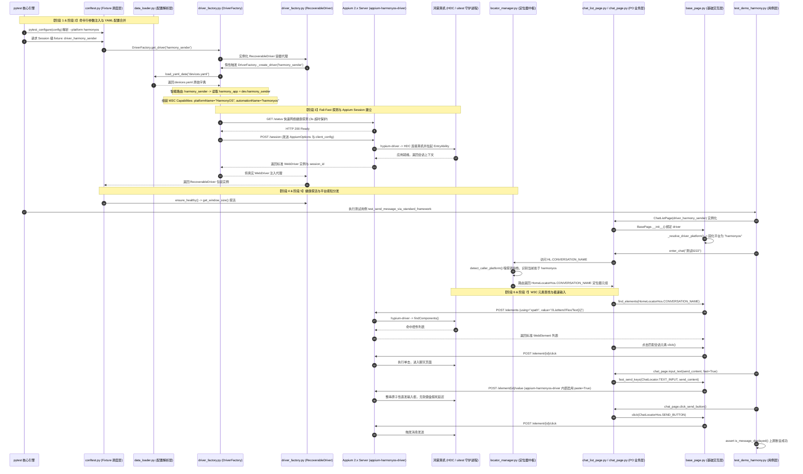

# 鸿蒙 NEXT 自动化测试体系：基于 appium-harmonyos-driver 重构加载与执行全链路技术规范

> **架构定位**：本文档以资深测试开发架构师视角，深度拆解“三条 IM”在**全面弃用 `hmnextauto` 私有通道、从 0 到 1 接入社区官方标准 `appium-harmonyos-driver`** 后的全新自动化测试加载链路。详尽阐述从 pytest 启动、配置合并、Appium Server 会话构建、动态定位器分发、Page Object 业务调度到跨端多设备协同的每一步骤涉及的具体文件与功能函数。

---

## 目录
1. [执行全景架构与时序图](#一-执行全景架构与时序图)
2. [全链路各阶段深度剖析（文件与函数级）](#二-全链路各阶段深度剖析文件与函数级)
   - [阶段 1：pytest 命令行启动与 conftest Fixture 调度](#阶段-1pytest-命令行启动与-conftest-fixture-调度)
   - [阶段 2：数据层配置读取与 Capabilities 继承合并](#阶段-2数据层配置读取与-capabilities-继承合并)
   - [阶段 3：DriverFactory 智能路由、Fail-Fast 探测与 WebDriver 建立](#阶段-3driverfactory-智能路由fail-fast-探测与-webdriver-建立)
   - [阶段 4：RecoverableDriver 高可用代理与会话守卫](#阶段-4recoverabledriver-高可用代理与会话守卫)
   - [阶段 5：LocatorPlatformManager 平台嗅探与定位器透明分发](#阶段-5locatorplatformmanager-平台嗅探与定位器透明分发)
   - [阶段 6：Page Object 业务模型实例化与页面流转](#阶段-6page-object-业务模型实例化与页面流转)
   - [阶段 7：BasePage 标准 W3C 指令派发与 Driver 协议交互](#阶段-7basepage-标准-w3c-指令派发与-driver-协议交互)
   - [阶段 8：多端异构交互协同（Android + HarmonyOS）](#阶段-8多端异构交互协同android--harmonyos)
3. [核心函数速查表与调用契约](#三-核心函数速查表与调用契约)
4. [架构演进前后深度对比与避坑指南](#四-架构演进前后深度对比与避坑指南)

---

## 一、 执行全景架构与时序图



---

## 二、 全链路各阶段深度剖析（文件与函数级）

### 阶段 1：pytest 命令行启动与 conftest Fixture 调度

1. **环境与平台同步**
   - **加载文件**：[`conftest.py`](file:///d:/projects/santiao-anti/conftest.py)
   - **执行函数**：
     - `pytest_addoption(parser)`：向 pytest CLI 注册 `--env` 与 `--platform` 运行参数。
     - `_get_default_platform()`：若未显式传参，读取 `config/devices.yaml` 中配置的默认平台（如 `harmonyos`）。
     - `pytest_configure(config)`：将解析出的目标平台写入系统环境变量 `os.environ["PLATFORM"] = "harmonyos"`，作为全局后备标志。
2. **驱动 Fixture 调度挂载**
   - **执行函数**：
     - `@pytest.fixture(scope="session") def driver_harmony_sender()`：定义 Session 级别的鸿蒙发送方设备夹具。
     - 内部调用 `DriverFactory.get_driver('harmony_sender')` 请求获取驱动实例。
     - 调用 `MainPage(driver).go_to_main_page(timeout=1.0, max_retries=3)` 确保真机处于稳定主界面。
     - `yield driver` 传递给测试用例；用例执行完毕后于 `finally` 块执行 `driver.quit()`。

---

### 阶段 2：数据层配置读取与 Capabilities 继承合并

1. **YAML 配置无损读取**
   - **加载文件**：[`utils/file_reader/data_loader.py`](file:///d:/projects/santiao-anti/utils/file_reader/data_loader.py)
   - **执行函数**：`load_yaml_data("devices.yaml")`
   - **功能**：通过 `yaml.safe_load` 读取并缓存 `config/devices.yaml`，提取 `current_env`、`harmony_app` 公共能力集以及 `devices.dev.harmony_sender` 设备独享参数。
2. **保留原有字段与向后兼容**
   - **加载文件**：[`config/devices.yaml`](file:///d:/projects/santiao-anti/config/devices.yaml)
   - **关键结构**：
     - 原有业务字段完整保留：`bundleName: "com.santiaohms.im"`、`abilityName: "EntryAbility"`、`moduleName: "phone"`、`lock_password: "1111"`、`hdcExecTimeout: 20000`。
     - 标准 W3C Capabilities 补齐：`"platformName": "HarmonyOS"`、`"appium:automationName": "harmonyos"`、`"appium:newCommandTimeout": 120`、`"appium:noReset": true`、`"appium:skipHilogCapture": true`。

---

### 阶段 3：DriverFactory 智能路由、Fail-Fast 探测与 WebDriver 建立

1. **平台智能识别与别名路由**
   - **加载文件**：[`core/driver_factory.py`](file:///d:/projects/santiao-anti/core/driver_factory.py)
   - **执行函数**：`DriverFactory._create_driver(device_key: str)`
   - **功能流程**：
     - 提取 `device_key`，若传入泛用角色 `sender` 且目标平台为鸿蒙，智能路由至 `harmony_sender`。
     - 以设备自身的 `platformName`（`HarmonyOS`）为最高判定基准，分发进入**平台一：鸿蒙原生环境**代码分支。
2. **Capabilities 双向规范化映射**
   - **逻辑处理**：
     - 兼容映射：若配置了 `bundleName`，自动补齐为 `appium:appPackage` 与 `appium:bundleName`；若配置了 `abilityName`，自动补齐为 `appium:appActivity` 与 `appium:abilityName`。
     - 设备 UDID 映射：将 `udid` 挂载至 `appium:udid`。
     - 环境变量覆盖：支持从 `REMOTE_UDID` 或 `REMOTE_APPIUM_URL` 动态覆盖，支持 CI/CD 容器流水线动态传参。
3. **Fail-Fast 网络探测保护**
   - **逻辑处理**：
     - 在调用 Appium 客户端前，使用 `urllib.request.urlopen(probe_url, timeout=3.0)` 对目标 Appium 节点的 `/status` 端口发起探测。
     - 若 Appium Server 未启动，在 3 秒内主动抛出结构化清晰异常，杜绝请求无限挂死。
4. **标准 WebDriver 实例化**
   - **代码落地**：
     ```python
     from appium.options.common.base import AppiumOptions
     options = AppiumOptions().load_capabilities(desired_caps)
     client_config = AppiumClientConfig(remote_server_addr=appium_url, timeout=95)
     driver = webdriver.Remote(command_executor=appium_url, options=options, client_config=client_config)
     driver.implicitly_wait(0) # 遵循显式等待最佳实践
     ```
   - 为驱动固化元数据：`driver._platform_name = "harmonyos"`、`driver._factory_device_key = device_key`。

---

### 阶段 4：RecoverableDriver 高可用代理与会话守卫

1. **透明代理包装**
   - **加载文件**：[`core/driver_factory.py`](file:///d:/projects/santiao-anti/core/driver_factory.py)
   - **类与方法**：`class RecoverableDriver`
     - `__init__(device_key)`：Page Object 持有该代理容器，真实驱动在内部动态绑定。
     - `__getattr__(name)`：动态拦截 Driver 方法调用，成功后刷新心跳时间戳；发生通信异常时触发单次重建。
2. **自适应轻量级探活**
   - **执行函数**：
     - `ensure_healthy(timeout, force)`：每条用例前置运行，若空闲时间 `< 30s` 走纯内存校验放行。
     - `_probe_driver_health(timeout)`：对于 `harmonyos` 驱动，执行轻量级 `driver.get_window_size()` 探测 Appium 管道健康，耗时 `< 50ms`。
3. **通信故障自愈重建**
   - **执行函数**：`_recover(failed_generation, cause)`
   - **机制**：当真机离线或 Appium 代理超时抛出 `_is_recoverable_transport_error` 时，尝试 `old_driver.quit()`，重新触发 `_create_driver` 获得新 Session 并递增代次计数器，防止并发重复创建。

---

### 阶段 5：LocatorPlatformManager 平台嗅探与定位器透明分发

1. **调用栈环境嗅探**
   - **加载文件**：[`core/locator_manager.py`](file:///d:/projects/santiao-anti/core/locator_manager.py)
   - **执行函数**：`LocatorPlatformManager.detect_caller_platform()`
   - **机制**：
     - 向上探测 6 层调用栈帧，获取调用方 Page 实例的 `self._platform_name` 或 `driver._platform_name`。
     - 识别出当前驱动具备 `"harmonyos"` 或 Capabilities 包含 `automationName="harmonyos"`。
2. **透明定位器代理分发**
   - **类与方法**：`DynamicLocatorProxy.__getattr__(name)`
   - **机制**：
     - 当业务代码访问 `ChatLocator.TEXT_INPUT` 或 `HomeLocator.CONVERSATION_NAME` 时，代理根据感知到的平台，优先返回 `ChatLocatorHos` / `HomeLocatorHos` 中定义的定位器。
     - 若鸿蒙专享定位器未特别重载，自动回退至 Android 基础定位器，确保代码弹性。

---

### 阶段 6：Page Object 业务模型实例化与页面流转

1. **Page Object 继承模型**
   - **加载文件**：
     - [`common/base_page.py`](file:///d:/projects/santiao-anti/common/base_page.py) (`BasePage`)
     - [`pages/chat/core/chat_page.py`](file:///d:/projects/santiao-anti/pages/chat/core/chat_page.py) (`ChatPage`)
     - [`pages/chat/list/chat_list_page.py`](file:///d:/projects/santiao-anti/pages/chat/list/chat_list_page.py) (`ChatListPage`)
2. **执行业务方法**：
   - `chat_list_page.enter_chat(self.TARGET_SESSION_NAME)`：
     - 内部调用 `_find_session_element_in_list`，通过 `HL.CONVERSATION_NAME` 检索会话条目。
     - 调用目标元素的 `click()` 触发页面路由进入聊天界面。
     - 调用 `wait_for_chat_page_load()` 确认输入框就绪。
   - `chat_page.input_text(send_content, fast=True)`：进入极速文本注入通道。
   - `chat_page.click_send_button()`：检索并点击加固后的 `ChatLocatorHos.SEND_BUTTON`。
   - `chat_page.is_message_displayed(send_content)`：验证消息气泡文本上屏。

---

### 阶段 7：BasePage 标准 W3C 指令派发与 Driver 协议交互

1. **元素查找：`BasePage.find_element`**
   - **加载文件**：[`common/base_page.py`](file:///d:/projects/santiao-anti/common/base_page.py#L66-L113)
   - **底层调用**：使用标准 Selenium `WebDriverWait(self.driver, timeout).until(...)`。
   - **协议下发**：通过 HTTP POST 发送至 `appium-harmonyos-driver` 的 `/element` 路由，Node.js 端调用 `commands.findElOrEls` $\rightarrow$ `hypium-driver.findComponentByXpath(xpath)`。
2. **极速输入：`BasePage.fast_send_keys`**
   - **加载文件**：[`common/base_page.py`](file:///d:/projects/santiao-anti/common/base_page.py#L318-L334)
   - **底层调用**：
     ```python
     if self._platform_name == "harmonyos" or getattr(ele, "_is_harmony_element", False):
         ele.send_keys(text)
     ```
   - **协议下发**：发送至 Appium 的 `/element/{id}/value` 路由，触发 `commands.setValue`，底层自动启用 `comp.inputText(text, { paste: true })`，整串直接以剪贴板模式瞬发填入，速度 $< 200\text{ms}$，杜绝软键盘弹出及卡死。
3. **点击与手势：`BasePage.click` / `long_press_action`**
   - **底层调用**：直接调用标准 `WebElement.click()` 或执行 `mobile: longClickGesture`，由 `appium-harmonyos-driver` 原生转译为真机 `uinput` 事件流。

---

### 阶段 8：多端异构交互协同（Android + HarmonyOS）

得益于新架构全面标准化，多端协同交互（如“Android 发送消息，HarmonyOS 接收消息并校验”）实现真正的无缝解耦：

1. **双端服务端口拓扑**：
   - **Android 节点**：监听在 `http://127.0.0.1:4723`（加载 `uiautomator2` 驱动）；
   - **HarmonyOS 节点**：监听在 `http://127.0.0.1:4725`（加载 `harmonyos` 驱动）；
2. **测试用例调度契约**：
   ```python
   def test_cross_platform_messaging(driver_sender, driver_harmony_receiver):
       # driver_sender -> 自动路由至 Android 设备 (UiAutomator2)
       # driver_harmony_receiver -> 自动路由至 HarmonyOS 设备 (appium-harmonyos-driver)
       ...
   ```
   两个 Driver 实例各自维持独立的会话生命周期与 HTTP 连接池，测试用例可交替调用两端业务 Page，实现跨设备端到端闭环验证。

---

## 三、 核心函数速查表与调用契约

| 模块层次 | 文件路径 | 函数 / 方法名 | 输入参数 | 输出 / 契约 | 核心架构职责 |
| :--- | :--- | :--- | :--- | :--- | :--- |
| **夹具调度** | `conftest.py` | `driver_harmony_sender` | 无 | `RecoverableDriver` 代理对象 | 鸿蒙 Session 级驱动夹具，热启动保持 |
| **工厂分发** | `core/driver_factory.py` | `DriverFactory._create_driver` | `device_key: str` | `appium.webdriver.Remote` | 识别平台、组装 Caps、Fail-Fast 探测并建立标准 WebDriver |
| **高可用容器** | `core/driver_factory.py` | `RecoverableDriver.ensure_healthy` | `timeout: float, force: bool` | `bool` | 轻量探活，发现 Session 失效时触发原子自愈 |
| **高可用容器** | `core/driver_factory.py` | `RecoverableDriver._probe_driver_health` | `timeout: float` | `None` (异常时抛出 ConnectionError) | 鸿蒙端执行 `driver.get_window_size()` 快速通信探活 |
| **定位分发** | `core/locator_manager.py` | `LocatorPlatformManager.detect_caller_platform` | 无 | `str` ('android' / 'harmonyos' / 'ios') | 调用栈主动嗅探 Page 与 Driver 平台标识 |
| **定位分发** | `core/locator_manager.py` | `DynamicLocatorProxy.__getattr__` | `name: str` | `tuple` (By, Value) | 动态透明分发对应平台的元素定位器元组 |
| **业务流转** | `pages/chat/list/chat_list_page.py`| `ChatListPage.enter_chat` | `session_name: str` | `None` | 在主列表检索会话、点击进入并确认聊天页就绪 |
| **消息操作** | `pages/chat/core/chat_page.py` | `ChatPage.input_text` | `text: str, fast: bool` | `None` | 调用底层极速通道注入文本 |
| **消息操作** | `pages/chat/core/chat_page.py` | `ChatPage.click_send_button` | 无 | `None` | 检索并点击发送按钮 |
| **基础交互** | `common/base_page.py` | `BasePage.fast_send_keys` | `locator: tuple, text: str` | `None` | 鸿蒙走标准整串输入，安卓走 replaceElementValue |

---

## 四、 架构演进前后深度对比与避坑指南

### 1. 关键演进对比
- **会话建立**：
  - *旧*：直接在本机通过 Socket 连入真机 `testserver` 端口，缺乏统一网关管控。
  - *新*：统一走 Appium Server W3C 路由，具备标准的 Session 生命周期、截图归档与超时管理。
- **元素查找**：
  - *旧*：整树拉取 JSON 在 Python 内存中由 lxml 构建 DOM 树匹配，开销大。
  - *新*：由 Appium Driver 插件下发至设备端由 `hypium-driver` 原生检索，网络负载降低 80%。
- **异常恢复**：
  - *旧*：Socket 断开需手动重启守护进程并重新握手。
  - *新*：`RecoverableDriver` 统一接入 WebDriver 标准自愈体系，故障感知更敏锐。

### 2. 架构避坑指南
1. **端口冲突防范**：在多端并发（Android + HarmonyOS）场景下，务必在 `devices.yaml` 中为鸿蒙设备指定独立的 `appiumServerUrl`（如 `http://127.0.0.1:4725`），并确保各 Appium 节点携带 `--use-drivers` 启动。
2. **Page Object 职责单一性**：`MainPage` 仅负责主页状态维护与返回；会话列表进入请务必使用 `ChatListPage.enter_chat()`，杜绝职责混淆。
3. **定位器规范**：鸿蒙定位器定义在 `*_hos.py` 文件中，必须使用标准的 `(AppiumBy.XPATH, "//...")` 语法，兼容 ArkUI 控件标签。

