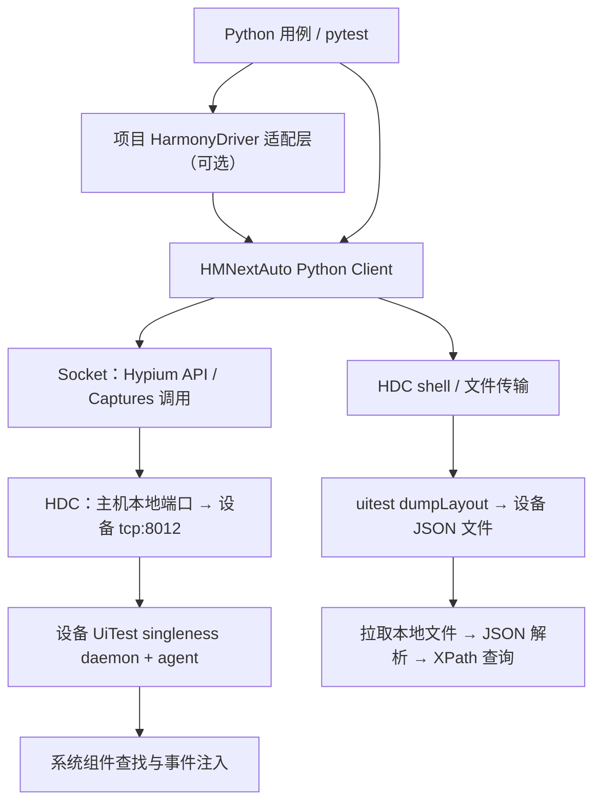

# HMNextAuto 鸿蒙自动化测试框架使用指南与完整 API 参考

> 核对日期：2026-10-20
>
> 源码核对基线：本机 Python 3.13 环境中的 `hmnextauto 1.7.0`。
>
> 框架定位：基于 HDC、设备端 UiTest 与 agent 的 HarmonyOS NEXT UI 自动化 Python 框架。API 风格参考 uiautomator2，具体参数、返回类型、等待和异常行为以实际源码为准。

本文保留设备操作、元素定位、XPath、视觉定位、性能采集和 Watcher 等功能分类，补充环境准备、项目适配层、完整流程及故障诊断。本文是源码核对后的使用说明，示例未在真机执行，不代表已经验证全部设备或系统版本。

第十三章按本机源码逐项列出完整签名、参数、返回值、异常边界和用法；第十四章列出数据结构、枚举和异常；第十五章记录接口覆盖数量及源码快照。其“完整”范围是本次快照中明确列举的公开命名接口与对象协议，不延伸为未来版本兼容承诺。

除第十章的完整函数外，各代码块均为局部示例：`d` 表示已创建且由当前测试拥有的原生 `Driver`；示例包名、Ability、控件 ID、文本和路径需要替换成被测应用中的实际值。不要连续执行所有示例，其中包含停止应用、清除数据、安装卸载、旋转屏幕等有副作用操作。

## 目录

1. [零、版本基线与环境准备](#environment)
2. [一、系统架构与通信原理](#architecture)
3. [二、Driver 核心 API](#driver-api)
4. [三、UiObject 元素定位、操作与等待](#uiobject)
5. [四、XPath 定位](#xpath)
6. [五、视觉匹配、截图与 OCR](#vision)
7. [六、性能指标与录屏](#performance)
8. [七、Watcher、Toast 与通知栏](#watchers)
9. [八、核心 API 速查](#api-matrix)
10. [九、项目 HarmonyDriver 适配层](#project-adapter)
11. [十、连接、验证与清理的完整示例](#complete-example)
12. [十一、异常、超时与故障诊断](#troubleshooting)
13. [十二、源码与文档依据](#references)
14. [十三、完整 API 参考](#full-api)
15. [十四、数据结构、枚举与异常](#data-models)
16. [十五、接口覆盖与源码快照](#coverage-manifest)

<a id="environment"></a>

## 零、版本基线与环境准备

### 1. 版本说明

| 项目 | 本文依据 | 使用要求 |
| :--- | :--- | :--- |
| HMNextAuto | 本机发行元数据为 `1.7.0` | 升级或修改依赖源码后，重新核对 API；发行版本号不能代替源码修订标识 |
| Python | 本机源码在 Python 3.13 环境中读取 | 项目兼容基线为 3.11+，目标环境为 3.13+ |
| 框架 Python 声明 | 发行元数据为 `>=3.8,<4.0` | 声明范围不等于每一版本、依赖组合均已通过本项目验证 |
| HarmonyOS | 上游声明 HarmonyOS NEXT API 12+ | 按实际系统构建号、API 级别、设备和 agent 组合验收，不能仅写“6.0+ 专用” |
| HDC | 本机已配置的 HarmonyOS SDK 工具链 | 确认实际可执行文件路径，避免多个 SDK 的工具混用 |
| 基础依赖 | 本机包元数据列出 `lxml`、`opencv-python-headless` | 依照项目依赖策略维护，不为阅读本文自动升级 |
| OCR | 实现依赖 EasyOCR 及模型 | 上游提供 `ocr` extra 指引，但仍需核查实际安装的 EasyOCR、推理依赖和模型 |

本次未形成真机兼容矩阵。测试执行记录至少保存：设备 serial、型号、系统完整版本、API 级别、HDC 版本、Python 版本、HMNextAuto 版本或源码修订、agent 文件标识、应用版本。

### 2. 环境检查与安装指引

以下是供操作者按需执行的命令；读取发行元数据不会连接设备：

```powershell
Get-Command python, hdc | Select-Object Name, Source
python --version
python -c "from importlib.metadata import version; print(version('hmnextauto'))"
hdc -v
hdc list targets
```

如果环境尚未安装框架，先选择项目的目标 Python 环境，再按项目依赖管理规则安装明确版本。本文核对版本的安装命令是：

```powershell
python -m pip install "hmnextauto==1.7.0"
```

以上为文档指引，不表示本次已执行安装。OCR 初始化可能下载模型并在用户目录创建缓存；离线环境应先准备模型并确认推理依赖兼容。不能只凭 extra 名称判断 OCR 已可用。

设备侧需要开启开发者选项和 USB 调试并完成主机授权。多设备时，所有测试和诊断命令明确指定目标 serial。Wi-Fi 或远程 HDC 的网络和认证条件应单独确认。

<a id="architecture"></a>

## 一、系统架构与通信原理



- 原生组件操作通过 Socket 发送 JSON 格式的调用消息，模块名为 `com.ohos.devicetest.hypiumApiHelper`。该协议不是 WebDriver/Appium HTTP Session，也不应直接假定符合标准 JSON-RPC 2.0。
- 当前设备端服务端口为 `8012`；主机端口由 HDC 转发创建，本机实现从可用端口范围中选择，不能把 `8012` 当成所有主机连接共用的端口。
- `dump_hierarchy()` 实际调用 HDC 的 `uitest dumpLayout`，生成设备端文件、拉取并解析 JSON。它不是纯内存树读取，也没有固定“毫秒级”耗时保证。
- 获取到的是当次导出的系统 UI 结构，不等于应用完整业务数据。懒加载列表、虚拟化节点、Canvas、WebView 或特殊组件的可访问范围需实测。
- 新建连接的初始化流程可能部署或更新 `/data/local/tmp/agent.so`，终止已存在的 `uitest start-daemon singleness` 进程并重启服务。`Driver(...)` 本身包含设备状态变更，不能作为纯只读环境探测。

延迟与设备负载、UI 树大小、命令传输、RPC、截图和框架固定等待有关。本机 `utils.delay` 在被装饰的操作成功后固定等待约 0.6 秒，不能描述为“无延迟”。

<a id="driver-api"></a>

## 二、Driver 核心 API

### 1. 初始化、连接复用与关闭

```python
from hmnextauto.driver import Driver

# 使用 hdc list targets 中的实际 serial，避免多设备时选错目标。
d = Driver(serial="YOUR_DEVICE_SERIAL")
try:
    print(d.device_info.model)
finally:
    d.close()
```

`Driver()` 未指定 serial 时选择设备列表中的第一个设备；没有设备时抛出 `DeviceNotFoundError`，指定的 serial 不在线时同样报错。

同一进程内，Driver 按 serial 复用实例。重复调用 `Driver(serial=...)` 不意味着创建独立会话；一个调用方关闭它会影响持有同一实例的其他调用方。测试 fixture 或设备管理层必须明确连接的所有者。

| API | 实际用途与返回值 |
| :--- | :--- |
| `d.close() -> None` | 释放当前连接和本地端口映射，并移除该 serial 的实例登记；应显式调用 |
| `d.implicitly_wait(seconds: float \| None = None) -> float` | 读取或设置默认等待配置；无参数读取当前值 |
| `d.settings` | 客户端配置对象，可读取 `wait_timeout` 等配置；具体设置是否被某个操作使用，应核对调用实现 |
| `d.dump_hierarchy() -> dict` | 导出并解析当次 UI 树；解析失败可能返回空字典 |
| `d.device_info` | `DeviceInfo` 数据类，通过属性访问字段 |

默认 `wait_timeout` 为 20.0 秒。`implicitly_wait()` 影响使用该配置的等待方法，不是 Selenium 式“所有元素操作自动等待”；`click()`、`exists()` 等各有查找或重试逻辑。

### 2. 屏幕、电源与缓存

| API | 行为 |
| :--- | :--- |
| `d.screen_on()` | 请求唤醒屏幕 |
| `d.screen_off()` | 当前实现先唤醒再派发电源键；最终状态应另行确认 |
| `d.unlock()` | 唤醒并执行向上滑动；不输入 PIN、密码或生物凭据，也不保证锁屏已解除 |
| `d.display_size` | 返回 `(width, height)` |
| `d.display_rotation` | 返回 `DisplayRotation` 枚举 |
| `d.set_display_rotation(rotation)` | 参数为 `DisplayRotation` 枚举，不直接传角度整数 |
| `d.is_screen_on` | 布尔属性，但当前使用缓存 |
| `d.screen_brightness` | 整数属性，当前使用缓存 |

```python
from hmnextauto.proto import DisplayRotation

d.set_display_rotation(DisplayRotation.ROTATION_90)
```

枚举含 `ROTATION_0/90/180/270`，其 `.value` 分别是 `0/1/2/3`，不是 `0/90/180/270`。

本机下列属性使用 `cached_property`：

```text
device_info、display_size、display_rotation、refresh_rate
is_screen_on、screen_brightness、network_type
battery_level、battery_status
```

首次访问后可能返回旧值；当前设置旋转或唤醒方法没有统一刷新这些缓存。方向、分辨率或电源变化后，不能直接将上述属性作为实时状态依据。

确需实时读取且接受依赖底层 HDC 接口时，可以采用：

```python
# 此处是 HdcWrapper 的实时查询，返回状态字符串。
screen_state = d.hdc.screen_state()
battery = d.hdc.battery_info()
```

`d.hdc` 是较底层的实现入口，项目如需依赖它，应由适配层集中封装并随版本核对。不建议在业务用例中散落对 `__dict__` 或私有缓存方法的修改。

### 3. 应用生命周期与元数据

| API | 说明 |
| :--- | :--- |
| `start_app(package_name, page_name=None)` | 启动应用；`page_name` 表示 Ability 名，不代表任意业务路由 |
| `force_start_app(package_name, page_name=None)` | 回桌面、停止应用、重新启动；不会清空应用数据 |
| `stop_app(package_name)` | 停止目标应用 |
| `clear_app(package_name)` | 清除缓存和应用数据，会破坏登录态及本地数据 |
| `install_app(apk_path)` | 当前形参保留 `apk_path` 名称，实际用于传入鸿蒙 HAP 路径；关键字调用应以源码为准 |
| `uninstall_app(package_name)` | 卸载目标应用 |
| `has_app(package_name) -> bool` | 检查安装状态 |
| `list_apps(include_system_apps=False) -> list` | 获取安装包名列表 |
| `current_app()` | 返回包名、Ability 的二元组；未找到时可能是 `(None, None)` |
| `get_app_info(package_name) -> dict` | 解析安装元数据；失败可能返回空字典 |
| `get_app_abilities(package_name) -> list[dict]` | 枚举解析到的 Ability 信息 |
| `get_app_main_ability(package_name) -> dict` | 选择主入口信息，未找到可能为空字典 |
| `app_version(bundle_name) -> dict` | 读取应用版本信息 |

安装包签名、设备授权、模块和 Ability 配置应与被测构建一致。启动命令执行完成后，仍需等待并断言目标页面的可观察状态。

按展示名定位应用时：

```python
bundle_name = d.find_package_by_display_name(
    "三条",
    match="exact",
    include_bundle_name=False,
    on_ambiguous="error",
)
d.start_app(bundle_name, "EntryAbility")
```

`find_package_by_display_name()`、`start_app_by_name()` 默认是 `match="contains"`，不是精准匹配。没有匹配时抛出 `AppNameNotFoundError`，多个匹配默认抛出 `AppNameAmbiguousError`。名称解析可能遍历安装包并查询元数据；测试主流程优先使用配置中已确认的 bundle name。

### 4. 坐标触控与手势

| API | 说明 |
| :--- | :--- |
| `click(x, y)`、`double_click(x, y)`、`long_click(x, y)` | 点击、双击、长按；支持像素及比例坐标 |
| `swipe(x1, y1, x2, y2, speed=2000)` | 起终点滑动，`speed` 为像素/秒 |
| `swipe_ext(direction, scale=0.8)` | 使用 `up/down/left/right` 或方向枚举；还可限定滑动区域 |
| `d.gesture` | 使用 `start().move().pause().action()` 组织轨迹；不据此推断支持任意多指编排 |

```python
d.click(500, 1000)       # 像素坐标
d.click(0.5, 0.4)        # 宽度 50%、高度 40%
d.swipe(0.5, 0.8, 0.5, 0.4, speed=2000)
d.swipe_ext("up", scale=0.8)
```

当前转换对每个小于 1 的非负坐标执行比例换算，`1` 或 `1.0` 表示 1 像素，不是屏幕的 100%。比例坐标必须结合当前方向、截图范围和实际显示尺寸确认。

### 5. 系统按键与文本输入

```python
from hmnextauto.proto import KeyCode

d.press_back()                  # 对应 go_back()，BACK = 2
d.press_home()                  # 对应 go_home()，HOME = 1
d.press_key(KeyCode.ENTER)       # ENTER = 2054
```

常用方法还有 `press_power()`、`press_enter()`、`press_backspace()`、`press_delete()`、`press_multitask()`、`press_menu()`、`page_up()`、`page_down()`、`volume_up()`、`volume_down()`、`volume_mute()` 和各方向键方法。

`d.input_text(text)` 面向当前焦点输入位置；应先定位并聚焦输入框。不要把 Android 的 KeyCode 数值直接迁移到鸿蒙，优先使用本框架 `KeyCode` 枚举。

### 6. 文件传输、Shell 与 URL

| API | 说明 |
| :--- | :--- |
| `push_file(lpath, rpath)` | 本地主机文件发送到设备 |
| `pull_file(rpath, lpath)` | 设备文件拉取到主机 |
| `shell(cmd) -> CommandResult` | 返回 `output`、`error`、`exit_code` |
| `open_url(url, system_browser=True)` | 按 URL/URI 唤起应用；结果依赖系统路由 |

```python
result = d.shell("param get const.ohos.apiversion")
if result.exit_code != 0:
    raise RuntimeError(f"HDC 查询失败：{result.error or result.output}")
api_version = result.output.strip()
```

`CommandResult` 没有 `stdout/stderr` 字段。退出码为零也不代替业务成功判断；动态命令内容需要校验和正确转义，不能把任意外部文本拼接到 Shell。文件路径需考虑设备目录权限、本地父目录和重名覆盖问题。

<a id="uiobject"></a>

## 三、UiObject 元素定位、操作与等待

### 1. 选择器与索引

```python
d(id="login_btn")
d(key="custom_key")
d(text="三条")
d(type="Button")
d(description="更多选项")

d(type="Button", text="发送", clickable=True, enabled=True)
d(type="ListItem", index=0)
d(textContains="登录")
d(textMatches=r"^\d+条$")
d(resourceIdContains="entry", type="Button")
```

- 构造选择器不代表已经找到元素；访问属性或执行操作时才发生相应查询。
- 状态选择器使用 `clickable/enabled/scrollable/checked/selected` 等名称；元素状态读取使用 `isClickable/isEnabled` 等属性。两者名称不能混用。
- 原生 `UiObject` 当前没有 `__getitem__`，不能使用 `d(...)[0]`、切片或 `[last]`。索引使用 `index=0`；集合首末项可通过 XPath 的 `first()/last()` 获取。
- `id` 与 `resourceId`、`type` 与 `className` 是对应的替代入口，不在同一选择器中重复提供。
- `id/key` 不保证全屏唯一；列表中重复的控件需要结合业务标识和层级限定。

### 2. 返回类型与状态属性

| 表达式 | 实际类型 | 用法 |
| :--- | :--- | :--- |
| `elem.bounds` | `Bounds` | `.left/.top/.right/.bottom` |
| `elem.boundsCenter` | `Point` | `.x/.y`，或 `.to_tuple()` |
| `elem.info` | `ElementInfo` | `.text/.isEnabled`，或 `.to_dict()` |
| `elem.text` | `str` | 调用原生组件文本读取；没有项目适配层的 `originalText` 兜底逻辑 |
| `elem.type` | `str` | 组件类型 |
| `elem.id`、`elem.key`、`elem.description` | `str` | 标识和描述 |
| `elem.count` | `int` | 当次匹配数量 |
| `elem.isClickable/isEnabled/isFocused` | `bool` | 点击、启用、焦点状态 |
| `elem.isScrollable/isChecked/isSelected` | `bool` | 滚动、勾选、选中状态 |
| `elem.isCheckable/isLongClickable` | `bool` | 可勾选、可长按属性 |

```python
from hmnextauto.proto import Bounds, ElementInfo, Point

button = d(id="login_btn")
info: ElementInfo = button.info
bounds: Bounds = info.bounds
center: Point = info.boundsCenter

print(info.text, info.isEnabled)
print(bounds.left, bounds.top, center.to_tuple())
print(info.to_dict())
```

`info` 会读取多项组件属性，不保证它们来自同一原子快照；动态页面中节点失效或频繁变化时，要重新定位。原生组件句柄在页面变化后也可能失效，不应长期缓存。

### 3. 元素操作与异常

| API | 行为 |
| :--- | :--- |
| `elem.click()`、`double_click()`、`long_click()` | 调用原生 Component 操作；与项目适配层基于中心坐标的实现不同 |
| `elem.click_if_exists()` | 只忽略 `ElementNotFoundError`；不存在时返回 `None`，没有稳定的布尔成功契约 |
| `elem.input_text(text)` | 调用 `Component.inputText`，不要套用 XPath 先坐标点击再输入的实现描述 |
| `elem.clear_text()` | 调用组件清空文本 |
| `elem.drag_to(component)` | 目标参数为 `ComponentData`，可通过目标的 `find_component()` 获取 |
| `elem.pinch_in(scale=0.5)`、`pinch_out(scale=2.0)` | 组件捏合/放大；支持情况以设备为准 |

`click_if_exists()` 仍可能传播 HDC、RPC、组件销毁等异常。不要使用 `if elem.click_if_exists():` 判断业务操作成功。

拖拽示例：

```python
target = d(type="ListItem", index=1).find_component()
if target is None:
    raise LookupError("拖拽目标不存在")
d(type="ListItem", index=0).drag_to(target)
```

动作完成后应断言可观察业务结果；例如发送消息后验证消息内容和发送状态，跨端用例还应验证接收端结果。通信中断导致结果未知时，不能直接重放发送、删除、支付等动作。

### 4. 列表滚动

```python
contacts = d(id="contacts_list", scrollable=True)
if not contacts.scroll.to(text="目标联系人", max_swipes=10):
    raise LookupError("限定滚动次数内未找到目标联系人")

# 目标选择器应足以区分列表内外的同名元素。
d(text="目标联系人").click()
```

`scroll.to()` 位于 `UiScroll` 上；当前不存在 `scroll.vert.to()` 或 `scroll.horiz.to()`。搜索可能检查全局目标选择器，不能假设天然只在容器后代中查找。

方向操作和边界滚动：

```python
contacts.scroll.vert.forward()
contacts.scroll.vert.backward()
contacts.scroll.vert.fling()
contacts.scroll.toBeginning(max_strokes=8)
contacts.scroll.toEnd(max_strokes=8)

d(id="tab_scroll").scroll.horiz.forward()
d(id="tab_scroll").scroll.horiz.backward()
```

`toBeginning()/toEnd()` 在原生滚动 API 不可用时会退回有限次坐标滑动；返回 `True` 不保证已到达业务列表的绝对首尾。懒加载列表需另行验证目标或边界标记。

水平搜索可用有次数上限的循环，容器和目标应替换成页面实际定位：

```python
from hmnextauto.driver import Driver


def find_horizontal_tab(
    d: Driver,
    container_id: str,
    target_text: str,
    max_swipes: int = 5,
) -> bool:
    """最多滑动指定次数，检查当前页面唯一的目标页签。"""
    if max_swipes < 0:
        raise ValueError("max_swipes 不能小于 0")

    for attempt in range(max_swipes + 1):
        if d(text=target_text).exists(retries=1, wait_time=0):
            return True
        if attempt == max_swipes:
            return False
        if not d(id=container_id).scroll.horiz.forward():
            return False
    return False
```

次数上限不等于严格总耗时上限；每次原生查询、滚动和 RPC 仍会耗时。方向和异步加载条件应按页面调整。

### 5. 显式等待与真实超时

| API | 本机签名/语义 |
| :--- | :--- |
| `exists(retries=2, wait_time=1) -> bool` | 有限次查询是否匹配组件；不是“可见且未遮挡”的完整判断 |
| `wait(timeout=None) -> bool` | 等待匹配组件出现 |
| `wait_gone(timeout=None) -> bool` | 等待不再匹配；开始时不存在也可成功 |
| `wait_enabled(timeout=None) -> bool` | 等待组件启用 |
| `wait_disabled(timeout=None) -> bool` | 等待组件禁用；与“不存在”不同 |
| `wait_clickable(timeout=None) -> bool` | 等待可点击属性为真，不验证业务完成 |
| `wait_until(condition, timeout=None) -> bool` | 回调接收 `ElementInfo` |
| `wait_until_not(condition, timeout=None) -> bool` | 等待条件为假；本机实现对元素缺失或部分回调异常也可能返回真 |

`timeout=None` 读取 `d.settings["wait_timeout"]`，默认为 20 秒。显式传入 `timeout=5.0` 才是本次等待使用 5 秒。

```python
button = d(id="login_btn")
if not button.wait_enabled(timeout=5.0):
    raise TimeoutError("登录按钮未在预期时间内启用")
button.click()

status = d(id="login_status")
if not status.wait_until(
    lambda info: info.text == "登录成功",
    timeout=10.0,
):
    raise AssertionError("未观察到登录成功状态")
```

当前 `wait_until()` 会捕获回调中的异常并继续轮询，回调拼写错误可能表现为超时。`wait_until_not()` 的真值也不能证明没有通信或回调错误；关键业务断言优先使用正向条件和独立最终校验。

外层等待先调用底层接口，再检查截止时间。本机 Socket 超时常量为 20 秒，而 HDC 子进程部分调用没有显式超时，因此 `wait(timeout=5)` 不保证整个调用严格在 5 秒内结束。业务等待、元素轮询、RPC 超时、HDC 进程超时应分别管理。

<a id="xpath"></a>

## 四、XPath 定位

XPath 查询使用导出 UI 树转换出的 XML 和 lxml。优先使用稳定属性，避免依赖会随布局变化的绝对路径或不稳定索引。

```python
button = d.xpath('//*[@id="login_btn"]')
if not button.wait(timeout=5.0):
    raise LookupError("未找到登录按钮")
button.click()

all_texts = d.xpath("//List//Text").all()
count = d.xpath("//ListItem").count
first = d.xpath("//ListItem").first()
last = d.xpath("//ListItem").last()
```

XPath 的位置从 1 开始；原生选择器的 `index` 从 0 开始：

```python
d(type="ListItem", index=0)
d.xpath("(//ListItem)[1]")
```

两种元素体系必须区分：

| 项目 | `d(...)` 原生 UiObject | `d.xpath(...)` |
| :--- | :--- | :--- |
| 数据来源 | 原生组件 API | 当次导出的 UI 树/XML |
| `info` | `ElementInfo` | 属性字典，布尔状态通常是字符串 |
| 自定义等待回调 | `lambda info: info.isEnabled` | `lambda attrs: attrs.get("enabled") == "true"` |
| 点击实现 | `Component.click` | 使用查询时的 bounds 转为坐标点击 |
| 存在性 | 查询组件匹配 | 单独 `exists()` 检查当前对象持有的 bounds，不自动重新导出树 |

保存 XPath 对象后页面变化，其 bounds 和属性可能陈旧。可重新调用 `d.xpath(path)` 或使用会重新查询的 `wait()` 更新；不要将旧对象的 `exists()` 当作实时探活。`all()` 返回的元素集合也具有快照性质，执行会改变列表的操作前应重新定位。

联合表达式 `A | B` 是节点集合合并，通常按文档顺序返回，不能当作“先找 A，找不到才用 B”的业务优先级。动态 XPath 文本还应处理引号转义。

<a id="vision"></a>

## 五、视觉匹配、截图与 OCR

### 1. 图像与颜色定位

当目标没有可靠可访问节点时，可采用视觉定位，并检查返回值：

```python
matched = d.click_image(
    "assets/send_icon.png",
    threshold=0.85,
    multi_scale=True,
    draw_box=False,
)
if not matched:
    raise LookupError("未匹配到发送图标")

matched_color = d.click_color(
    (30, 144, 255),
    tolerance=15,
    region=(100, 400, 600, 1200),
)
if not matched_color:
    raise LookupError("目标区域内未找到指定颜色")
```

模板要记录分辨率、主题、缩放和截图方式。阈值只是匹配阈值，不是业务正确率；单色在多个区域重复时容易误点。操作后仍需验证业务结果。

`return_result=True` 时图像/找色方法返回元组，不能直接对整个元组做真假判断：

```python
success, match_result = d.click_image(
    "assets/send_icon.png",
    return_result=True,
    draw_box=False,
)
if not success:
    raise LookupError(f"图像定位失败：{match_result}")
```

### 2. 截图与坐标映射

```python
from pathlib import Path

output = Path("reports/harmony")
output.mkdir(parents=True, exist_ok=True)

# 明确需要 PNG 时使用 screenCap；默认 snapshot_display 的内容格式另行确认。
screenshot_path = d.screenshot(
    str(output / "screen.png"),
    method="screenCap",
)
```

`screenshot(path, method="snapshot_display") -> str` 返回保存路径。它包含截图和文件传输，不是纯内存返回接口。若使用默认截图方式，不应只凭扩展名判断实际编码。

`click_from_screenshot(x, y, screenshot_path)` 根据图像尺寸与 `display_size` 换算坐标，返回 `Point`。它不会自动理解裁剪偏移、内容区域、横竖屏变化或旧截图对应的页面；这类情况需要业务侧明确处理。

### 3. OCR

```python
results = d.ocr.read()
position = d.ocr.find_text("立即更新")

if not d.ocr.click_text(
    "立即更新",
    exact=True,
    min_confidence=0.8,
    timeout=5.0,
):
    raise LookupError("OCR 未找到满足条件的目标文字")
```

`d.ocr` 是 OCR 对象，不能写成 `d.ocr(text="...").click()`。可用方法还包括 `find_all_text()`、`wait_text()`、`wait_text_gone()`。

首次初始化可能加载/下载模型，耗时与稳定运行时不同。应记录语言、推理设备、置信度和区域；同一文字多次出现时需要区域限制或二次确认。OCR 识别成功、坐标点击成功和业务成功是三个不同结果。

<a id="performance"></a>

## 六、性能指标与录屏

### 1. 指标口径

| API | 当前数据来源与含义 | 不能直接推断的结果 |
| :--- | :--- | :--- |
| `measure_cold_start(package, ability=None, timeout=10.0)` | 停止应用后计时 `aa start` 命令执行；返回 `success/duration_ms/package/ability` | 不等于首屏渲染完成、页面可交互或完整用户启动耗时 |
| `measure_hot_start(package, wait_time=2.0, timeout=5.0)` | 将应用置后台后计时启动命令 | 不等于业务恢复完成时间 |
| `app_start_time(package_name)` | 应用启动时的系统运行时间戳，可能为 `None` | 不是启动耗时 |
| `fps()` | 从 RenderService ScreenNode 帧时间戳计算 FPS | 不是屏幕刷新率，也不是明确归属于目标应用的独立帧率 |
| `refresh_rate` | 缓存的屏幕刷新率整数，单位 Hz | 不是可调用方法，也不能当实时 FPS |
| `frame_hitchs()` | ScreenNode 的 `over_16ms/over_33ms/over_66ms` 阈值计数 | 不是完整掉帧率、最大卡顿时长或稳定的每秒增量 |
| `cpu_usage()` | 解析 `hidumper --cpuusage` 返回的系统/进程数据 | 需核对字段、采样窗口、核心数与百分比口径 |
| `cpu_freq()` | CPU 频率相关原始解析结果 | 需按目标系统核对单位和缺失字段 |
| `memory_info(package_name=None)` | 指定包时查询 PID 并解析 `hidumper --mem PID`；无包时读取 `/proc/meminfo`，解析数值按 kB 口径 | 两种结果不能混为统一 PSS/RSS/Native Heap 结构 |
| `memory_percent()` | 系统内存使用百分比 | 不是目标应用内存百分比 |
| `thermal_info()` | 可解析的传感器温度，框架按摄氏度处理 | 字段和单位转换需与设备输出核对，不能保证所有传感器存在 |
| `battery_level`、`battery_status` | 缓存的属性，分别是电量值和充放电状态 | 不能加括号调用，也不能作为连续采样结果 |

当前启动测量实现虽然接收 `timeout`，但没有将其完整贯穿到 HDC 命令执行，不能把该参数当成可靠的命令总耗时上限。需要用户感知启动指标时，应定义“开始事件”和“业务就绪事件”，或使用目标系统的启动追踪能力。

`fps()` 时间戳不足时可能返回 0，卡顿计数解析不到时也可能保持 0；空字典和零值需要结合命令原始输出与日志判断，不能自动归为性能正常。建议保存原始值，并在采集层区分“有效样本、缺失、解析失败”。

### 2. 后台性能采集

```python
from pathlib import Path

perf_dir = Path("reports/harmony")
perf_dir.mkdir(parents=True, exist_ok=True)

monitor = d.performance_watcher.configure(
    metrics=["fps", "cpu", "memory", "hitches"],
    package="com.example.im",
    interval=1.0,
)
with monitor.start(str(perf_dir / "performance.jsonl")):
    # 此处替换为当前专项已授权的业务动作。
    d(id="performance_scene").click()
```

监控输出 JSON Lines，可使用其分析接口生成统计结果。采集间隔是调度配置，不保证实际每秒精确采到一次；HDC 命令、并行采集耗时、录屏与 UI 操作都会影响采样。

进程内存应指定目标包，记录进程是否存在、指标单位、样本数量及缺失率。框架的异常评分规则需要根据项目基线校准，不能直接代替验收门禁。性能报告和业务 Allure 报告的关联需要项目显式集成。

### 3. 录屏和资源限制

```python
from pathlib import Path

video_dir = Path("reports/harmony")
video_dir.mkdir(parents=True, exist_ok=True)

with d.screenrecord.start(str(video_dir / "case.mp4")):
    d(id="record_scene").click()
```

录屏上下文负责请求停止并释放相关资源，不会自动将视频附加到 pytest/Allure 报告。录屏线程的停止包含等待，不能保证在固定短时间内结束；性能采集和 Watcher 的 `stop(join_timeout=...)` 也不证明所有底层阻塞任务已经完全退出。

发生停止超时时，先保留原始测试失败和日志，再由设备管理层确认后台任务终止状态。不能在旧任务可能仍运行时直接重建连接继续操作同一设备。

<a id="watchers"></a>

## 七、Watcher、Toast 与通知栏

### 1. 后台 Watcher

```python
rule_name = "case_owned_skip_intro"
d.watcher(rule_name).when(id="intro_skip", text="跳过").click()
d.watcher.start(interval=1.0)

try:
    if not d(id="main_content").wait(timeout=5.0):
        raise AssertionError("主页面内容未在预期时间内出现")
finally:
    d.watcher.stop()
    d.watcher.remove(rule_name)
```

注册形式是 `d.watcher("规则名").when(**selector).click()`，也支持 `when_xpath()`、`press_back()`、`do(callback)`。

规则应限制到当前测试已批准处理的弹窗。权限、升级、安全确认等恰好是待测业务时，不启动会自动处理它们的规则。不要仅凭“确定”或“允许”等宽泛文本跨页面点击。

后台循环和主流程共用设备；Socket 请求锁只防止部分传输交叉，不保证一整段“查找后点击”是原子操作。轮询还会占用查询时间，`interval=1` 不代表绝对每秒执行一次。清理只移除当前测试拥有的规则，不随意 `clear()` 其他任务的规则。

### 2. Toast

```python
d.toast_watcher.start()
d(id="show_toast").click()
toast = d.toast_watcher.get_toast(timeout=3)

if toast != "操作成功":
    raise AssertionError(f"Toast 不符合预期：{toast!r}")
```

当前没有 `get_last_toast()`。应在触发事件前启动监听；`get_toast()` 无事件时可能返回 `None`。监听窗口、事件是否被消费以及后续是否需要重新注册，应结合实际设备和用例时序验证。

### 3. 通知栏

```python
try:
    notifications = d.notification.get_notifications()
finally:
    d.notification.close()
```

当前 `get_notifications()` 必要时会打开通知栏，并按 UI 节点解析；本机实现最多尝试读取前 10 个 ListItem。它不是系统全部通知历史查询，也不是推送服务端日志。

通知读取会改变当前页面。跨端推送测试还要明确应用前后台状态、接收设备、通知权限、消息唯一标识和验证时间窗，避免把历史通知当成本次结果。快捷开关、亮度和通知清空会修改系统状态或数据，应由专项流程显式安排并恢复。

<a id="api-matrix"></a>

## 八、核心 API 速查

| 功能 | 常用 API | 使用边界 |
| :--- | :--- | :--- |
| 设备连接 | `Driver(serial=...)`、`close()` | 按 serial 复用；初始化可能重启 UiTest 服务 |
| 屏幕 | `screen_on()`、`screen_off()`、`unlock()` | unlock 仅唤醒上滑，不保证解除密码锁 |
| 应用 | `start_app()`、`stop_app()`、`current_app()` | 启动命令后还需验证页面状态 |
| 坐标 | `click()`、`swipe()`、`swipe_ext()` | 支持比例坐标，注意方向和缓存尺寸 |
| 按键 | `press_back()`、`press_home()`、`press_key()` | 使用鸿蒙 KeyCode |
| 原生定位 | `d(id=...)`、`d(text=...)`、`index=0` | 不支持 UiObject 下标访问 |
| 元素信息 | `info`、`bounds`、`boundsCenter` | 分别为 ElementInfo、Bounds、Point |
| 滚动 | `scroll.to()`、`scroll.horiz.forward()`、`toEnd()` | 设置次数上限并验证目标；没有轴对象 .to() |
| 等待 | `wait()`、`wait_gone()`、`wait_until()` | 默认等待配置不是所有操作的硬超时 |
| XPath | `xpath()`、`all()`、`first()`、`last()` | 对象持有的坐标可能失效 |
| 视觉 | `click_image()`、`click_color()`、`ocr.click_text()` | 检查返回值并断言业务结果 |
| 性能 | `measure_cold_start()`、`fps()`、`memory_info()` | 分别明确采集来源、窗口和单位 |
| 录屏 | `screenrecord.start()`、`stop()` | 视频附件和停止失败处理需项目集成 |
| 后台规则 | `watcher("name").when(...).click()` | 限定条件和生命周期，避免干扰待测业务 |

<a id="project-adapter"></a>

## 九、项目 HarmonyDriver 适配层

本项目 [core/harmony_driver.py](../../core/harmony_driver.py) 在 HMNextAuto 外提供 Selenium 风格兼容接口。两层 API 不应混用其类型和异常约定。

| 项目 | 原生 HMNextAuto | 项目适配层当前行为 |
| :--- | :--- | :--- |
| 驱动入口 | `Driver` 实例 | `HarmonyDriver` 实例 |
| 原生访问 | `d(...)` | `driver.hm` 或 `driver.d`；原生挂载失败时可能为 `None` |
| `raw_driver` | 不作为本文原生入口 | `driver.raw_driver` 返回适配器自身，不是 `driver.hm` |
| 元素查找 | `d(id=...)` 返回 UiObject | `find_element(By.ID, ...)` 返回 HarmonyWebElement |
| XPath | 框架的导出/转换逻辑 | 适配层自己的树检索与 XML 转换，需分别验证 |
| 文本 | 调用原生组件文本读取 | 优先 `originalText`，再读取 `text` |
| 点击 | `Component.click` | 取已有节点中心坐标，再调用 `hm.click` 或 HDC |
| 等待设置 | `implicitly_wait()` 读写等待配置 | `HarmonyDriver.implicitly_wait()` 当前为占位空实现 |
| 元素缺失 | 原生操作可能抛出 ElementNotFoundError | `find_element()` 抛出 Selenium NoSuchElementException |
| 退出 | `close()` | `quit()` 调用原生关闭，当前会忽略部分关闭异常 |

项目适配器初始化还会调用设备准备和应用激活。仅需检查配置或源码时，不实例化适配器。

适配层可能回退到 HDC，部分错误会被记录或转换为空结果。因此它的“未找到”不一定能完全保留底层故障原因；诊断时应结合原始日志。本文只记录当前实现限制，不代表这些占位或回退行为已完成修复。

测试用例沿用现有 Page、common 和 Driver 分层；需要原生扩展能力时，在明确对象类型、连接所有权和异常语义后集中调用。

<a id="complete-example"></a>

## 十、连接、验证与清理的完整示例

以下函数展示指定设备、启动应用、等待业务状态、失败截图和关闭连接。调用前替换包名、Ability、控件 ID 和预期状态；它不会发送消息或清除数据。

```python
import logging
from pathlib import Path
from uuid import uuid4

from hmnextauto.driver import Driver

logger = logging.getLogger(__name__)


def verify_app_status(
    serial: str,
    bundle_name: str,
    ability_name: str,
    status_id: str,
    expected_status: str,
    output_root: Path,
) -> None:
    """启动已配置应用并验证其页面状态，失败时尽力保留截图。"""
    evidence_dir = output_root / f"case_{uuid4().hex}"
    evidence_dir.mkdir(parents=True, exist_ok=False)

    d: Driver | None = None
    try:
        d = Driver(serial=serial)
        d.start_app(bundle_name, ability_name)

        if not d(id=status_id).wait_until(
            lambda info: info.text == expected_status,
            timeout=10.0,
        ):
            raise AssertionError(f"未观察到预期状态：{expected_status!r}")

        # 重新读取正向结果，不仅依赖“启动命令未抛异常”。
        observed = d(id=status_id).text
        if observed != expected_status:
            raise AssertionError(
                f"页面状态不符：预期 {expected_status!r}，实际 {observed!r}"
            )
    except Exception:
        if d is not None:
            try:
                d.screenshot(
                    str(evidence_dir / "failure.png"),
                    method="screenCap",
                )
            except Exception:
                logger.exception("失败截图采集异常，保留原始测试失败")
        raise
    finally:
        if d is not None:
            d.close()
```

此示例的外部 I/O 受框架底层超时限制影响；如设备端失去响应，截图或关闭也可能耗时。框架构造中途失败时，`d` 可能尚未赋值，不能假定外层 finally 已清理所有初始化中间资源，需由设备管理层诊断。

启用 Watcher、性能采集或录屏的用例，应先结束自己启动的后台任务，确认停止状态，再关闭 Driver。收集失败证据和清理失败不能覆盖最初业务失败。只清理本用例拥有的数据，不自动重放结果未知的写操作。

<a id="troubleshooting"></a>

## 十一、异常、超时与故障诊断

### 1. 按故障层级处理

| 现象/异常 | 首先核对 | 处理原则 |
| :--- | :--- | :--- |
| `DeviceNotFoundError` | serial、设备授权、HDC 目标列表 | 确认目标设备，不自动换成第一台 |
| `HdcError` 或 Shell 非零退出码 | `output/error/exit_code`、实际 hdc 路径和目标 | 保留命令和错误，避免当作元素不存在 |
| `ElementNotFoundError`、`XmlElementNotFoundError` | 当前页面、定位器、重复节点、树中是否含目标 | 区分业务缺失与导出失败，限制查询次数 |
| `InvokeHypiumError` | 原始设备错误码、agent、组件生命周期 | 组件变化后重新定位；不吞掉通信异常 |
| Socket timeout / 连接断开 | 端口映射、设备端服务、当前并发任务 | 与页面等待超时分开诊断，不立即重放动作 |
| `AppNameNotFoundError`、`AppNameAmbiguousError` | 展示名匹配模式和候选包 | 使用确认后的 bundle name |
| OCR ImportError / 模型失败 | EasyOCR、推理依赖、模型、网络和目录权限 | 不把依赖故障当成“未识别到文字” |
| 性能值为 0 或空字典 | 原始命令输出、解析格式、PID 是否存在 | 标注样本缺失或采集失败 |
| 后台停止超时 | Watcher、性能线程、录屏 Socket 及 HDC 命令 | 确认旧任务退出后再允许后续设备操作 |

同一设备上的多个测试进程可能互相重启服务或影响前台页面。多端 IM 用例应显式分配设备 A/B、发送/接收角色和独立产物目录；同一设备同一时间由一个测试执行者拥有。

### 2. UiTest 错误码参考

以下为本机 DevEco 文档核对的 UiTest 错误码，HMNextAuto 包装后的异常文本可能还包含其他错误：

| 错误码 | 含义 | 建议检查 |
| :--- | :--- | :--- |
| `17000001` | 初始化失败 | 无障碍连接、设备环境和现存服务 |
| `17000002` | 接口不支持并发调用 | 同设备多任务、异步调用是否正确等待 |
| `17000003` | 断言失败 | 断言目标当前是否存在 |
| `17000004` | 组件或窗口不可见/已销毁 | 获取后页面是否发生变化，重新定位 |
| `17000005` | 操作不支持 | 设备、组件与 API 能力 |
| `17000007` | 参数不合法 | 参数类型、范围与 agent 支持情况 |

这些错误码不应直接触发自动设备重启、服务终止或系统设置修改。恢复策略应由当前测试任务明确授权并限制次数；恢复连接不代表原业务已成功。

### 3. 建议保留的证据

失败记录包含：用例 ID、阶段和时间、设备 serial、应用与系统版本、HMNextAuto/agent 标识、定位器或操作参数、原始异常链、最后一次成功动作、截图/UI 树及必要设备日志。涉及账号、聊天内容、令牌和锁屏凭据时按项目规则脱敏。

UI 树、截图、日志和视频应使用每次任务唯一目录；文件采集失败单独记录，不覆盖原始异常。需要验证性能或业务时另行安排真机执行，不能把静态审查称为测试通过。

<a id="references"></a>

## 十二、源码与文档依据

本文的具体 API 以本机已安装源码为主要依据；上游链接用于交叉查阅。上游 main 可能随时间变化，维护时应记录实际使用的 tag、commit 或分发包，不能只引用“最新”。

| 文件/资料 | 核对内容 |
| :--- | :--- |
| `hmnextauto/driver.py` | Driver 创建复用、属性缓存、应用管理、截图、性能接口 |
| `hmnextauto/_uiobject.py`、`match.py` | 选择器、返回对象、等待、组件操作 |
| `hmnextauto/proto.py` | DeviceInfo、ElementInfo、Bounds、Point、CommandResult、枚举 |
| `hmnextauto/_client.py`、`hdc.py` | Socket、端口、agent、UiTest 初始化、命令与树导出 |
| `hmnextauto/_xpath.py`、`_scrollable.py` | XPath 快照、集合及滚动边界 |
| `hmnextauto/_ocr.py`、`_watcher.py`、`_notification.py` | OCR、后台规则、Toast/通知相关能力 |
| `hmnextauto/_performance_watcher.py`、`_screenrecord.py` | 采集与录屏生命周期及停止限制 |
| [项目适配层](../../core/harmony_driver.py) | 原生入口、兼容方法、回退逻辑 |
| [项目执行流程说明](harmony_test_execution_flow%28%E6%89%A7%E8%A1%8C%E6%B5%81%E7%A8%8B%29.md) | 配合当前代码核对流程；该说明不代替本次源码审查 |

上游与官方参考：

- [HMNextAuto 项目](https://github.com/ziguiway/hmnextauto)
- [PyPI 1.7.0 版本说明](https://pypi.org/project/hmnextauto/1.7.0/)
- [Driver 源码](https://github.com/ziguiway/hmnextauto/blob/main/hmnextauto/driver.py)
- [原生元素源码](https://github.com/ziguiway/hmnextauto/blob/main/hmnextauto/_uiobject.py)
- [数据类型定义](https://github.com/ziguiway/hmnextauto/blob/main/hmnextauto/proto.py)
- [滚动实现](https://github.com/ziguiway/hmnextauto/blob/main/hmnextauto/_scrollable.py)
- [XPath 实现](https://github.com/ziguiway/hmnextauto/blob/main/hmnextauto/_xpath.py)
- [OCR 实现](https://github.com/ziguiway/hmnextauto/blob/main/hmnextauto/_ocr.py)
- [Watcher 实现](https://github.com/ziguiway/hmnextauto/blob/main/hmnextauto/_watcher.py)
- [华为开发者文档入口](https://developer.huawei.com/consumer/cn/doc/)

本机官方文档可通过以下只读命令检索：

```powershell
devecocli docs search UiTest --limit 5 --format json
devecocli docs read "API参考/调测调优/Test_Kit_应用测试服务/错误码/UiTest错误码/errorcode-uitest"
```

本文修订只调整文档及示例，未更改项目 Driver、依赖包源码或设备配置；示例的真机行为仍需在目标环境验证。

<a id="full-api"></a>

## 十三、完整 API 参考

本章以本机 `hmnextauto 1.7.0` 的源码快照为范围，逐项列出源码中显式定义的公开命名方法、模块函数和属性，以及构造、调用、长度、上下文和字符串表示协议。继承自 Python/Enum/Exception 的通用基础接口不重复展开；数据类自动生成的构造签名由后面的字段表说明。以下划线命名的内部方法不作为稳定接口列出；但 `d.xpath`、`d.gesture` 等公开入口返回的辅助对象，以及底层实现中无下划线的方法，仍明确列入。

“源码注解”不是运行时保证：签名完整保留源码的 `self/cls`、参数名、默认值和注解；实际空值、返回字段和副作用写在行为说明中。表中的“用法”是局部调用表达式，不是应该连续运行的测试步骤。

### 13.1 阅读约定与参数

| 参数/对象 | 含义 |
| :--- | :--- |
| `serial` | 当前任务拥有的设备编号，不默认代替为第一台 |
| `package/package_name/bundle_name/bundlename` | 目标应用的 bundle name，注意不同方法保留各自形参名 |
| `ability/page_name/ability_name` | Ability 名称，不是任意页面路由 |
| `path/lpath/rpath` | 主机文件、主机发送路径或设备路径，以当前接口定义为准 |
| `timeout/wait_time/interval/join_timeout` | 均以秒计；分别表示轮询期限、固定等待、间隔、线程退出等待，不相互替代 |
| `sampling_ms` | 手势采样间隔，单位毫秒 |
| `speed` | 滑动速度，像素/秒，不是时长 |
| `region/box` | 通常为 `(x1,y1,x2,y2)`；OCR/视觉区域为截图像素，SwipeExt 的 box 使用 Driver 坐标换算规则 |
| `scale/extent` | 比例参数，不是像素值；具体边界见对应方法 |
| `condition` | 原生元素回调接收 ElementInfo，XPath 回调接收 dict |
| `metrics` | 性能指标列表；实际允许 `fps/cpu/cpu_freq/memory/hitches/thermal/memory_percent` |
| `monitor/analyzer/stats/score` | 性能监控、分析器、统计结果、评分对象，按对应章节获取 |
| `elem/xpath_elem` | 分别是当前页面的原生元素和 XPath 元素；不要长期缓存跨页面使用 |
| `client/service` | 底层 RPC/服务对象，仅用于说明实现；普通用例使用 Driver 生命周期 |

共同异常约定：涉及设备的查询和动作仍可能抛出 HdcError、Socket 异常、InvokeHypiumError 或组件失效错误；表中列出的特有异常不表示“只有这些异常”。纯数据转换不访问设备，但仍要求传入字段类型正确。

属性没有调用括号；缓存属性只在首次访问时运行取值逻辑。状态采样需要按实时查询路径处理。代码行号对应本次本机源码，不能机械套用到可能更新的上游 main。

### 13.2 Driver 与 Toast


#### Driver

使用入口：`d`。源码文件：`driver.py`。

| 完整签名 / 类型 | 参数、行为与实际返回 | 异常、边界与副作用 | 局部用法 | 源码位置 |
| :--- | :--- | :--- | :--- | :--- |
| <a id="api-driver-driver-settings"></a>`Driver.settings: Settings`<br>属性 | 返回客户端 Settings 配置对象。 | 设置项不保证被所有调用读取；具体生效点见对应操作。 | `d.settings["wait_timeout"]` | `driver.py:128` |
| <a id="api-driver-driver-implicitly-wait"></a>`Driver.implicitly_wait(self, seconds: Optional[float]=None) -> float`<br>方法 | seconds 为秒，None 仅读取；设置后返回当前等待值 float。 | 仅影响读取 wait_timeout 的等待方法，不是所有操作的硬超时。 | `d.implicitly_wait(10.0)` | `driver.py:132` |
| <a id="api-driver-driver-close"></a>`Driver.close(self) -> None`<br>方法 | 显式释放 Socket、端口转发和本 serial 实例登记；返回 None。 | 不替代后台 Watcher、性能采集、录屏的停止；部分清理异常仅写日志。 | `d.close()` | `driver.py:168` |
| <a id="api-driver-driver-start-app"></a>`Driver.start_app(self, package_name: str, page_name: Optional[str]=None)`<br>方法 | package_name 为包名，page_name 为 Ability；省略时解析主入口；返回 None。 | 执行 aa start 后没有业务就绪断言；HDC 或 Ability 元数据故障可传播。 | `d.start_app("com.example.im", "EntryAbility")` | `driver.py:189` |
| <a id="api-driver-driver-force-start-app"></a>`Driver.force_start_app(self, package_name: str, page_name: Optional[str]=None)`<br>方法 | 先回桌面、停止再启动，可指定 Ability；返回 None。 | 不清数据，非完整首屏耗时测量；可能中断正在执行的业务。 | `d.force_start_app("com.example.im")` | `driver.py:202` |
| <a id="api-driver-driver-stop-app"></a>`Driver.stop_app(self, package_name: str)`<br>方法 | 停止包名对应应用；返回 None。 | 不代表清空数据；停止失败可能抛 HdcError。 | `d.stop_app("com.example.im")` | `driver.py:207` |
| <a id="api-driver-driver-clear-app"></a>`Driver.clear_app(self, package_name: str)`<br>方法 | 清除指定应用缓存和数据；返回 None。 | 破坏登录态和本地数据；仅在测试拥有该数据时使用。 | `d.clear_app("com.example.im")` | `driver.py:210` |
| <a id="api-driver-driver-install-app"></a>`Driver.install_app(self, apk_path: str)`<br>方法 | apk_path 是本地 HAP 路径；Driver 忽略底层 CommandResult 并返回 None。 | 参数名仍为 apk_path；签名不匹配和安装失败可能抛 HdcError。 | `d.install_app("build/demo.hap")` | `driver.py:217` |
| <a id="api-driver-driver-uninstall-app"></a>`Driver.uninstall_app(self, package_name: str)`<br>方法 | 卸载包名对应应用；Driver 返回 None。 | 会删除安装和应用数据；失败可能抛 HdcError。 | `d.uninstall_app("com.example.im")` | `driver.py:220` |
| <a id="api-driver-driver-list-apps"></a>`Driver.list_apps(self, include_system_apps: bool=False) -> List`<br>方法 | include_system_apps 为是否包含系统包；返回包名列表。 | 本机排除系统应用主要按 com.huawei 字符串过滤，不能视为精确系统包分类。 | `d.list_apps(include_system_apps=True)` | `driver.py:223` |
| <a id="api-driver-driver-app-version"></a>`Driver.app_version(self, bundle_name) -> Dict`<br>方法 | bundle_name 为包名；实际返回 version_name、version_code 字段。 | 读取失败可能返回空字符串；version_code 成功时为 int，源码注解不完全体现实际类型。 | `d.app_version("com.example.im")` | `driver.py:226` |
| <a id="api-driver-driver-has-app"></a>`Driver.has_app(self, package_name: str) -> bool`<br>方法 | 检查 package_name 是否在应用列表中，返回 bool。 | 依赖列表解析结果；命令故障不应当作未安装。 | `d.has_app("com.example.im")` | `driver.py:229` |
| <a id="api-driver-driver-current-app"></a>`Driver.current_app(self) -> Tuple[str, str]`<br>方法 | 返回当前前台 (包名, Ability)。 | 可能为 (None, None)，不能只按源码 Tuple[str, str] 注解处理。 | `d.current_app()` | `driver.py:232` |
| <a id="api-driver-driver-get-app-info"></a>`Driver.get_app_info(self, package_name: str) -> Dict`<br>方法 | 返回 bm dump 安装元数据 dict。 | 解析异常可记录后返回 {}；空值也可能是采集失败。 | `d.get_app_info("com.example.im")` | `driver.py:243` |
| <a id="api-driver-driver-get-app-abilities"></a>`Driver.get_app_abilities(self, package_name: str) -> List[Dict]`<br>方法 | 返回解析到的 Ability 字典列表。 | 元数据结构和字段缺失可能影响解析；并非保证枚举全部运行时能力。 | `d.get_app_abilities("com.example.im")` | `driver.py:267` |
| <a id="api-driver-driver-get-app-main-ability"></a>`Driver.get_app_main_ability(self, package_name: str) -> Dict`<br>方法 | 按入口和模块信息选择一个主 Ability，返回 dict。 | 没有候选时可能返回 {}；使用前核对 name/moduleName 等键。 | `d.get_app_main_ability("com.example.im")` | `driver.py:310` |
| <a id="api-driver-driver-get-app-display-name"></a>`Driver.get_app_display_name(self, package_name: str) -> str`<br>方法 | 解析并缓存应用展示名，返回 str。 | 可能退回 vendor/bundleName 或空串；资源化 label 未必等于桌面本地化名称。 | `d.get_app_display_name("com.example.im")` | `driver.py:334` |
| <a id="api-driver-driver-find-all-packages-by-display-name"></a>`Driver.find_all_packages_by_display_name(self, name: str, *, include_system_apps: bool=False, match: str='contains', case_insensitive: bool=True, include_bundle_name: bool=True) -> List[Tuple[str, str, str]]`<br>方法 | name 为查询；返回 (包名, 展示名, 匹配来源) 三元组列表。 | match 支持 exact/contains/startswith/endswith/regex；默认 contains；会查询多个包。 | `d.find_all_packages_by_display_name("三条", match="exact")` | `driver.py:368` |
| <a id="api-driver-driver-find-package-by-display-name"></a>`Driver.find_package_by_display_name(self, name: str, *, include_system_apps: bool=False, match: str='contains', case_insensitive: bool=True, include_bundle_name: bool=True, on_ambiguous: str='error') -> str`<br>方法 | 返回唯一匹配的包名；include_bundle_name 控制是否也匹配包名。 | 无匹配抛 AppNameNotFoundError；多匹配默认抛 AppNameAmbiguousError；on_ambiguous 可选 error/first。 | `d.find_package_by_display_name("三条", match="exact")` | `driver.py:395` |
| <a id="api-driver-driver-start-app-by-name"></a>`Driver.start_app_by_name(self, app_name: str, page_name: Optional[str]=None, *, include_system_apps: bool=False, match: str='contains', case_insensitive: bool=True, include_bundle_name: bool=True, on_ambiguous: str='error') -> str`<br>方法 | 按展示名解析并启动，返回解析后的包名 str。 | 展示名匹配选项同解析方法；不是定位桌面图标点击。 | `d.start_app_by_name("三条", match="exact")` | `driver.py:432` |
| <a id="api-driver-driver-force-start-app-by-name"></a>`Driver.force_start_app_by_name(self, app_name: str, page_name: Optional[str]=None, *, include_system_apps: bool=False, match: str='contains', case_insensitive: bool=True, include_bundle_name: bool=True, on_ambiguous: str='error') -> str`<br>方法 | 按展示名解析后回桌面、停止、启动；返回包名 str。 | 继承展示名歧义和应用强制启动的副作用。 | `d.force_start_app_by_name("三条", match="exact")` | `driver.py:460` |
| <a id="api-driver-driver-toast-watcher"></a>`Driver.toast_watcher`<br>缓存属性 | 属性返回 Toast 监听对象；通过 start()/get_toast() 操作。 | cached_property：首次取得后缓存；状态数值可能陈旧，操作对象的线程和连接生命周期也需管理。 | `d.toast_watcher` | `driver.py:486` |
| <a id="api-driver-driver-watcher"></a>`Driver.watcher`<br>缓存属性 | 属性返回 WatcherManager；后台规则管理。 | cached_property：首次取得后缓存；状态数值可能陈旧，操作对象的线程和连接生命周期也需管理。 | `d.watcher` | `driver.py:506` |
| <a id="api-driver-driver-performance-watcher"></a>`Driver.performance_watcher`<br>缓存属性 | 属性返回 PerformanceWatcher；后台性能采集。 | cached_property：首次取得后缓存；状态数值可能陈旧，操作对象的线程和连接生命周期也需管理。 | `d.performance_watcher` | `driver.py:523` |
| <a id="api-driver-driver-notification"></a>`Driver.notification`<br>缓存属性 | 属性返回 NotificationPanel；通知栏操作。 | cached_property：首次取得后缓存；状态数值可能陈旧，操作对象的线程和连接生命周期也需管理。 | `d.notification` | `driver.py:553` |
| <a id="api-driver-driver-ocr"></a>`Driver.ocr`<br>缓存属性 | 属性返回 OCR；文字识别。 | cached_property：首次取得后缓存；状态数值可能陈旧，操作对象的线程和连接生命周期也需管理。 | `d.ocr` | `driver.py:578` |
| <a id="api-driver-driver-go-back"></a>`Driver.go_back(self)`<br>方法 | 无额外参数；派发 KeyCode.BACK，返回 None。 | HDC 错误可传播；焦点、系统状态和按键支持决定实际效果，不能照搬 Android 数值。 | `d.go_back()` | `driver.py:610` |
| <a id="api-driver-driver-go-home"></a>`Driver.go_home(self)`<br>方法 | 无额外参数；派发 KeyCode.HOME，返回 None。 | HDC 错误可传播；焦点、系统状态和按键支持决定实际效果，不能照搬 Android 数值。 | `d.go_home()` | `driver.py:614` |
| <a id="api-driver-driver-press-key"></a>`Driver.press_key(self, key_code: Union[KeyCode, int])`<br>方法 | key_code 接收 KeyCode 或整数；返回 None。 | HDC 错误可传播；焦点、系统状态和按键支持决定实际效果，不能照搬 Android 数值。 | `d.press_key(KeyCode.ENTER)` | `driver.py:618` |
| <a id="api-driver-driver-press-back"></a>`Driver.press_back(self) -> None`<br>方法 | 无额外参数；派发 KeyCode.BACK，返回 None。 | HDC 错误可传播；焦点、系统状态和按键支持决定实际效果，不能照搬 Android 数值。 | `d.press_back()` | `driver.py:626` |
| <a id="api-driver-driver-press-home"></a>`Driver.press_home(self) -> None`<br>方法 | 无额外参数；派发 KeyCode.HOME，返回 None。 | HDC 错误可传播；焦点、系统状态和按键支持决定实际效果，不能照搬 Android 数值。 | `d.press_home()` | `driver.py:630` |
| <a id="api-driver-driver-press-power"></a>`Driver.press_power(self) -> None`<br>方法 | 无额外参数；派发 KeyCode.POWER，返回 None。 | HDC 错误可传播；焦点、系统状态和按键支持决定实际效果，不能照搬 Android 数值。 | `d.press_power()` | `driver.py:635` |
| <a id="api-driver-driver-press-menu"></a>`Driver.press_menu(self) -> None`<br>方法 | 无额外参数；派发 KeyCode.MENU，返回 None。 | HDC 错误可传播；焦点、系统状态和按键支持决定实际效果，不能照搬 Android 数值。 | `d.press_menu()` | `driver.py:639` |
| <a id="api-driver-driver-press-enter"></a>`Driver.press_enter(self) -> None`<br>方法 | 无额外参数；派发 KeyCode.ENTER，返回 None。 | HDC 错误可传播；焦点、系统状态和按键支持决定实际效果，不能照搬 Android 数值。 | `d.press_enter()` | `driver.py:643` |
| <a id="api-driver-driver-press-backspace"></a>`Driver.press_backspace(self) -> None`<br>方法 | 无额外参数；派发 KeyCode.DEL，返回 None。 | HDC 错误可传播；焦点、系统状态和按键支持决定实际效果，不能照搬 Android 数值。 | `d.press_backspace()` | `driver.py:647` |
| <a id="api-driver-driver-press-delete"></a>`Driver.press_delete(self) -> None`<br>方法 | 无额外参数；派发 KeyCode.FORWARD_DEL，返回 None。 | HDC 错误可传播；焦点、系统状态和按键支持决定实际效果，不能照搬 Android 数值。 | `d.press_delete()` | `driver.py:652` |
| <a id="api-driver-driver-volume-up"></a>`Driver.volume_up(self) -> None`<br>方法 | 无额外参数；派发 KeyCode.VOLUME_UP，返回 None。 | HDC 错误可传播；焦点、系统状态和按键支持决定实际效果，不能照搬 Android 数值。 | `d.volume_up()` | `driver.py:657` |
| <a id="api-driver-driver-volume-down"></a>`Driver.volume_down(self) -> None`<br>方法 | 无额外参数；派发 KeyCode.VOLUME_DOWN，返回 None。 | HDC 错误可传播；焦点、系统状态和按键支持决定实际效果，不能照搬 Android 数值。 | `d.volume_down()` | `driver.py:661` |
| <a id="api-driver-driver-volume-mute"></a>`Driver.volume_mute(self) -> None`<br>方法 | 无额外参数；派发 KeyCode.VOLUME_MUTE，返回 None。 | HDC 错误可传播；焦点、系统状态和按键支持决定实际效果，不能照搬 Android 数值。 | `d.volume_mute()` | `driver.py:665` |
| <a id="api-driver-driver-press-tab"></a>`Driver.press_tab(self) -> None`<br>方法 | 无额外参数；派发 KeyCode.TAB，返回 None。 | HDC 错误可传播；焦点、系统状态和按键支持决定实际效果，不能照搬 Android 数值。 | `d.press_tab()` | `driver.py:669` |
| <a id="api-driver-driver-press-space"></a>`Driver.press_space(self) -> None`<br>方法 | 无额外参数；派发 KeyCode.SPACE，返回 None。 | HDC 错误可传播；焦点、系统状态和按键支持决定实际效果，不能照搬 Android 数值。 | `d.press_space()` | `driver.py:673` |
| <a id="api-driver-driver-press-escape"></a>`Driver.press_escape(self) -> None`<br>方法 | 无额外参数；派发 KeyCode.ESCAPE，返回 None。 | HDC 错误可传播；焦点、系统状态和按键支持决定实际效果，不能照搬 Android 数值。 | `d.press_escape()` | `driver.py:677` |
| <a id="api-driver-driver-page-up"></a>`Driver.page_up(self) -> None`<br>方法 | 无额外参数；派发 KeyCode.PAGE_UP，返回 None。 | HDC 错误可传播；焦点、系统状态和按键支持决定实际效果，不能照搬 Android 数值。 | `d.page_up()` | `driver.py:681` |
| <a id="api-driver-driver-page-down"></a>`Driver.page_down(self) -> None`<br>方法 | 无额外参数；派发 KeyCode.PAGE_DOWN，返回 None。 | HDC 错误可传播；焦点、系统状态和按键支持决定实际效果，不能照搬 Android 数值。 | `d.page_down()` | `driver.py:685` |
| <a id="api-driver-driver-press-dpad-up"></a>`Driver.press_dpad_up(self) -> None`<br>方法 | 无额外参数；派发 KeyCode.DPAD_UP，返回 None。 | HDC 错误可传播；焦点、系统状态和按键支持决定实际效果，不能照搬 Android 数值。 | `d.press_dpad_up()` | `driver.py:689` |
| <a id="api-driver-driver-press-dpad-down"></a>`Driver.press_dpad_down(self) -> None`<br>方法 | 无额外参数；派发 KeyCode.DPAD_DOWN，返回 None。 | HDC 错误可传播；焦点、系统状态和按键支持决定实际效果，不能照搬 Android 数值。 | `d.press_dpad_down()` | `driver.py:693` |
| <a id="api-driver-driver-press-dpad-left"></a>`Driver.press_dpad_left(self) -> None`<br>方法 | 无额外参数；派发 KeyCode.DPAD_LEFT，返回 None。 | HDC 错误可传播；焦点、系统状态和按键支持决定实际效果，不能照搬 Android 数值。 | `d.press_dpad_left()` | `driver.py:697` |
| <a id="api-driver-driver-press-dpad-right"></a>`Driver.press_dpad_right(self) -> None`<br>方法 | 无额外参数；派发 KeyCode.DPAD_RIGHT，返回 None。 | HDC 错误可传播；焦点、系统状态和按键支持决定实际效果，不能照搬 Android 数值。 | `d.press_dpad_right()` | `driver.py:701` |
| <a id="api-driver-driver-press-dpad-center"></a>`Driver.press_dpad_center(self) -> None`<br>方法 | 无额外参数；派发 KeyCode.DPAD_CENTER，返回 None。 | HDC 错误可传播；焦点、系统状态和按键支持决定实际效果，不能照搬 Android 数值。 | `d.press_dpad_center()` | `driver.py:705` |
| <a id="api-driver-driver-press-multitask"></a>`Driver.press_multitask(self) -> None`<br>方法 | 无额外参数；派发 KeyCode.VIRTUAL_MULTITASK，返回 None。 | HDC 错误可传播；焦点、系统状态和按键支持决定实际效果，不能照搬 Android 数值。 | `d.press_multitask()` | `driver.py:709` |
| <a id="api-driver-driver-press-search"></a>`Driver.press_search(self) -> None`<br>方法 | 无额外参数；派发 KeyCode.FIND，返回 None。 | HDC 错误可传播；焦点、系统状态和按键支持决定实际效果，不能照搬 Android 数值。 | `d.press_search()` | `driver.py:714` |
| <a id="api-driver-driver-press-brightness-up"></a>`Driver.press_brightness_up(self) -> None`<br>方法 | 无额外参数；派发 KeyCode.BRIGHTNESS_UP，返回 None。 | HDC 错误可传播；焦点、系统状态和按键支持决定实际效果，不能照搬 Android 数值。 | `d.press_brightness_up()` | `driver.py:718` |
| <a id="api-driver-driver-press-brightness-down"></a>`Driver.press_brightness_down(self) -> None`<br>方法 | 无额外参数；派发 KeyCode.BRIGHTNESS_DOWN，返回 None。 | HDC 错误可传播；焦点、系统状态和按键支持决定实际效果，不能照搬 Android 数值。 | `d.press_brightness_down()` | `driver.py:722` |
| <a id="api-driver-driver-screen-on"></a>`Driver.screen_on(self)`<br>方法 | 通过 HDC 请求唤醒；返回 None。 | 不保证解除密码锁；不刷新缓存状态。 | `d.screen_on()` | `driver.py:725` |
| <a id="api-driver-driver-screen-off"></a>`Driver.screen_off(self)`<br>方法 | 先唤醒再派发电源键；返回 None。 | 确认设备实际状态，不能依赖旧 is_screen_on 缓存。 | `d.screen_off()` | `driver.py:728` |
| <a id="api-driver-driver-unlock"></a>`Driver.unlock(self)`<br>方法 | 唤醒后上滑；返回 None。 | 没有密码参数，不完成 PIN/密码验证。 | `d.unlock()` | `driver.py:733` |
| <a id="api-driver-driver-display-size"></a>`Driver.display_size: Tuple[int, int]`<br>缓存属性 | 属性返回 Tuple[int, int]；设备宽高。 | cached_property：首次取得后缓存；状态数值可能陈旧，操作对象的线程和连接生命周期也需管理。 | `d.display_size` | `driver.py:739` |
| <a id="api-driver-driver-display-rotation"></a>`Driver.display_rotation: DisplayRotation`<br>缓存属性 | 属性返回 DisplayRotation；设备旋转枚举。 | cached_property：首次取得后缓存；状态数值可能陈旧，操作对象的线程和连接生命周期也需管理。 | `d.display_rotation` | `driver.py:746` |
| <a id="api-driver-driver-set-display-rotation"></a>`Driver.set_display_rotation(self, rotation: DisplayRotation)`<br>方法 | rotation 为 DisplayRotation 枚举；请求设置方向，返回 None。 | 不会统一刷新已缓存的 display_size/display_rotation/device_info。 | `d.set_display_rotation(DisplayRotation.ROTATION_0)` | `driver.py:751` |
| <a id="api-driver-driver-device-info"></a>`Driver.device_info: DeviceInfo`<br>缓存属性 | 属性返回 DeviceInfo；设备型号、系统、ABI、网络及显示信息。 | cached_property：首次取得后缓存；状态数值可能陈旧，操作对象的线程和连接生命周期也需管理。 | `d.device_info` | `driver.py:762` |
| <a id="api-driver-driver-battery-level"></a>`Driver.battery_level: int`<br>缓存属性 | 属性返回 int；电量百分比。 | cached_property：首次取得后缓存；状态数值可能陈旧，操作对象的线程和连接生命周期也需管理。 | `d.battery_level` | `driver.py:782` |
| <a id="api-driver-driver-battery-status"></a>`Driver.battery_status: str`<br>缓存属性 | 属性返回 str；充放电状态。 | cached_property：首次取得后缓存；状态数值可能陈旧，操作对象的线程和连接生命周期也需管理。 | `d.battery_status` | `driver.py:792` |
| <a id="api-driver-driver-screen-brightness"></a>`Driver.screen_brightness: int`<br>缓存属性 | 属性返回 int；系统亮度原始数值。 | cached_property：首次取得后缓存；状态数值可能陈旧，操作对象的线程和连接生命周期也需管理。 | `d.screen_brightness` | `driver.py:809` |
| <a id="api-driver-driver-network-type"></a>`Driver.network_type: str`<br>缓存属性 | 属性返回 str；WiFi/MOBILE/NO_NETWORK 解析结果。 | cached_property：首次取得后缓存；状态数值可能陈旧，操作对象的线程和连接生命周期也需管理。 | `d.network_type` | `driver.py:819` |
| <a id="api-driver-driver-is-screen-on"></a>`Driver.is_screen_on: bool`<br>缓存属性 | 属性返回 bool；屏幕 AWAKE 状态。 | cached_property：首次取得后缓存；状态数值可能陈旧，操作对象的线程和连接生命周期也需管理。 | `d.is_screen_on` | `driver.py:829` |
| <a id="api-driver-driver-memory-info"></a>`Driver.memory_info(self, package_name: Optional[str]=None) -> Dict`<br>方法 | package_name 可选；返回进程内存或系统 /proc/meminfo 解析字典。 | 两种字典字段不同；进程缺失可返回 {}，单位按采集来源核对。 | `d.memory_info("com.example.im")` | `driver.py:843` |
| <a id="api-driver-driver-cpu-usage"></a>`Driver.cpu_usage(self) -> Dict`<br>方法 | 返回系统百分比和 processes 列表 dict。 | 解析不到的字段可能保留 0，不自动证明系统空闲。 | `d.cpu_usage()` | `driver.py:855` |
| <a id="api-driver-driver-cpu-freq"></a>`Driver.cpu_freq(self) -> List[Dict]`<br>方法 | 返回各 CPU 的 cpu/current/max 字典列表。 | 原始频率数值的单位随命令输出核对，解析不足可能返回 []。 | `d.cpu_freq()` | `driver.py:864` |
| <a id="api-driver-driver-refresh-rate"></a>`Driver.refresh_rate: int`<br>缓存属性 | 属性返回 int；屏幕刷新率 Hz。 | cached_property：首次取得后缓存；状态数值可能陈旧，操作对象的线程和连接生命周期也需管理。 | `d.refresh_rate` | `driver.py:874` |
| <a id="api-driver-driver-fps"></a>`Driver.fps(self) -> float`<br>方法 | 根据 ScreenNode 纳秒帧时间戳计算平均 FPS，返回 float。 | 不足两个有效时间戳可返回 0；不是目标应用独立指标。 | `d.fps()` | `driver.py:883` |
| <a id="api-driver-driver-frame-hitchs"></a>`Driver.frame_hitchs(self) -> Dict`<br>方法 | 返回 over_16ms、over_33ms、over_66ms 阈值计数 dict。 | 阈值可重叠，累计或时间窗需验证；不能直接当掉帧率。 | `d.frame_hitchs()` | `driver.py:916` |
| <a id="api-driver-driver-thermal-info"></a>`Driver.thermal_info(self) -> Dict[str, float]`<br>方法 | 返回传感器名到温度的字典，框架按摄氏度处理。 | 字段依赖设备，空结果和单位转换需要核验。 | `d.thermal_info()` | `driver.py:925` |
| <a id="api-driver-driver-memory-percent"></a>`Driver.memory_percent(self) -> float`<br>方法 | 返回系统内存使用百分比 float。 | 不是指定应用占比；默认值和解析失败需与原始输出区分。 | `d.memory_percent()` | `driver.py:943` |
| <a id="api-driver-driver-app-start-time"></a>`Driver.app_start_time(self, package_name: str) -> Optional[int]`<br>方法 | 返回系统运行时间基准下的应用启动时间戳，单位 ms，或 None。 | 不是启动时长；依赖 aa dump 的文本格式。 | `d.app_start_time("com.example.im")` | `driver.py:956` |
| <a id="api-driver-driver-measure-cold-start"></a>`Driver.measure_cold_start(self, package: str, ability: str=None, timeout: float=10.0) -> Dict`<br>方法 | package/ability 指定目标，返回 success/duration_ms/package/ability。 | 停止应用后计时 aa start；timeout 未贯穿命令执行；不包含可靠的业务就绪终点。 | `d.measure_cold_start("com.example.im", "EntryAbility")` | `driver.py:986` |
| <a id="api-driver-driver-measure-hot-start"></a>`Driver.measure_hot_start(self, package: str, wait_time: float=2.0, timeout: float=5.0) -> Dict`<br>方法 | wait_time 为置后台后的等待秒数；返回启动测量 dict。 | 会先确保启动再回桌面；timeout 不是可靠的命令总耗时限制。 | `d.measure_hot_start("com.example.im", wait_time=2.0)` | `driver.py:1042` |
| <a id="api-driver-driver-process-info"></a>`Driver.process_info(self, package_name: str) -> Optional[Dict]`<br>方法 | 返回 pid/package_name/total_pss/native_heap/ark_ts_heap/graph 字典，或 None。 | PID 与内存分次查询，进程变化时非原子快照；字段可能回退为 0。 | `d.process_info("com.example.im")` | `driver.py:1106` |
| <a id="api-driver-driver-open-url"></a>`Driver.open_url(self, url: str, system_browser: bool=True)`<br>方法 | url 为 URI，system_browser 决定浏览器 action 或默认路由；返回 None。 | URL 参数需校验转义；不能只凭未抛异常判断页面成功打开。 | `d.open_url("https://example.com")` | `driver.py:1134` |
| <a id="api-driver-driver-pull-file"></a>`Driver.pull_file(self, rpath: str, lpath: str)`<br>方法 | rpath 为设备路径，lpath 为本地路径；Driver 返回 None。 | 底层文件传输可能抛 HdcError，提前准备本地目录。 | `d.pull_file("/data/local/tmp/log.txt", "reports/log.txt")` | `driver.py:1142` |
| <a id="api-driver-driver-push-file"></a>`Driver.push_file(self, lpath: str, rpath: str)`<br>方法 | lpath 为本地路径，rpath 为设备路径；Driver 返回 None。 | 注意目标目录权限和覆盖影响。 | `d.push_file("data/input.txt", "/data/local/tmp/input.txt")` | `driver.py:1152` |
| <a id="api-driver-driver-screenshot"></a>`Driver.screenshot(self, path: str, method: str='snapshot_display') -> str`<br>方法 | 保存到 path，method 可为 snapshot_display/screenCap，返回路径 str。 | 父目录需存在；默认截图编码不由扩展名决定。 | `d.screenshot("reports/screen.png", method="screenCap")` | `driver.py:1162` |
| <a id="api-driver-driver-click-from-screenshot"></a>`Driver.click_from_screenshot(self, x: int, y: int, screenshot_path: str, assume_in_bounds: bool=True) -> Point`<br>方法 | 将截图 x/y 映射至设备；assume_in_bounds 为是否夹取输入；返回 Point。 | 不处理裁剪偏移或旧页面，且依赖可能缓存的 display_size。 | `d.click_from_screenshot(100, 200, "reports/screen.png")` | `driver.py:1184` |
| <a id="api-driver-driver-click-image"></a>`Driver.click_image(self, template_path: str, threshold: float=0.85, grayscale: bool=True, method: str='snapshot_display', return_result: bool=False, draw_box: bool=True, multi_scale: bool=True, scale_range: Tuple[float, float]=(0.5, 2.0), scale_steps: int=30) -> Union[bool, Tuple[bool, Optional['MatchResult']]]`<br>方法 | 模板匹配后点击；默认返回 bool，return_result=True 返回 (bool, MatchResult 或 None)。 | threshold 为匹配阈值；draw_box 可生成标注；不能把返回元组整体当成功 bool。 | `d.click_image("assets/send.png", threshold=0.9, draw_box=False)` | `driver.py:1244` |
| <a id="api-driver-driver-click-color"></a>`Driver.click_color(self, rgb: Tuple[int, int, int], tolerance: int=10, region: Optional[Tuple[int, int, int, int]]=None, method: str='snapshot_display', return_result: bool=False) -> Union[bool, Tuple[bool, Optional[Tuple[int, int]]]]`<br>方法 | rgb 为 RGB，tolerance 为通道容差，region 为搜索区域；返回 bool 或 (bool, 坐标)。 | 多处同色可能误匹配；部分识别/点击异常会记录后返回 False。 | `d.click_color((30, 144, 255), region=(100, 200, 500, 800))` | `driver.py:1331` |
| <a id="api-driver-driver-shell"></a>`Driver.shell(self, cmd) -> CommandResult`<br>方法 | 执行 cmd 并返回 CommandResult。 | 没有 error_raise 参数；默认底层非零退出可能直接抛 HdcError。 | `d.shell("param get const.ohos.apiversion")` | `driver.py:1377` |
| <a id="api-driver-driver-click"></a>`Driver.click(self, x: Union[int, float], y: Union[int, float])`<br>方法 | x/y 为像素或小于 1 的非负比例坐标；返回 None。 | 负值检查使用 assert；不会验证最终业务结果。 | `d.click(0.5, 0.4)` | `driver.py:1403` |
| <a id="api-driver-driver-double-click"></a>`Driver.double_click(self, x: Union[int, float], y: Union[int, float])`<br>方法 | 按 x/y 双击，坐标规则与 click 相同；返回 None。 | 受系统和组件支持限制，操作后需业务断言。 | `d.double_click(500, 1000)` | `driver.py:1411` |
| <a id="api-driver-driver-long-click"></a>`Driver.long_click(self, x: Union[int, float], y: Union[int, float])`<br>方法 | 按 x/y 长按；返回 None。 | 本方法没有 duration 参数；长按时长由底层实现决定。 | `d.long_click(500, 1000)` | `driver.py:1417` |
| <a id="api-driver-driver-swipe"></a>`Driver.swipe(self, x1, y1, x2, y2, speed=2000)`<br>方法 | 按起终点滑动，speed 单位像素/秒；返回 None。 | speed 在 200–40000 外会回退为 2000；不是持续时间参数。 | `d.swipe(0.5, 0.8, 0.5, 0.3, speed=2000)` | `driver.py:1423` |
| <a id="api-driver-driver-swipe-ext"></a>`Driver.swipe_ext`<br>缓存属性 | 属性返回 SwipeExt；通过对象调用执行方向滑动。 | cached_property：首次取得后缓存；状态数值可能陈旧，操作对象的线程和连接生命周期也需管理。 | `d.swipe_ext` | `driver.py:1447` |
| <a id="api-driver-driver-input-text"></a>`Driver.input_text(self, text: str)`<br>方法 | 向当前焦点注入 text，返回 HypiumResponse。 | 先明确焦点；字符串输入不等于消息提交。 | `d.input_text("测试内容")` | `driver.py:1456` |
| <a id="api-driver-driver-dump-hierarchy"></a>`Driver.dump_hierarchy(self) -> Dict`<br>方法 | 经 HDC 导出、拉取和解析 JSON，返回 dict。 | 导出失败、解析失败可能导致空树；不是完整业务模型。 | `d.dump_hierarchy()` | `driver.py:1467` |
| <a id="api-driver-driver-gesture"></a>`Driver.gesture`<br>缓存属性 | 属性返回 _Gesture；通过 start/move/pause/action 编排手势。 | cached_property：首次取得后缓存；状态数值可能陈旧，操作对象的线程和连接生命周期也需管理。 | `d.gesture` | `driver.py:1478` |
| <a id="api-driver-driver-screenrecord"></a>`Driver.screenrecord`<br>缓存属性 | 属性返回 RecordClient；通过 start/stop 录屏。 | cached_property：首次取得后缓存；状态数值可能陈旧，操作对象的线程和连接生命周期也需管理。 | `d.screenrecord` | `driver.py:1483` |
| <a id="api-driver-driver-xpath"></a>`Driver.xpath`<br>缓存属性 | 属性返回 _XPath；通过 d.xpath(path) 获取 XPath 元素。 | cached_property：首次取得后缓存；状态数值可能陈旧，操作对象的线程和连接生命周期也需管理。 | `d.xpath` | `driver.py:1498` |

#### Driver.toast_watcher._Watcher

使用入口：`d.toast_watcher`。源码文件：`driver.py`。

| 完整签名 / 类型 | 参数、行为与实际返回 | 异常、边界与副作用 | 局部用法 | 源码位置 |
| :--- | :--- | :--- | :--- | :--- |
| <a id="api-driver-driver-toast-watcher--watcher-start"></a>`Driver.toast_watcher._Watcher.start(self) -> bool`<br>方法 | 注册一次 toastShow 事件观察，返回设备结果 bool。 | 先注册再触发；多次事件是否需重注册应实测。 | `d.toast_watcher.start()` | `driver.py:491` |
| <a id="api-driver-driver-toast-watcher--watcher-get-toast"></a>`Driver.toast_watcher._Watcher.get_toast(self, timeout: int=3) -> str`<br>方法 | timeout 为设备事件等待秒数，返回文字；实际无事件时可能为 None。 | 源码 -> str 不完整；不可调用不存在的 get_last_toast。 | `d.toast_watcher.get_toast(timeout=3)` | `driver.py:496` |

### 13.3 UiObject 原生元素


#### UiObject

使用入口：`elem`。源码文件：`_uiobject.py`。

| 完整签名 / 类型 | 参数、行为与实际返回 | 异常、边界与副作用 | 局部用法 | 源码位置 |
| :--- | :--- | :--- | :--- | :--- |
| <a id="api-uiobject-uiobject-count"></a>`UiObject.count: int`<br>属性 | 属性返回当次查询匹配数量 int。 | 会访问设备；数量为 0 不等于已经排除通信故障。 | `d(type="Button").count` | `_uiobject.py:95` |
| <a id="api-uiobject-uiobject-exists"></a>`UiObject.exists(self, retries: int=2, wait_time=1) -> bool`<br>方法 | retries 为查询次数、wait_time 为每次缺失后的等待秒数；返回 bool。 | 默认次数用尽仍可能有等待；不是统一 timeout，也不保证可见可交互。 | `d(id="target").exists(retries=1, wait_time=0)` | `_uiobject.py:102` |
| <a id="api-uiobject-uiobject-wait"></a>`UiObject.wait(self, timeout: Optional[float]=None) -> bool`<br>方法 | 等待匹配出现；timeout=None 读默认 20 秒配置，返回 bool。 | 单次 RPC 可超出外层期限；命中与超时不覆盖所有异常。 | `d(id="target").wait(timeout=5.0)` | `_uiobject.py:106` |
| <a id="api-uiobject-uiobject-wait-gone"></a>`UiObject.wait_gone(self, timeout: Optional[float]=None) -> bool`<br>方法 | 等待匹配消失，开始就缺失也返回真；timeout=None 读默认 20 秒配置，返回 bool。 | 单次 RPC 可超出外层期限；命中与超时不覆盖所有异常。 | `d(id="target").wait_gone(timeout=5.0)` | `_uiobject.py:129` |
| <a id="api-uiobject-uiobject-wait-enabled"></a>`UiObject.wait_enabled(self, timeout: Optional[float]=None) -> bool`<br>方法 | 等待启用；timeout=None 读默认 20 秒配置，返回 bool。 | 单次 RPC 可超出外层期限；命中与超时不覆盖所有异常。 | `d(id="target").wait_enabled(timeout=5.0)` | `_uiobject.py:152` |
| <a id="api-uiobject-uiobject-wait-disabled"></a>`UiObject.wait_disabled(self, timeout: Optional[float]=None) -> bool`<br>方法 | 等待禁用，缺失并不等于禁用；timeout=None 读默认 20 秒配置，返回 bool。 | 单次 RPC 可超出外层期限；命中与超时不覆盖所有异常。 | `d(id="target").wait_disabled(timeout=5.0)` | `_uiobject.py:174` |
| <a id="api-uiobject-uiobject-wait-clickable"></a>`UiObject.wait_clickable(self, timeout: Optional[float]=None) -> bool`<br>方法 | 等待 clickable 为真；timeout=None 读默认 20 秒配置，返回 bool。 | 单次 RPC 可超出外层期限；命中与超时不覆盖所有异常。 | `d(id="target").wait_clickable(timeout=5.0)` | `_uiobject.py:196` |
| <a id="api-uiobject-uiobject-wait-until"></a>`UiObject.wait_until(self, condition: callable, timeout: Optional[float]=None) -> bool`<br>方法 | condition 接收 ElementInfo，返回真结束；timeout 同默认等待，返回 bool。 | 捕获回调异常后继续，回调拼写错误可能只表现为超时。 | `d(id="status").wait_until(lambda info: info.text == "完成", timeout=5.0)` | `_uiobject.py:218` |
| <a id="api-uiobject-uiobject-wait-until-not"></a>`UiObject.wait_until_not(self, condition: callable, timeout: Optional[float]=None) -> bool`<br>方法 | condition 接收 ElementInfo；条件为假、元素缺失或某些回调异常可返回 True。 | 不能用该真值证明没有设备或回调错误。 | `d(id="loading").wait_until_not(lambda info: info.isEnabled, timeout=5.0)` | `_uiobject.py:255` |
| <a id="api-uiobject-uiobject-find-component"></a>`UiObject.find_component(self, retries: int=1, wait_time=1) -> ComponentData`<br>方法 | 返回指定 index 的 ComponentData 句柄，实际未找到返回 None。 | 与源码 -> ComponentData 注解有差异；缓存句柄可能随页面变化失效。 | `d(id="target").find_component(retries=1, wait_time=0)` | `_uiobject.py:292` |
| <a id="api-uiobject-uiobject-scroll"></a>`UiObject.scroll`<br>属性 | 返回 UiScroll 辅助对象。 | 通过本元素指定容器；搜索目标仍可能按全局选择器查询。 | `d(id="list").scroll` | `_uiobject.py:357` |
| <a id="api-uiobject-uiobject-id"></a>`UiObject.id: str`<br>属性 | 属性读取标识 ID，源码注解为 str。 | 按原生组件 API 读取，不添加适配层 originalText 兜底；失败可能抛异常。 | `d(id="target").id` | `_uiobject.py:363` |
| <a id="api-uiobject-uiobject-key"></a>`UiObject.key: str`<br>属性 | 属性读取key 标识，源码注解为 str。 | 按原生组件 API 读取，不添加适配层 originalText 兜底；失败可能抛异常。 | `d(id="target").key` | `_uiobject.py:367` |
| <a id="api-uiobject-uiobject-type"></a>`UiObject.type: str`<br>属性 | 属性读取组件类型，源码注解为 str。 | 按原生组件 API 读取，不添加适配层 originalText 兜底；失败可能抛异常。 | `d(id="target").type` | `_uiobject.py:371` |
| <a id="api-uiobject-uiobject-text"></a>`UiObject.text: str`<br>属性 | 属性读取原生组件文本，源码注解为 str。 | 按原生组件 API 读取，不添加适配层 originalText 兜底；失败可能抛异常。 | `d(id="target").text` | `_uiobject.py:375` |
| <a id="api-uiobject-uiobject-description"></a>`UiObject.description: str`<br>属性 | 属性读取无障碍描述，源码注解为 str。 | 按原生组件 API 读取，不添加适配层 originalText 兜底；失败可能抛异常。 | `d(id="target").description` | `_uiobject.py:379` |
| <a id="api-uiobject-uiobject-isselected"></a>`UiObject.isSelected: bool`<br>属性 | 布尔属性；读取对应组件状态。 | 属性真值不代表最终业务成功；组件失效或连接故障可抛异常。 | `d(id="target").isSelected` | `_uiobject.py:383` |
| <a id="api-uiobject-uiobject-ischecked"></a>`UiObject.isChecked: bool`<br>属性 | 布尔属性；读取对应组件状态。 | 属性真值不代表最终业务成功；组件失效或连接故障可抛异常。 | `d(id="target").isChecked` | `_uiobject.py:387` |
| <a id="api-uiobject-uiobject-isenabled"></a>`UiObject.isEnabled: bool`<br>属性 | 布尔属性；读取对应组件状态。 | 属性真值不代表最终业务成功；组件失效或连接故障可抛异常。 | `d(id="target").isEnabled` | `_uiobject.py:391` |
| <a id="api-uiobject-uiobject-isfocused"></a>`UiObject.isFocused: bool`<br>属性 | 布尔属性；读取对应组件状态。 | 属性真值不代表最终业务成功；组件失效或连接故障可抛异常。 | `d(id="target").isFocused` | `_uiobject.py:395` |
| <a id="api-uiobject-uiobject-ischeckable"></a>`UiObject.isCheckable: bool`<br>属性 | 布尔属性；读取对应组件状态。 | 属性真值不代表最终业务成功；组件失效或连接故障可抛异常。 | `d(id="target").isCheckable` | `_uiobject.py:399` |
| <a id="api-uiobject-uiobject-isclickable"></a>`UiObject.isClickable: bool`<br>属性 | 布尔属性；读取对应组件状态。 | 属性真值不代表最终业务成功；组件失效或连接故障可抛异常。 | `d(id="target").isClickable` | `_uiobject.py:403` |
| <a id="api-uiobject-uiobject-islongclickable"></a>`UiObject.isLongClickable: bool`<br>属性 | 布尔属性；读取对应组件状态。 | 属性真值不代表最终业务成功；组件失效或连接故障可抛异常。 | `d(id="target").isLongClickable` | `_uiobject.py:407` |
| <a id="api-uiobject-uiobject-isscrollable"></a>`UiObject.isScrollable: bool`<br>属性 | 布尔属性；读取对应组件状态。 | 属性真值不代表最终业务成功；组件失效或连接故障可抛异常。 | `d(id="target").isScrollable` | `_uiobject.py:411` |
| <a id="api-uiobject-uiobject-bounds"></a>`UiObject.bounds: Bounds`<br>属性 | 返回 Bounds 数据类。 | 不是四元组；组件不存在/失效的异常仍会传播。 | `d(id="target").bounds.left` | `_uiobject.py:415` |
| <a id="api-uiobject-uiobject-boundscenter"></a>`UiObject.boundsCenter: Point`<br>属性 | 返回 Point 数据类。 | 通过 x/y 或 to_tuple() 使用。 | `d(id="target").boundsCenter.to_tuple()` | `_uiobject.py:421` |
| <a id="api-uiobject-uiobject-info"></a>`UiObject.info: ElementInfo`<br>属性 | 返回包含组件属性和 Bounds/Point 的 ElementInfo。 | 逐属性 RPC 构建，非单次原子快照；组件失效可抛异常。 | `d(id="target").info.to_dict()` | `_uiobject.py:427` |
| <a id="api-uiobject-uiobject-click"></a>`UiObject.click(self)`<br>方法 | 调用 Component.click，返回设备 API 的 result，通常不可作为稳定 bool。 | 找不到可抛 ElementNotFoundError，RPC/组件失效错误也可传播。 | `d(id="target").click()` | `_uiobject.py:446` |
| <a id="api-uiobject-uiobject-click-if-exists"></a>`UiObject.click_if_exists(self)`<br>方法 | 尝试 Component.click；仅忽略 ElementNotFoundError，缺失时 None。 | 不提供稳定 bool 契约；不吞掉所有异常。 | `d(id="optional_popup").click_if_exists()` | `_uiobject.py:450` |
| <a id="api-uiobject-uiobject-double-click"></a>`UiObject.double_click(self)`<br>方法 | 调用组件双击，返回设备 API 结果。 | 组件必须支持，完成后验证业务状态。 | `d(id="target").double_click()` | `_uiobject.py:457` |
| <a id="api-uiobject-uiobject-long-click"></a>`UiObject.long_click(self)`<br>方法 | 调用组件长按，返回设备 API 结果。 | 此签名没有 duration 参数。 | `d(id="target").long_click()` | `_uiobject.py:461` |
| <a id="api-uiobject-uiobject-drag-to"></a>`UiObject.drag_to(self, component: ComponentData)`<br>方法 | component 为目标 ComponentData；返回设备 API 结果。 | 先判断目标 find_component() 不为 None；不能直接传 UiObject。 | `source.drag_to(target_component)` | `_uiobject.py:465` |
| <a id="api-uiobject-uiobject-input-text"></a>`UiObject.input_text(self, text: str)`<br>方法 | text 为写入文本；调用 Component.inputText 返回设备结果。 | 不等同于 XPath 的坐标点击后输入，也不代表消息发送。 | `d(id="editor").input_text("测试")` | `_uiobject.py:469` |
| <a id="api-uiobject-uiobject-clear-text"></a>`UiObject.clear_text(self)`<br>方法 | 调用 Component.clearText，返回设备结果。 | 清空完成仍需验证输入框实际内容。 | `d(id="editor").clear_text()` | `_uiobject.py:473` |
| <a id="api-uiobject-uiobject-pinch-in"></a>`UiObject.pinch_in(self, scale: float=0.5)`<br>方法 | scale 默认 0.5；调用组件捏合，返回设备结果。 | 取值与组件支持以设备 API 为准；失败不应静默当成功。 | `d(id="picture").pinch_in(scale=0.5)` | `_uiobject.py:477` |
| <a id="api-uiobject-uiobject-pinch-out"></a>`UiObject.pinch_out(self, scale: float=2)`<br>方法 | scale 默认 2；调用组件放大，返回设备结果。 | 不能据此推断任意多指手势可用。 | `d(id="picture").pinch_out(scale=2)` | `_uiobject.py:481` |

### 13.4 XPath 工厂与元素


#### _XMLElement

使用入口：`xpath_elem`。源码文件：`_xpath.py`。

| 完整签名 / 类型 | 参数、行为与实际返回 | 异常、边界与副作用 | 局部用法 | 源码位置 |
| :--- | :--- | :--- | :--- | :--- |
| <a id="api-xpath--xmlelement-wait"></a>`_XMLElement.wait(self, timeout: Optional[float]=None) -> bool`<br>方法 | 等待匹配出现；timeout=None 读默认 20 秒配置，返回 bool。 | 会重新导出树并查询；timeout 仍受 HDC 调用耗时影响，返回 bool。 | `d.xpath('//*[@id="target"]').wait(timeout=5.0)` | `_xpath.py:102` |
| <a id="api-xpath--xmlelement-wait-gone"></a>`_XMLElement.wait_gone(self, timeout: Optional[float]=None) -> bool`<br>方法 | 等待匹配消失，开始就缺失也返回真；timeout=None 读默认 20 秒配置，返回 bool。 | 会重新导出树并查询；timeout 仍受 HDC 调用耗时影响，返回 bool。 | `d.xpath('//*[@id="target"]').wait_gone(timeout=5.0)` | `_xpath.py:121` |
| <a id="api-xpath--xmlelement-wait-enabled"></a>`_XMLElement.wait_enabled(self, timeout: Optional[float]=None) -> bool`<br>方法 | 等待启用；timeout=None 读默认 20 秒配置，返回 bool。 | 会重新导出树并查询；timeout 仍受 HDC 调用耗时影响，返回 bool。 | `d.xpath('//*[@id="target"]').wait_enabled(timeout=5.0)` | `_xpath.py:136` |
| <a id="api-xpath--xmlelement-wait-clickable"></a>`_XMLElement.wait_clickable(self, timeout: Optional[float]=None) -> bool`<br>方法 | 等待 clickable 为真；timeout=None 读默认 20 秒配置，返回 bool。 | 会重新导出树并查询；timeout 仍受 HDC 调用耗时影响，返回 bool。 | `d.xpath('//*[@id="target"]').wait_clickable(timeout=5.0)` | `_xpath.py:158` |
| <a id="api-xpath--xmlelement-wait-until"></a>`_XMLElement.wait_until(self, condition: callable, timeout: Optional[float]=None) -> bool`<br>方法 | condition 接收属性 dict；timeout=None 使用默认等待配置，返回 bool。 | 布尔属性通常为字符串；回调异常被捕获后继续等待。 | `d.xpath('//*[@id="status"]').wait_until(lambda attrs: attrs.get("text") == "完成")` | `_xpath.py:180` |
| <a id="api-xpath--xmlelement-wait-until-not"></a>`_XMLElement.wait_until_not(self, condition: callable, timeout: Optional[float]=None) -> bool`<br>方法 | 回调接收 dict；条件为假、节点缺失或某些回调异常也可返回 True。 | 不能把真值等同于无异常完成。 | `d.xpath('//*[@id="status"]').wait_until_not(lambda attrs: attrs.get("text") == "处理中")` | `_xpath.py:217` |
| <a id="api-xpath--xmlelement-center"></a>`_XMLElement.center`<br>缓存属性 | 缓存属性返回当前 bounds 的中心 Point。 | 无 bounds 时抛 XmlElementNotFoundError；页面变化后可陈旧。 | `d.xpath("//Button").center` | `_xpath.py:255` |
| <a id="api-xpath--xmlelement-exists"></a>`_XMLElement.exists(self) -> bool`<br>方法 | 只检查当前对象是否持有 bounds，返回 bool。 | 不会自动重新导出树；长时间保存的对象可能失效。 | `d.xpath('//*[@id="target"]').exists()` | `_xpath.py:259` |
| <a id="api-xpath--xmlelement-click"></a>`_XMLElement.click(self)`<br>方法 | 使用中心坐标执行 Driver.click，返回 None。 | 无节点可抛 XmlElementNotFoundError；不是 Component.click。 | `d.xpath('//*[@id="target"]').click()` | `_xpath.py:263` |
| <a id="api-xpath--xmlelement-click-if-exists"></a>`_XMLElement.click_if_exists(self)`<br>方法 | 当前对象有 bounds 时坐标点击，缺失时直接返回 None。 | 不是实时查找；不提供布尔成功契约。 | `d.xpath('//*[@id="optional"]').click_if_exists()` | `_xpath.py:268` |
| <a id="api-xpath--xmlelement-double-click"></a>`_XMLElement.double_click(self)`<br>方法 | 按当前节点中心坐标双击，返回 None。 | 坐标可陈旧，需及时重定位。 | `d.xpath("//Button").double_click()` | `_xpath.py:278` |
| <a id="api-xpath--xmlelement-long-click"></a>`_XMLElement.long_click(self)`<br>方法 | 按中心坐标长按，返回 None。 | 不接受自定义 duration。 | `d.xpath("//ListItem").long_click()` | `_xpath.py:283` |
| <a id="api-xpath--xmlelement-input-text"></a>`_XMLElement.input_text(self, text)`<br>方法 | 先点击坐标使输入框获焦，再 Driver.input_text；返回 None。 | 与 UiObject.input_text 的调用路径不同。 | `d.xpath('//*[@id="editor"]').input_text("测试")` | `_xpath.py:288` |
| <a id="api-xpath--xmlelement-info"></a>`_XMLElement.info: dict`<br>属性 | 返回当前节点属性 dict。 | 值通常是字符串；不是 ElementInfo，可能缺少键。 | `d.xpath("//Button").info.get("enabled")` | `_xpath.py:294` |
| <a id="api-xpath--xmlelement-text"></a>`_XMLElement.text: str`<br>属性 | 从 info 取 text；实际缺失可能 None。 | 源码 -> str 不能代替空值处理。 | `d.xpath("//Text").text` | `_xpath.py:304` |
| <a id="api-xpath--xmlelement-count"></a>`_XMLElement.count: int`<br>属性 | 重新导出树查询，返回匹配数量 int。 | 与当前对象 exists() 的快照检查不同；每次查询有 I/O 成本。 | `d.xpath("//ListItem").count` | `_xpath.py:309` |
| <a id="api-xpath--xmlelement-all"></a>`_XMLElement.all(self) -> list`<br>方法 | 重新查询并返回所有匹配的 XPath 元素列表。 | 列表中对象仍是快照；页面更新后重新查询。 | `d.xpath("//ListItem").all()` | `_xpath.py:322` |
| <a id="api-xpath--xmlelement-first"></a>`_XMLElement.first(self) -> '_XMLElement'`<br>方法 | 重新查询并返回首个 XPath 元素；缺失返回 bounds=None 的对象。 | 不自动抛缺失异常；点击时才可能抛错。 | `d.xpath("//ListItem").first()` | `_xpath.py:335` |
| <a id="api-xpath--xmlelement-last"></a>`_XMLElement.last(self) -> '_XMLElement'`<br>方法 | 重新查询并返回末个 XPath 元素；缺失返回空对象。 | 对返回对象再次 wait() 会按保存的原 XPath 重新取首项；要保持末项语义可使用 (//ListItem)[last()]。 | `d.xpath("(//ListItem)[last()]")` | `_xpath.py:350` |

### 13.5 滚动容器与坐标轴


#### _Axis

使用入口：`elem.scroll.vert / elem.scroll.horiz`。源码文件：`_scrollable.py`。

| 完整签名 / 类型 | 参数、行为与实际返回 | 异常、边界与副作用 | 局部用法 | 源码位置 |
| :--- | :--- | :--- | :--- | :--- |
| <a id="api-scrollable--axis-forward"></a>`_Axis.forward(self, steps: int=1, speed: int=2000, extent: float=0.72) -> bool`<br>方法 | 按轴正向滚动，steps 为次数；speed 为像素/秒，extent 为备用坐标滑动比例；返回 bool。 | 方向由 vert/horiz 决定；原生调用不适用时退回坐标，True 不保证到业务边界。 | `d(id="list").scroll.vert.forward()` | `_scrollable.py:128` |
| <a id="api-scrollable--axis-backward"></a>`_Axis.backward(self, steps: int=1, speed: int=2000, extent: float=0.72) -> bool`<br>方法 | 按轴反向滚动，steps 为次数；speed 为像素/秒，extent 为备用坐标滑动比例；返回 bool。 | 方向由 vert/horiz 决定；原生调用不适用时退回坐标，True 不保证到业务边界。 | `d(id="list").scroll.vert.backward()` | `_scrollable.py:148` |
| <a id="api-scrollable--axis-fling"></a>`_Axis.fling(self, speed: int=5000, extent: float=0.9) -> bool`<br>方法 | 按轴执行快速滑动；speed 为像素/秒，extent 为备用坐标滑动比例；返回 bool。 | 方向由 vert/horiz 决定；原生调用不适用时退回坐标，True 不保证到业务边界。 | `d(id="list").scroll.vert.fling()` | `_scrollable.py:166` |

#### UiScroll

使用入口：`elem.scroll`。源码文件：`_scrollable.py`。

| 完整签名 / 类型 | 参数、行为与实际返回 | 异常、边界与副作用 | 局部用法 | 源码位置 |
| :--- | :--- | :--- | :--- | :--- |
| <a id="api-scrollable-uiscroll-tobeginning"></a>`UiScroll.toBeginning(self, speed: int=2000, max_strokes: int=8) -> bool`<br>方法 | speed 为速度，max_strokes 为备用滑动次数上限；返回 bool。 | 备用路径执行固定次数后也返回 True，必须另行确认顶部标记。 | `d(id="list").scroll.toBeginning(max_strokes=8)` | `_scrollable.py:194` |
| <a id="api-scrollable-uiscroll-toend"></a>`UiScroll.toEnd(self, speed: int=2000, max_strokes: int=8) -> bool`<br>方法 | speed 为速度，max_strokes 为备用滑动次数上限；返回 bool。 | 懒加载列表不保证已到业务数据末尾。 | `d(id="list").scroll.toEnd(max_strokes=8)` | `_scrollable.py:210` |
| <a id="api-scrollable-uiscroll-to"></a>`UiScroll.to(self, max_swipes: int=20, **kwargs: Any) -> bool`<br>方法 | max_swipes 限制备用搜索滑动次数，kwargs 为目标选择器；返回 bool。 | 目标匹配不天然限定容器后代；备用路径主要向上滑屏搜索。 | `d(id="list").scroll.to(text="联系人", max_swipes=10)` | `_scrollable.py:224` |
| <a id="api-scrollable-uiscroll-fling"></a>`UiScroll.fling(self, direction: str='vert', speed: int=5000, extent: float=0.9) -> bool`<br>方法 | direction 为 vert/horiz，speed 与 extent 控制快速滑动；返回 bool。 | direction 只有字符串 horiz 选择横轴，其他值走纵轴；不把 up/down 当该参数的方向选择。 | `d(id="list").scroll.fling(direction="horiz")` | `_scrollable.py:246` |

### 13.6 方向滑动调用对象

该模块没有普通公开方法；完整调用参数列在 13.21 的 `SwipeExt.__call__` 协议条目中。

### 13.7 轨迹手势


#### _Gesture

使用入口：`d.gesture`。源码文件：`_gesture.py`。

| 完整签名 / 类型 | 参数、行为与实际返回 | 异常、边界与副作用 | 局部用法 | 源码位置 |
| :--- | :--- | :--- | :--- | :--- |
| <a id="api-gesture--gesture-start"></a>`_Gesture.start(self, x: Union[int, float], y: Union[int, float], interval: float=0.5) -> '_Gesture'`<br>方法 | x/y 为比例或像素坐标，interval 为起点停留秒数；返回自身。 | 未执行上一条手势就再次 start 可能抛 InjectGestureError。 | `d.gesture.start(0.5, 0.8, interval=0.2)` | `_gesture.py:46` |
| <a id="api-gesture--gesture-move"></a>`_Gesture.move(self, x: Union[int, float], y: Union[int, float], interval: float=0.5) -> '_Gesture'`<br>方法 | x/y 为下一点，interval 为移动秒数；返回自身。 | 应先 start；点数量受采样时间影响。 | `d.gesture.start(0.5, 0.8).move(0.5, 0.4)` | `_gesture.py:62` |
| <a id="api-gesture--gesture-pause"></a>`_Gesture.pause(self, interval: float=1) -> '_Gesture'`<br>方法 | interval 为当前位置停留秒数；返回自身。 | 应先 start；不是只在主机 time.sleep。 | `d.gesture.start(0.5, 0.8).pause(interval=0.3)` | `_gesture.py:78` |
| <a id="api-gesture--gesture-action"></a>`_Gesture.action(self)`<br>方法 | 将已配置轨迹注入设备，成功后清空 steps；返回 None。 | 失败路径不保证清空轨迹；不要在未知结果时自动重放。 | `d.gesture.start(0.5, 0.8).move(0.5, 0.4).action()` | `_gesture.py:94` |

### 13.8 Watcher 构建与管理


#### WatcherBuilder

使用入口：`d.watcher("规则名")`。源码文件：`_watcher.py`。

| 完整签名 / 类型 | 参数、行为与实际返回 | 异常、边界与副作用 | 局部用法 | 源码位置 |
| :--- | :--- | :--- | :--- | :--- |
| <a id="api-watcher-watcherbuilder-when"></a>`WatcherBuilder.when(self, **kwargs) -> 'WatcherBuilder'`<br>方法 | kwargs 为一组原生选择器；返回 builder。 | 空条件抛 ValueError；连续 when 会替换而非自动合并前一组条件。 | `d.watcher("intro").when(id="skip", text="跳过")` | `_watcher.py:44` |
| <a id="api-watcher-watcherbuilder-when-xpath"></a>`WatcherBuilder.when_xpath(self, path: str) -> 'WatcherBuilder'`<br>方法 | path 为非空 XPath；返回 builder。 | 空字符串抛 ValueError，会替换原选择器模式。 | `d.watcher("intro").when_xpath('//*[@id="skip"]')` | `_watcher.py:52` |
| <a id="api-watcher-watcherbuilder-click"></a>`WatcherBuilder.click(self) -> 'WatcherManager'`<br>方法 | 将点击动作注册到规则管理器，返回 manager。 | 此时只注册；未设置 when/when_xpath 抛 ValueError。 | `d.watcher("intro").when(id="skip").click()` | `_watcher.py:69` |
| <a id="api-watcher-watcherbuilder-press-back"></a>`WatcherBuilder.press_back(self) -> 'WatcherManager'`<br>方法 | 为条件注册返回键动作，返回 manager。 | 匹配后会改变导航状态，需限制页面上下文。 | `d.watcher("intro").when(id="intro_page").press_back()` | `_watcher.py:82` |
| <a id="api-watcher-watcherbuilder-do"></a>`WatcherBuilder.do(self, fn: Callable[[Any], None]) -> 'WatcherManager'`<br>方法 | fn 必须是接收 Driver 的可调用对象；返回 manager。 | 非可调用对象抛 TypeError；后台回调异常写日志，不等于主流程失败。 | `d.watcher("log").when(id="banner").do(lambda driver: print(driver.serial))` | `_watcher.py:95` |

#### WatcherManager

使用入口：`d.watcher`。源码文件：`_watcher.py`。

| 完整签名 / 类型 | 参数、行为与实际返回 | 异常、边界与副作用 | 局部用法 | 源码位置 |
| :--- | :--- | :--- | :--- | :--- |
| <a id="api-watcher-watchermanager-rule-names"></a>`WatcherManager.rule_names: List[str]`<br>属性 | 属性返回已注册的规则名称列表。 | 是当前管理器快照，不说明规则是否触发。 | `d.watcher.rule_names` | `_watcher.py:137` |
| <a id="api-watcher-watchermanager-running"></a>`WatcherManager.running: bool`<br>属性 | 属性返回后台线程是否存活的 bool。 | stop 后线程引用清空，不保证所有底层任务都已结束。 | `d.watcher.running` | `_watcher.py:146` |
| <a id="api-watcher-watchermanager-remove"></a>`WatcherManager.remove(self, name: str) -> bool`<br>方法 | name 为规则名；移除成功返回 True，不存在为 False。 | 只移除本测试拥有的规则；并发轮询可能已取得旧规则快照。 | `d.watcher.remove("intro")` | `_watcher.py:150` |
| <a id="api-watcher-watchermanager-clear"></a>`WatcherManager.clear(self) -> None`<br>方法 | 清空本管理器全部规则；返回 None。 | 不会自动停止后台线程，勿清除其他任务的规则。 | `d.watcher.clear()` | `_watcher.py:157` |
| <a id="api-watcher-watchermanager-start"></a>`WatcherManager.start(self, interval: float=0.3) -> 'WatcherManager'`<br>方法 | interval 为轮询间隔秒数，最小 0.05；返回自身。 | 已运行时不重新设置当前 interval；需先 stop。 | `d.watcher.start(interval=1.0)` | `_watcher.py:161` |
| <a id="api-watcher-watchermanager-stop"></a>`WatcherManager.stop(self, join_timeout: float=2.0) -> None`<br>方法 | join_timeout 为等待线程退出秒数；返回 None。 | 超过期限后可能仍有阻塞动作，不是强制终止。 | `d.watcher.stop(join_timeout=2.0)` | `_watcher.py:174` |

### 13.9 通知栏与快捷设置


#### NotificationPanel

使用入口：`d.notification`。源码文件：`_notification.py`。

| 完整签名 / 类型 | 参数、行为与实际返回 | 异常、边界与副作用 | 局部用法 | 源码位置 |
| :--- | :--- | :--- | :--- | :--- |
| <a id="api-notification-notificationpanel-open"></a>`NotificationPanel.open(self, wait_time: float=0.5) -> bool`<br>方法 | 从左侧顶部向下滑，wait_time 为后续固定等待秒数；返回 True。 | 基于 _is_open 标记，不执行完整打开状态识别；其他操作改变面板后标记可能陈旧。 | `d.notification.open(wait_time=0.5)` | `_notification.py:27` |
| <a id="api-notification-notificationpanel-close"></a>`NotificationPanel.close(self, wait_time: float=0.3) -> bool`<br>方法 | 向上滑动关闭，wait_time 为固定等待秒数；返回 True。 | 只按本地打开标记判断，返回 True 不保证设备已恢复目标页面。 | `d.notification.close(wait_time=0.3)` | `_notification.py:51` |
| <a id="api-notification-notificationpanel-toggle"></a>`NotificationPanel.toggle(self) -> bool`<br>方法 | 按本地状态切换，返回切换后打开状态 bool。 | False 可表示已关闭，不表示操作失败。 | `d.notification.toggle()` | `_notification.py:74` |
| <a id="api-notification-notificationpanel-open-quick-settings"></a>`NotificationPanel.open_quick_settings(self, wait_time: float=0.5) -> bool`<br>方法 | 从右上方下拉快捷面板，等待 wait_time 秒；返回 True。 | 面板位置依赖系统和设备；本地打开标记不区分不同面板类型。 | `d.notification.open_quick_settings()` | `_notification.py:88` |
| <a id="api-notification-notificationpanel-get-notifications"></a>`NotificationPanel.get_notifications(self) -> List[Dict[str, Any]]`<br>方法 | 必要时打开面板，返回 index/text/type/clickable 字典列表。 | 最多检查前 10 个 ListItem；部分异常被吞掉，不是全部通知历史。 | `d.notification.get_notifications()` | `_notification.py:108` |
| <a id="api-notification-notificationpanel-click-notification"></a>`NotificationPanel.click_notification(self, index: int=0, text: Optional[str]=None) -> bool`<br>方法 | text 非空时优先按包含文本匹配，否则使用从 0 开始的 index；返回 bool。 | 点击后本地标记关闭；部分异常变 False，须验证目标应用与消息。 | `d.notification.click_notification(text="唯一消息标识")` | `_notification.py:149` |
| <a id="api-notification-notificationpanel-clear-all-notifications"></a>`NotificationPanel.clear_all_notifications(self) -> bool`<br>方法 | 尝试查找清除/删除/清空类按钮并点击；返回 bool。 | 会删除通知，通用选择器可能误命中；非精确的按本用例归属清理。 | `d.notification.clear_all_notifications()` | `_notification.py:190` |
| <a id="api-notification-notificationpanel-click-quick-setting"></a>`NotificationPanel.click_quick_setting(self, name: str) -> bool`<br>方法 | 打开快捷面板后按 name 映射 ID/文本并点击；返回 bool。 | 是切换操作而非设定开关为 on/off；需记录并恢复真实状态。 | `d.notification.click_quick_setting("wifi")` | `_notification.py:228` |
| <a id="api-notification-notificationpanel-set-brightness"></a>`NotificationPanel.set_brightness(self, level: int) -> bool`<br>方法 | level 为 0–100 的百分比，寻找滑块并滑动；返回 bool。 | 超范围返回 False；与读取属性的原始亮度 1–255 口径不同。 | `d.notification.set_brightness(50)` | `_notification.py:284` |

### 13.10 OCR 与结果对象


#### OCRResult

使用入口：`ocr_result`。源码文件：`_ocr.py`。

| 完整签名 / 类型 | 参数、行为与实际返回 | 异常、边界与副作用 | 局部用法 | 源码位置 |
| :--- | :--- | :--- | :--- | :--- |
| <a id="api-ocr-ocrresult-center"></a>`OCRResult.center: Tuple[int, int]`<br>属性 | 属性返回四个角点坐标的整数平均中心 (x, y)。 | 不是 Point；区域识别偏移应由 OCR 模块返回数据核对。 | `ocr_result.center` | `_ocr.py:42` |
| <a id="api-ocr-ocrresult-bounds"></a>`OCRResult.bounds: Tuple[int, int, int, int]`<br>属性 | 属性返回角点最小最大值组成的 (left, top, right, bottom)。 | 不是 Bounds 数据类。 | `ocr_result.bounds` | `_ocr.py:49` |
| <a id="api-ocr-ocrresult-to-dict"></a>`OCRResult.to_dict(self) -> Dict[str, Any]`<br>方法 | 返回 text/bbox/confidence/center/bounds 字典。 | 转换不会重新执行 OCR，也不会校验识别结果。 | `ocr_result.to_dict()` | `_ocr.py:55` |

#### OCR

使用入口：`d.ocr`。源码文件：`_ocr.py`。

| 完整签名 / 类型 | 参数、行为与实际返回 | 异常、边界与副作用 | 局部用法 | 源码位置 |
| :--- | :--- | :--- | :--- | :--- |
| <a id="api-ocr-ocr-read"></a>`OCR.read(self, region: Optional[Tuple[int, int, int, int]]=None, languages: Optional[List[str]]=None, gpu: bool=False, detail: bool=True, paragraph: bool=False, min_confidence: float=0.0) -> Union[List[OCRResult], List[str]]`<br>方法 | region 为屏幕区域，languages 默认中英，gpu 控制首次 Reader；detail=True 返回 OCRResult 列表，否则文本列表。 | paragraph 控制段落，min_confidence 过滤结果；Reader 首次缓存后改变 languages/gpu 不一定重建。模型/依赖/截图异常可传播，失败时可能遗留临时文件。 | `d.ocr.read(region=(100, 100, 500, 300), detail=True)` | `_ocr.py:215` |
| <a id="api-ocr-ocr-find-text"></a>`OCR.find_text(self, text: str, region: Optional[Tuple[int, int, int, int]]=None, languages: Optional[List[str]]=None, gpu: bool=False, exact: bool=False, min_confidence: float=0.5) -> Optional[Tuple[int, int]]`<br>方法 | 按 text 找首个中心坐标，未找到 None；exact=False 是子串匹配。 | region、languages、gpu、min_confidence 同识别配置；同文案多处出现时需限定区域。 | `d.ocr.find_text("登录", exact=True, min_confidence=0.8)` | `_ocr.py:303` |
| <a id="api-ocr-ocr-find-all-text"></a>`OCR.find_all_text(self, text: str, region: Optional[Tuple[int, int, int, int]]=None, languages: Optional[List[str]]=None, gpu: bool=False, exact: bool=False, min_confidence: float=0.5) -> List[Tuple[int, int]]`<br>方法 | 返回所有满足 text/exact/min_confidence 的中心坐标列表。 | 空列表仅说明没有返回匹配，不覆盖依赖和通信异常。 | `d.ocr.find_all_text("确定", exact=True)` | `_ocr.py:352` |
| <a id="api-ocr-ocr-click-text"></a>`OCR.click_text(self, text: str, region: Optional[Tuple[int, int, int, int]]=None, languages: Optional[List[str]]=None, gpu: bool=False, exact: bool=False, min_confidence: float=0.5, timeout: float=10.0, interval: float=0.5) -> bool`<br>方法 | 按 region 等条件循环识别并点击；timeout/interval 为秒，返回 bool。 | 找到并点击不代表业务成功；单次 OCR 可超过 timeout。 | `d.ocr.click_text("确定", exact=True, timeout=5.0)` | `_ocr.py:400` |
| <a id="api-ocr-ocr-wait-text"></a>`OCR.wait_text(self, text: str, region: Optional[Tuple[int, int, int, int]]=None, languages: Optional[List[str]]=None, gpu: bool=False, exact: bool=False, min_confidence: float=0.5, timeout: float=20.0, interval: float=0.5) -> bool`<br>方法 | 等待文字匹配出现，返回 bool；timeout 默认 20、interval 默认 0.5 秒。 | 不会点击；依赖模型和截图的单次耗时可能突破外层期限。 | `d.ocr.wait_text("加载完成", timeout=10.0)` | `_ocr.py:454` |
| <a id="api-ocr-ocr-wait-text-gone"></a>`OCR.wait_text_gone(self, text: str, region: Optional[Tuple[int, int, int, int]]=None, languages: Optional[List[str]]=None, gpu: bool=False, exact: bool=False, min_confidence: float=0.5, timeout: float=20.0, interval: float=0.5) -> bool`<br>方法 | 等待不再匹配指定文字；开始没有匹配也返回 True。 | 识别漏检也可表现为消失，不能独立证明页面业务状态。 | `d.ocr.wait_text_gone("加载中", timeout=10.0)` | `_ocr.py:507` |
| <a id="api-ocr-ocr-read-text-in-region"></a>`OCR.read_text_in_region(self, region: Tuple[int, int, int, int], languages: Optional[List[str]]=None, gpu: bool=False) -> str`<br>方法 | region 必填；读取区域内所有文本并用空格合成 str。 | 没有 confidence 参数，此方法使用 read 的默认识别配置；结果顺序不是业务布局排序保证。 | `d.ocr.read_text_in_region((100, 100, 500, 300))` | `_ocr.py:560` |

### 13.11 性能监控与采样数据


#### PerformanceData

使用入口：`performance_data`。源码文件：`_performance_watcher.py`。

| 完整签名 / 类型 | 参数、行为与实际返回 | 异常、边界与副作用 | 局部用法 | 源码位置 |
| :--- | :--- | :--- | :--- | :--- |
| <a id="api-performance-watcher-performancedata-to-dict"></a>`PerformanceData.to_dict(self) -> Dict[str, Any]`<br>方法 | 转为字典并过滤值为 None 的字段。 | 这是结果序列化，不重新采样或重新分析；具体字段见数据对象表。 | `performance_data.to_dict()` | `_performance_watcher.py:82` |

#### PerformanceWatcher

使用入口：`monitor = d.performance_watcher`。源码文件：`_performance_watcher.py`。

| 完整签名 / 类型 | 参数、行为与实际返回 | 异常、边界与副作用 | 局部用法 | 源码位置 |
| :--- | :--- | :--- | :--- | :--- |
| <a id="api-performance-watcher-performancewatcher-configure"></a>`PerformanceWatcher.configure(self, metrics: Optional[List[str]]=None, package: Optional[str]=None, output_file: Optional[str]=None, interval: Optional[float]=None) -> 'PerformanceWatcher'`<br>方法 | metrics 选择指标、package 指定进程内存目标、output_file 为 JSONL 路径、interval 为秒；返回自身。 | 无效指标抛 ValueError；interval 最小 0.1；空 metrics 列表可能让采集线程的线程池创建失败，应提供至少一项。 | `d.performance_watcher.configure(metrics=["fps", "memory"], package="com.example.im", interval=1.0)` | `_performance_watcher.py:128` |
| <a id="api-performance-watcher-performancewatcher-running"></a>`PerformanceWatcher.running: bool`<br>属性 | 属性返回当前线程是否存活 bool。 | stop 超时清空引用后，False 不能证明阻塞中的任务已彻底结束。 | `d.performance_watcher.running` | `_performance_watcher.py:165` |
| <a id="api-performance-watcher-performancewatcher-output-file"></a>`PerformanceWatcher.output_file: Optional[str]`<br>属性 | 属性返回配置的输出路径或 None。 | 不会创建文件，也不说明采集已完成。 | `d.performance_watcher.output_file` | `_performance_watcher.py:171` |
| <a id="api-performance-watcher-performancewatcher-start"></a>`PerformanceWatcher.start(self, output_file: Optional[str]=None, interval: Optional[float]=None) -> 'PerformanceWatcher'`<br>方法 | 可覆盖 output_file/interval，启动采集线程并返回自身。 | 缺路径抛 ValueError；父目录应存在，后台以 w 模式覆盖输出文件；已运行时返回当前实例，I/O 故障可能只发生在后台。 | `d.performance_watcher.start("reports/performance.jsonl", interval=1.0)` | `_performance_watcher.py:175` |
| <a id="api-performance-watcher-performancewatcher-stop"></a>`PerformanceWatcher.stop(self, join_timeout: float=2.0) -> None`<br>方法 | join_timeout 为停止等待秒数；返回 None。 | 不是强制终止底层 HDC/线程池任务，超时需确认资源状态。 | `d.performance_watcher.stop(join_timeout=2.0)` | `_performance_watcher.py:213` |
| <a id="api-performance-watcher-performancewatcher-get-summary"></a>`PerformanceWatcher.get_summary(self) -> Optional[Dict[str, Any]]`<br>方法 | 读取 JSONL，返回 count/metrics 的均值、极值、标准差及卡顿汇总 dict，或 None。 | 缺路径、空文件、部分读取/解析失败返回 None；建议停止采集后再调用。 | `d.performance_watcher.get_summary()` | `_performance_watcher.py:372` |
| <a id="api-performance-watcher-performancewatcher-analyze"></a>`PerformanceWatcher.analyze(self) -> 'PerformanceAnalyzer'`<br>方法 | 从当前输出文件创建 PerformanceAnalyzer。 | 未配置路径抛 ValueError；文件缺失可抛 FileNotFoundError，空或格式错可抛 ValueError。 | `d.performance_watcher.analyze()` | `_performance_watcher.py:439` |

### 13.12 性能分析与结果序列化


#### Anomaly

使用入口：`anomaly`。源码文件：`_performance_analyzer.py`。

| 完整签名 / 类型 | 参数、行为与实际返回 | 异常、边界与副作用 | 局部用法 | 源码位置 |
| :--- | :--- | :--- | :--- | :--- |
| <a id="api-performance-analyzer-anomaly-to-dict"></a>`Anomaly.to_dict(self) -> Dict[str, Any]`<br>方法 | 转为字典，异常类型和等级使用枚举 value。 | 这是结果序列化，不重新采样或重新分析；具体字段见数据对象表。 | `anomaly.to_dict()` | `_performance_analyzer.py:74` |

#### MetricStats

使用入口：`metric_stats`。源码文件：`_performance_analyzer.py`。

| 完整签名 / 类型 | 参数、行为与实际返回 | 异常、边界与副作用 | 局部用法 | 源码位置 |
| :--- | :--- | :--- | :--- | :--- |
| <a id="api-performance-analyzer-metricstats-to-dict"></a>`MetricStats.to_dict(self) -> Dict[str, Any]`<br>方法 | 转为统计字典并对部分数值舍入。 | 这是结果序列化，不重新采样或重新分析；具体字段见数据对象表。 | `metric_stats.to_dict()` | `_performance_analyzer.py:97` |

#### PerformanceStats

使用入口：`stats`。源码文件：`_performance_analyzer.py`。

| 完整签名 / 类型 | 参数、行为与实际返回 | 异常、边界与副作用 | 局部用法 | 源码位置 |
| :--- | :--- | :--- | :--- | :--- |
| <a id="api-performance-analyzer-performancestats-to-dict"></a>`PerformanceStats.to_dict(self) -> Dict[str, Any]`<br>方法 | 转为含嵌套统计结果的字典。 | 这是结果序列化，不重新采样或重新分析；具体字段见数据对象表。 | `stats.to_dict()` | `_performance_analyzer.py:128` |

#### PerformanceScore

使用入口：`score`。源码文件：`_performance_analyzer.py`。

| 完整签名 / 类型 | 参数、行为与实际返回 | 异常、边界与副作用 | 局部用法 | 源码位置 |
| :--- | :--- | :--- | :--- | :--- |
| <a id="api-performance-analyzer-performancescore-to-dict"></a>`PerformanceScore.to_dict(self) -> Dict[str, Any]`<br>方法 | 转为各项得分、总分、等级和摘要字典。 | 这是结果序列化，不重新采样或重新分析；具体字段见数据对象表。 | `score.to_dict()` | `_performance_analyzer.py:158` |

#### PerformanceAnalyzer

使用入口：`analyzer`。源码文件：`_performance_analyzer.py`。

| 完整签名 / 类型 | 参数、行为与实际返回 | 异常、边界与副作用 | 局部用法 | 源码位置 |
| :--- | :--- | :--- | :--- | :--- |
| <a id="api-performance-analyzer-performanceanalyzer-from-file"></a>`PerformanceAnalyzer.from_file(cls, path: str) -> 'PerformanceAnalyzer'`<br>类方法 | 类方法；path 指向 JSON Lines 文件，返回 PerformanceAnalyzer。 | 不存在抛 FileNotFoundError；无记录或 JSON 错误抛 ValueError；不完整采集文件需先停止写入。 | `PerformanceAnalyzer.from_file("reports/performance.jsonl")` | `_performance_analyzer.py:215` |
| <a id="api-performance-analyzer-performanceanalyzer-records"></a>`PerformanceAnalyzer.records: List[Dict[str, Any]]`<br>属性 | 属性返回内部原始记录列表。 | 不是防修改副本；stats() 缓存后修改 records 可能使统计和原始数据不一致。 | `analyzer.records` | `_performance_analyzer.py:249` |
| <a id="api-performance-analyzer-performanceanalyzer-count"></a>`PerformanceAnalyzer.count: int`<br>属性 | 属性返回记录条数 int。 | 记录总数不等于每种指标的有效样本数。 | `analyzer.count` | `_performance_analyzer.py:254` |
| <a id="api-performance-analyzer-performanceanalyzer-stats"></a>`PerformanceAnalyzer.stats(self) -> PerformanceStats`<br>方法 | 返回并缓存 PerformanceStats：FPS/CPU/内存等均值、百分位、峰值和时间范围。 | memory_pss 从 kB 除以 1024 得到统计 MB；缺指标为 None。卡顿阈值按样本求和，累计源可能重复计数。 | `analyzer.stats()` | `_performance_analyzer.py:258` |
| <a id="api-performance-analyzer-performanceanalyzer-detect-anomalies"></a>`PerformanceAnalyzer.detect_anomalies(self, fps_drop_threshold: float=0.5, fps_low_threshold: float=30.0, memory_spike_threshold: float=0.3, memory_leak_threshold: float=0.1, cpu_high_threshold: float=80.0, temp_warning_threshold: float=45.0, temp_critical_threshold: float=50.0) -> List[Anomaly]`<br>方法 | 返回 Anomaly 列表；阈值包含 FPS 下降/下限、内存突增/趋势增长、CPU 高占用和温度。 | memory_leak_threshold 是前后半段均值增长启发式，至少 10 个内存样本，不等于已证明泄漏。比例阈值用 0–1，CPU 用百分数，温度用摄氏度。 | `analyzer.detect_anomalies(fps_low_threshold=30.0, cpu_high_threshold=80.0)` | `_performance_analyzer.py:359` |
| <a id="api-performance-analyzer-performanceanalyzer-score"></a>`PerformanceAnalyzer.score(self, fps_target: float=55.0, memory_limit_mb: float=500.0, cpu_limit: float=50.0) -> PerformanceScore`<br>方法 | fps_target 为目标 FPS，memory_limit_mb 为内存限额，cpu_limit 为 CPU 百分比；返回 PerformanceScore。 | 权重为 FPS 30、流畅度 30、内存 20、CPU 20；缺失指标可产生误导分数，需先核对有效样本。 | `analyzer.score(fps_target=55.0, memory_limit_mb=500.0, cpu_limit=50.0)` | `_performance_analyzer.py:529` |
| <a id="api-performance-analyzer-performanceanalyzer-generate-report"></a>`PerformanceAnalyzer.generate_report(self, path: str, title: str='性能分析报告', include_charts: bool=True) -> str`<br>方法 | path 为 HTML 输出，title 为标题，include_charts 控制图表；返回保存路径 str。 | 需要父目录；matplotlib 缺失时跳过图表。内部用默认评分/异常阈值，不继承之前手工 score()/detect_anomalies() 参数。 | `analyzer.generate_report("reports/performance.html", title="性能分析报告", include_charts=False)` | `_performance_analyzer.py:639` |

### 13.13 录屏


#### RecordClient

使用入口：`recording`。源码文件：`_screenrecord.py`。

| 完整签名 / 类型 | 参数、行为与实际返回 | 异常、边界与副作用 | 局部用法 | 源码位置 |
| :--- | :--- | :--- | :--- | :--- |
| <a id="api-screenrecord-recordclient-start"></a>`RecordClient.start(self, video_path: str)`<br>方法 | video_path 指定 MP4 输出；连接屏幕流并启动写入线程，返回自身。 | 成功进入上下文后才有自动 stop；启动中途失败不保证所有中间资源清理。 | `d.screenrecord.start("reports/case.mp4")` | `_screenrecord.py:45` |
| <a id="api-screenrecord-recordclient-stop"></a>`RecordClient.stop(self) -> str`<br>方法 | 停止线程、请求停止屏幕流、释放连接并失效 screenrecord 缓存；返回视频路径。 | 部分错误仅记录；线程 join 没有统一短超时，不保证路径对应有效完整视频。 | `recording.stop()` | `_screenrecord.py:117` |

### 13.14 协议数据与坐标对象


#### DisplayRotation

使用入口：`DisplayRotation 实例`。源码文件：`proto.py`。

| 完整签名 / 类型 | 参数、行为与实际返回 | 异常、边界与副作用 | 局部用法 | 源码位置 |
| :--- | :--- | :--- | :--- | :--- |
| <a id="api-proto-displayrotation-from-value"></a>`DisplayRotation.from_value(cls, value)`<br>类方法 | 类方法；根据 0/1/2/3 返回对应旋转枚举。 | 无对应值抛 ValueError，不直接接受 90/180/270 角度数值。 | `DisplayRotation.from_value(1)` | `proto.py:30` |

#### Point

使用入口：`point`。源码文件：`proto.py`。

| 完整签名 / 类型 | 参数、行为与实际返回 | 异常、边界与副作用 | 局部用法 | 源码位置 |
| :--- | :--- | :--- | :--- | :--- |
| <a id="api-proto-point-to-tuple"></a>`Point.to_tuple(self)`<br>方法 | 返回 (x, y) 整数坐标元组。 | 纯数据转换，不读取设备。 | `point.to_tuple()` | `proto.py:91` |
| <a id="api-proto-point-to-dict"></a>`Point.to_dict(self)`<br>方法 | 返回 x/y 字典。 | 纯数据转换，不进行坐标变换。 | `point.to_dict()` | `proto.py:94` |

#### Bounds

使用入口：`bounds`。源码文件：`proto.py`。

| 完整签名 / 类型 | 参数、行为与实际返回 | 异常、边界与副作用 | 局部用法 | 源码位置 |
| :--- | :--- | :--- | :--- | :--- |
| <a id="api-proto-bounds-get-center"></a>`Bounds.get_center(self) -> Point`<br>方法 | 返回矩形中心的 Point，使用整数坐标。 | 不验证矩形是否属于当前页面。 | `bounds.get_center()` | `proto.py:108` |

#### ElementInfo

使用入口：`info`。源码文件：`proto.py`。

| 完整签名 / 类型 | 参数、行为与实际返回 | 异常、边界与副作用 | 局部用法 | 源码位置 |
| :--- | :--- | :--- | :--- | :--- |
| <a id="api-proto-elementinfo-to-json"></a>`ElementInfo.to_json(self) -> str`<br>方法 | 以缩进 JSON 文本返回递归数据类内容。 | 不会执行设备查询；与 to_dict 的返回类型不同。 | `info.to_json()` | `proto.py:134` |
| <a id="api-proto-elementinfo-to-dict"></a>`ElementInfo.to_dict(self) -> dict`<br>方法 | 返回递归转换 Bounds/Point 后的字典。 | 不是持续更新的 UI 树。 | `info.to_dict()` | `proto.py:137` |

### 13.15 客户端配置


#### Settings

使用入口：`d.settings`。源码文件：`settings.py`。

| 完整签名 / 类型 | 参数、行为与实际返回 | 异常、边界与副作用 | 局部用法 | 源码位置 |
| :--- | :--- | :--- | :--- | :--- |
| <a id="api-settings-settings-get"></a>`Settings.get(self, key, default=None)`<br>方法 | key 为配置名，default 为缺失默认值；返回配置值或默认。 | 不会验证对应操作是否读取该配置。 | `d.settings.get("wait_timeout", 20.0)` | `settings.py:22` |

### 13.16 HDC 底层接口


#### 模块级函数

本节为较底层或辅助接口；公开命名不等于承诺稳定兼容。项目使用时集中封装，并根据源码快照验证。

| 完整签名 / 类型 | 参数、行为与实际返回 | 异常、边界与副作用 | 局部用法 | 源码位置 |
| :--- | :--- | :--- | :--- | :--- |
| <a id="api-hdc-list-devices"></a>`list_devices() -> List[str]`<br>模块函数 | 返回 HDC 查询到的设备 serial 列表 list[str]。 | HDC 查询失败抛 HdcError；不会创建 Driver 或启动 UiTest。 | `list_devices()` | `hdc.py:52` |

#### HdcWrapper

使用入口：`d.hdc`。源码文件：`hdc.py`。

本节为较底层或辅助接口；公开命名不等于承诺稳定兼容。项目使用时集中封装，并根据源码快照验证。

| 完整签名 / 类型 | 参数、行为与实际返回 | 异常、边界与副作用 | 局部用法 | 源码位置 |
| :--- | :--- | :--- | :--- | :--- |
| <a id="api-hdc-hdcwrapper-is-online"></a>`HdcWrapper.is_online(self)`<br>方法 | 检查本 serial 是否在 HDC 设备列表，返回 bool。 | 设备列表查询本身可能抛 HdcError；不代表 UiTest RPC 健康。 | `d.hdc.is_online()` | `hdc.py:77` |
| <a id="api-hdc-hdcwrapper-forward-port"></a>`HdcWrapper.forward_port(self, rport: int) -> int`<br>方法 | rport 为设备端口，创建本地转发并返回本地端口 int。 | 会修改转发；失败抛 HdcError，不与 Driver 所有的转发混用。 | `d.hdc.forward_port(9000)` | `hdc.py:81` |
| <a id="api-hdc-hdcwrapper-rm-forward"></a>`HdcWrapper.rm_forward(self, lport: int, rport: int) -> int`<br>方法 | 移除 lport 到 rport 的映射，返回本地端口 int。 | 只清理当前任务拥有的映射；失败抛 HdcError。 | `d.hdc.rm_forward(local_port, 9000)` | `hdc.py:88` |
| <a id="api-hdc-hdcwrapper-list-fport"></a>`HdcWrapper.list_fport(self) -> List`<br>方法 | 返回当前设备端口映射字符串列表。 | 失败可抛 HdcError；存在映射不代表对端服务健康。 | `d.hdc.list_fport()` | `hdc.py:94` |
| <a id="api-hdc-hdcwrapper-send-file"></a>`HdcWrapper.send_file(self, lpath: str, rpath: str)`<br>方法 | 发送本地 lpath 到设备 rpath，返回 CommandResult。 | 失败抛 HdcError，路径与权限需确认。 | `d.hdc.send_file("data/input.txt", "/data/local/tmp/input.txt")` | `hdc.py:104` |
| <a id="api-hdc-hdcwrapper-recv-file"></a>`HdcWrapper.recv_file(self, rpath: str, lpath: str)`<br>方法 | 拉取设备 rpath 到主机 lpath，返回 CommandResult。 | 父目录需存在，失败抛 HdcError。 | `d.hdc.recv_file("/data/local/tmp/log.txt", "reports/log.txt")` | `hdc.py:110` |
| <a id="api-hdc-hdcwrapper-shell"></a>`HdcWrapper.shell(self, cmd: str, error_raise=True) -> CommandResult`<br>方法 | cmd 非空命令，error_raise 控制非零退出是否抛 HdcError；返回 CommandResult。 | 空命令可能索引报错；关闭异常后也要检查 exit_code，不能处理任意外部命令文本。 | `d.hdc.shell("param get const.ohos.apiversion", error_raise=False)` | `hdc.py:116` |
| <a id="api-hdc-hdcwrapper-uninstall"></a>`HdcWrapper.uninstall(self, bundlename: str)`<br>方法 | bundlename 为目标包名，返回 CommandResult。 | 失败抛 HdcError；破坏安装和数据。 | `d.hdc.uninstall("com.example.im")` | `hdc.py:127` |
| <a id="api-hdc-hdcwrapper-install"></a>`HdcWrapper.install(self, apkpath: str)`<br>方法 | apkpath 实际为 HAP 路径，返回 CommandResult。 | 安装签名和权限故障可抛 HdcError。 | `d.hdc.install("build/demo.hap")` | `hdc.py:133` |
| <a id="api-hdc-hdcwrapper-list-apps"></a>`HdcWrapper.list_apps(self, include_system_apps: bool=False) -> List[str]`<br>方法 | include_system_apps 控制是否做包名字符串过滤；返回 list[str]。 | 分类并非根据严格系统应用元数据；空值需核对命令。 | `d.hdc.list_apps(True)` | `hdc.py:142` |
| <a id="api-hdc-hdcwrapper-app-version"></a>`HdcWrapper.app_version(self, bundlename: str) -> Dict[str, Optional[str]]`<br>方法 | 返回 version_name/version_code 的 dict。 | 匹配失败返回空串；version_code 可能 int/None，源码注解仅作参考。 | `d.hdc.app_version("com.example.im")` | `hdc.py:170` |
| <a id="api-hdc-hdcwrapper-has-app"></a>`HdcWrapper.has_app(self, package_name: str) -> bool`<br>方法 | 检查包名是否在安装列表，返回 bool。 | 列表查询错误可传播，不是业务可启动检测。 | `d.hdc.has_app("com.example.im")` | `hdc.py:201` |
| <a id="api-hdc-hdcwrapper-start-app"></a>`HdcWrapper.start_app(self, package_name: str, ability_name: str)`<br>方法 | package_name、ability_name 指定启动目标，返回 CommandResult。 | 与 Driver.start_app 的 None 返回不同；成功退出后仍需等待页面。 | `d.hdc.start_app("com.example.im", "EntryAbility")` | `hdc.py:205` |
| <a id="api-hdc-hdcwrapper-stop-app"></a>`HdcWrapper.stop_app(self, package_name: str)`<br>方法 | 停止 package_name，返回 CommandResult。 | 中断业务且不清数据；失败可能抛 HdcError。 | `d.hdc.stop_app("com.example.im")` | `hdc.py:208` |
| <a id="api-hdc-hdcwrapper-current-app"></a>`HdcWrapper.current_app(self) -> Tuple[Optional[str], Optional[str]]`<br>方法 | 解析前台包名和 Ability，返回二元组，各项可为 None。 | 依赖 aa dump 文本和系统状态。 | `d.hdc.current_app()` | `hdc.py:211` |
| <a id="api-hdc-hdcwrapper-wakeup"></a>`HdcWrapper.wakeup(self)`<br>方法 | 调用电源唤醒，返回 None。 | 不输入锁屏凭据。 | `d.hdc.wakeup()` | `hdc.py:259` |
| <a id="api-hdc-hdcwrapper-screen-state"></a>`HdcWrapper.screen_state(self) -> str`<br>方法 | 实时解析 PowerManagerService 状态，返回字符串，实际无匹配可能 None。 | 没有 cached_property；仍依赖命令格式，不等于已解锁。 | `d.hdc.screen_state()` | `hdc.py:262` |
| <a id="api-hdc-hdcwrapper-wlan-ip"></a>`HdcWrapper.wlan_ip(self) -> Union[str, None]`<br>方法 | 实时读取 WLAN IP，返回 str 或 None。 | 没有地址不证明所有网络均断开。 | `d.hdc.wlan_ip()` | `hdc.py:272` |
| <a id="api-hdc-hdcwrapper-sdk-version"></a>`HdcWrapper.sdk_version(self) -> str`<br>方法 | 通过 param get 读取系统 API 级别，返回 str。 | 命令故障可传播；字段缺失需保留原始输出，不虚构设备能力。 | `d.hdc.sdk_version()` | `hdc.py:280` |
| <a id="api-hdc-hdcwrapper-sys-version"></a>`HdcWrapper.sys_version(self) -> str`<br>方法 | 通过 param get 读取完整软件版本，返回 str。 | 命令故障可传播；字段缺失需保留原始输出，不虚构设备能力。 | `d.hdc.sys_version()` | `hdc.py:284` |
| <a id="api-hdc-hdcwrapper-model"></a>`HdcWrapper.model(self) -> str`<br>方法 | 通过 param get 读取机型，返回 str。 | 命令故障可传播；字段缺失需保留原始输出，不虚构设备能力。 | `d.hdc.model()` | `hdc.py:288` |
| <a id="api-hdc-hdcwrapper-brand"></a>`HdcWrapper.brand(self) -> str`<br>方法 | 通过 param get 读取品牌，返回 str。 | 命令故障可传播；字段缺失需保留原始输出，不虚构设备能力。 | `d.hdc.brand()` | `hdc.py:292` |
| <a id="api-hdc-hdcwrapper-product-name"></a>`HdcWrapper.product_name(self) -> str`<br>方法 | 通过 param get 读取产品名称，返回 str。 | 命令故障可传播；字段缺失需保留原始输出，不虚构设备能力。 | `d.hdc.product_name()` | `hdc.py:296` |
| <a id="api-hdc-hdcwrapper-cpu-abi"></a>`HdcWrapper.cpu_abi(self) -> str`<br>方法 | 通过 param get 读取CPU ABI，返回 str。 | 命令故障可传播；字段缺失需保留原始输出，不虚构设备能力。 | `d.hdc.cpu_abi()` | `hdc.py:300` |
| <a id="api-hdc-hdcwrapper-display-size"></a>`HdcWrapper.display_size(self) -> Tuple[int, int]`<br>方法 | 实时解析 RenderService 显示尺寸，返回 (w,h)。 | 解析不到可能为 (0,0)，不能作为有效比例换算基础。 | `d.hdc.display_size()` | `hdc.py:304` |
| <a id="api-hdc-hdcwrapper-send-key"></a>`HdcWrapper.send_key(self, key_code: Union[KeyCode, int]) -> None`<br>方法 | key_code 为框架 KeyCode 或整数，返回 None。 | 数值大于 3200 抛 HdcError；类型错误可能 TypeError；键码需使用鸿蒙定义。 | `d.hdc.send_key(KeyCode.ENTER)` | `hdc.py:314` |
| <a id="api-hdc-hdcwrapper-tap"></a>`HdcWrapper.tap(self, x: int, y: int) -> None`<br>方法 | x/y 为像素坐标，调用 uiInput click；返回 None。 | 底层接口不自动按 Driver 比例坐标换算。 | `d.hdc.tap(100, 200)` | `hdc.py:324` |
| <a id="api-hdc-hdcwrapper-swipe"></a>`HdcWrapper.swipe(self, x1, y1, x2, y2, speed=1000)`<br>方法 | 起终点为底层坐标，speed 默认 1000；返回 None。 | 与 Driver.swipe 默认速度不同，不应用比例坐标语义。 | `d.hdc.swipe(100, 800, 100, 300, speed=1000)` | `hdc.py:327` |
| <a id="api-hdc-hdcwrapper-input-text"></a>`HdcWrapper.input_text(self, x: int, y: int, text: str)`<br>方法 | x/y 为输入目标坐标，text 为文本；返回 None。 | 与 Driver.input_text(text) 的焦点接口不同，命令转义需确认。 | `d.hdc.input_text(100, 200, "测试")` | `hdc.py:330` |
| <a id="api-hdc-hdcwrapper-screenshot"></a>`HdcWrapper.screenshot(self, path: str, method: str='snapshot_display') -> str`<br>方法 | path 为本地文件路径，method 控制截图方式；返回 path。 | 非法 method 抛 ValueError，HDC 失败可传播。 | `d.hdc.screenshot("reports/screen.png", method="screenCap")` | `hdc.py:333` |
| <a id="api-hdc-hdcwrapper-dump-hierarchy"></a>`HdcWrapper.dump_hierarchy(self) -> Dict`<br>方法 | 导出到设备临时 JSON，接收并读取，返回 dict。 | 解析失败可返回 {}；临时文件和 I/O 需监控，不是内存 API。 | `d.hdc.dump_hierarchy()` | `hdc.py:367` |
| <a id="api-hdc-hdcwrapper-battery-info"></a>`HdcWrapper.battery_info(self) -> Dict`<br>方法 | 返回电量和充放电等字段解析字典。 | 是实时查询，字段与数值类型依赖系统输出。 | `d.hdc.battery_info()` | `hdc.py:384` |
| <a id="api-hdc-hdcwrapper-screen-brightness"></a>`HdcWrapper.screen_brightness(self) -> int`<br>方法 | 实时解析系统原始亮度整数。 | 读取口径不等于 NotificationPanel.set_brightness 的百分比；失败可回退 0。 | `d.hdc.screen_brightness()` | `hdc.py:416` |
| <a id="api-hdc-hdcwrapper-network-type"></a>`HdcWrapper.network_type(self) -> str`<br>方法 | 返回 WiFi/MOBILE/NO_NETWORK 的推断字符串。 | 基于 ifconfig 文本，不是连通性或互联网可用性测试。 | `d.hdc.network_type()` | `hdc.py:432` |
| <a id="api-hdc-hdcwrapper-memory-info"></a>`HdcWrapper.memory_info(self, package_name: Optional[str]=None) -> Dict`<br>方法 | 指定 package_name 时取 PID 内存，否则解析系统 meminfo；返回 dict。 | 不存在 PID 返回 {}；数值来源与单位见性能章节。 | `d.hdc.memory_info("com.example.im")` | `hdc.py:481` |
| <a id="api-hdc-hdcwrapper-cpu-usage"></a>`HdcWrapper.cpu_usage(self) -> Dict`<br>方法 | 返回 total/user/kernel/iowait/irq/idle 和 processes 列表。 | 解析不到时可能保留默认 0，不当作测量成功。 | `d.hdc.cpu_usage()` | `hdc.py:555` |
| <a id="api-hdc-hdcwrapper-cpu-freq"></a>`HdcWrapper.cpu_freq(self) -> List[Dict]`<br>方法 | 返回 cpu/current/max 字典列表。 | 无有效当前频率可返回 []；max 缺失可能用 current 代替。 | `d.hdc.cpu_freq()` | `hdc.py:626` |
| <a id="api-hdc-hdcwrapper-refresh-rate"></a>`HdcWrapper.refresh_rate(self) -> int`<br>方法 | 解析 activeMode 的 refreshRate 返回整数 Hz。 | 未解析到时默认返回 60，不证明真实刷新率是 60Hz。 | `d.hdc.refresh_rate()` | `hdc.py:687` |
| <a id="api-hdc-hdcwrapper-fps-timestamps"></a>`HdcWrapper.fps_timestamps(self) -> List[int]`<br>方法 | 返回 ScreenNode 帧时间戳 list[int]，单位纳秒。 | 空列表可能是格式不匹配或无帧，不是 FPS 数值。 | `d.hdc.fps_timestamps()` | `hdc.py:703` |
| <a id="api-hdc-hdcwrapper-frame-hitchs"></a>`HdcWrapper.frame_hitchs(self) -> Dict`<br>方法 | 解析 ScreenNode 的三类卡顿阈值计数。 | 默认 0 可能只是无匹配；须确认是累计还是区间值。 | `d.hdc.frame_hitchs()` | `hdc.py:722` |
| <a id="api-hdc-hdcwrapper-thermal-info"></a>`HdcWrapper.thermal_info(self) -> Dict[str, float]`<br>方法 | 返回各可解析传感器温度 dict。 | 按框架转换为摄氏度；缺失和单位需与目标系统核对。 | `d.hdc.thermal_info()` | `hdc.py:761` |
| <a id="api-hdc-hdcwrapper-memory-percent"></a>`HdcWrapper.memory_percent(self) -> float`<br>方法 | 从系统内存推算使用比例 float。 | 总量无效可返回 0.0；不是目标应用占比。 | `d.hdc.memory_percent()` | `hdc.py:791` |

### 13.17 RPC 客户端与服务初始化


#### HmClient

使用入口：`client（底层连接）`。源码文件：`_client.py`。

本节为较底层或辅助接口；公开命名不等于承诺稳定兼容。项目使用时集中封装，并根据源码快照验证。

| 完整签名 / 类型 | 参数、行为与实际返回 | 异常、边界与副作用 | 局部用法 | 源码位置 |
| :--- | :--- | :--- | :--- | :--- |
| <a id="api-client-hmclient-local-port"></a>`HmClient.local_port`<br>缓存属性 | 缓存属性；首次读取将建立到设备 8012 的端口转发并返回本地端口。 | 属性访问本身会修改转发状态；不是纯本地字段。 | `client.local_port` | `_client.py:34` |
| <a id="api-client-hmclient-invoke"></a>`HmClient.invoke(self, api: str, this: str='Driver#0', args: typing.List=[]) -> HypiumResponse`<br>方法 | api 为设备接口名，this 为对象句柄，args 为参数列表；返回 HypiumResponse。 | 响应含异常时抛 InvokeHypiumError；Socket 读写失败可传播。 | `client.invoke("Driver.getDisplaySize")` | `_client.py:88` |
| <a id="api-client-hmclient-invoke-captures"></a>`HmClient.invoke_captures(self, api: str, args: typing.List=[]) -> HypiumResponse`<br>方法 | 向捕获通道派发 api/args，返回 HypiumResponse。 | 响应异常可能抛 InvokeCaptures；与主业务 RPC 共享资源需协调。 | `client.invoke_captures("captureLayout")` | `_client.py:126` |
| <a id="api-client-hmclient-start"></a>`HmClient.start(self)`<br>方法 | 部署/启动 UiTest 服务、连接 Socket 并创建设备 Driver；返回 None。 | 含设备进程和 agent 修改；不要绕过 Driver 生命周期重复调用。 | `client.start()` | `_client.py:148` |
| <a id="api-client-hmclient-release"></a>`HmClient.release(self)`<br>方法 | 关闭 Socket 并移除端口转发；返回 None，当前有重复释放保护。 | 部分异常写日志；解释器终结阶段可能跳过 fport 清理。 | `client.release()` | `_client.py:156` |

#### _UITestService

使用入口：`service（内部服务，仅说明实现）`。源码文件：`_client.py`。

本节为较底层或辅助接口；公开命名不等于承诺稳定兼容。项目使用时集中封装，并根据源码快照验证。

| 完整签名 / 类型 | 参数、行为与实际返回 | 异常、边界与副作用 | 局部用法 | 源码位置 |
| :--- | :--- | :--- | :--- | :--- |
| <a id="api-client--uitestservice-init"></a>`_UITestService.init(self)`<br>方法 | 初始化设备 agent 并重启 singleness daemon；返回 None。 | 内部服务编排入口，会终止既有服务；仅供源码理解，普通用例不直接调用。 | `service.init()` | `_client.py:202` |

### 13.18 离线图像与颜色工具


#### MatchResult

使用入口：`match_result`。源码文件：`_vision.py`。

本节为较底层或辅助接口；公开命名不等于承诺稳定兼容。项目使用时集中封装，并根据源码快照验证。

| 完整签名 / 类型 | 参数、行为与实际返回 | 异常、边界与副作用 | 局部用法 | 源码位置 |
| :--- | :--- | :--- | :--- | :--- |
| <a id="api-vision-matchresult-center"></a>`MatchResult.center: Tuple[int, int]`<br>属性 | 属性返回模板匹配矩形中心坐标元组。 | 纯离线匹配结果，不读取设备。 | `match_result.center` | `_vision.py:17` |

#### 模块级函数

本节为较底层或辅助接口；公开命名不等于承诺稳定兼容。项目使用时集中封装，并根据源码快照验证。

| 完整签名 / 类型 | 参数、行为与实际返回 | 异常、边界与副作用 | 局部用法 | 源码位置 |
| :--- | :--- | :--- | :--- | :--- |
| <a id="api-vision-find-image"></a>`find_image(screenshot_path: str, template_path: str, threshold: float=0.85, grayscale: bool=True, multi_scale: bool=True, scale_range: Tuple[float, float]=(0.5, 2.0), scale_steps: int=30) -> Optional[MatchResult]`<br>模块函数 | screenshot_path/template_path 为本地图像；返回 MatchResult 或 None。 | threshold/grayscale/multi_scale/scale_range/scale_steps 控制匹配；文件不可读抛 FileNotFoundError，依赖缺失可抛 RuntimeError。 | `find_image("reports/screen.png", "assets/send.png", threshold=0.9)` | `_vision.py:33` |
| <a id="api-vision-find-color"></a>`find_color(screenshot_path: str, rgb: Tuple[int, int, int], tolerance: int=10, region: Optional[Tuple[int, int, int, int]]=None) -> Optional[Tuple[int, int]]`<br>模块函数 | 从 screenshot_path 在 region 内按 RGB 和 tolerance 查找首个像素，返回坐标或 None。 | tolerance 夹取到 0–255；文件/依赖异常可传播，同色首像素不等于目标组件。 | `find_color("reports/screen.png", (255, 0, 0), tolerance=10)` | `_vision.py:124` |

### 13.19 选择器解析工具


#### 模块级函数

本节为较底层或辅助接口；公开命名不等于承诺稳定兼容。项目使用时集中封装，并根据源码快照验证。

| 完整签名 / 类型 | 参数、行为与实际返回 | 异常、边界与副作用 | 局部用法 | 源码位置 |
| :--- | :--- | :--- | :--- | :--- |
| <a id="api-match-is-selector-key"></a>`is_selector_key(name: str) -> bool`<br>模块函数 | name 为字符串，返回是否为本机 RESOLVED_SELECTOR_KEY 中有效键的 bool。 | 只验证名称，不代表设备 agent 支持所有匹配模式。 | `is_selector_key("textContains")` | `match.py:96` |
| <a id="api-match-resolve-on-call"></a>`resolve_on_call(key: str) -> Tuple[str, Optional[MatchPattern]]`<br>模块函数 | key 为选择器名，返回 On 属性名与可选 MatchPattern 的元组。 | 无效键抛 KeyError；属于选择器实现工具。 | `resolve_on_call("textMatches")` | `match.py:100` |
| <a id="api-match-on-args"></a>`on_args(value, pattern: Optional[MatchPattern]) -> list`<br>模块函数 | value 为匹配值，pattern 为模式枚举或 None；返回参数 list。 | 不会发送请求或验证设备端签名。 | `on_args("登录", MatchPattern.CONTAINS)` | `match.py:106` |

### 13.20 端口、图像尺寸与通用工具


#### 模块级函数

本节为较底层或辅助接口；公开命名不等于承诺稳定兼容。项目使用时集中封装，并根据源码快照验证。

| 完整签名 / 类型 | 参数、行为与实际返回 | 异常、边界与副作用 | 局部用法 | 源码位置 |
| :--- | :--- | :--- | :--- | :--- |
| <a id="api-utils-delay"></a>`delay(func)`<br>模块函数 | 装饰器工厂，func 为待包装函数，返回 wrapper。 | 本机成功调用后固定 sleep 0.6 秒，不等于 Settings.operation_delay 生效。 | `delay(local_operation)` | `utils.py:14` |
| <a id="api-utils-parse-bounds"></a>`parse_bounds(bounds: str) -> Union[Bounds, None]`<br>模块函数 | bounds 为形如 [x1,y1][x2,y2] 的字符串；返回 Bounds 或 None。 | 当前正则主要接受非负整数格式，不校验页面语义。 | `parse_bounds("[10,20][110,220]")` | `utils.py:49` |
| <a id="api-utils-image-size"></a>`image_size(path: str) -> Tuple[int, int]`<br>模块函数 | path 为本地 PNG/JPEG 路径，返回 (width,height)。 | 格式无效可能抛 ValueError，文件错误可能 OSError；不处理裁剪偏移。 | `image_size("reports/screen.png")` | `utils.py:113` |

#### FreePort

使用入口：`port_allocator`。源码文件：`utils.py`。

本节为较底层或辅助接口；公开命名不等于承诺稳定兼容。项目使用时集中封装，并根据源码快照验证。

| 完整签名 / 类型 | 参数、行为与实际返回 | 异常、边界与副作用 | 局部用法 | 源码位置 |
| :--- | :--- | :--- | :--- | :--- |
| <a id="api-utils-freeport-get"></a>`FreePort.get(self) -> int`<br>方法 | 查找并返回 10000–20000 范围内未占用的主机端口。 | 只探测不预留，存在检查后被占用的竞态；耗尽时循环可能不结束。 | `port_allocator.get()` | `utils.py:35` |
| <a id="api-utils-freeport-is-port-in-use"></a>`FreePort.is_port_in_use(port: int) -> bool`<br>静态方法 | 静态方法；port 为主机端口，返回 localhost TCP 连通性判断 bool。 | 端口可连接不代表属于本测试进程。 | `FreePort.is_port_in_use(10000)` | `utils.py:44` |

### 13.21 构造、调用与对象协议

以下协议通过构造器、`d(...)`、`len()`、`str()/repr()`、下标和 `with` 触发。普通调用方不直接调用 `__del__`；私有辅助类通常由公开入口创建。未列出的对象基础协议沿用 Python 行为。

| 完整源码签名 | 参数、行为与实际返回 | 异常、边界与副作用 | 局部用法 | 源码位置 |
| :--- | :--- | :--- | :--- | :--- |
| <a id="api-client-hmclient---init--"></a>`HmClient.__init__(self, serial: str)`<br>方法 | 绑定 serial、构造 HDC 包装器和 Socket 状态。 | 底层连接对象，普通用例通过 Driver 管理；可校验设备在线状态。 | `HmClient("YOUR_DEVICE_SERIAL")` | `_client.py:26` |
| <a id="api-client--uitestservice---init--"></a>`_UITestService.__init__(self, hdc: HdcWrapper)`<br>方法 | 绑定 HdcWrapper。 | 内部部署服务的对象，不作为稳定业务 API。 | `service` | `_client.py:198` |
| <a id="api-gesture--gesture---init--"></a>`_Gesture.__init__(self, d: Driver, sampling_ms=50)`<br>方法 | 绑定 d，sampling_ms 为轨迹采样间隔 ms，默认 50。 | 正常使用 d.gesture；越界采样值由实现回退，不保证无限轨迹精度。 | `d.gesture` | `_gesture.py:17` |
| <a id="api-gesture-gesturestep---init--"></a>`GestureStep.__init__(self, pos: tuple, step_type: str, interval: float)`<br>方法 | pos 为坐标，step_type 为步骤种类，interval 为秒。 | 轨迹内部数据对象，正常通过 gesture.start/move/pause 构造步骤。 | `GestureStep((100, 200), "start", 0.5)` | `_gesture.py:326` |
| <a id="api-gesture-gesturestep---repr--"></a>`GestureStep.__repr__(self)`<br>方法 | 返回步骤的字符串表示。 | 仅用于日志，不执行手势。 | `repr(step)` | `_gesture.py:339` |
| <a id="api-gesture-gesturestep---str--"></a>`GestureStep.__str__(self)`<br>方法 | 返回步骤的字符串表示。 | 仅用于日志，不执行手势。 | `str(step)` | `_gesture.py:342` |
| <a id="api-notification-notificationpanel---init--"></a>`NotificationPanel.__init__(self, driver: 'Driver') -> None`<br>方法 | 绑定 Driver，初始化本地 _is_open 标记。 | 正常由 d.notification 创建；不探测面板真实状态。 | `d.notification` | `_notification.py:23` |
| <a id="api-notification-notificationpanel---enter--"></a>`NotificationPanel.__enter__(self) -> 'NotificationPanel'`<br>方法 | 进入 with 时打开通知栏，返回面板自身。 | 会改变当前页面，应限定测试场景。 | `with d.notification as panel: ...` | `_notification.py:331` |
| <a id="api-notification-notificationpanel---exit--"></a>`NotificationPanel.__exit__(self, *args) -> None`<br>方法 | 退出 with 时调用 close，返回 None。 | 不吞掉原始异常；close 的错误也可能影响退出。 | `with d.notification as panel: ...` | `_notification.py:335` |
| <a id="api-ocr-ocr---init--"></a>`OCR.__init__(self, driver: 'Driver') -> None`<br>方法 | 绑定 Driver 并准备延迟初始化的 Reader 状态。 | 正常由 d.ocr 获取；模型首次使用时才加载。 | `d.ocr` | `_ocr.py:76` |
| <a id="api-performance-analyzer-performanceanalyzer---init--"></a>`PerformanceAnalyzer.__init__(self, records: List[Dict[str, Any]]) -> None`<br>方法 | records 为已读取的 JSONL 记录列表。 | 不复制记录、不完整校验字段；后续统计要求字段类型正确。 | `PerformanceAnalyzer(records)` | `_performance_analyzer.py:204` |
| <a id="api-performance-watcher-performancewatcher---init--"></a>`PerformanceWatcher.__init__(self, driver: 'Driver') -> None`<br>方法 | 绑定 Driver，准备默认指标和线程状态。 | 正常通过 d.performance_watcher 获取；此时尚未开始采样。 | `d.performance_watcher` | `_performance_watcher.py:118` |
| <a id="api-performance-watcher-performancewatcher---enter--"></a>`PerformanceWatcher.__enter__(self) -> 'PerformanceWatcher'`<br>方法 | 返回自身。 | 直接 with monitor 不会自动 start，推荐 with monitor.start(path)。 | `with monitor.start("reports/performance.jsonl"): ...` | `_performance_watcher.py:467` |
| <a id="api-performance-watcher-performancewatcher---exit--"></a>`PerformanceWatcher.__exit__(self, *args) -> None`<br>方法 | 退出 with 时调用 stop，返回 None。 | join_timeout 限制不等于所有底层 I/O 已终止。 | `with monitor.start("reports/performance.jsonl"): ...` | `_performance_watcher.py:470` |
| <a id="api-screenrecord-recordclient---init--"></a>`RecordClient.__init__(self, serial: str, d: Driver)`<br>方法 | serial 为设备，d 为所属 Driver；准备流和队列。 | 正常由 d.screenrecord 获取；不可将其当普通 HmClient 使用。 | `d.screenrecord` | `_screenrecord.py:18` |
| <a id="api-screenrecord-recordclient---enter--"></a>`RecordClient.__enter__(self)`<br>方法 | 返回录屏对象。 | 直接 with recording 不会自动 start；应先 start(path)。 | `with d.screenrecord.start("reports/case.mp4"): ...` | `_screenrecord.py:27` |
| <a id="api-screenrecord-recordclient---exit--"></a>`RecordClient.__exit__(self, exc_type, exc_val, exc_tb)`<br>方法 | 退出上下文调用 stop，返回 None。 | 停止包含线程等待，失败未必完整传播。 | `with d.screenrecord.start("reports/case.mp4"): ...` | `_screenrecord.py:30` |
| <a id="api-scrollable--axis---init--"></a>`_Axis.__init__(self, uio: 'UiObject', name: str) -> None`<br>方法 | uio 为容器，name 为 vert/horiz 轴。 | 由 UiScroll 提供，不手工构造内部轴。 | `elem.scroll.horiz` | `_scrollable.py:123` |
| <a id="api-scrollable-uiscroll---init--"></a>`UiScroll.__init__(self, uio: 'UiObject') -> None`<br>方法 | 从 UiObject 构造滚动辅助器。 | 正常使用 elem.scroll，容器需支持滚动或备用手势。 | `elem.scroll` | `_scrollable.py:188` |
| <a id="api-swipe-swipeext---init--"></a>`SwipeExt.__init__(self, d: Driver)`<br>方法 | 绑定 Driver 的方向滑动辅助器。 | 正常使用 d.swipe_ext。 | `d.swipe_ext` | `_swipe.py:10` |
| <a id="api-swipe-swipeext---call--"></a>`SwipeExt.__call__(self, direction: Union[SwipeDirection, str], scale: float=0.8, box: Union[Tuple, None]=None, speed=2000)`<br>方法 | direction 为 up/down/left/right 或枚举；scale 为 (0,1]；box 为四元组；speed 为像素/秒。 | 非法 scale、区域或方向可抛 ValueError；box 按 Driver 比例坐标规则转换。 | `d.swipe_ext("up", scale=0.8, box=(0.2, 0.2, 0.8, 0.8))` | `_swipe.py:13` |
| <a id="api-uiobject-uiobject---init--"></a>`UiObject.__init__(self, client: HmClient, driver=None, **kwargs) -> None`<br>方法 | 保存客户端、Driver 和选择器参数。 | 正常通过 d(**selector) 创建，避免自己绑定错误连接。 | `d(id="target")` | `_uiobject.py:27` |
| <a id="api-uiobject-uiobject---str--"></a>`UiObject.__str__(self) -> str`<br>方法 | 返回选择器描述字符串。 | 只用于日志，不验证存在性。 | `str(elem)` | `_uiobject.py:41` |
| <a id="api-uiobject-uiobject---len--"></a>`UiObject.__len__(self)`<br>方法 | 等价于读取 count，返回当前匹配数量。 | 会执行设备查询；因有 __len__，if elem 也可能触发查询。 | `len(elem)` | `_uiobject.py:99` |
| <a id="api-watcher-watcherbuilder---init--"></a>`WatcherBuilder.__init__(self, name: str, parent: 'WatcherManager') -> None`<br>方法 | name 为规则名，parent 为规则管理器。 | 正常由 d.watcher(name) 创建。 | `d.watcher("intro")` | `_watcher.py:37` |
| <a id="api-watcher-watchermanager---init--"></a>`WatcherManager.__init__(self, driver: 'Driver') -> None`<br>方法 | 绑定 Driver 并初始化规则和线程状态。 | 正常通过 d.watcher 获取，避免多个管理器争用设备。 | `d.watcher` | `_watcher.py:118` |
| <a id="api-watcher-watchermanager---call--"></a>`WatcherManager.__call__(self, name: str) -> WatcherBuilder`<br>方法 | name 为规则名，返回 WatcherBuilder。 | 同名注册会替换规则；构造 builder 本身尚未注册动作。 | `d.watcher("intro")` | `_watcher.py:126` |
| <a id="api-watcher-watchermanager---len--"></a>`WatcherManager.__len__(self) -> int`<br>方法 | 返回当前规则数量 int。 | 本地管理器状态，不代表后台巡检或匹配成功。 | `len(d.watcher)` | `_watcher.py:141` |
| <a id="api-xpath--xpath---init--"></a>`_XPath.__init__(self, d: Driver)`<br>方法 | 保存 Driver 引用，供 XPath 查询使用。 | 通常由 d.xpath 属性创建，不手工构造私有类。 | `d.xpath` | `_xpath.py:22` |
| <a id="api-xpath--xpath---call--"></a>`_XPath.__call__(self, xpath: str) -> '_XMLElement'`<br>方法 | xpath 为表达式，导出树并返回首个匹配元素或空对象。 | 语法错误可由 lxml 抛出；不是惰性构造。 | `d.xpath('//*[@id="target"]')` | `_xpath.py:25` |
| <a id="api-xpath--xmlelement---init--"></a>`_XMLElement.__init__(self, bounds: Optional[Bounds], d: Driver, xpath: str) -> None`<br>方法 | 保存 bounds、Driver 和原 XPath 表达式。 | 使用 d.xpath() 创建；初始 bounds 可为空。 | `d.xpath("//Button")` | `_xpath.py:80` |
| <a id="api-driver-driver---new--"></a>`Driver.__new__(cls: Type['Driver'], serial: Optional[str]=None) -> 'Driver'`<br>方法 | 按 serial 查找或创建进程内单例；构造过程中选择并验证设备。 | 不直接手工调用；同 serial 共享连接，不是独立 Session。 | `Driver(serial="YOUR_DEVICE_SERIAL")` | `driver.py:72` |
| <a id="api-driver-driver---init--"></a>`Driver.__init__(self, serial: Optional[str]=None)`<br>方法 | 准备 HmClient、HDC、配置并初始化设备服务。 | 有设备端副作用；初始化中途失败时清理需单独确认。 | `Driver(serial="YOUR_DEVICE_SERIAL")` | `driver.py:86` |
| <a id="api-driver-driver---call--"></a>`Driver.__call__(self, **kwargs) -> UiObject`<br>方法 | kwargs 为选择器，返回 UiObject。 | 构造选择器不代表目标已存在；未知参数可抛 ReferenceError。 | `d(id="target", enabled=True)` | `driver.py:123` |
| <a id="api-driver-driver---del--"></a>`Driver.__del__(self)`<br>方法 | 析构时移除登记并尝试释放客户端。 | 触发时机不确定，不能代替显式 close；不手工调用析构。 | `d.close()` | `driver.py:163` |
| <a id="api-exception-appnameambiguouserror---init--"></a>`AppNameAmbiguousError.__init__(self, message: str, matches)`<br>方法 | message 为说明，matches 为候选 (包名,展示名) 列表；保存到 .matches。 | 通常由展示名解析抛出，按实际候选修正查询，不默认随便选第一项。 | `AppNameAmbiguousError("多个匹配", matches=[("com.example.im", "示例")])` | `exception.py:54` |
| <a id="api-hdc-hdcwrapper---init--"></a>`HdcWrapper.__init__(self, serial: str) -> None`<br>方法 | serial 为目标设备，构造时查询在线状态。 | 普通用例优先使用 d.hdc；无设备可抛 DeviceNotFoundError。 | `HdcWrapper("YOUR_DEVICE_SERIAL")` | `hdc.py:70` |
| <a id="api-proto-elementinfo---str--"></a>`ElementInfo.__str__(self) -> str`<br>方法 | 把递归数据类内容序列化为缩进 JSON。 | 纯对象序列化，不重新读取元素。 | `str(info)` | `proto.py:131` |
| <a id="api-settings-settings---init--"></a>`Settings.__init__(self, driver)`<br>方法 | 设置 wait_timeout=20、operation_delay=(0,0)、poll_interval=0.1 默认配置。 | 声明的设置不保证被实际方法使用，避免把它当已生效能力。 | `d.settings` | `settings.py:6` |
| <a id="api-settings-settings---getitem--"></a>`Settings.__getitem__(self, key)`<br>方法 | 按 key 返回配置值，未找到时当前实现为 None。 | 与普通字典未知键抛 KeyError 不同。 | `d.settings["wait_timeout"]` | `settings.py:14` |
| <a id="api-settings-settings---setitem--"></a>`Settings.__setitem__(self, key, value)`<br>方法 | 按 key 设置配置；无返回值。 | 未知键抛 KeyError，但没有完整数值校验；调用方保证参数有效。 | `d.settings["wait_timeout"] = 10.0` | `settings.py:17` |
| <a id="api-settings-settings---repr--"></a>`Settings.__repr__(self)`<br>方法 | 返回便于阅读的本地配置字符串。 | 展示值不等于对应操作已使用该值。 | `repr(d.settings)` | `settings.py:25` |
| <a id="api-utils-freeport---init--"></a>`FreePort.__init__(self)`<br>方法 | 建立本地端口扫描游标，默认范围 10000–20000。 | 正常供框架内部转发使用；不预留端口。 | `FreePort()` | `utils.py:30` |

### 13.22 离线性能分析使用教程

下面仅处理已保存的 JSONL，不创建 Driver。先完成采集并确认文件写入结束，再读取统计、检测异常与输出报告：

```python
from pathlib import Path

from hmnextauto._performance_analyzer import PerformanceAnalyzer

data_path = Path("reports/harmony/performance.jsonl")
analyzer = PerformanceAnalyzer.from_file(str(data_path))
stats = analyzer.stats()

if stats.fps is None or stats.cpu is None or stats.memory is None:
    raise ValueError("FPS、CPU 或进程内存缺少有效样本，不能直接解释总评分")

print(stats.sample_count, stats.fps.avg, stats.memory_peak_mb)
print(stats.to_dict())

anomalies = analyzer.detect_anomalies(
    fps_low_threshold=30.0,
    cpu_high_threshold=80.0,
)
for anomaly in anomalies:
    print(anomaly.severity.value, anomaly.message)

score = analyzer.score(
    fps_target=55.0,
    memory_limit_mb=500.0,
    cpu_limit=50.0,
)
print(score.grade, score.total, score.to_dict())

report_path = data_path.with_name("performance.html")
analyzer.generate_report(
    str(report_path),
    title="鸿蒙专项性能分析",
    include_charts=False,
)
```

这里使用的评分和检测参数与报告默认值一致。若另外传入自定义阈值，`generate_report()` 当前会重新调用默认评分/检测函数，报告不会自动沿用自定义结果；不能据此报告另一套验收标准。

这些示例中的包名、消息文本和截图仍可能包含业务数据。离线分析不访问设备，但写报告会创建或覆盖文件，应使用当前任务自己的输出目录。

<a id="data-models"></a>

## 十四、数据结构、枚举与异常

### 14.1 数据类字段和默认值

数据类由 `dataclass` 自动生成构造方法，字段顺序就是位置参数顺序；没有默认值的字段必须提供。下表按源码列出类型与默认值，`field(default_factory=dict)` 表示每个实例单独创建字典。返回对象以业务方法构造为主，通常不必手动传入所有字段。

`MatchResult` 为 frozen 数据类。`HypiumResponse.result/exception` 的实际协议载荷可能超出源码注解所列类型，应保留原始响应诊断。


#### OCRResult

源码：`_ocr.py:34`。

| 字段 | 源码类型 | 默认值 |
| :--- | :--- | :--- |
| `text` | `str` | 必填 |
| `bbox` | `Tuple[Tuple[int, int], Tuple[int, int], Tuple[int, int], Tuple[int, int]]` | 必填 |
| `confidence` | `float` | 必填 |

#### Anomaly

源码：`_performance_analyzer.py:65`。

| 字段 | 源码类型 | 默认值 |
| :--- | :--- | :--- |
| `type` | `AnomalyType` | 必填 |
| `severity` | `AnomalySeverity` | 必填 |
| `timestamp` | `str` | 必填 |
| `message` | `str` | 必填 |
| `value` | `float` | 必填 |
| `threshold` | `float` | 必填 |

#### MetricStats

源码：`_performance_analyzer.py:86`。

| 字段 | 源码类型 | 默认值 |
| :--- | :--- | :--- |
| `avg` | `float` | 必填 |
| `min` | `float` | 必填 |
| `max` | `float` | 必填 |
| `stdev` | `float` | 必填 |
| `median` | `float` | 必填 |
| `p95` | `float` | 必填 |
| `p99` | `float` | 必填 |
| `count` | `int` | 必填 |

#### PerformanceStats

源码：`_performance_analyzer.py:111`。

| 字段 | 源码类型 | 默认值 |
| :--- | :--- | :--- |
| `fps` | `Optional[MetricStats]` | `None` |
| `cpu` | `Optional[MetricStats]` | `None` |
| `memory` | `Optional[MetricStats]` | `None` |
| `memory_peak_mb` | `float` | `0.0` |
| `memory_peak_timestamp` | `str` | `''` |
| `hitches_total` | `Dict[str, int]` | `field(default_factory=dict)` |
| `thermal` | `Optional[MetricStats]` | `None` |
| `thermal_peak` | `float` | `0.0` |
| `thermal_peak_timestamp` | `str` | `''` |
| `memory_percent` | `Optional[MetricStats]` | `None` |
| `duration_seconds` | `float` | `0.0` |
| `sample_count` | `int` | `0` |
| `start_time` | `str` | `''` |
| `end_time` | `str` | `''` |

#### PerformanceScore

源码：`_performance_analyzer.py:148`。

| 字段 | 源码类型 | 默认值 |
| :--- | :--- | :--- |
| `fps` | `int` | 必填 |
| `fluency` | `int` | 必填 |
| `memory` | `int` | 必填 |
| `cpu` | `int` | 必填 |
| `total` | `int` | 必填 |
| `grade` | `str` | 必填 |
| `summary` | `str` | 必填 |

#### PerformanceData

源码：`_performance_watcher.py:68`。

| 字段 | 源码类型 | 默认值 |
| :--- | :--- | :--- |
| `timestamp` | `str` | 必填 |
| `fps` | `Optional[float]` | `None` |
| `cpu_percent` | `Optional[float]` | `None` |
| `cpu_freqs` | `Optional[List[Dict[str, int]]]` | `None` |
| `memory_pss` | `Optional[int]` | `None` |
| `memory_native` | `Optional[int]` | `None` |
| `memory_ark` | `Optional[int]` | `None` |
| `hitches` | `Optional[Dict[str, int]]` | `None` |
| `thermal` | `Optional[Dict[str, float]]` | `None` |
| `memory_percent` | `Optional[float]` | `None` |

#### MatchResult

源码：`_vision.py:9`。

| 字段 | 源码类型 | 默认值 |
| :--- | :--- | :--- |
| `score` | `float` | 必填 |
| `x` | `int` | 必填 |
| `y` | `int` | 必填 |
| `w` | `int` | 必填 |
| `h` | `int` | 必填 |

#### CommandResult

源码：`proto.py:10`。

| 字段 | 源码类型 | 默认值 |
| :--- | :--- | :--- |
| `output` | `str` | 必填 |
| `error` | `str` | 必填 |
| `exit_code` | `int` | 必填 |

#### DeviceInfo

源码：`proto.py:47`。

| 字段 | 源码类型 | 默认值 |
| :--- | :--- | :--- |
| `productName` | `str` | 必填 |
| `model` | `str` | 必填 |
| `sdkVersion` | `str` | 必填 |
| `sysVersion` | `str` | 必填 |
| `cpuAbi` | `str` | 必填 |
| `wlanIp` | `str` | 必填 |
| `displaySize` | `tuple` | 必填 |
| `displayRotation` | `DisplayRotation` | 必填 |

#### HypiumResponse

源码：`proto.py:59`。

| 字段 | 源码类型 | 默认值 |
| :--- | :--- | :--- |
| `result` | `Union[List, bool, str, None]` | `None` |
| `exception` | `Union[List, bool, str, None]` | `None` |

#### ByData

源码：`proto.py:72`。

| 字段 | 源码类型 | 默认值 |
| :--- | :--- | :--- |
| `value` | `str` | 必填 |

#### DriverData

源码：`proto.py:77`。

| 字段 | 源码类型 | 默认值 |
| :--- | :--- | :--- |
| `value` | `str` | 必填 |

#### ComponentData

源码：`proto.py:82`。

| 字段 | 源码类型 | 默认值 |
| :--- | :--- | :--- |
| `value` | `str` | 必填 |

#### Point

源码：`proto.py:87`。

| 字段 | 源码类型 | 默认值 |
| :--- | :--- | :--- |
| `x` | `int` | 必填 |
| `y` | `int` | 必填 |

#### Bounds

源码：`proto.py:102`。

| 字段 | 源码类型 | 默认值 |
| :--- | :--- | :--- |
| `left` | `int` | 必填 |
| `top` | `int` | 必填 |
| `right` | `int` | 必填 |
| `bottom` | `int` | 必填 |

#### ElementInfo

源码：`proto.py:114`。

| 字段 | 源码类型 | 默认值 |
| :--- | :--- | :--- |
| `id` | `str` | 必填 |
| `key` | `str` | 必填 |
| `type` | `str` | 必填 |
| `text` | `str` | 必填 |
| `description` | `str` | 必填 |
| `isSelected` | `bool` | 必填 |
| `isChecked` | `bool` | 必填 |
| `isEnabled` | `bool` | 必填 |
| `isFocused` | `bool` | 必填 |
| `isCheckable` | `bool` | 必填 |
| `isClickable` | `bool` | 必填 |
| `isLongClickable` | `bool` | 必填 |
| `isScrollable` | `bool` | 必填 |
| `bounds` | `Bounds` | 必填 |
| `boundsCenter` | `Point` | 必填 |

### 14.2 字段单位与结果使用

- `DeviceInfo` 是设备信息快照；其中 `displaySize/displayRotation` 也可能来自缓存。
- `CommandResult` 使用 `output/error/exit_code`，不要访问不存在的 stdout/stderr。
- `Bounds/Point` 为原生坐标数据类；`OCRResult.bounds/center` 则是元组。
- `PerformanceData.memory_pss/memory_native/memory_ark` 的采样值按 kB 口径处理，分析器将内存统计除以 1024 后标作 MB。
- `PerformanceStats.fps/cpu/memory/thermal/memory_percent` 可为 None；读取 `stats.fps.avg` 前先检查 `stats.fps is not None`。
- `MetricStats.count` 是该指标有效样本量，`PerformanceStats.sample_count` 是记录总量，两者可能不同。
- `PerformanceScore.total/grade` 不是自动验收结论；缺失指标、系统累计卡顿或阈值未经校准时可能误导评分。
- `Anomaly` 是启发式检测结果，`MEMORY_LEAK` 名称不代表已经用泄漏工具证明了内存泄漏。

### 14.3 枚举和状态常量

以下成员和值来自本机源码。KeyCode 数值是鸿蒙按键定义，不采用 Android 键码。AppState 为普通类中的状态常量；其他下列类为 Enum/IntEnum。常量表属于查阅索引，不计入方法/属性覆盖数量。


#### SwipeDirection

| 成员 | 源码值 |
| :--- | :--- |
| `SwipeDirection.LEFT` | `'left'` |
| `SwipeDirection.RIGHT` | `'right'` |
| `SwipeDirection.UP` | `'up'` |
| `SwipeDirection.DOWN` | `'down'` |

#### DisplayRotation

| 成员 | 源码值 |
| :--- | :--- |
| `DisplayRotation.ROTATION_0` | `0` |
| `DisplayRotation.ROTATION_90` | `1` |
| `DisplayRotation.ROTATION_180` | `2` |
| `DisplayRotation.ROTATION_270` | `3` |

#### AppState

| 成员 | 源码值 |
| :--- | :--- |
| `AppState.INIT` | `0` |
| `AppState.READY` | `1` |
| `AppState.FOREGROUND` | `2` |
| `AppState.FOCUS` | `3` |
| `AppState.BACKGROUND` | `4` |
| `AppState.EXIT` | `5` |

#### KeyCode

| 成员 | 源码值 |
| :--- | :--- |
| `KeyCode.FN` | `0` |
| `KeyCode.UNKNOWN` | `-1` |
| `KeyCode.HOME` | `1` |
| `KeyCode.BACK` | `2` |
| `KeyCode.MEDIA_PLAY_PAUSE` | `10` |
| `KeyCode.MEDIA_STOP` | `11` |
| `KeyCode.MEDIA_NEXT` | `12` |
| `KeyCode.MEDIA_PREVIOUS` | `13` |
| `KeyCode.MEDIA_REWIND` | `14` |
| `KeyCode.MEDIA_FAST_FORWARD` | `15` |
| `KeyCode.VOLUME_UP` | `16` |
| `KeyCode.VOLUME_DOWN` | `17` |
| `KeyCode.POWER` | `18` |
| `KeyCode.CAMERA` | `19` |
| `KeyCode.VOLUME_MUTE` | `22` |
| `KeyCode.MUTE` | `23` |
| `KeyCode.BRIGHTNESS_UP` | `40` |
| `KeyCode.BRIGHTNESS_DOWN` | `41` |
| `KeyCode.NUM_0` | `2000` |
| `KeyCode.NUM_1` | `2001` |
| `KeyCode.NUM_2` | `2002` |
| `KeyCode.NUM_3` | `2003` |
| `KeyCode.NUM_4` | `2004` |
| `KeyCode.NUM_5` | `2005` |
| `KeyCode.NUM_6` | `2006` |
| `KeyCode.NUM_7` | `2007` |
| `KeyCode.NUM_8` | `2008` |
| `KeyCode.NUM_9` | `2009` |
| `KeyCode.STAR` | `2010` |
| `KeyCode.POUND` | `2011` |
| `KeyCode.DPAD_UP` | `2012` |
| `KeyCode.DPAD_DOWN` | `2013` |
| `KeyCode.DPAD_LEFT` | `2014` |
| `KeyCode.DPAD_RIGHT` | `2015` |
| `KeyCode.DPAD_CENTER` | `2016` |
| `KeyCode.A` | `2017` |
| `KeyCode.B` | `2018` |
| `KeyCode.C` | `2019` |
| `KeyCode.D` | `2020` |
| `KeyCode.E` | `2021` |
| `KeyCode.F` | `2022` |
| `KeyCode.G` | `2023` |
| `KeyCode.H` | `2024` |
| `KeyCode.I` | `2025` |
| `KeyCode.J` | `2026` |
| `KeyCode.K` | `2027` |
| `KeyCode.L` | `2028` |
| `KeyCode.M` | `2029` |
| `KeyCode.N` | `2030` |
| `KeyCode.O` | `2031` |
| `KeyCode.P` | `2032` |
| `KeyCode.Q` | `2033` |
| `KeyCode.R` | `2034` |
| `KeyCode.S` | `2035` |
| `KeyCode.T` | `2036` |
| `KeyCode.U` | `2037` |
| `KeyCode.V` | `2038` |
| `KeyCode.W` | `2039` |
| `KeyCode.X` | `2040` |
| `KeyCode.Y` | `2041` |
| `KeyCode.Z` | `2042` |
| `KeyCode.COMMA` | `2043` |
| `KeyCode.PERIOD` | `2044` |
| `KeyCode.ALT_LEFT` | `2045` |
| `KeyCode.ALT_RIGHT` | `2046` |
| `KeyCode.SHIFT_LEFT` | `2047` |
| `KeyCode.SHIFT_RIGHT` | `2048` |
| `KeyCode.TAB` | `2049` |
| `KeyCode.SPACE` | `2050` |
| `KeyCode.SYM` | `2051` |
| `KeyCode.EXPLORER` | `2052` |
| `KeyCode.ENVELOPE` | `2053` |
| `KeyCode.ENTER` | `2054` |
| `KeyCode.DEL` | `2055` |
| `KeyCode.GRAVE` | `2056` |
| `KeyCode.MINUS` | `2057` |
| `KeyCode.EQUALS` | `2058` |
| `KeyCode.LEFT_BRACKET` | `2059` |
| `KeyCode.RIGHT_BRACKET` | `2060` |
| `KeyCode.BACKSLASH` | `2061` |
| `KeyCode.SEMICOLON` | `2062` |
| `KeyCode.APOSTROPHE` | `2063` |
| `KeyCode.SLASH` | `2064` |
| `KeyCode.AT` | `2065` |
| `KeyCode.PLUS` | `2066` |
| `KeyCode.MENU` | `2067` |
| `KeyCode.PAGE_UP` | `2068` |
| `KeyCode.PAGE_DOWN` | `2069` |
| `KeyCode.ESCAPE` | `2070` |
| `KeyCode.FORWARD_DEL` | `2071` |
| `KeyCode.CTRL_LEFT` | `2072` |
| `KeyCode.CTRL_RIGHT` | `2073` |
| `KeyCode.CAPS_LOCK` | `2074` |
| `KeyCode.SCROLL_LOCK` | `2075` |
| `KeyCode.META_LEFT` | `2076` |
| `KeyCode.META_RIGHT` | `2077` |
| `KeyCode.FUNCTION` | `2078` |
| `KeyCode.SYSRQ` | `2079` |
| `KeyCode.BREAK` | `2080` |
| `KeyCode.MOVE_HOME` | `2081` |
| `KeyCode.MOVE_END` | `2082` |
| `KeyCode.INSERT` | `2083` |
| `KeyCode.FORWARD` | `2084` |
| `KeyCode.MEDIA_PLAY` | `2085` |
| `KeyCode.MEDIA_PAUSE` | `2086` |
| `KeyCode.MEDIA_CLOSE` | `2087` |
| `KeyCode.MEDIA_EJECT` | `2088` |
| `KeyCode.MEDIA_RECORD` | `2089` |
| `KeyCode.F1` | `2090` |
| `KeyCode.F2` | `2091` |
| `KeyCode.F3` | `2092` |
| `KeyCode.F4` | `2093` |
| `KeyCode.F5` | `2094` |
| `KeyCode.F6` | `2095` |
| `KeyCode.F7` | `2096` |
| `KeyCode.F8` | `2097` |
| `KeyCode.F9` | `2098` |
| `KeyCode.F10` | `2099` |
| `KeyCode.F11` | `2100` |
| `KeyCode.F12` | `2101` |
| `KeyCode.NUM_LOCK` | `2102` |
| `KeyCode.NUMPAD_0` | `2103` |
| `KeyCode.NUMPAD_1` | `2104` |
| `KeyCode.NUMPAD_2` | `2105` |
| `KeyCode.NUMPAD_3` | `2106` |
| `KeyCode.NUMPAD_4` | `2107` |
| `KeyCode.NUMPAD_5` | `2108` |
| `KeyCode.NUMPAD_6` | `2109` |
| `KeyCode.NUMPAD_7` | `2110` |
| `KeyCode.NUMPAD_8` | `2111` |
| `KeyCode.NUMPAD_9` | `2112` |
| `KeyCode.NUMPAD_DIVIDE` | `2113` |
| `KeyCode.NUMPAD_MULTIPLY` | `2114` |
| `KeyCode.NUMPAD_SUBTRACT` | `2115` |
| `KeyCode.NUMPAD_ADD` | `2116` |
| `KeyCode.NUMPAD_DOT` | `2117` |
| `KeyCode.NUMPAD_COMMA` | `2118` |
| `KeyCode.NUMPAD_ENTER` | `2119` |
| `KeyCode.NUMPAD_EQUALS` | `2120` |
| `KeyCode.NUMPAD_LEFT_PAREN` | `2121` |
| `KeyCode.NUMPAD_RIGHT_PAREN` | `2122` |
| `KeyCode.VIRTUAL_MULTITASK` | `2210` |
| `KeyCode.SLEEP` | `2600` |
| `KeyCode.ZENKAKU_HANKAKU` | `2601` |
| `KeyCode.ND` | `2602` |
| `KeyCode.RO` | `2603` |
| `KeyCode.KATAKANA` | `2604` |
| `KeyCode.HIRAGANA` | `2605` |
| `KeyCode.HENKAN` | `2606` |
| `KeyCode.KATAKANA_HIRAGANA` | `2607` |
| `KeyCode.MUHENKAN` | `2608` |
| `KeyCode.LINEFEED` | `2609` |
| `KeyCode.MACRO` | `2610` |
| `KeyCode.NUMPAD_PLUSMINUS` | `2611` |
| `KeyCode.SCALE` | `2612` |
| `KeyCode.HANGUEL` | `2613` |
| `KeyCode.HANJA` | `2614` |
| `KeyCode.YEN` | `2615` |
| `KeyCode.STOP` | `2616` |
| `KeyCode.AGAIN` | `2617` |
| `KeyCode.PROPS` | `2618` |
| `KeyCode.UNDO` | `2619` |
| `KeyCode.COPY` | `2620` |
| `KeyCode.OPEN` | `2621` |
| `KeyCode.PASTE` | `2622` |
| `KeyCode.FIND` | `2623` |
| `KeyCode.CUT` | `2624` |
| `KeyCode.HELP` | `2625` |
| `KeyCode.CALC` | `2626` |
| `KeyCode.FILE` | `2627` |
| `KeyCode.BOOKMARKS` | `2628` |
| `KeyCode.NEXT` | `2629` |
| `KeyCode.PLAYPAUSE` | `2630` |
| `KeyCode.PREVIOUS` | `2631` |
| `KeyCode.STOPCD` | `2632` |
| `KeyCode.CONFIG` | `2634` |
| `KeyCode.REFRESH` | `2635` |
| `KeyCode.EXIT` | `2636` |
| `KeyCode.EDIT` | `2637` |
| `KeyCode.SCROLLUP` | `2638` |
| `KeyCode.SCROLLDOWN` | `2639` |
| `KeyCode.NEW` | `2640` |
| `KeyCode.REDO` | `2641` |
| `KeyCode.CLOSE` | `2642` |
| `KeyCode.PLAY` | `2643` |
| `KeyCode.BASSBOOST` | `2644` |
| `KeyCode.PRINT` | `2645` |
| `KeyCode.CHAT` | `2646` |
| `KeyCode.FINANCE` | `2647` |
| `KeyCode.CANCEL` | `2648` |
| `KeyCode.KBDILLUM_TOGGLE` | `2649` |
| `KeyCode.KBDILLUM_DOWN` | `2650` |
| `KeyCode.KBDILLUM_UP` | `2651` |
| `KeyCode.SEND` | `2652` |
| `KeyCode.REPLY` | `2653` |
| `KeyCode.FORWARDMAIL` | `2654` |
| `KeyCode.SAVE` | `2655` |
| `KeyCode.DOCUMENTS` | `2656` |
| `KeyCode.VIDEO_NEXT` | `2657` |
| `KeyCode.VIDEO_PREV` | `2658` |
| `KeyCode.BRIGHTNESS_CYCLE` | `2659` |
| `KeyCode.BRIGHTNESS_ZERO` | `2660` |
| `KeyCode.DISPLAY_OFF` | `2661` |
| `KeyCode.BTN_MISC` | `2662` |
| `KeyCode.GOTO` | `2663` |
| `KeyCode.INFO` | `2664` |
| `KeyCode.PROGRAM` | `2665` |
| `KeyCode.PVR` | `2666` |
| `KeyCode.SUBTITLE` | `2667` |
| `KeyCode.FULL_SCREEN` | `2668` |
| `KeyCode.KEYBOARD` | `2669` |
| `KeyCode.ASPECT_RATIO` | `2670` |
| `KeyCode.PC` | `2671` |
| `KeyCode.TV` | `2672` |
| `KeyCode.TV2` | `2673` |
| `KeyCode.VCR` | `2674` |
| `KeyCode.VCR2` | `2675` |
| `KeyCode.SAT` | `2676` |
| `KeyCode.CD` | `2677` |
| `KeyCode.TAPE` | `2678` |
| `KeyCode.TUNER` | `2679` |
| `KeyCode.PLAYER` | `2680` |
| `KeyCode.DVD` | `2681` |
| `KeyCode.AUDIO` | `2682` |
| `KeyCode.VIDEO` | `2683` |
| `KeyCode.MEMO` | `2684` |
| `KeyCode.CALENDAR` | `2685` |
| `KeyCode.RED` | `2686` |
| `KeyCode.GREEN` | `2687` |
| `KeyCode.YELLOW` | `2688` |
| `KeyCode.BLUE` | `2689` |
| `KeyCode.CHANNELUP` | `2690` |
| `KeyCode.CHANNELDOWN` | `2691` |
| `KeyCode.LAST` | `2692` |
| `KeyCode.RESTART` | `2693` |
| `KeyCode.SLOW` | `2694` |
| `KeyCode.SHUFFLE` | `2695` |
| `KeyCode.VIDEOPHONE` | `2696` |
| `KeyCode.GAMES` | `2697` |
| `KeyCode.ZOOMIN` | `2698` |
| `KeyCode.ZOOMOUT` | `2699` |
| `KeyCode.ZOOMRESET` | `2700` |
| `KeyCode.WORDPROCESSOR` | `2701` |
| `KeyCode.EDITOR` | `2702` |
| `KeyCode.SPREADSHEET` | `2703` |
| `KeyCode.GRAPHICSEDITOR` | `2704` |
| `KeyCode.PRESENTATION` | `2705` |
| `KeyCode.DATABASE` | `2706` |
| `KeyCode.NEWS` | `2707` |
| `KeyCode.VOICEMAIL` | `2708` |
| `KeyCode.ADDRESSBOOK` | `2709` |
| `KeyCode.MESSENGER` | `2710` |
| `KeyCode.BRIGHTNESS_TOGGLE` | `2711` |
| `KeyCode.SPELLCHECK` | `2712` |
| `KeyCode.COFFEE` | `2713` |
| `KeyCode.MEDIA_REPEAT` | `2714` |
| `KeyCode.IMAGES` | `2715` |
| `KeyCode.BUTTONCONFIG` | `2716` |
| `KeyCode.TASKMANAGER` | `2717` |
| `KeyCode.JOURNAL` | `2718` |
| `KeyCode.CONTROLPANEL` | `2719` |
| `KeyCode.APPSELECT` | `2720` |
| `KeyCode.SCREENSAVER` | `2721` |
| `KeyCode.ASSISTANT` | `2722` |
| `KeyCode.KBD_LAYOUT_NEXT` | `2723` |
| `KeyCode.BRIGHTNESS_MIN` | `2724` |
| `KeyCode.BRIGHTNESS_MAX` | `2725` |
| `KeyCode.KBDINPUTASSIST_PREV` | `2726` |
| `KeyCode.KBDINPUTASSIST_NEXT` | `2727` |
| `KeyCode.KBDINPUTASSIST_PREVGROUP` | `2728` |
| `KeyCode.KBDINPUTASSIST_NEXTGROUP` | `2729` |
| `KeyCode.KBDINPUTASSIST_ACCEPT` | `2730` |
| `KeyCode.KBDINPUTASSIST_CANCEL` | `2731` |
| `KeyCode.FRONT` | `2800` |
| `KeyCode.SETUP` | `2801` |
| `KeyCode.WAKE_UP` | `2802` |
| `KeyCode.SENDFILE` | `2803` |
| `KeyCode.DELETEFILE` | `2804` |
| `KeyCode.XFER` | `2805` |
| `KeyCode.PROG1` | `2806` |
| `KeyCode.PROG2` | `2807` |
| `KeyCode.MSDOS` | `2808` |
| `KeyCode.SCREENLOCK` | `2809` |
| `KeyCode.DIRECTION_ROTATE_DISPLAY` | `2810` |
| `KeyCode.CYCLEWINDOWS` | `2811` |
| `KeyCode.COMPUTER` | `2812` |
| `KeyCode.EJECTCLOSECD` | `2813` |
| `KeyCode.ISO` | `2814` |
| `KeyCode.MOVE` | `2815` |
| `KeyCode.F13` | `2816` |
| `KeyCode.F14` | `2817` |
| `KeyCode.F15` | `2818` |
| `KeyCode.F16` | `2819` |
| `KeyCode.F17` | `2820` |
| `KeyCode.F18` | `2821` |
| `KeyCode.F19` | `2822` |
| `KeyCode.F20` | `2823` |
| `KeyCode.F21` | `2824` |
| `KeyCode.F22` | `2825` |
| `KeyCode.F23` | `2826` |
| `KeyCode.F24` | `2827` |
| `KeyCode.PROG3` | `2828` |
| `KeyCode.PROG4` | `2829` |
| `KeyCode.DASHBOARD` | `2830` |
| `KeyCode.SUSPEND` | `2831` |
| `KeyCode.HP` | `2832` |
| `KeyCode.SOUND` | `2833` |
| `KeyCode.QUESTION` | `2834` |
| `KeyCode.CONNECT` | `2836` |
| `KeyCode.SPORT` | `2837` |
| `KeyCode.SHOP` | `2838` |
| `KeyCode.ALTERASE` | `2839` |
| `KeyCode.SWITCHVIDEOMODE` | `2841` |
| `KeyCode.BATTERY` | `2842` |
| `KeyCode.BLUETOOTH` | `2843` |
| `KeyCode.WLAN` | `2844` |
| `KeyCode.UWB` | `2845` |
| `KeyCode.WWAN_WIMAX` | `2846` |
| `KeyCode.RFKILL` | `2847` |
| `KeyCode.CHANNEL` | `3001` |
| `KeyCode.BTN_0` | `3100` |
| `KeyCode.BTN_1` | `3101` |
| `KeyCode.BTN_2` | `3102` |
| `KeyCode.BTN_3` | `3103` |
| `KeyCode.BTN_4` | `3104` |
| `KeyCode.BTN_5` | `3105` |
| `KeyCode.BTN_6` | `3106` |
| `KeyCode.BTN_7` | `3107` |
| `KeyCode.BTN_8` | `3108` |
| `KeyCode.BTN_9` | `3109` |

#### MatchPattern

| 成员 | 源码值 |
| :--- | :--- |
| `MatchPattern.EQUALS` | `0` |
| `MatchPattern.CONTAINS` | `1` |
| `MatchPattern.STARTS_WITH` | `2` |
| `MatchPattern.ENDS_WITH` | `3` |
| `MatchPattern.REGEX` | `4` |
| `MatchPattern.FUZZY` | `5` |

#### AnomalyType

| 成员 | 源码值 |
| :--- | :--- |
| `AnomalyType.FPS_DROP` | `'fps_drop'` |
| `AnomalyType.LOW_FPS` | `'low_fps'` |
| `AnomalyType.MEMORY_SPIKE` | `'memory_spike'` |
| `AnomalyType.MEMORY_LEAK` | `'memory_leak'` |
| `AnomalyType.HIGH_CPU` | `'high_cpu'` |
| `AnomalyType.JANK` | `'jank'` |
| `AnomalyType.HIGH_TEMPERATURE` | `'high_temperature'` |

#### AnomalySeverity

| 成员 | 源码值 |
| :--- | :--- |
| `AnomalySeverity.WARNING` | `'warning'` |
| `AnomalySeverity.CRITICAL` | `'critical'` |

### 14.4 异常类

| 异常 | 语义和处理 |
| :--- | :--- |
| `ElementNotFoundError` | 原生元素操作缺失；仅在业务允许的可选元素场景忽略 |
| `ElementFoundTimeout` | 框架声明的超时异常类；不是所有 wait 返回 False 都会抛出它 |
| `XmlElementNotFoundError` | XPath 对象没有有效 bounds 而执行操作 |
| `HmDriverError` | 部分框架错误的基类，不能假定其他全部异常都继承它 |
| `DeviceNotFoundError` | 设备列表缺失或目标 serial 不在线 |
| `HdcError` | HDC 进程、转发、文件、Shell 或键码错误 |
| `InvokeHypiumError` | Hypium 调用响应包含异常 |
| `InvokeCaptures` | 捕获通道响应异常 |
| `InjectGestureError` | 轨迹顺序、指针矩阵或手势注入错误 |
| `ScreenRecordError` | 屏幕流录制初始化等故障 |
| `AppNameNotFoundError` | 展示名解析无匹配，继承 HmDriverError |
| `AppNameAmbiguousError` | 展示名多匹配，继承 HmDriverError，并提供 matches 候选列表 |

`AppNameAmbiguousError(message, matches)` 的构造签名见协议表。其他空实现异常类沿用 Exception 的 `*args` 构造；处理时记录异常链和设备上下文。

### 14.5 配置项、选择器和继承边界

Settings 当前默认配置为：

| 键 | 默认值 | 已核对限制 |
| :--- | :--- | :--- |
| `wait_timeout` | `20.0` 秒 | 被原生和 XPath 等待方法读取，不能替代底层 I/O 超时 |
| `operation_delay` | `(0, 0)` | 当前 delay 装饰器仍固定等待 0.6 秒，不能只改配置就声称取消延迟 |
| `poll_interval` | `0.1` 秒 | 当前部分等待直接使用类/模块轮询常量，不保证改此设置会生效 |

选择器支持文本、描述、类型、className、id、key、resourceId 及源码中声明的模糊形式，状态键包括 clickable、longClickable、scrollable、enabled、focused、selected、checked、checkable、visible、password。辅助参数 `index/isBefore/isAfter` 由 UiObject 构造处理，不是直接传入 On 的普通属性键。可用名称以 `match.RESOLVED_SELECTOR_KEY` 为准，具体 agent 支持情况另行核对。

RecordClient 继承 HmClient，但重写了发送协议。普通用例只通过录屏对象的 start/stop/上下文管理使用；不能因为继承而混用主业务 invoke。其他类继承的 Python/Enum/Exception 通用方法不重复抄录。

内部 `_Rule`、`Driver._instance`、私有缓存和协议编码函数是实现细节。它们没有被伪装成可稳定依赖的业务 API。

<a id="coverage-manifest"></a>

## 十五、接口覆盖与源码快照

本次静态清单覆盖 **281 个公开命名方法、模块函数和属性**，并单列 **43 个构造/调用/上下文等协议条目**，共 **324 个显式定义接口**。数据类字段、自动构造行为、枚举成员与异常类另列，不混入这个计数。每个接口行都有完整签名、中文行为/返回说明、异常边界、局部用法和本机源码位置。

覆盖检查按“文件 + 限定类名 + 成员名”比对，不能只搜索同名字符串。统计范围是本次本机源码，不是未来版本或所有继承成员；公开方法的静态覆盖不等于真机用例执行覆盖。

| 源码文件 | 公开命名接口 | 对象协议 |
| :--- | ---: | ---: |
| `driver.py` | 97 | 4 |
| `_uiobject.py` | 36 | 3 |
| `_xpath.py` | 19 | 3 |
| `_scrollable.py` | 7 | 2 |
| `_swipe.py` | 0 | 2 |
| `_gesture.py` | 4 | 4 |
| `_watcher.py` | 11 | 4 |
| `_notification.py` | 9 | 3 |
| `_ocr.py` | 10 | 1 |
| `_performance_watcher.py` | 8 | 3 |
| `_performance_analyzer.py` | 11 | 1 |
| `_screenrecord.py` | 2 | 3 |
| `proto.py` | 6 | 1 |
| `settings.py` | 1 | 4 |
| `hdc.py` | 43 | 1 |
| `_client.py` | 6 | 2 |
| `_vision.py` | 3 | 0 |
| `match.py` | 3 | 0 |
| `utils.py` | 5 | 1 |
| `exception.py` | 0 | 1 |

以下 SHA-256 标识核对时读取的文件内容；升级、热修或本地修改后应重新核对清单和行为说明。哈希用于区分源码快照，不代替依赖来源或真实性验证。

| 文件 | SHA-256 |
| :--- | :--- |
| `__init__.py` | `d5bd9c7c1bfa1e8945d1c6b9e2c020b1a18224a635e93d685385979679db399e` |
| `_client.py` | `db701ceba28d18c30301b711ac1aa7a65d96b41634102a14e08bd33d999d6c72` |
| `_gesture.py` | `c891a571e46a149396ed3f4d1bc05ad99f8b1234bc8608d5a940a30284b12832` |
| `_notification.py` | `8d157e11f769be1625e6d8de4f9668242d6574484e6444ff5f66837a09509775` |
| `_ocr.py` | `8ebb68dd33f41422277934efe3427981ec0fd54b7ec85c87eed726875c98a31e` |
| `_performance_analyzer.py` | `2552313db0c44bbe0a7a4526556acf93d8d590f8f78220ec65b403cea28d455c` |
| `_performance_watcher.py` | `7558cc7d0528d19540623974ac690926c823eb6a9937a2606703ea329b983d54` |
| `_screenrecord.py` | `9766fc5847582fb6deca0269cb625425b1ca898fc45861802a701470c727b304` |
| `_scrollable.py` | `a5b04e87ed393c1e24689c798101f983c9b339673d705812988d17ec40cd5c3e` |
| `_swipe.py` | `b999198e5e171c32545af790b4cab7014cd2e64e01158d47c5e66e6ea99a4fa5` |
| `_uiobject.py` | `28f6b5f9558d1bd3d16ee4b0537cd92286f96910af9fdafc6f9f5c9a553d863b` |
| `_vision.py` | `dd16dc3574e8da5af335a4b9f7f9edb75caa06493b5d66ccff24adee69b78abb` |
| `_watcher.py` | `63cda7fa88f645174eeab5ed32981e5726463c84ce87dd25ca220f33df6c9bfe` |
| `_xpath.py` | `af3dedf39702f30a62d433fb92c81f5185d2fde9cadb85c18063355793a95eff` |
| `driver.py` | `e746d246514f4e2861cccc505cb4e8ff8b039cb60c03367cfc395adc9b0d27ee` |
| `exception.py` | `8fc87c19491e80888df32b5faf7af75d5d5abcd27387845b6c3998dd634a0578` |
| `hdc.py` | `557444c97c68e79aba0339f5e5b2e6ec147f652417833f4378ca03a98e741931` |
| `match.py` | `1e1e394d3967fc53c44b0c301d1632ebf50d6a8375b7d9a436a844cb2f7755da` |
| `proto.py` | `3e53542c4ca0a1d54c5a69d1034294e52098769c8b14dc468b2d84cdf21ec661` |
| `settings.py` | `0ae6ed39cf997d323694492f7deea901f4b2ef21b0b8c20cf4f7ad9fe8a43ae3` |
| `utils.py` | `7634afc147c6e0655fa3bcdf30bdf71b1c221e1a738277f81ec79a646b14e331` |
