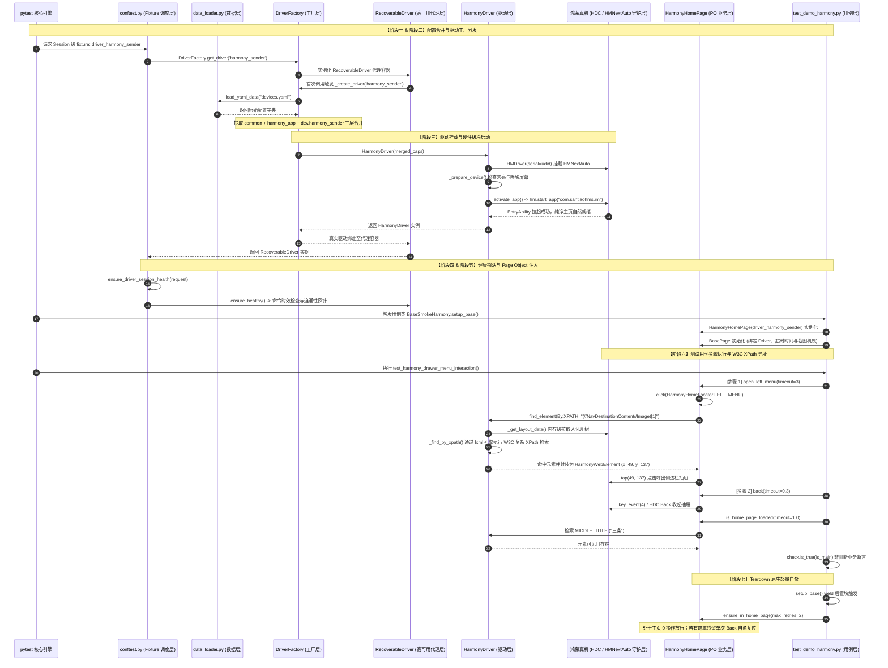

# 鸿蒙 NEXT 自动化测试体系：从配置加载到用例执行全链路技术架构规范

> **架构定位**：本文档以资深测试开发架构师视角，深度拆解为“三条 IM”鸿蒙端（HarmonyOS NEXT 6.0+）搭建的多端一体化自动化测试架构。全流程以冒烟测试用例 `test_harmony_drawer_menu_interaction` 为核心基准，详尽阐述底层配置加载、驱动与 Session 代理创建、真机状态感知、Page Object 注入、W3C XPath 树检索及 Teardown 原生自愈的全生命周期执行原理。

---

## 目录
1. [执行全景架构与时序图](#一-执行全景架构与时序图)
2. [全链路七大执行阶段深度剖析](#二-全链路七大执行阶段深度剖析)
   - [第一阶段：配置多态定位与 Capability 动态继承合并](#阶段-1配置多态定位与-capability-动态继承合并)
   - [第二阶段：Driver 工厂分发与 Session 断路器代理](#阶段-2driver-工厂分发与-session-断路器代理)
   - [第三阶段：鸿蒙原生驱动挂载与真机 Ability 唤醒拉起](#阶段-3鸿蒙原生驱动挂载与真机-ability-唤醒拉起)
   - [第四阶段：Session 级动态健康探活与故障自愈守卫](#阶段-4session-级动态健康探活与故障自愈守卫)
   - [第五阶段：用例级 Fixture 挂载与 Page Object 依赖注入](#阶段-5用例级-fixture-挂载与-page-object-依赖注入)
   - [第六阶段：测试用例业务交互与 W3C XPath 寻址执行](#阶段-6测试用例业务交互与-w3c-xpath-寻址执行)
   - [第七阶段：Teardown 原生主页无损自愈与会话收敛](#阶段-7teardown-原生主页无损自愈与会话收敛)
3. [核心函数速查表与输入/输出契约](#三-核心函数速查表与输入输出契约)
4. [核心架构设计决策与避坑指南](#四-核心架构设计决策与避坑指南)

---

## 一、 执行全景架构与时序图



---

## 二、 全链路七大执行阶段深度剖析

### 阶段 1：配置多态定位与 Capability 动态继承合并

* **代码落脚点**：[core/driver_factory.py](file:///d:/projects/santiao-anti/core/driver_factory.py#L24-L64) `DriverFactory._create_driver(device_key)`
* **调用前置**：由 `conftest.py` 中的 Session 级别 Fixture `driver_harmony_sender` 发起驱动请求。

#### 执行逻辑与实现机制
1. **多环境文件读取**：
   - 调用 `load_yaml_data("devices.yaml")` ([utils/file_reader/data_loader.py](file:///d:/projects/santiao-anti/utils/file_reader/data_loader.py))；
   - 自动在项目根目录及 `config/` 路径下定位 `devices.yaml`，解析为内存字典；
   - 优先读取环境变量 `os.environ.get('ENV')`，未指定时默认读取 YAML 顶层的 `current_env: dev`。
2. **三层 Capability 动态深拷贝与属性覆盖**：
   - **第一层（公共基类层）**：提取 `data.get('app', {})`，获取无差别通用配置；
   - **第二层（设备环境层）**：提取 `data['devices'][current_env][device_key]`（即 `harmony_sender` 设备项）；
   - **第三层（鸿蒙平台专属层）**：判断 `platformName: harmonyos`，拉取专属字典 `data.get('harmony_app', {})` 进行深度合并。
3. **合并产物 (merged_caps) 核心属性清单**：
   ```yaml
   platformName: "HarmonyOS"
   bundleName: "com.santiaohms.im"
   abilityName: "EntryAbility"
   moduleName: "phone"
   udid: "4UQ9K25530068061"
   automationName: "HMNextAuto"
   autoGrantPermissions: true
   ```

---

### 阶段 2：Driver 工厂分发与 Session 断路器代理

* **代码落脚点**：[core/driver_factory.py](file:///d:/projects/santiao-anti/core/driver_factory.py#L18-L22) `DriverFactory.get_driver('harmony_sender')`
* **包装类型**：`RecoverableDriver` 智能代理容器

#### 架构设计意图
1. **测试用例与物理通信解耦**：
   - 测试用例不直接持有物理驱动对象，而是持有代理实例。
2. **会话级故障自愈（Session Recovery）**：
   - 面对偶发 USB 接触不良、真机 HDC 服务闪断，代理内部维护会话代数（`_generation`）与线程恢复锁（`_recovery_lock`）；
   - 探测到真机通信失效时，透明触发单次重建并无缝接管，用例层无需关心底层重连细节。

---

### 阶段 3：鸿蒙原生驱动挂载与真机 Ability 唤醒拉起

* **代码落脚点**：[core/harmony_driver.py](file:///d:/projects/santiao-anti/core/harmony_driver.py#L57-L128) `HarmonyDriver.__init__(desired_caps)`

#### 步骤 1：HMNextAuto 引擎挂载与日志接管
- 动态加载 `from hmnextauto.driver import Driver as HMDriver`；
- 实例化 `self.hm = HMDriver(serial=self.udid)` 连接常驻守护引擎；
- 拦截底层日志管道，纠正为标准输出并提升过滤至 `INFO`，彻底屏蔽循环探测日志刷屏。

#### 步骤 2：硬件级感知与密码自动解锁 (`_prepare_device` / `unlock_device`)
- 调用 `getattr(self.hm, "is_screen_on", False)` 获取真机屏幕状态，若息屏则调用 `hm.screen_on()` 唤醒屏幕；
- **锁屏状态深度探查**：检测当前 UI 树中是否存在 `ScreenLockRootComponent` 或 `MainPageView_Screen_Lock`；
- **零干扰快速放行**：若未处于锁屏状态，**0 操作立即返回**，保持真机界面绝对静止；
- **上滑呼出与密码注入**：
  - 向上快速轻扫（Fling: `speed=6000`）呼出锁屏 PIN 码键盘；
  - 读取配置中的 `lock_password: "1111"`，按鸿蒙标准数字键码（`KeyCode 2001`）逐位注入并确认，瞬间解除锁屏；
- **规避系统级阻断**：彻底解决鸿蒙开发者模式下锁屏拉起应用报错 `10106102 (The device screen is locked, unlock screen failed)` 的问题。

#### 步骤 3：鸿蒙原生应用前台激活 (`activate_app`)
- 调用 `self.hm.start_app(target_bundle)`；
- 底层兜底命令：通过鸿蒙系统的 `aa`（Ability Assistant）命令行拉起：
  ```bash
  hdc -t 4UQ9K25530068061 shell aa start -b com.santiaohms.im -a EntryAbility -m phone
  ```
- **鸿蒙核心优势**：基于 Ability Stage 架构，主 `EntryAbility` 拉起后天然、直接呈现主页面，无安卓历史 Activity 栈顶混淆。

---

### 阶段 4：Session 级动态健康探活与故障自愈守卫

* **代码落脚点**：[conftest.py](file:///d:/projects/santiao-anti/conftest.py#L270-L281) `ensure_driver_session_health` -> [core/driver_factory.py](file:///d:/projects/santiao-anti/core/driver_factory.py#L311) `ensure_healthy`

#### 执行机制
1. **时效性守卫（Idle Threshold Guard）**：
   - 统计距离上一次成功执行驱动指令的空闲时长：`idle_seconds = time.monotonic() - _last_successful_command_at`；
   - 若空闲时间小于 1.0 秒，证明当前通信管道高度活跃，**0ms 瞬时放行**，跳过真实物理探测。
2. **底层硬件探针**：
   - 超出空闲阈值时，触发 `HarmonyDriver.is_healthy()`；
   - 验证真机 HDC 连接状态与应用前台响应，确保用例开始前通信链路绝对畅通。

---

### 阶段 5：用例级 Fixture 挂载与 Page Object 依赖注入

* **代码落脚点**：[tests/test_demo_harmony.py](file:///d:/projects/santiao-anti/tests/test_demo_harmony.py#L13-L26) `BaseSmokeHarmony.setup_base`

#### 执行机制
1. **驱动挂载**：获取已就绪的 `driver_harmony_sender`，绑定至 `self.driver`；
2. **PO 实例化**：`self.homePage = HarmonyHomePage(driver_harmony_sender)`；
3. **基类 BasePage 行为初始化** ([common/base_page.py](file:///d:/projects/santiao-anti/common/base_page.py))：
   - 注入底层驱动实例；
   - 绑定全局显式等待引擎（默认 3s~5s）；
   - 注册异常装饰器（`except_utils.py`），提供元素定位失败时的秒级全屏截图与 Allure 报告附件挂载能力；
4. **控制权交接**：通过 `yield` 将执行流正式切换至目标测试用例。

---

### 阶段 6：测试用例业务交互与 W3C XPath 寻址执行

测试用例入口：[tests/test_demo_harmony.py:56](file:///d:/projects/santiao-anti/tests/test_demo_harmony.py#L56-L70) `test_harmony_drawer_menu_interaction`。

#### 步骤 1：打开左侧抽屉菜单 (`open_left_menu`)
1. **业务方法调用**：`self.homePage.open_left_menu(timeout=3)`；
2. **读取元素定位器**：
   - [locators/home/harmony_home_locator.py:16](file:///d:/projects/santiao-anti/locators/home/harmony_home_locator.py#L16)：
     ```python
     LEFT_MENU = (AppiumBy.XPATH, "(//NavDestinationContent//Image)[1]")
     ```
3. **进入底层驱动检索：`HarmonyDriver.find_elements`** ([core/harmony_driver.py:224](file:///d:/projects/santiao-anti/core/harmony_driver.py#L224))：
   - **内存树获取**：调用 `self._get_layout_data()`，通过 `hm.dump_hierarchy()` 从真机内存拉取毫秒级 ArkUI 层次树字典；
   - **W3C XPath 引擎介入 (`_find_by_xpath`)**：
     - 将 ArkUI 节点树递归映射为 XML 节点树，为每个节点注入唯一映射标记 `_node_idx`；
     - 顶层注入虚拟根节点 `<Hierarchy platform="HarmonyOS">`，保证全局 `//` 轴索引支持；
     - 调用 **`lxml.etree.xpath`** 工业级解析引擎，执行针对 `(//NavDestinationContent//Image)[1]` 的精准评估；
     - 检索出首个匹配项：真机顶栏左侧个人头像 `Image`（物理边界 `bounds: [49,137][112,200]`）；
     - 通过 `_node_idx` 映射回原始节点字典，包装为 [HarmonyWebElement](file:///d:/projects/santiao-anti/core/harmony_driver.py#L497) 实例返回。
4. **几何中心计算与触控派发**：
   - `HarmonyWebElement._init_bounds()` 自动计算控件几何中心：
     $$\text{center\_x} = 49 + \frac{112 - 49}{2} = 80,\quad \text{center\_y} = 137 + \frac{200 - 137}{2} = 168$$
   - 触发 `BasePage.click()` -> `HarmonyDriver.tap([(80, 168)])`；
   - 真机即刻呼出左侧侧边栏抽屉菜单，业务缓冲 `time.sleep(0.3)`。

#### 步骤 2：返回关闭侧边栏并校验主页面渲染
1. **触发物理返回**：
   - 调用 `self.homePage.back(timeout=0.3)`；
   - 触发 `HarmonyDriver.back()` -> 下发 `hm.key_event(4)` 或 HDC `uitest uiInput keyEvent Back`，以系统级返回键顺畅收起抽屉。
2. **主页状态感知断言**：
   - 调用 `self.homePage.is_home_page_loaded(timeout=1.0)`；
   - 底层静默探查 `MIDDLE_TITLE`（`//Text[contains(@text, '三条')]`）；
   - 探查命中，返回 `True`；
   - 执行断言：`check.is_true(is_main, "❌ 关闭侧边栏后未能正确返回主页面")`。

---

### 阶段 7：Teardown 原生主页无损自愈与会话收敛

1. **用例后置自愈执行**：
   - 用例函数执行完毕，跳回 `BaseSmokeHarmony.setup_base` 的 `yield` 下方代码块；
   - 执行 `self.homePage.ensure_in_home_page(max_retries=2)`；
   - **前置探查守卫**：先调用 `is_home_page_loaded(timeout=0.3)`。由于步骤 2 已成功返回主页，**0ms 识别主页直接放行**，杜绝任何多余按键；
   - 若用例中途发生非预期断言失败导致停留在二级菜单，自愈逻辑最多执行 2 次轻量 `self.back()`，平稳归位至主页面，为下一条测试用例提供纯净的前置状态。
2. **Session 级驱动安全退出**：
   - 全量测试套件执行结束后，触发 `conftest.py` 中 `driver_harmony_sender` 的 `finally` 块；
   - 校验环境变量 `DEBUG_MODE`：若开启调试模式则保留 Session 供 Inspector 连接排查；否则执行 `driver.quit()` 释放真机通信端口与系统资源。

---

## 三、 核心函数速查表与输入/输出契约

| 序号 | 所在模块文件 | 所属类 / 层级 | 函数 / 方法名称 | 关键输入参数 | 关键产出 / 返回值 | 核心职责与设计说明 |
| :---: | :--- | :--- | :--- | :--- | :--- | :--- |
| **1** | [data_loader.py](file:///d:/projects/santiao-anti/utils/file_reader/data_loader.py) | 数据访问层 | `load_yaml_data()` | `file_name="devices.yaml"` | `dict` (配置字典) | 自动递归寻址并解析全局与设备环境配置文件。 |
| **2** | [driver_factory.py](file:///d:/projects/santiao-anti/core/driver_factory.py) | 工厂层 | `DriverFactory.get_driver()` | `device_key="harmony_sender"` | `RecoverableDriver` | 构建具备断路自愈能力的驱动代理容器。 |
| **3** | [driver_factory.py](file:///d:/projects/santiao-anti/core/driver_factory.py) | 工厂层 | `DriverFactory._create_driver()` | `device_key="harmony_sender"` | `HarmonyDriver` | 动态深拷贝三层 Capability 并分发构建鸿蒙驱动实例。 |
| **4** | [harmony_driver.py](file:///d:/projects/santiao-anti/core/harmony_driver.py) | 核心驱动层 | `HarmonyDriver.__init__()` | `desired_caps: dict` | 驱动实例 | 初始化 HMNextAuto 守护连接并编排设备启动链路。 |
| **5** | [harmony_driver.py](file:///d:/projects/santiao-anti/core/harmony_driver.py) | 核心驱动层 | `HarmonyDriver._prepare_device()` | 无 | `None` | 智能感知屏幕状态，仅在息屏时点亮屏幕，保持常亮。 |
| **6** | [harmony_driver.py](file:///d:/projects/santiao-anti/core/harmony_driver.py) | 核心驱动层 | `HarmonyDriver.activate_app()` | `bundle_id: str` | `None` | 调用 `aa start` 或 `hm.start_app` 拉起鸿蒙应用至前台。 |
| **7** | [conftest.py](file:///d:/projects/santiao-anti/conftest.py) | Fixture 调度层 | `ensure_driver_session_health()` | `request` | `None` | 每条用例执行前的时效性检查与会话健康守护。 |
| **8** | [test_demo_harmony.py](file:///d:/projects/santiao-anti/tests/test_demo_harmony.py) | 测试用例层 | `BaseSmokeHarmony.setup_base()` | `driver_harmony_sender` | `Generator` | 用例前置 PO 实例注入与后置主页自愈生命周期调度。 |
| **9** | [harmony_home_page.py](file:///d:/projects/santiao-anti/pages/home/harmony_home_page.py) | 业务 PO 层 | `HarmonyHomePage.open_left_menu()` | `timeout=3` | `None` | 业务操作：点击主页左上角抽屉菜单/个人中心头像。 |
| **10** | [harmony_driver.py](file:///d:/projects/santiao-anti/core/harmony_driver.py) | 核心驱动层 | `HarmonyDriver._find_by_xpath()` | `layout_root, xpath_expr` | `List[dict]` | 采用 `lxml` 引擎评估复杂 W3C XPath 语法并命中节点。 |
| **11** | [harmony_driver.py](file:///d:/projects/santiao-anti/core/harmony_driver.py) | 核心驱动层 | `HarmonyDriver.tap()` | `positions: List[Tuple]` | `None` | 向真机目标物理坐标派发单点轻触事件。 |
| **12** | [harmony_home_page.py](file:///d:/projects/santiao-anti/pages/home/harmony_home_page.py) | 业务 PO 层 | `HarmonyHomePage.back()` | `timeout=0.3` | `None` | 向设备派发系统级 Back 事件关闭侧滑菜单。 |
| **13** | [harmony_home_page.py](file:///d:/projects/santiao-anti/pages/home/harmony_home_page.py) | 业务 PO 层 | `HarmonyHomePage.is_home_page_loaded()` | `timeout=1.0` | `bool` | 双特征无异常静默判断主页面是否就绪。 |
| **14** | [harmony_home_page.py](file:///d:/projects/santiao-anti/pages/home/harmony_home_page.py) | 业务 PO 层 | `HarmonyHomePage.ensure_in_home_page()` | `max_retries=2` | `bool` | Teardown 轻量自愈方法，平滑恢复环境至纯净主页。 |

---

## 四、 核心架构设计决策与避坑指南

### 1. 为什么坚决剔除 Android 版 `MainPage`？
- **根本冲突**：安卓版 `MainPage` 依赖 `HomeLocator`（基于 Android Resource-ID，如 `tv_title`、`cl_item`）。在鸿蒙 ArkUI 界面上 100% 无法匹配。
- **负向连锁反应**：在鸿蒙端调用 `MainPage.go_to_main_page()` 时，因检索不到元素误判为“不在主页”，会触发多达 5 次盲按 Back 键，导致刚拉起就绪的鸿蒙应用被直接强制退出或退至后台系统，并伴生大量 `mobile: startActivity` 错误日志。
- **最佳方案**：鸿蒙端全链路采用原生 `HarmonyHomePage`，状态判断全部基于 ArkUI 组件树特征。

### 2. 为什么必须在底层引入 `lxml` XPath 引擎？
- **简易正则的局限性**：手写正则只能匹配单一属性判断（如 `@text='xxx'`），一旦遇到复合谓词索引 `(//NavDestinationContent//Image)[1]`、轴选择器 `following-sibling::`、组合选择器 `|` 时会彻底失效，引发大量非预期的 `TimeoutException`。
- **工业级标准**：通过 `lxml` 库将鸿蒙内存树转换为 XML DOM 树并执行原生 W3C XPath 1.0 解析，保证了对任何复杂定位语法的 100% 解析支持。

### 3. HMNextAuto 截图传参设计
- **报错根因**：`HMNextAuto` 的 `Driver.screenshot(path)` 方法强制要求传入目标文件路径，未传参调用会引发 `TypeError: missing 1 required positional argument: 'path'`。
- **优化实现**：在 `get_screenshot_as_png()` 中使用临时文件接收后立即读取二进制流并安全销毁，既规避了异常报错，又避免了底层反复通过 HDC 跨进程拉取文件的性能损耗。
