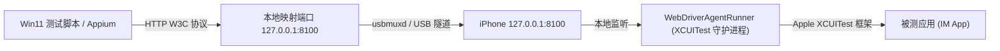

# 📱 Windows 11 环境下 iOS 自动化测试 WDA 完整部署与落地指南

> **适用环境**：Windows 11 / Windows 10  
> **支持设备**：iPhone / iPad 全系列（已深度适配 iOS 16 / iOS 17 / iOS 18+）  
> **核心目标**：彻底脱离 Mac 电脑限制，在纯 Windows 环境下完成 WebDriverAgent (WDA) 的编译包获取、免费证书自签名、真机部署、底层服务拉起及 Appium 自动化测试对接。

---

## 目录
1. [核心认知与架构设计原理](#1-核心认知与架构设计原理)
2. [步骤一：下载官方预编译 WDA 真机包](#步骤一下载官方预编译-wda-真机包)
3. [步骤二：解压清理与标准 IPA 封包（必做避坑）](#步骤二解压清理与标准-ipa-封包必做避坑)
4. [步骤三：免费激活 Apple 开发者权限](#步骤三免费激活-apple-开发者权限)
5. [步骤四：Sideloadly 本地自签与推送到 iPhone](#步骤四sideloadly-本地自签与推送到-iphone)
6. [步骤五：iPhone 手机端权限授权与环境准备](#步骤五iphone-手机端权限授权与环境准备)
7. [步骤六：Win11 端拉起 WDA 守护进程与端口映射（适配 iOS 17+）](#步骤六win11-端拉起-wda-守护进程与端口映射适配-ios-17)
8. [步骤七：服务验证与自动化框架对接](#步骤七服务验证与自动化框架对接)
9. [全流程排错与高频故障索引表](#全流程排错与高频故障索引表)

---

## 1. 核心认知与架构设计原理

在 Windows 11 下驱动 iOS 原生应用自动化测试，整体通信链路如下：



- **WDA 的本质**：它是一个运行在 iPhone 上的 HTTP Server，将接收到的标准 WebDriver 协议指令（点击、滑动、输入、找元素）转化为 iOS 系统底层的 XCUITest 原生调用。
- **iOS 签名红线**：由于 iOS 沙盒与代码签名限制，任何在物理真机上运行的程序必须经过 Apple 证书签名（绑定真机 UDID）。利用个人免费 Apple ID 即可获取 7 天有效期的官方免费调试证书。
- **Windows 基础前置依赖**：
  1. **Apple USB 驱动 (`usbmuxd`)**：电脑需安装 iTunes（非微软商店版）或 Apple Devices 驱动组件，确保 Windows 服务中的 `Apple Mobile Device Service` 处于正在运行状态。
  2. **Python 通信工具库**：在项目 Python 环境中安装核心依赖：
     ```powershell
     pip install -U pymobiledevice3 tidevice psutil
     ```

---

## 步骤一：下载官方预编译 WDA 真机包

1. 打开浏览器访问 Appium 官方 Releases 仓库：  
   👉 **[Appium WebDriverAgent Releases (GitHub)](https://github.com/appium/WebDriverAgent/releases)**
2. 展开最新版本的 **Assets** 列表。
3. **文件选择红线**：
   - 必须且只能下载：**`WebDriverAgentRunner-Runner.zip`**
   - ⚠️ **切勿下载带 `Sim` 的文件**（如 `Build-Sim-x86_64.zip`、`Build-Sim-arm64.zip` 是 Mac 专用模拟器版，Windows 无法运行）。
   - ⚠️ **切勿下载带 `tvOS` / `watchOS` 的文件**。

---

## 步骤二：解压清理与标准 IPA 封包（必做避坑）

直接打包官方解压文件会导致 Windows 签名工具解析符号表崩溃（报错 `macho sign/edit failed (-40)`），必须执行关键清理：

1. **解压文件**：  
   解压 `WebDriverAgentRunner-Runner.zip`，得到名为 `WebDriverAgentRunner-Runner.app` 的文件夹。
2. **清理调试符号表（关键必做）**：  
   进入 `WebDriverAgentRunner-Runner.app/PlugIns/` 目录：
   - 彻底删除 **`WebDriverAgentRunner.xctest.dSYM`** 文件夹（若有其他任何以 `.dSYM` 结尾的文件夹也一并删除）。
   - ⚠️ 保留不带 dSYM 的核心测试插件 `WebDriverAgentRunner.xctest`。
3. **标准目录组装封包**：
   - 在桌面上新建一个名为 **`Payload`** 的空文件夹（注意首字母大写 `P`）。
   - 将清理后的 `WebDriverAgentRunner-Runner.app` 剪切移入 `Payload` 文件夹中。
   - 将 `Payload` 文件夹压缩为 `Payload.zip`，并将扩展名重命名为 **`WebDriverAgent.ipa`**。

---

## 步骤三：免费激活 Apple 开发者权限

无需支付 688 元/年的 Apple Developer Program 会员费用，普通 Apple ID 免费签署协议即可：

1. 访问官网后台：👉 **[Apple Developer (developer.apple.com)](https://developer.apple.com)**。
2. 点击右上角 **`Account`**，使用你的 Apple ID 登录。
3. 页面会自动弹出 **《Apple 开发者协议》（Apple Developer Agreement）**。
4. 勾选 **“同意条款”** 并点击提交即可。
   > ⚠️ **警告**：看到控制台出现个人名字后直接关闭页面即可，**切勿点击页面上的“Enroll（加入付费会员）”按钮！**

---

## 步骤四：Sideloadly 本地自签与推送到 iPhone

1. 保持 iPhone 处于**亮屏解锁状态**，通过 USB 数据线连接电脑。
2. 打开 **Sideloadly** 工具，确认顶部已经识别出当前连接的 iPhone。
3. 将制作好的 `WebDriverAgent.ipa` 拖入左上角的 IPA 框。
4. 在 **`Apple account`** 中填入刚刚同意协议的 Apple ID 邮箱。
5. 展开下方的 **`Advanced Options`**：
   - 勾选 **`Change bundle ID`**，修改为一个全网独一无二的名字（例如：`com.autotest.wda123`），避免与公共命名冲突。
6. 点击右下角 **`Start`** 按钮：
   - 弹出密码提示时，输入你的 Apple ID 密码。
   - 看着手机屏幕，手机会弹出 **“Apple ID 登录请求”** 弹窗，显示 **6 位验证码**。
   - 在电脑 Sideloadly 弹出的对话框中输入这 6 位验证码。
7. Sideloadly 将自动在后台向苹果申请免费开发证书、注入描述文件、签名并推送到手机。
8. 提示 **`Done`** 即代表安装成功，iPhone 桌面上将正式出现 **`WebDriverAgentRunner`** 图标。

---

## 步骤五：iPhone 手机端权限授权与环境准备

在启动服务前，必须在手机上放行安全权限（**注：不要手动去点击桌面上的 WDA 图标，手动点开闪退是正常的**）：

1. **信任签名证书**：
   - 打开 iPhone **【设置】 $\rightarrow$ 【通用】 $\rightarrow$ 【VPN 与设备管理】**。
   - 在“开发者 App”下找到你的 Apple ID 邮箱，点击进去，点击 **“信任”**。
2. **开启“开发者模式”**（iOS 16 及以上强制要求）：
   - 打开 iPhone **【设置】 $\rightarrow$ 【隐私与安全性】**。
   - 滑动到底部，进入 **【开发者模式】** $\rightarrow$ 开启开关 $\rightarrow$ 手机自动重启后，解锁并点击“开启”确认。
3. **关闭屏幕自动息屏（自动化测试必备）**：
   - 打开 iPhone **【设置】 $\rightarrow$ 【显示与亮度】 $\rightarrow$ 【自动锁定】**。
   - 勾选为 **【永不】**（防止闲置锁屏切断自动化测试通道）。

---

## 步骤六：Win11 端拉起 WDA 守护进程与端口映射（适配 iOS 17+）

由于 iOS 17+ 移除了传统的 lockdown 调试通道，老版本 `tidevice` 会报错 `DeveloperImage not found` 或 `InvalidService`。在 Windows 11 下统一使用官方维护的现代工具 **`pymobiledevice3`**。本项目提供以下三种启动方式（任选其一即可）：

### 方式 A：桌面控制台 UI 审查器可视化一键启停（最推荐）
1. 打开 **【三条 IM 自动化测试控制台】 $\rightarrow$ 【UI 审查】** 页面。
2. 在顶部【设备】下拉框中选择 `[IOS] 苹果真机 (...)`，右侧会自动显示 iOS 服务状态控制按钮：
   - **【启动服务】（白色）**：当前双服务未运行，点击后自动在后台无黑框拉起 `8100` 端口透传与 `WDA XCUITest` 守护进程，就绪后按钮变为翠绿色 **【正在运行】** 并提示 `✅ 服务已启动`。
   - **【重启服务】（橙色）**：检测到仅单项子服务存活（状态异常），点击即可一键清理残留进程并重新拉起双服务，恢复至 **【正在运行】**。
   - **【正在运行】（翠绿）**：双服务健康运行中，点击即可一键安全停止所有后台 WDA 进程与端口转发。

### 方式 B：项目内置双看门狗守护脚本一键启动（推荐命令行使用）
在项目根目录下直接运行统一守护脚本（自动检测真机连接、自动匹配已安装的 WDA Bundle ID、自动守护 `8100` 端口转发与 `XCUITest` 进程，断线自动重连）：
```powershell
# PowerShell / 终端直接运行
python scripts/start_ios_wda.py

# 或直接双击运行批处理文件
scripts\start_ios_wda.bat
```

### 方式 C：手动分步命令启动（底层调试排障使用）
若需手动在终端分别观察两个底层服务，请在 Windows PowerShell 中按顺序执行以下两步：

#### 1. 启动本地端口转发（后台静默或独立终端运行）
在 PowerShell 中执行（Windows 下切勿加 `-d`，`-d` 依赖 Unix 守护库）：
```powershell
Start-Process python -ArgumentList "-u -m pymobiledevice3 usbmux forward 8100 8100" -WindowStyle Hidden
```
或者在独立终端窗口中常驻运行：
```powershell
python -u -m pymobiledevice3 usbmux forward 8100 8100
```
*(该命令将 Win11 本地 `127.0.0.1:8100` 端口直接穿透映射至 iPhone 设备的 8100 端口)*

#### 2. 拉起 WDA 守护进程（独立终端常驻运行）
```powershell
# 1. 查找真机已安装的 WDA Bundle ID（例如：com.facebook.WebDriverAgentRunner.xctrunner.VX43WKZ6A5）
tidevice applist

# 2. 执行拉起命令（注意替换为你在手机上实际安装的 Bundle ID）
python -u -m pymobiledevice3 developer dvt xcuitest --userspace com.facebook.WebDriverAgentRunner.xctrunner.VX43WKZ6A5
```

> [!IMPORTANT]
> **终端常驻说明**  
> 当终端输出停留在：  
> `INFO [IDE] testCaseDidStart: UITestingUITests/testRunner (iter=1)`  
> **这绝对不是卡死，而是代表 WDA 服务已经在 iPhone 上成功拉起并进入常驻监听状态！**  
> **必须保持当前终端窗口常开**，切勿按 `Ctrl + C` 关闭该窗口。

---

## 步骤七：服务验证与自动化框架对接

### 1. 浏览器验证 WDA 健康状态
打开电脑浏览器，直接访问：👉 **`http://127.0.0.1:8100/status`**

当返回如下 JSON 响应时，证明整套驱动环境 100% 成功就绪：
```json
{
  "value": {
    "message": "WebDriverAgent is ready to accept commands",
    "state": "success",
    "ready": true,
    "os": {
      "name": "iOS",
      "version": "27.0.1"
    },
    "device": "iphone",
    "build": {
      "productBundleIdentifier": "com.facebook.WebDriverAgentRunner"
    }
  },
  "sessionId": null
}
```

### 2. Appium Inspector 可视化元素审查配置
打开 Appium Inspector，在 JSON Representation 中配置如下 Capabilities 直连真机：
```json
{
  "platformName": "iOS",
  "appium:automationName": "XCUITest",
  "appium:udid": "00008101-001538462600001E",
  "appium:bundleId": "com.baimo.santiao",
  "appium:webDriverAgentUrl": "http://127.0.0.1:8100",
  "appium:noReset": true
}
```

### 3. 项目自动化测试对接（`config/devices.yaml`）
在工程配置文件中指定已运行的 WDA 地址，免除任何 Mac 依赖：
```yaml
current_platform: "ios"

ios_app:
  "appium:automationName": "XCUITest"
  "appium:platformName": "iOS"
  "appium:udid": "00008101-001538462600001E"
  "appium:bundleId": "com.baimo.santiao"                # 被测 IM 应用 Bundle ID
  "appium:webDriverAgentUrl": "http://127.0.0.1:8100"   # 核心：直接复用本地代理会话
  "appium:noReset": true
```

### 4. 自动化测试完毕后的服务安全终止
当完成自动化测试或 Inspector 审查后，需要释放电脑 8100 端口并关闭真机测试 App，提供以下三种终止方式：
* **方式 1：桌面控制台一键停止（最便捷）**
  * 在【三条 IM 自动化测试控制台 $\rightarrow$ UI 审查】顶部点击绿色的 **【正在运行】** 按钮，即可一键静默停止双服务并切换回【启动服务】状态。
* **方式 2：一键脚本终止（命令行推荐）**
  * 在终端运行：`python scripts/stop_ios_wda.py`
  * 或直接双击运行：`scripts/stop_ios_wda.bat`
  * 该工具会自动安全回收电脑端守护进程、清理 8100 端口占用，并联动通知 iPhone 真机退出 WDA Runner，使手机恢复常态与省电状态。
* **方式 3：控制台直接终止**
  * 如果 `start_ios_wda` 在前台终端运行，直接在终端中按下键盘 `Ctrl + C` 即可触发平滑回收。


---

## 全流程排错与高频故障索引表

| 序号 | 典型错误提示 | 根因分析 | 官方根治方案 |
| :--- | :--- | :--- | :--- |
| **1** | `ec=-20970: Your account information was entered incorrectly` | 账号密码有空格，或从未在苹果开发者后台同意过协议 | 1. 检查账密前后无空格；<br>2. 登录 `developer.apple.com` 勾选同意开发者协议。 |
| **2** | `Login failed (-22411): This action cannot be completed at this time` | 1. 新注册账号未在 iPhone App Store 完成过“首次检查(Review)”；<br>2. 账号未绑定手机号开启双重认证(2FA) | 1. 在 iPhone 的 App Store 登录一次并点击“检查”，随意补全姓名地址；<br>2. 在 `appleid.apple.com` 开启双重认证；<br>3. 优先推荐使用有日常使用历史的主力 Apple ID。 |
| **3** | `SignBinary(...dSYM...): macho sign/edit failed (-40)` | WDA 安装包中残留了 Xcode 生成的无用调试符号文件夹 | 彻底删除 `WebDriverAgentRunner-Runner.app/PlugIns/` 目录下的所有 `*.dSYM` 文件夹后再打成 zip/ipa。 |
| **4** | `lockdownd_client_new_with_handshake failed: LOCKDOWN_E_INVALID_HOST_ID` | 手机当前处于锁屏状态，或者未授权信任此电脑 | 1. 解锁 iPhone 屏幕并保持常亮；<br>2. 重新插拔数据线，在手机弹出的“要信任此电脑吗”中点击【信任】并输入锁屏密码；<br>3. 退出电脑后台冲突的爱思助手等软件。 |
| **5** | `tidevice` 报 `DeveloperImage not found` 或 `InvalidService` | iPhone 系统为 iOS 17+，苹果废弃了老版 lockdown 测试服务 | 放弃老版 `tidevice`，使用专为 iOS 17+ 打造的 `python -u -m pymobiledevice3 developer dvt xcuitest --userspace <bundle_id>` 指令。 |
| **6** | 拉起 WDA 报 `Failed to launch process with bundle identifier` | 1. 手机上尚未在设置中信任该开发者的签名证书；<br>2. 个人免费 Apple ID 签名已满 **7 天有效期** | 1. 进入手机 **【设置】 $\rightarrow$ 【通用】 $\rightarrow$ 【VPN 与设备管理】**，找到对应 Apple ID 点击 **【信任】**；<br>2. 若已满 7 天证书过期，打开 Sideloadly 使用相同 Apple ID 与相同 Bundle ID 重新覆盖签名安装一次即可。 |
| **7** | WDA 运行 1 分钟后自动断开退出 | iPhone 触发了自动息屏锁定，iOS 挂起了前台测试进程 | 进入手机 **【设置】 $\rightarrow$ 【显示与亮度】 $\rightarrow$ 【自动锁定】** 设为 **【永不】**。 |
| **8** | UI 审查器顶部按钮显示橙色 **【重启服务】** | `8100` 端口转发与 `XCUITest` 两个子服务中仅有一项存活（如拔插了数据线或单进程意外退出） | 直接点击橙色 **【重启服务】** 按钮（或运行 `scripts/start_ios_wda.bat`），系统会自动清理残留进程并重新拉起双服务恢复至绿色的 **【正在运行】**。 |

