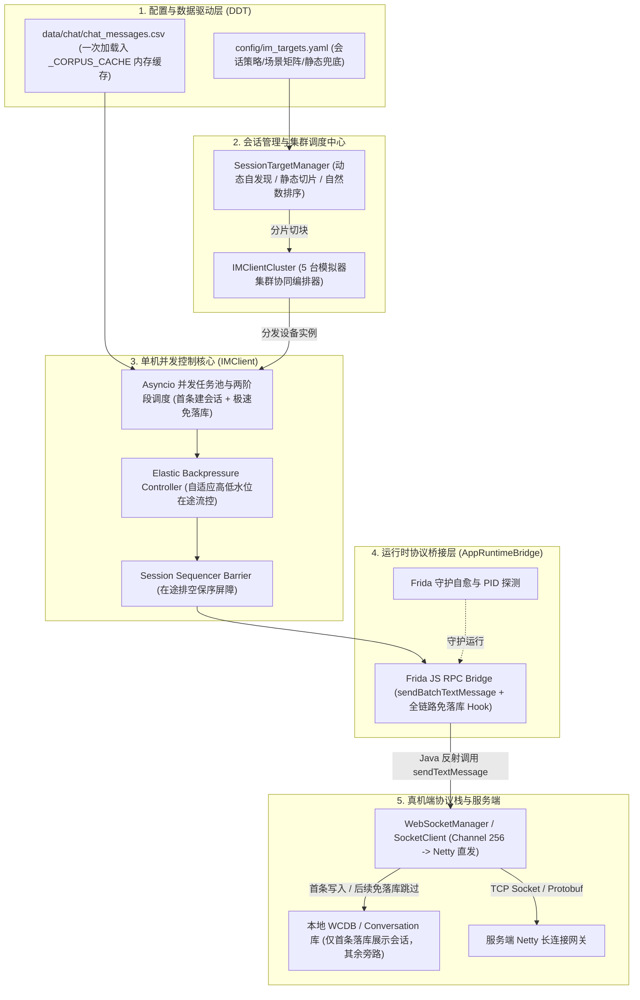
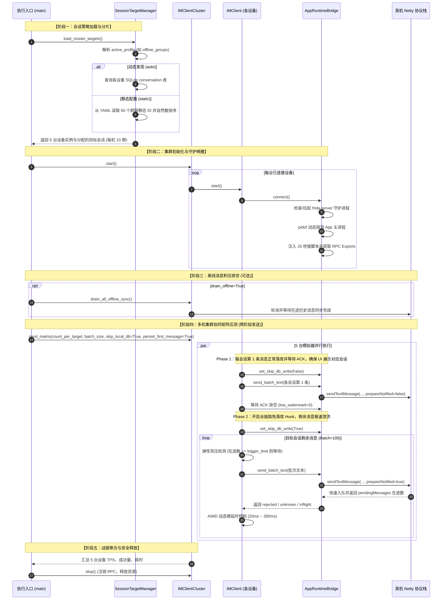
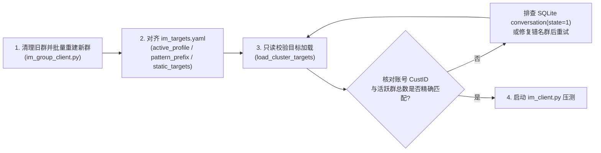

# 🚀 三条 IM 分布式并发压测引擎架构与全流程规范 (im_client.py)

> **定位**：本文档详细阐述三条 IM 自动化测试体系中，高并发消息压测引擎 [`tools/im_client.py`](file:///d:/projects/santiao-anti/tools/im_client.py) 的系统架构、设计理念、多模拟器集群协同机制及端到端执行全流程。该引擎彻底抛弃了脆弱缓慢的 UI 操作，采用 Frida 微秒级 RPC 直通真机底层 Netty 长连接协议栈，支撑百万级消息的高保真、保序并发投递。

---

## 🏛️ 一、整体系统架构

整个压测引擎采用**「配置数据驱动 (DDT) + 分布式集群调度 + 运行时协议直通」**的三层工业化架构：



---

## 🔄 二、端到端执行全流程时序

压测从启动到聚合输出战报，涵盖五个严密生命周期阶段：



---

## ⚙️ 三、核心关键机制深度剖析

### 1. 弹性自适应背压流控 (Elastic Backpressure Controller)
* **痛点**：端侧 `SocketClient.sendQueue` 容量为 256。若在途堆积过多，将触发发送拒收、30s 协议超时以及（未跳过落库时的）WCDB 锁争用。
* **机制**：
  - **动态监控**：通过 `get_inflight()` 实时读取 `SocketClient.pendingMessages` 的在途待 ACK 消息数（`SocketClient.onMessageSendStatusReceived` 在触发上层回调前已同步完成清理，免落库时计数依然精准）。
  - **双水位线与 AIMD 控制**：
    - `low_watermark`（集群默认 `150`）/ `high_watermark`（集群默认 `300`）：在途达到阈值（开启 `enforce_fifo_order=True` 时以 `low_watermark` 为准）即主动挂起并调用 `wait_for_ack_window()` 排空，顺畅时加性回落延时、发生拒收时乘性退避。

### 2. 全链路免落库极速模式 (`skip_local_db`) 与两阶段建会话 (`persist_first_message`)
* **根因与架构优化**：仅 Hook `MessageDao.insert` / `ShardedMessageDao.insert` 时，每条 `WebSocketManager.sendTextMessage(..., false, false)` 仍会因参数 `prepareNotified=false` 阻塞进入 `BuildersKt.runBlocking`，同步执行 `MessageStorage.saveOrUpdateMessage` 查表、`ConversationUpdater.updateConversationForSend` 双 `Mutex` 写会话库、敏感词评估、气泡装扮反射、ACK 回流空查与重试退避及 `NetworkLogger` 写盘，导致单机卡在 25~33 msg/s。
* **全链路旁路方案**（`skip_local_db=True`）：
  1. 发送调用将第 11 参 `prepareNotified` 置为 `_skipSendDbWrite`（`true`），直接跳过 `runBlocking` 准备链，并以 Hook `MessageSenderHelper.notifyMessagePrepareSend` 作为兜底。
  2. 补齐 `MessageDao.update` / `ShardedMessageDao.update` / `MessageDao.syncFtsAsync` 旁路，以及 `STIMImpl$login$6.onMessageSendStatus`、`STIMImpl.updateMessageStatusWithRetry`、`MessageStorage.updateMessageStatus` 的 ACK 重试旁路。
  3. 旁路 `UserDressUpProvider.inject`（直接返回原 `msg`）与 `STIMImpl$login$4.onCheckSensitiveRemind`（**注意：必须原样返回 `content` 或 `null`，切勿返回 `''`，否则 `TextMessageSender.send` 会将消息正文置空导致接收端渲染为 `[消息]`**），并临时调用 `NetworkLogger.setLogEnabled(false)` 静默调试日志（压测结束恢复原状）。
* **两阶段首条展示机制**（`persist_first_message=True`）：
  - 免落库开启时默认分两段：先以 `set_skip_db_write(False)` 正常发送并等待每个会话第 1 条消息落库及 ACK 完成，使发送端模拟器聊天列表出现对应会话并展示第 1 条消息；随后切换 `set_skip_db_write(True)`，剩余消息全速免落库发送。

### 3. 单会话保序屏障与语料加载分发规范
* **保序屏障与正文解耦**：
  - `enforce_fifo_order=True` 控制发送队列在途超过 `low_watermark` 时的网络排空防超车门禁；
  - `include_seq_prefix=False`（默认关闭）将网络保序门禁与正文前缀解耦，默认不再强行前置 `[#SEQ0001]`，需要聊天窗视觉核对顺序时再显式开启。
* **消息文件一次加载与顺序发送**：
  - [`get_chat_message_corpus`](file:///d:/projects/santiao-anti/tools/im_client.py#L113-L160) 使用进程级字典缓存 `_CORPUS_CACHE[(file_name, include_case_id, deduplicate)]`，支持 `.csv` / `.xlsx` / `.txt` / `.yaml`，**整个进程运行期只读盘一次**，过滤空值与 `\x00` 字节；默认 `include_case_id=True` 保留 `case_id:原文` 格式。
  - 默认 `shard_corpus=False`、`shard_targets_corpus=False`，所有设备与会话严格从消息表第 1 行起按表顺序逐条发送（如发 10 条即发送前 10 条）；需全量打散覆盖时可显式开启分片偏移。

### 4. 多模拟器自然数均分分片算法 (Natural Cluster Sharding)
* **机制**：
  - 针对 `1群` ~ `50群` 或 `离线群001` ~ `050`，系统内置自然数正则解析引擎 `re.findall(r'\d+', name)`。
  - 彻底规避字典序排序陷阱（防止排成 `1群, 10群, 11群, 2群...`）。
  - 将 50 个群按序号整齐切块：
    - **设备 1 (`emulator-5562`)**：分得第 `1群 ~ 10群`
    - **设备 2 (`emulator-5564`)**：分得第 `11群 ~ 20群`
    - **设备 3 (`emulator-5566`)**：分得第 `21群 ~ 30群`
    - **设备 4 (`emulator-5568`)**：分得第 `31群 ~ 40群`
    - **设备 5 (`emulator-5572`)**：分得第 `41群 ~ 50群`

---

## 📋 四、实战配置与运行指南

### 1. 压测场景切换（修改 [`config/im_targets.yaml`](file:///d:/projects/santiao-anti/config/im_targets.yaml)）

```yaml
# 切换全局压测场景：
active_profile: "offline_groups"  # 1-50群 集群分片压测
# active_profile: "dedicated_groups" # 设备专属测试群压测
# active_profile: "single_chat"      # 好友单聊压测
```

### 2. 压测参数调整（在 [`tools/im_client.py`](file:///d:/projects/santiao-anti/tools/im_client.py#L1796-L1907) 的 `main` 函数中）

```python
# 核心压测参数配置：
CORPUS_FILE = "chat/chat_messages.csv"  # 消息文件数据源（按表从第 1 条起顺序读取）
USE_CLUSTER = True                      # True: 多台设备集群协同; False: 单台 (cluster_devs[0]) 独立运行
COUNT_PER_TARGET = 10                   # 每个会话发送配额（如 10 即严格发送前 10 条；压测可设为 200+）

# 集群发送核心参数（cluster.send_matrix）：
batch_size = 100                        # 单次 RPC 批量发送条数（单机模式默认 200）
delay_between_batches = 0.02            # 分片模式批次微延时 20ms（全量未分片为 0.1s）
high_watermark = 300                    # 底层在途消息高水位线
low_watermark = 150                     # 底层在途消息低水位线（保序模式触及即排空）
shard_corpus = False                    # 是否跨设备错开消息表起始行（False 时统一从第 1 条发）
include_case_id = True                  # 是否保留 case_id:原文 前缀
include_seq_prefix = False              # 是否额外附加 [#SEQ0001] 视觉序号前缀
skip_local_db = True                    # 是否开启全链路免落库极速模式
persist_first_message = True            # 免落库模式下先为每会话落库第 1 条以展示 UI 会话
```

### 3. 一键启动
直接在终端或 IDE 中执行：
```bash
python tools/im_client.py
```
终端将自动输出多机各节点的发送进度条与全集群综合 TPS 战报。

---

## 🛠️ 五、账号切换、脏数据隔离与配置同步规范 (SOP)

当测试设备切换登录账号（例如 `emulator-5562` 切换为账号 `008628100000423`）或批量重建压测群聊后，需遵循以下排查与同步流程，防止身份错配与已解散群聊脏读。

### 1. 多账号切换自适应识别 (`_get_active_meta_db_path` & `discover_current_user_from_sqlite`)
* **常见问题**：设备切换账号后，沙箱目录 `/data/data/com.santiaotalk.im/databases/IM_Data/*/` 下可能同时残留多个历史账号的数据库子目录；若仍使用静态配置或固定读取旧目录，会导致发送方 `cust_id` 与当前长连接登录身份不一致。
* **解决机制**：
  - `SessionTargetManager._get_active_meta_db_path()` 通过 `ls -dt .../meta-wal .../meta` 按 WAL 日志最新修改时间锁定当前真实活跃账号库。
  - `SessionTargetManager.discover_current_user_from_sqlite()` 在线探测设备上当前登录账号，直查本地 `user` 表的 `(cust_id, username, mobile)` 自动覆盖静态兜底配置。

### 2. 已解散群聊软删除脏读拦截 (`state=1` 活跃态过滤)
* **常见问题**：通过 `im_group_client.py --disband-groups` 解散旧群后，群记录会从 `group_table` 移除，但 `conversation` 表中的历史会话不会物理删除，而是转为 `state=2`（活跃会话为 `state=1`）。此前 `discover_groups_from_sqlite()` 仅按 `conv_type=2` 与群名前缀过滤，导致已解散旧群的 `conv_id` 在 `auto` 自发现时重新混入目标池。
* **解决机制**：在 [`SessionTargetManager.discover_groups_from_sqlite`](file:///d:/projects/santiao-anti/tools/im_client.py#L1565) 中强制限定 `conv_type=2 AND state=1`，彻底隔离已解散残留群聊。

### 3. 账号/群组变更后的配置同步与自检闭环


* **实操校验命令（只读验证配置加载，不触发发包）**：
  ```bash
  python -c "from tools.im_client import SessionTargetManager; devs, targets, shard = SessionTargetManager.load_cluster_targets(); print('DEVICES:', [(d.device_id, d.sender_cust_id, d.sender_name) for d in devs]); print('COUNT:', len(targets)); print('TARGETS:', [(t.name, t.chat_id) for t in targets]); print('SHARD:', shard)"
  ```
* **多机协同注意事项**：若在 [`config/im_targets.yaml`](file:///d:/projects/santiao-anti/config/im_targets.yaml) 中启用 `shard_by_device: true` 进行 5 机分片发送，需确认所有参与发包的设备账号均已在新群成员列表中；若仅单台设备测试，直接以该设备执行即可。
