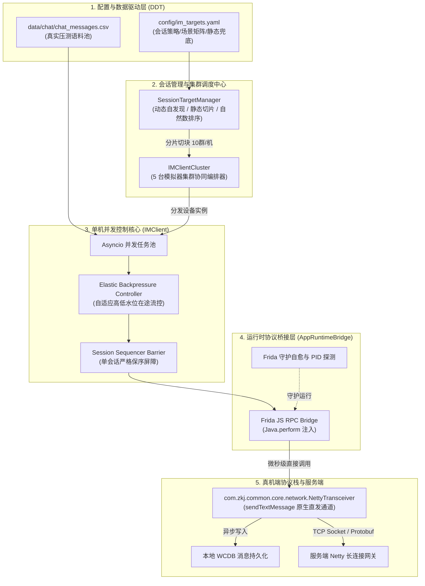
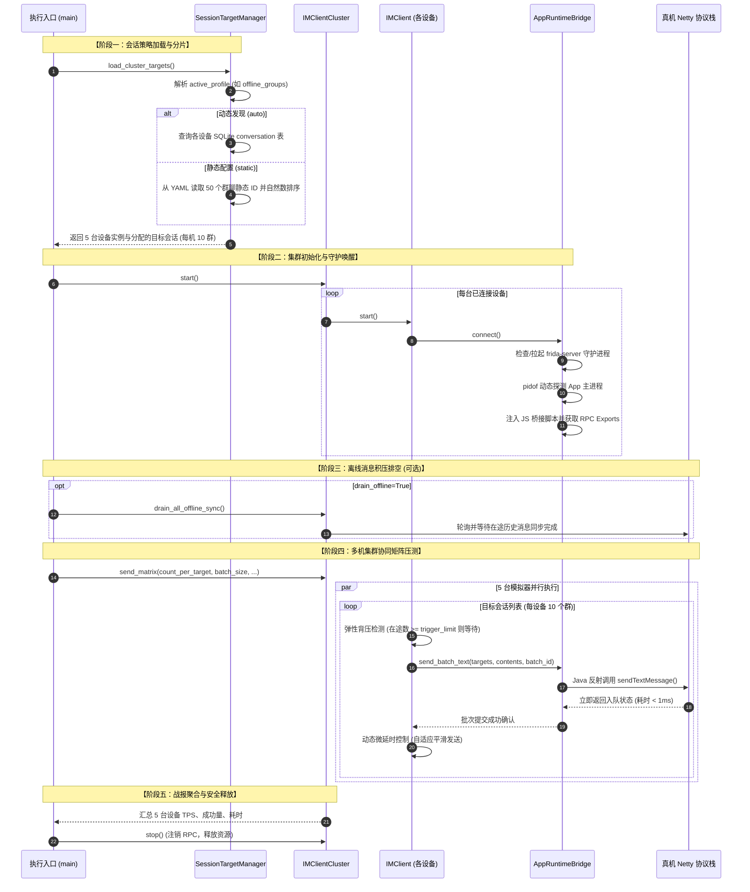

# 🚀 三条 IM 分布式并发压测引擎架构与全流程规范 (im_client.py)

> **定位**：本文档详细阐述三条 IM 自动化测试体系中，高并发消息压测引擎 [`tools/im_client.py`](file:///d:/projects/santiao-anti/tools/im_client.py) 的系统架构、设计理念、多模拟器集群协同机制及端到端执行全流程。该引擎彻底抛弃了脆弱缓慢的 UI 操作，采用 Frida 微秒级 RPC 直通真机底层 Netty 长连接协议栈，支撑百万级消息的高保真、保序并发投递。

---

## 🏛️ 一、整体系统架构

整个压测引擎采用**「配置数据驱动 (DDT) + 分布式集群调度 + 运行时协议直通」**的三层工业化架构：



---

## 🔄 二、端到端执行全流程时序

压测从启动到聚合输出战报，涵盖五个严密生命周期阶段：



---

## ⚙️ 三、核心关键机制深度剖析

### 1. 弹性自适应背压流控 (Elastic Backpressure Controller)
* **痛点**：端侧 SQLite/WCDB 数据库写入性能有限。若以万级 TPS 无限推送，真机底层消息队列严重堆积，将导致内存泄露、WCDB 锁争用崩溃，以及触发 30s 协议超时。
* **机制**：
  - **动态监控**：通过 `get_inflight()` 实时读取 NettyTransceiver 中排队待发与待 ACK 的在途消息数。
  - **双水位线控制**：
    - `trigger_limit (高水位，默认 50 条)`：在途消息达到此阈值时，自动挂起后续批次，进入异步等待状态。
    - `low_watermark (低水位，默认 20 条)`：等待真机网络与数据库消费回流，在途数降至低水位时平滑恢复发送。

### 2. 单会话严格保序屏障 (Session Sequencer Barrier)
* **痛点**：在异步并发下，若同一会话的多条消息被多协程乱序投递，会导致服务端记录的聊天时序错乱。
* **机制**：
  - 对同一 `chat_id` 的批次打上严格递增的本地时序序号。
  - 采用会话维度锁屏障，确保前一批次被 Netty 成功受理前，后续批次严禁超车，保障消息在服务端 seq 的绝对单调递增。

### 3. 多模拟器自然数均分分片算法 (Natural Cluster Sharding)
* **机制**：
  - 针对 `1群` ~ `50群` 或 `离线群001` ~ `050`，系统内置自然数正则解析引擎 `re.findall(r'\d+', name)`。
  - 彻底规避字典序排序陷阱（防止排成 `1群, 10群, 11群, 2群...`）。
  - 将 50 个群按序号整齐切块：
    - **设备 1 (`emulator-5562`)**：分得第 `1群 ~ 10群`
    - **设备 2 (`emulator-5564`)**：分得第 `11群 ~ 20群`
    - **设备 3 (`emulator-5566`)**：分得第 `21群 ~ 30群`
    - **设备 4 (`emulator-5568`)**：分得第 `31群 ~ 40群`
    - **设备 5 (`emulator-5572`)**：分得第 `41群 ~ 50群`

---

## 📋 四、实战配置与运行指南

### 1. 压测场景切换（修改 [`config/im_targets.yaml`](file:///d:/projects/santiao-anti/config/im_targets.yaml)）

```yaml
# 切换全局压测场景：
active_profile: "offline_groups"  # 1-50群 集群分片压测
# active_profile: "dedicated_groups" # 设备专属测试群压测
# active_profile: "single_chat"      # 好友单聊压测
```

### 2. 压测参数调整（在 [`tools/im_client.py`](file:///d:/projects/santiao-anti/tools/im_client.py#L1435) 的 main 函数中）

```python
# 核心压测参数配置：
USE_CLUSTER = True            # True: 5 台设备集群协同; False: 单设备运行
TARGET_DEVICE_INDEX = 0       # 单机模式下指定的设备编号 (0~4)

COUNT_PER_TARGET = 100        # 每个会话目标发送的消息配额 (例: 10个群各发100条 = 单机1000条)
BATCH_SIZE = 5                # 每批次聚合发送消息条数 (推荐 1~10)
DELAY_BETWEEN_BATCHES = 0.05  # 批次之间的缓冲微延时 (50ms，保护端侧数据库)
ENFORCE_FIFO = True           # 是否开启会话保序屏障
USE_CSV_DATA = True           # 是否使用真实语料库 (data/chat/chat_messages.csv)
```

### 3. 一键启动
直接在终端或 IDE 中执行：
```bash
python tools/im_client.py
```
终端将自动输出多机各节点的发送进度条与全集群综合 TPS 战报。
