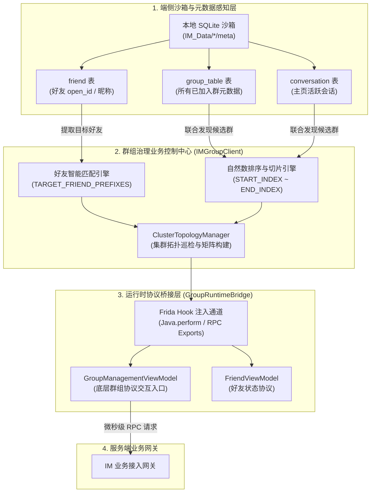
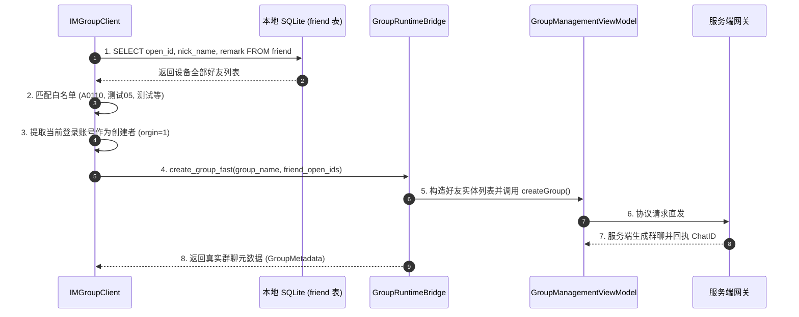
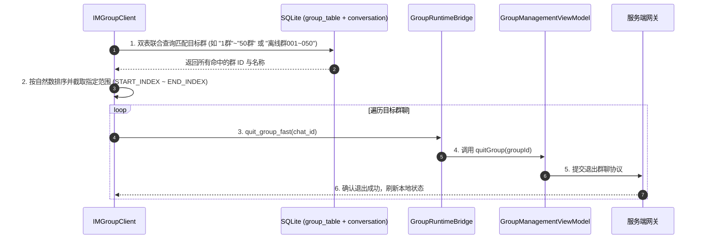
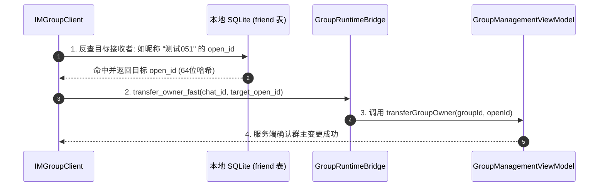
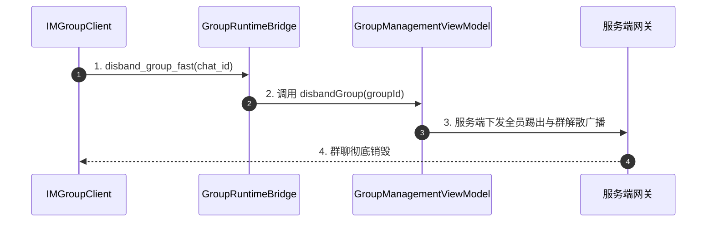

# 👥 三条 IM 群组拓扑与测试数据治理引擎架构与全流程规范 (im_group_client.py)

> **定位**：本文档详细记录三条 IM 自动化测试体系中，群组拓扑与测试数据全生命周期治理引擎 [`tools/im_group_client.py`](file:///d:/projects/santiao-anti/tools/im_group_client.py) 的架构设计、Frida ViewModel 协议桥接机制、四大核心治理流程以及实战配置规范。该引擎彻底告别脆弱耗时的 UI 自动化，在 0.1 秒内完成底层极速建群、批量退群、群主转让与一键解散。

---

## 🏛️ 一、整体系统架构

系统由**「元数据检索层」**、**「业务控制层」**与**「运行时协议桥接层」**组成：



---

## 🔄 二、四大核心治理场景执行全流程

### 1. 场景一：批量/单群极速创建与好友自动装载 (create_group)
彻底废弃 UI 界面逐个搜索、滑动、勾选好友的低效方式，由底层协议一次性打包创建：



---

### 2. 场景二：批量/单群成员优雅退出 (quit_group)
测试结束后，清理参测模拟器的冗余群聊，避免收到后续广播消息产生干扰：



---

### 3. 场景三：群主身份转移 (transfer_owner)
支持通过**昵称**（如 `测试051`）、**手机号**或 **OpenId**，一键将当前群的群主移交给目标设备或管理账号：



---

### 4. 场景四：群聊彻底销毁与一键解散 (disband_group)
压测结束后，群主可一键批量解散测试群，彻底清理服务端与所有参测设备上的会话垃圾：



---

## 🔍 三、核心技术与自适应机制

### 1. 双表联合候选群发现机制 (Dual-Table Group Discovery)
* **背景**：新创建或刚加入的群聊，在未产生任何聊天记录时，本地 SQLite 的 `conversation`（会话表）**没有任何记录**，仅存在于 `group_table` 中。
* **解法**：`_get_all_candidate_groups()` 采用双表联合扫描：
  ```sql
  SELECT group_id, group_name FROM group_table WHERE group_type = 2;
  SELECT conv_id, conv_name FROM conversation WHERE conv_type = 2;
  ```
  通过 `chat_id` 自动去重合并，确保即便零聊天的群也能被 100% 精准检索。

### 2. 双向名称正则与自然数切片引擎
* **命名兼容性**：
  - **前缀型**：如 `离线群001` ~ `离线群050`、`测试群001` ~ `测试群005`；
  - **后缀型**：如 `1群`、`2群` ... `50群`。
* **自然数切片**：通过 `START_INDEX` 与 `END_INDEX` 支持精准局部操作。例如设置 `START_INDEX=21, END_INDEX=30`，引擎仅对 `21群 ~ 30群` 执行退群或解散，不波及其它会话。

### 3. 好友昵称变更自适应
内置好友白名单机制：
```python
TARGET_FRIEND_PREFIXES = ["A0110", "测试05", "测试", "1920000005", "192000001"]
```
即便压测模拟器账号昵称在 `测试050` ~ `测试054` 与原手机号之间频繁变更，引擎均能动态自适应识别并拉取入群。

---

## 📋 四、实战配置与运行指南

### 1. IDE 极简一键运行模式（直接修改脚本底部常量）

在 [`tools/im_group_client.py`](file:///d:/projects/santiao-anti/tools/im_group_client.py#L1399-L1417) 中直接指定模式：

```python
# 🎯 运行模式切换 (直接按 F5 启动)：
MODE = "batch_quit"         # 可选: batch_single / batch_cluster / batch_quit / batch_disband / single_transfer

# 批量参数：
GROUP_PREFIX = "群"          # 填 "群" 匹配 1群~50群；填 "离线群" 匹配 离线群001~050
START_INDEX = 1             # 起始序号 (例如 1)
END_INDEX = 50              # 截止序号 (例如 50)

# 操作设备指定 (单机模式)：
TARGET_DEVICE_INDEX = 0     # 0: 设备1(测试050) | 1: 设备2(测试051) | 2: 设备3(测试052)...

# 转让群主目标 (支持填昵称或手机号)：
TARGET_TRANSFER_USER = "测试051"
```

### 2. 命令行 CLI 驱动模式

支持在 CI/CD 或终端流水线中通过参数调用：

```bash
# 查看 5 台设备群聊拓扑巡检看板
python tools/im_group_client.py --list

# 为 5 台设备批量初始化专属测试群 (测试群001~005)
python tools/im_group_client.py --batch-init

# 指定设备 1 退出 1群 ~ 10群
python tools/im_group_client.py --quit "1群" --device emulator-5562

# 将群聊转让给指定好友
python tools/im_group_client.py --transfer "测试群001" --to "测试051"
```
