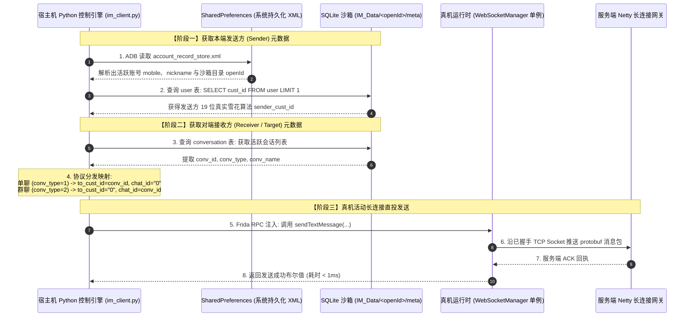

# 📱 三条 IM 端侧元数据逆向解析与长连接直投全流程规范

> **定位**：本文档详细记录三条 IM 自动化测试体系中，如何绕过 UI 与跨进程模拟，直接从 Android 设备底层持久化沙箱中逆向提取发送方（`sender_cust_id`、`openId`）与接收方（`to_cust_id`、`chat_id`、`chat_type`），并通过 Frida 微秒级 RPC 直投真机 Netty 长连接协议栈的全流程规范。

---

## 🏛️ 一、整体数据流转架构



---

## 🔍 二、阶段一：设备端发送方（Sender）元数据提取

要让脚本驱动模拟器设备以特定账号身份发送消息，必须获取该账号在 App 底层的 3 个核心凭据：
1. **`openId`**：进入该用户专属数据库目录的物理钥匙；
2. **`sender_cust_id`**：服务端唯一认定的 19 位用户数字 ID；
3. **`sender_name`**：发送方显示昵称。

### 步骤 1：定位并读取持久化 XML 配置

* **物理路径**：`/data/data/com.santiaotalk.im/shared_prefs/account_record_store.xml`
* **底层机制**：用户每次成功登录或切换账号后，App 会将账号历史列表写入该 XML 的 `<string name="accounts">` 标签中，内容为经过 HTML 转义的 JSON 数组。
* **ADB 读取命令**：
  ```bash
  adb -s <device_id> shell "cat /data/data/com.santiaotalk.im/shared_prefs/account_record_store.xml"
  ```
* **Python 解析逻辑**：
  ```python
  import html
  import json
  import subprocess
  import xml.etree.ElementTree as ET

  out = subprocess.check_output(f"adb -s {device_id} shell cat /data/data/com.santiaotalk.im/shared_prefs/account_record_store.xml", shell=True, text=True)
  root = ET.fromstring(out)
  for s in root.findall("string"):
      if s.attrib.get("name") == "accounts":
          accounts_json = json.loads(html.unescape(s.text))
          current_account = accounts_json[0]  # 最新活跃账号
          mobile = current_account.get("mobile")      # 如: "008619200000051"
          nickname = current_account.get("nickname")  # 如: "19200000051"
          open_id = current_account.get("openId")     # 如: "SOorz7P7qqLyTO52cHNBj6R15VpHDtWL"
  ```

### 步骤 2：穿透进入沙箱数据库提取 `sender_cust_id`

* **物理路径**：`/data/data/com.santiaotalk.im/databases/IM_Data/<openId>/meta`
* **底层机制**：三条 IM 采用“**单账号单沙箱分库架构**”，每个账号的所有私有数据（好友、会话、消息、本人资料）均存储于以其 `openId` 命名的独立文件夹下的 `meta` SQLite 数据库中。
* **数据表**：`user`（当前账号自身信息表）
* **SQL 查询语句**：
  ```sql
  SELECT cust_id, mobile, nickname FROM user LIMIT 1;
  ```
* **ADB 执行命令**：
  ```bash
  adb -s <device_id> shell "sqlite3 /data/data/com.santiaotalk.im/databases/IM_Data/<openId>/meta 'SELECT cust_id, mobile, nickname FROM user LIMIT 1;'"
  ```
* **返回结果示例**：
  ```text
  1500692599583707136|008619200000051|19200000051
  ```
  其中 `1500692599583707136` 即为发送方底层协议严格认定的雪花算法 `sender_cust_id`。

---

## 🎯 三、阶段二：对端接收方（Receiver / Target）元数据提取

当发送方身份确立后，需要获取主页会话列表中的接收目标参数（`to_cust_id`、`chat_id`、`chat_type`）。

### 步骤 1：查询会话列表表（`conversation`）

* **物理路径**：同样位于 `/data/data/com.santiaotalk.im/databases/IM_Data/<openId>/meta`
* **核心字段定义**：
  | 字段名 | 类型 | 说明 |
  | :--- | :--- | :--- |
  | `conv_id` | TEXT | 会话主键（单聊为对方 CustID，群聊为群 GroupID） |
  | `conv_type` | INTEGER | 协议类型：`1` 为单聊，`2` 为群聊，`0` 为系统通知 |
  | `conv_name` | TEXT | 会话显示名称（如 "测试群001", "A0110", "测试130"） |
  | `is_top` | INTEGER | 置顶标记：`1` 为置顶，`0` 为普通会话 |
  | `is_muted` | INTEGER | 免打扰标记：`1` 为免打扰 |
  | `last_msg_time` | INTEGER | 最后一条消息时间戳（用于排序） |

* **SQL 查询语句**：
  ```sql
  SELECT conv_id, conv_type, conv_name, is_top, is_muted 
  FROM conversation 
  ORDER BY is_top DESC, last_msg_time DESC 
  LIMIT 15;
  ```

### 步骤 2：单聊与群聊协议参数映射规则

三条 IM 底层协议栈对单聊与群聊采用了统一的多路复用分发设计，参数路由映射规则如下：

```text
┌─────────────────┬───────────┬───────────────┬──────────────┬───────────────────────────────────────────┐
│ 会话类型        │ conv_type │ chat_id 参数  │ to_cust_id   │ 业务行为说明                              │
├─────────────────┼───────────┼───────────────┼──────────────┼───────────────────────────────────────────┤
│ 单聊 (私聊)     │     1     │ "0"           │ <conv_id>    │ 单播投递，to_cust_id 填目标用户 CustID    │
│ 群聊 (多播)     │     2     │ <conv_id>     │ "0"          │ 广播投递，chat_id 填群 GroupID，目标填 0   │
└─────────────────┴───────────┴───────────────┴──────────────┴───────────────────────────────────────────┘
```

#### 实战解析示例：
1. **普通单聊【A0110】**：
   - `conv_id` = `"1500692620387454976"`, `conv_type` = `1`
   - 映射结果：`chat_type = 1`, `to_cust_id = "1500692620387454976"`, `chat_id = "0"`
2. **置顶群聊【测试群001】**：
   - `conv_id` = `"1558306114846638080"`, `conv_type` = `2`
   - 映射结果：`chat_type = 2`, `to_cust_id = "0"`, `chat_id = "1558306114846638080"`


### 步骤 3：`chat_id` 的专属获取流程与底层协议原理 (重点)

在 `WebSocketManager.sendTextMessage` 协议调用中，第一个参数即为 `chatId`。很多开发者会困惑为什么有时候是 `"0"`，有时候是具体的一长串数字，以下是其完整的提取机制：

#### 1. 单聊场景中 `chat_id` 的获取（固定占位规则）
* **取值**：严格固定为字符串 `"0"`。
* **协议底层原因**：
  - 单聊在 IM 底层采用**点对点单播路由（P2P Unicast）**。
  - 服务端长连接网关只需要根据第五参数 `toCustId`（目标用户的 19 位真实 CustID）去长连接会话注册表中定位该用户当前挂载在哪个网关节点和 Netty Channel 上即可。
  - 单聊不存在“群实体”，因此协议设计上规定单聊的 `chatId` 字段填默认占位符 `"0"`。
* **获取逻辑**：
  ```python
  if target.chat_type == ChatType.SINGLE:
      chat_id = "0"  # 单聊固定填 0
  ```

#### 2. 群聊场景中 `chat_id` 的获取（两条核心提取路径）
群聊在底层属于**多播广播模式（Multicast Fan-out）**，网关必须依靠 `chat_id` 作为群主键来拉取全群在线成员并分发，因此必须填写真实的群 GroupID。

* **路径 A（最常用）：从主页活跃会话表 `conversation` 中动态提取**
  - **适用场景**：当前主页列表中能看到的群会话。
  - **SQL 提取语句**：
    ```sql
    SELECT conv_id, conv_name FROM conversation WHERE conv_type = 2;
    ```
  - **映射关系**：当 `conv_type == 2` 时，数据库主键 `conv_id` **100% 完全等价于群聊的 `chat_id`**！
  - **真实案例**：主页上的【测试群001】，其在 `conversation` 表中的 `conv_id` 为 `1558306114846638080`，该值即为直投发送时所需的 `chat_id`。

* **路径 B（冷启动防丢失）：从通讯录群组资料库 `group_table` / `group_data` 中静态提取**
  - **适用场景**：主页聊天记录被清空，或新拉入群但主页尚未产生会话项。
  - **底层数据库路径**：`/data/data/com.santiaotalk.im/databases/IM_Data/<openId>/meta`
  - **SQL 提取语句**：
    ```sql
    -- 方式 1：从群组元数据表提取 (按群名称检索)
    SELECT group_id, group_name FROM group_table WHERE group_name = '测试群001';
    
    -- 方式 2：从群组资料表提取
    SELECT group_no, group_name FROM group_data WHERE group_name = '测试群001';
    ```
  - **映射关系**：查询返回的 `group_id` 或 `group_no` 即为目标群真实的 `chat_id`。

#### 3. `chat_id` 与 `to_cust_id` 对偶互补矩阵

在调用协议时，`chat_id` 与 `to_cust_id` 呈现严格互补：

| 消息场景 | `chat_type` | 第一参数: `chat_id` | 第五参数: `to_cust_id` | 网关寻址机制 |
| :--- | :--- | :--- | :--- | :--- |
| **私信单聊** | `1` | **`"0"` (固定空占位)** | **目标用户的真实 CustID** (如 1500692620387454976) | 点对点精准路由 |
| **多人群聊** | `2` | **真实群 GroupID** (如 1558306114846638080) | **`"0"` (固定空占位)** | 群通道广播扩散 |
| **系统通知** | `0` | `"0"` | 目标用户的真实 CustID | 系统信令投递 |

---

## ⚡ 四、阶段三：真机协议直投发送调用（Frida 微秒 RPC）

当参数全部计算齐备后，宿主机无需通过任何 UI 点击，而是通过 Frida 直接调用真机运行内存中的通信单例。

### 1. 挂接目标 Java 单例与方法

* **目标类名**：`com.network.lib.socket.WebSocketManager`
* **单例属性**：`WebSocketManager.INSTANCE.value`
* **底层发送方法签名**：
  ```java
  public boolean sendTextMessage(
      String chatId,               // 单聊填 "0"，群聊填 group_id
      int chatType,                // 1 为单聊, 2 为群聊
      String fromCustId,           // 发送方 sender_cust_id
      String fromCustName,         // 发送方昵称 (sender_name)
      String toCustId,             // 单聊填对方 to_cust_id，群聊填 "0"
      String content,              // 消息正文
      long quoteSeq,               // 引用回复序号 (填 0)
      String richContent,          // 富媒体结构体 (填 null)
      String contentJson,          // 扩展 JSON (填 null)
      List<String> atCustIds,      // @提醒成员列表 (填 null)
      boolean isBurnAfterReading,  // 阅后即焚标识 (填 false)
      boolean isGroupNotify        // 群提示消息 (填 false)
  );
  ```

### 2. 注入桥接脚本（JavaScript RPC）

在 `im_client.py` 中注入以下微秒级 RPC 脚本：

```javascript
rpc.exports = {
    init: function() {
        var ok = false;
        Java.perform(function() {
            try {
                WebSocketMgr = Java.use('com.network.lib.socket.WebSocketManager').INSTANCE.value;
                ok = (WebSocketMgr != null);
            } catch (e) {
                console.log("[Bridge] 初始化异常: " + e.toString());
            }
        });
        return ok;
    },
    sendTextMessage: function(chatId, chatType, fromCustId, fromCustName, toCustId, content) {
        var success = false;
        Java.perform(function() {
            try {
                if (!WebSocketMgr) {
                    WebSocketMgr = Java.use('com.network.lib.socket.WebSocketManager').INSTANCE.value;
                }
                if (WebSocketMgr) {
                    success = WebSocketMgr.sendTextMessage(
                        chatId,
                        chatType,
                        fromCustId,
                        fromCustName,
                        toCustId,
                        content,
                        0, null, null, null, false, false
                    );
                }
            } catch (e) {
                console.log("[Bridge] 发送底层异常: " + e.toString());
            }
        });
        return success;
    }
};
```

---

## 👥 五、阶段四：5 台模拟器集群与专属群聊解耦映射实战表

在真实压测体系中，多台设备通常需要对应压测各自的专属群聊（**设备1->测试群001，设备2->测试群002，依次类推**），同时共享公共单聊会话。

当前工程已全面通过底层数据库实测验证并完成了 1 对 1 严格映射：

| 参战设备 (Device ID) | 绑定账号 (手机号) | 专属绑定群聊 | 专属群真实 chat_id (GroupID) | 发送方 sender_cust_id | 沙箱 OpenID |
| :--- | :--- | :--- | :--- | :--- | :--- |
| **`emulator-5562`** | `19200000050` | **`测试群001`** | **`1558306114846638080`** | `1500692599256551424` | `SOorz7P7qqKAtlnrv7C9HCJnUtGiapId` |
| **`emulator-5564`** | `19200000051` | **`测试群002`** | **`1553530733224574976`** | `1500692599583707136` | `SOorz7P7qqLyTO52cHNBj6R15VpHDtWL` |
| **`emulator-5566`** | `19200000052` | **`测试群003`** | **`1553531260331147264`** | `1500692599990554624` | `SOorz7P7qqIFd-BbwaqJgjfclrNXdkeB` |
| **`emulator-5568`** | `19200000053` | **`测试群004`** | **`1553530999466409984`** | `1500692600422567936` | `zcamCiqn1iUZfb320IYg5_3OdCiM6uWk` |
| **`emulator-5572`** | `19200000054` | **`测试群005`** | **`1553531578875953152`** | `1500692600787472384` | `zcamCiqn1iU5medwAyVt245ovsNZB1uh` |

### 🛠️ 集群目标矩阵动态合成架构（Decoupled Target Matrix）
在 `IMClientCluster` 中实现了**自适应目标合成**：
1. **专属群隔离**：每台设备只向自己绑定的专属群发送消息（如设备 2 仅打向 `测试群002`，杜绝跨群越权错误）；
2. **公共单聊去自发**：公共单聊池（测试130~135、A0110）全设备共享，但在装配时通过 `t.to_cust_id != cfg.sender_cust_id` 自动剔除发向本人的单聊，保证发送 100% 具备业务真实性。

### 📋 公共单聊目标池端侧 SQLite 实测核对表
| 目标联系人名称 | 业务属性 | 真实 to_cust_id (conv_id) | 避坑提醒 |
| :--- | :--- | :--- | :--- |
| **测试130** | 置顶单聊 | `1500692627358388224` | 验证通过 |
| **测试131** | 置顶单聊 | `1500692627706515456` | 验证通过 |
| **测试132** | 置顶单聊 | `1500692628088197120` | 验证通过 |
| **测试133** | 置顶单聊 | **`1500692628398575616`** | ⚠️ 切勿误填为 `1500692628353048576`（该 ID 对应未初始化的账号 `default1`） |
| **测试134** | 置顶单聊 | `1500692628729925632` | 验证通过 |
| **测试135** | 置顶单聊 | `1500692629031915520` | 验证通过 |
| **A0110** | 普通单聊 | `1500692620387454976` | 验证通过 |

---

## 🎯 六、技术方案总结

1. **零 UI 干扰**：不受界面弹窗、软键盘弹出、输入法卡顿、界面未渲染等任何 UI 因素影响；
2. **免登录握手开销**：直连真机进程内已经完成 TCP TLS 握手与心跳保活的 `WebSocketManager` 单例，100% 模拟真实已鉴权会话；
3. **数据一致性保证**：从端侧 SQLite 原生数据库读取的 ID，杜绝了硬编码导致的雪花 ID 溢出或类型转换异常；
4. **横向弹性扩展**：通过 `IMClientCluster`，任意接入新模拟器或真实真机，只需补充上述映射关系，即可将压测集群无缝扩容至数十台。
